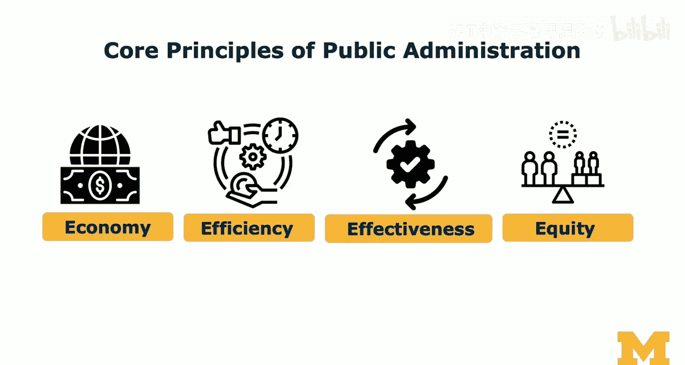
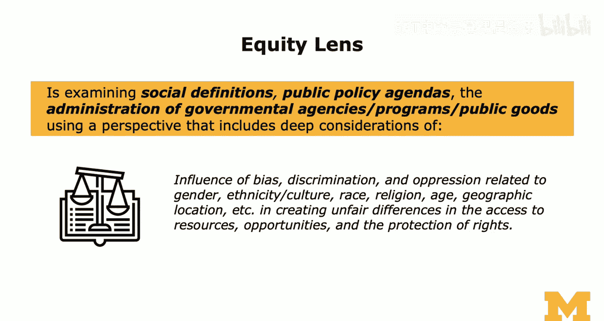
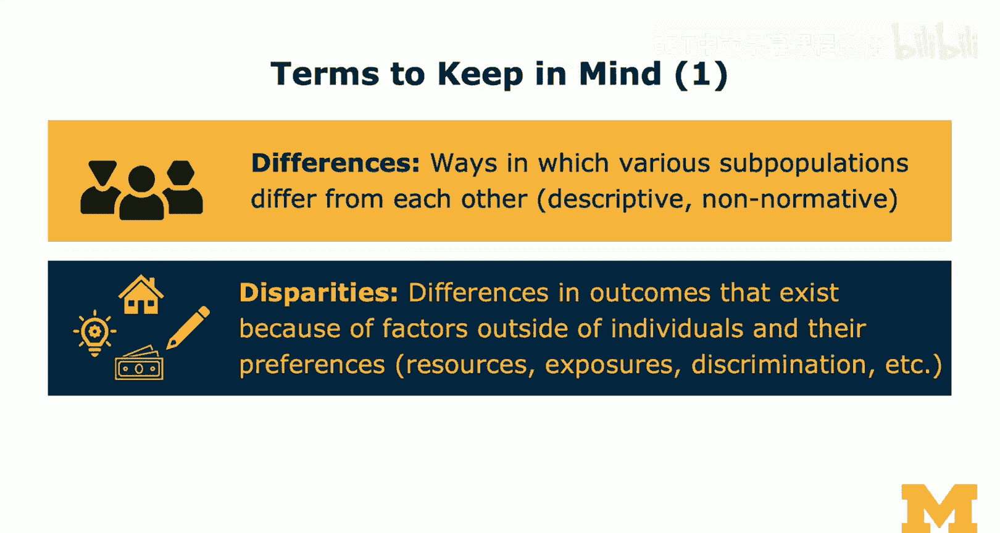
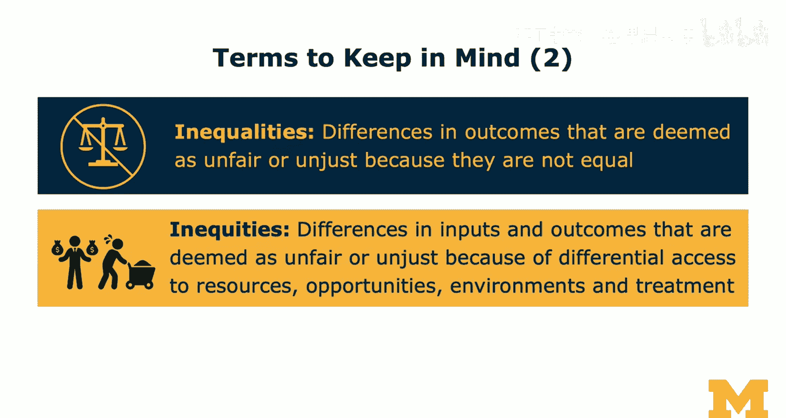
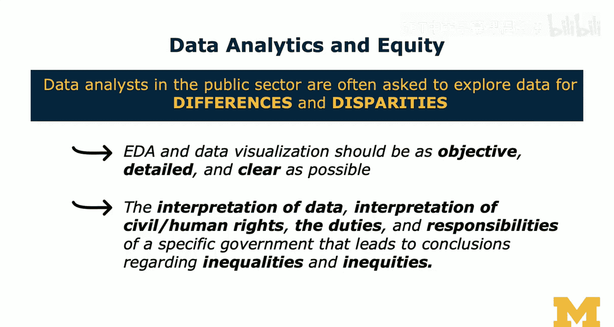
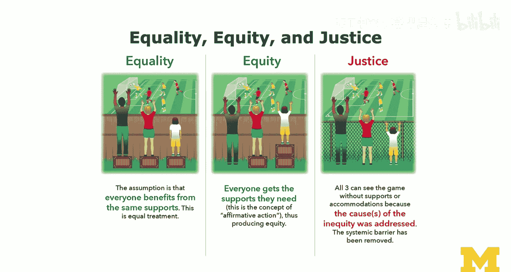
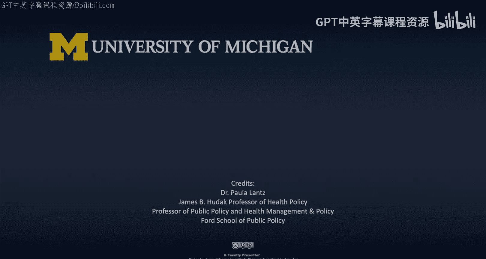

# 9：公平性作为公共管理核心原则 👁️

在本节课中，我们将探讨探索性数据分析和数据可视化在公共管理四大核心原则之一——公平性——中的重要性。我们将学习公平性视角的定义，并区分几个关键但易混淆的概念：差异、差距、不平等与不公平。

上一节我们介绍了探索性数据分析在公共管理核心职能中的重要性，本节中我们来看看它在公平性原则中的应用。

## 公平性视角的定义

公平性作为公共管理的四大支柱之一，要求我们使用“公平性视角”来审视问题。其定义如下：

公平性视角意味着，在审视社会问题的定义与框架、公共政策议程、潜在政策解决方案以及政府机构、项目和公共物品的管理时，需要采用一种深刻考虑偏见、歧视和压迫影响的视角。这些影响与性别、民族或文化、种族、宗教、年龄、地理区域或任何其他导致资源、机会和权利保护获取上产生不公平差异的社会因素相关。

## 核心概念辨析

以下是几个与公平性相关且常被混用的核心概念，它们虽有重叠，但也存在重要区别。

*   **差异**：指不同子群体、人群或社区之间相互区别的方式。这些差异通常通过描述性数据以非规范性的方式理解，意味着仅描述差异本身，而不对其做出任何价值判断。
*   **差距**：指不同子群体之间的差异，但这些差异被理解为是由个体自身偏好之外的因素驱动的，例如资源、机会、歧视等方面的不同，而非个人选择。
*   **不平等**：指被认为不公平、不公正的结果差异，因为它们不相等或不同。
*   **不公平**：指在投入和结果两方面存在的差异，这些差异之所以被认为不公平或不公正，是因为在获取实现平等所需的资源、机会、环境和待遇上存在差别。

## 平等与公平的对比

这些概念可能有些令人困惑，让我们通过对比“平等”与“公平”来进一步理解。

**平等**是指每个个体、群体或社区拥有相同的资源、机会、待遇和结果。在公共部门，我们关心的许多重要事物是平等或相同的。

**公平**则认识到个体、群体和社区所处的环境不同，并据此分配或维护每个人为实现平等结果所需的资源、机会和体验。

正如美国民权活动家德雷·麦凯森所解释的：“**平等是每个人都得到相同的东西，而公平是每个人都得到他们需要和应得的东西。**”

## 数据分析的角色

公共部门的数据分析师经常被要求探索数据中的差异和差距。这类探索性数据分析和数据可视化应尽可能客观、详细和清晰地进行。数据应揭示差异和差距的**幅度**、**方向**甚至**随时间的变化**。

数据经过探索和呈现后，才进入解释阶段。将差异解释为不平等或不公平，涉及价值观以及关于应得性和公平性的观念。

此外，若要从权利角度解释差异，需要理解**公民权利**与**人权**的区别。公民权利是由政府宪法和法律体系所维护的权利；而人权则是基于普遍的道德伦理准则赋予全人类的、更具交叉性的权利观念。

哲学中有一个基本观念：权利与责任相伴而生。如果有人拥有一项权利，那么其他实体就有责任维护这项权利。就政府和公共部门而言，政府有责任维护的唯一权利是公民权利，即通过正式政策和法律编纂的权利。

因此，在公共部门数据分析中，从显示差异和差距的数据过渡到关于不平等和不公平的论断，会变得更加棘手。但关键在于，大多数政府（虽非全部）的设计初衷是关注公平性，而数据有助于它们做到这一点。正是数据分析和数据可视化，清晰地揭示了社会公平与不公平问题。

## 一个经典图示：平等、公平与正义

让我们以一个试图说明平等、公平以及正义之间区别的图示来结束本节。正义包含了政府为应对不公平所能采取的行动。

该图示的第一块面板描绘了三个人试图在栅栏后观看棒球比赛的情景，它展示了**平等**，但也揭示了一个有缺陷的假设：即当每个人获得相同或平等的资源、支持或待遇时，每个人都能受益。在此案例中，待遇是尺寸完全相同的箱子，用于垫脚以看到栅栏另一边。这种平等的支持或待遇并未产生平等的结果，因为右边最矮的人仍然无法越过栅栏看到比赛。这里存在支持上的平等，但结果却不平等。

中间的面板展示了每个人获得观看比赛所需的东西。第一个人什么也没得到，因为他已经能看到比赛；第二个人获得了一个能帮助他看到栅栏另一边所需高度的箱子；第三个人则获得了一个更高的箱子以帮助他观看。这种待遇上的不同或不平等，正是实现**公平**的途径。

然而，最后还有重要的一点。最后一块面板显示，三个人在观看比赛时，木栅栏已被移除。那个对不同人造成不同程度问题或障碍的屏障被主动拆除了。现在取而代之的是一个链式围栏，它既能保护人群，又能让每个人看到比赛。在这个类比中，**移除结构性障碍被称为正义**。所有人现在无需额外的支持或便利就能实现观看比赛的目标，因为不公平的根源得到了解决。

这只是一个类比，用以阐释平等、公平以及解决不公平根源、移除结构性障碍这些概念。

## 总结

本节课中，我们一起学习了公共管理中的公平性原则。我们定义了“公平性视角”，并区分了差异、差距、不平等与不公平这几个核心概念。通过对比平等与公平，我们理解了公平要求根据个体不同情况分配资源以实现平等结果。最后，我们通过一个经典图示，形象地理解了平等、公平与正义（即移除结构性障碍）之间的区别，并认识到数据分析和可视化在揭示和解决社会公平问题中的关键作用。