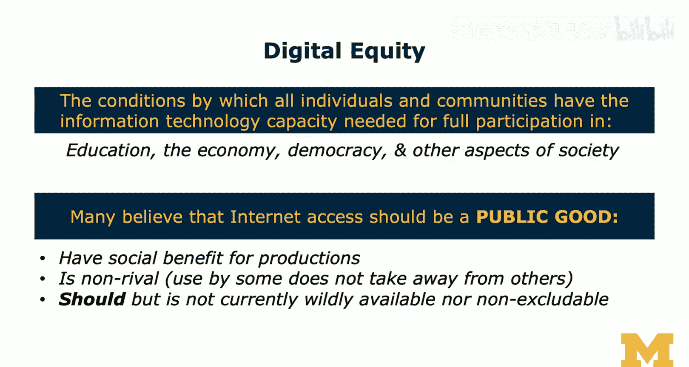
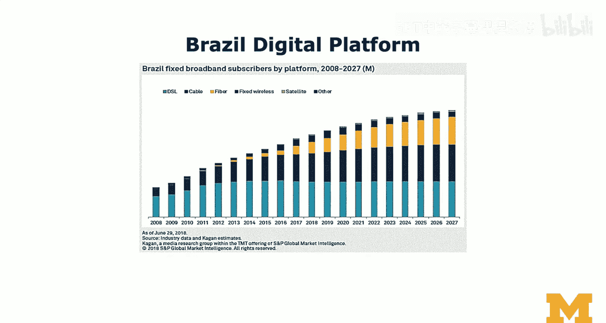
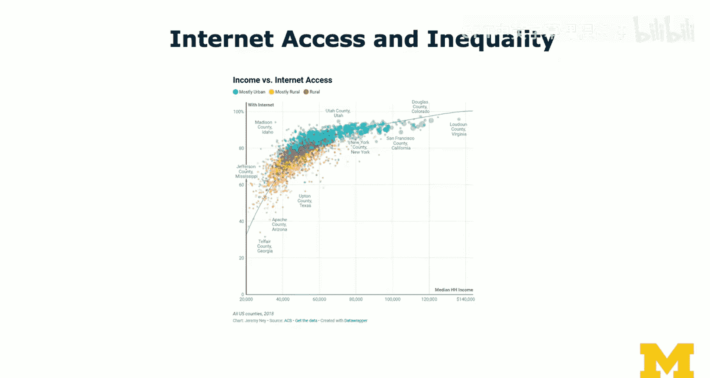
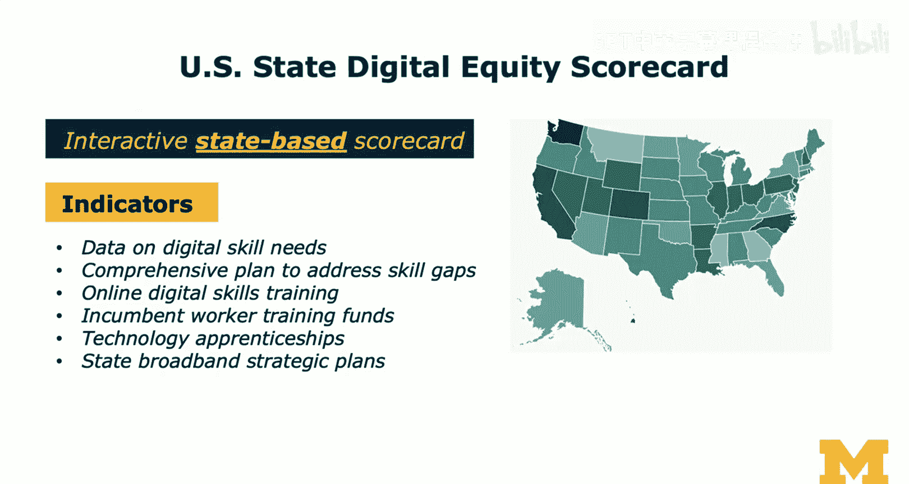
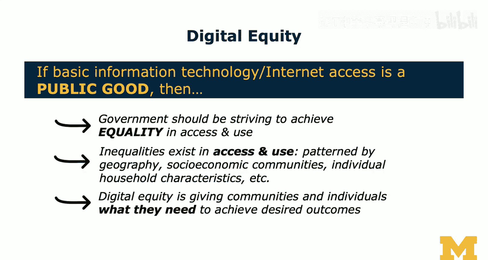

# 公共部门的R数据分析：10：典型案例：数字公平性分析 📊

在本节课中，我们将要学习数字公平性这一公共部门的重要议题，并探讨如何通过探索性数据分析和数据可视化来理解其中的差异与不平等。

上一节我们讨论了公平与平等在公共部门中的重要性。本节中，我们将聚焦于一个具体问题：数字公平性。

## 什么是数字公平性？ 🌐

数字公平性被定义为所有个人和社区都拥有充分参与教育、经济、民主及社会各方面所需的信息、技术和能力的条件。互联网接入通常被视为一种**公共品**。

希望您还记得第一门课程中对公共品的定义：**公共品**是指对社会和人群具有社会效益的事物。公共品还具有**非竞争性**，即一部分人的使用不会减少供应或剥夺他人的使用机会。同时，公共品应广泛普及，具有**非排他性**，即不会排除特定人群或亚群体。

然而，在数字资源方面，目前的情况并非如此。这正是人们致力于采取必要措施以实现数字公平的主要原因。

## 数字公平性的构成要素 📱

以下是数字公平性或数字包容性的几个关键要素：

*   **可负担且稳定的宽带互联网接入**。
*   **接入互联网连接设备**，如智能手机、电脑和平板电脑。
*   **获取应用程序和其他资源**，以增强工作、教育以及各种协作与联系。
*   **支持**，包括技术支持、用户体验支持和广泛的公共教育。

数据可视化对于理解数字公平性的水平和趋势至关重要。接下来，我们快速浏览一些示例。

## 数据可视化案例解析 🗺️

以下是几个用于揭示数字公平性问题的数据可视化示例。

*   **全球互联网接入地图**：这张2019年的地图显示了世界各国人口接入互联网的百分比。它清晰地展示了在疫情爆发前，数字不平等问题最严重的地区，其中整个非洲大陆和东南亚部分地区最为突出。
*   **多国数字接入条形图**：这张由皮尤基金会制作的图表，针对选定国家展示了三个不同的数字接入指标：声称使用互联网且家中有接入的成年人百分比、声称使用互联网但家中无接入的百分比，以及声称不使用互联网的成年人百分比。
*   **印度各州宽带订阅率地图**：这张地图通过颜色显示了印度各州每百人宽带订阅率的不平等状况，绿色调的州订阅率最低。
*   **芝加哥社区互联网接入率地图**：芝加哥市制作的地图显示了每个社区拥有互联网接入的家庭百分比。颜色越深表示接入水平越低，图例从深蓝色到黄色，代表了55%到近100%的社区覆盖率。这张图清晰地展示了芝加哥各社区间存在的数字鸿沟。
*   **巴西宽带增长与类型条形图**：这张条形图不仅显示了巴西宽带订阅量随时间已实现和预计的增长，还展示了所使用的宽带平台类型的百分比分布。请注意，该图包含了截至2019年的已收集数据和未来的预测。
*   **美国智能手机、平板电脑拥有率及社交媒体使用趋势图**：展示了这些指标在美国随时间的变化。
*   **美国县收入与互联网接入散点图**：显示了美国各县收入与互联网接入之间的相关性，并通过颜色高亮了城市、郊区和农村地区在此关系上的差异。

## 公共数据与互动探索 🔍

最后，请注意一个关于数字公平性数据日益公开化的例子。在美国，有一个互动网站为每个州提供数字公平性记分卡。这些记分卡包含多种指标，如数字技能需求、州人口相关培训问题、劳动力问题，以及州政府是否制定并实施了解决数字不平等问题的战略计划。这是一个有趣且互动的数据集，鼓励您花时间探索。

## 总结与核心要点 📝

本节课中，我们一起学习了数字公平性分析。

*   如果基础信息技术和互联网接入是一种**公共品**，那么政府应努力实现接入和使用上的平等。每个人都应有机会接入，并能利用互联网的力量。
*   显示接入和使用方面存在不平等的数据，对这些努力至关重要。
*   最后，数字公平性涉及为社区和个人提供的，并非完全一模一样的东西，而是在特定时刻为实现这一公共品成果平等目标所需的支持。

通过本课的学习，我们了解到数据可视化是揭示和理解数字鸿沟、推动制定有效干预措施的强大工具。