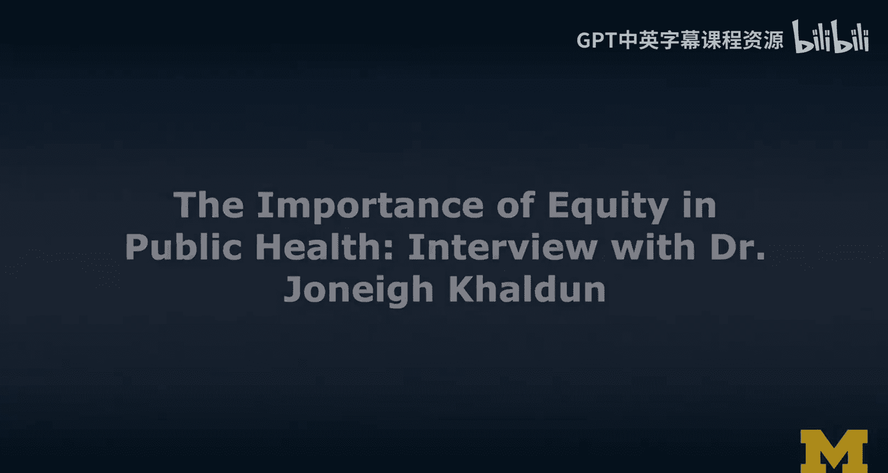
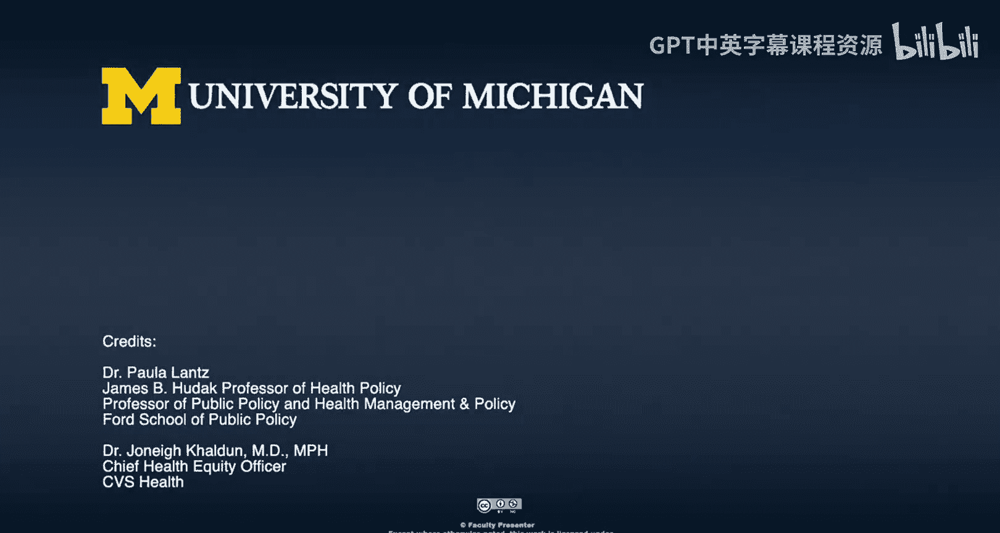

# 11：公共卫生公平性重要性：Joneigh Khaldun博士访谈 🩺

在本节课中，我们将通过Joneigh Khaldun博士的访谈，探讨公共卫生领域的公平性概念、挑战以及数据在推动公平性工作中的核心作用。

---

## 概述：公平性的核心原则

在公共服务中，效率、经济、效果和公平是核心原则。本次对话将聚焦于**公平**这一原则，探讨其在公共政策、服务和项目中的含义与实践。

---

## 公平性的定义与重要性

上一节我们介绍了课程的核心原则，本节中我们来看看Joneigh Khaldun博士如何定义公平性。

公平性意味着确保每个人都有平等的机会，尽可能获得健康。这承认了一个现实：由于机会和资源的不同，以及社会将人群分类并区别对待，导致了健康不平等和差异。因此，公平性关乎于无论个人身份、居住地或信仰如何，都应拥有平等的健康机会。

从政策角度看，这意味着理解并非所有人都拥有同等资源，并思考如何分配资源、支持社区，以及如何真诚地让社区参与决策，承认社区自身就是专家。

---

## 公共部门在解决公平性问题时面临的挑战

理解了公平性的定义后，我们来看看公共部门在识别和解决不平等问题上面临哪些主要挑战。

健康不平等往往由社会不平等驱动，这在环境、教育和食品等其他政府服务领域也是如此。最大的挑战在于追溯根本原因，理解差异化的待遇和资源获取途径。

解决不平等问题需要将健康公平性**有意识地嵌入**到所有工作中。这意味着在审视任何质量指标或提案时，都应自问：历史上被边缘化的社区（如种族/族裔少数群体、残障人士、老年人、农村居民）受到了何种影响？我们如何将他们纳入解决方案的制定过程？

这种工作方式的转变是具有挑战性的，因为它要求改变各部门（包括公共和私营部门）惯常的工作模式。公平性不能只是一个独立项目，它必须成为一个核心支柱和原则，**整合到所有事务中**。

---

## 数据在推动公平性工作中的强大作用

认识到挑战后，我们来看看数据如何在这一工作中扮演关键角色。

数据常常不完整或缺失，例如关于少数族裔、残障人士或城乡差异群体的健康洞察。因此，任何组织工作的基础是努力**标准化和增加数据收集**，并创建仪表板来理解数据。

然而，拥有不完全的数据不应成为不采取行动的借口。数据本身不会带来改变，关键在于如何利用数据、讲述故事，并让其指导项目和政策的制定。

以下是利用数据推动公平性工作的核心步骤：
1.  **收集与标准化数据**：努力获取关于不同社区群体的数据。
2.  **分析与可视化**：创建仪表板，从公平性视角理解数据。
3.  **指导行动**：让数据引导具体的项目和政策开发，而不仅仅是为了拥有数据。

---

## 向决策者有效传达数据

拥有了数据，下一步是如何有效地将其传达给掌控资源或政策的决策者。

向决策者传达数据时，需理解他们的宏观目标及其选民关心的问题。大多数决策者并非数据科学家或医生，因此沟通需要简洁明了。

有效的沟通策略包括：
*   **使用图表**：一图胜千言。
*   **提炼要点**：任何图表都应能提炼为**三句话**以内的核心信息。
*   **关联行动**：阐述数据展示了什么、数据的局限性、这意味着什么，以及可采取的一到三个具体行动方案。
*   **使用通俗语言**：避免使用数据分析术语，使用听众能理解的语言。

---

## 案例研究：利用邮政编码数据解决婴儿死亡率问题

让我们通过一个具体案例，看看数据如何指导有针对性的行动。

在底特律市解决婴儿死亡率问题时，我们分析了**邮政编码层级的数据**。数据显示，不同邮政编码区域的婴儿死亡率不同，且根本原因也不同。

例如，在某个邮政编码区域，主要问题是婴儿安全睡眠；而在另一个区域，主要问题是早产。这些数据帮助我们确定了策略的针对性投放地点，使我们能够基于不同区域的根本问题来定制解决方案，而不仅仅是笼统地应对“婴儿死亡率”问题。

---

## 给未来公共部门数据分析师的建议

最后，对于有志于进入公共部门数据分析领域，并同样关注公平性这一核心支柱的学习者，Joneigh Khaldun博士给出了建议。

无论身处何地，重要的是理解你所服务的**人群**以及所在部门的核心工作。数据始终关乎于人，以及你用它来做什么。

不要仅仅提交一份文件或图表。要始终能够阐述：“**这是数据讲述的故事，这是它告诉我们的信息，这是因此需要采取的行动。**” 记住，数据分析工作始终关乎于人和实际影响，这一点至关重要。

---

## 总结

本节课中，我们一起学习了公共卫生领域的公平性概念。我们探讨了公平性的定义、公共部门在实现公平性时面临的挑战，以及数据在识别和解决不平等问题中的关键作用。我们学习了如何向决策者有效传达数据，并通过婴儿死亡率的案例看到了数据如何驱动有针对性的行动。最后，我们牢记，所有数据分析工作的核心都应服务于人，并导向有意义的行动。