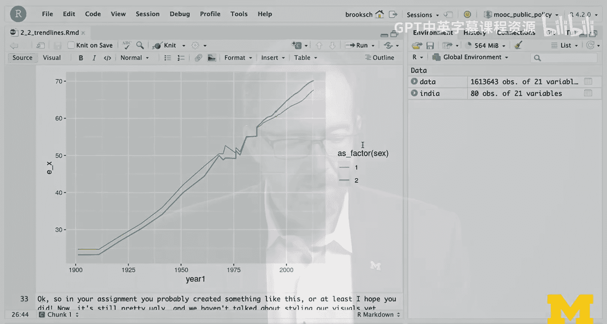
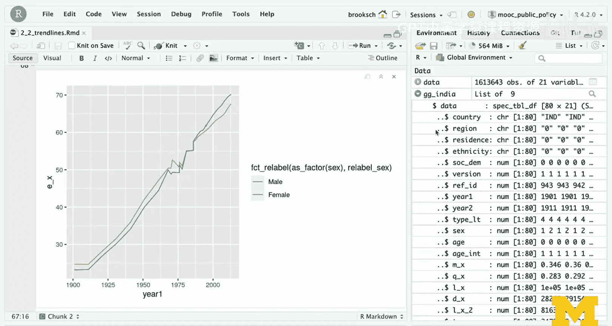
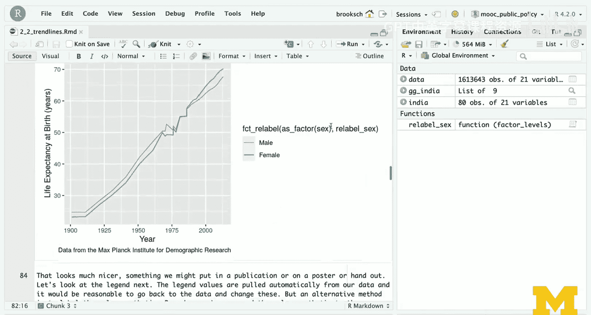
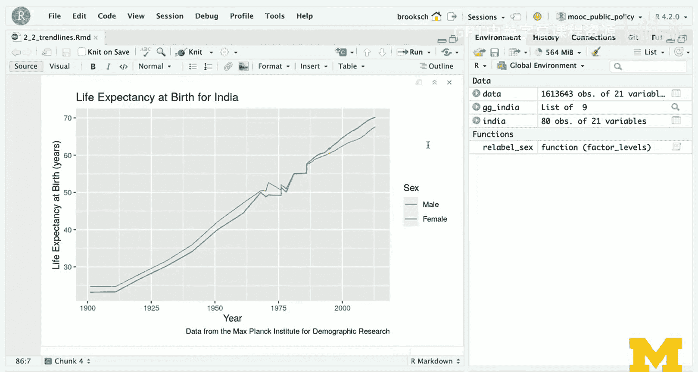

# 12：趋势线基础绘制方法 📈

在本节课中，我们将学习如何扩展探索性数据分析技术，重点聚焦于趋势分析。我们将回顾趋势这一主题，并学习如何使用R和ggplot2来可视化数据中的趋势，特别是时间序列数据中的趋势。课程将涵盖数据清理、基础绘图、美化图表以及添加统计模型趋势线等核心步骤。

## 概述

在公共部门，计算和比较趋势是一项非常常见的任务。我们经常需要创建图表来展示随时间变化的趋势，例如在第一次作业中或使用宠物数据所做的那样，并用它来比较几个不同的群体。一个独立但高度相关的需求是根据趋势进行预测，以便制定政策。这需要为我们的数据建立一个统计模型，然后将其投射到未来的某个时间点，以预测可能发生的情况。本节课，我们将使用上周作业中的预期寿命数据，探索如何用ggplot2可视化数据并添加趋势线。

## 数据准备与基础绘图

首先，我们需要导入必要的库并清理数据。我们将使用`tidyverse`和`janitor`包，并按照作业中的参数过滤数据，以获取印度的预期寿命数据。

```r
# 加载必要的库
library(tidyverse)
library(janitor)

# 导入并清理数据
data <- read_csv("your_data_file.csv") %>%
  clean_names()


# 过滤数据：所有地区、所有种族、所有居住类型、出生时预期寿命、国家为印度
filtered_data <- data %>%
  filter(region == 0, ethnicity == 0, age == 0, type_lt_foreign_residents == 0, country == "India")
```

接下来，我们使用`ggplot2`创建一个基础折线图，将年份放在X轴，预期寿命放在Y轴，并根据性别用不同颜色区分线条。

```r
# 创建基础折线图
base_plot <- ggplot(data = filtered_data, aes(x = year_one, y = e_x, color = sex)) +
  geom_line()

# 显示图形
print(base_plot)
```



生成的图表功能上正确，但直接展示给决策者还不够美观。标签直接来自数据列名，不够人性化。

## 美化图表标签


为了使图表更易于理解，我们需要改进坐标轴和图例的标签。有两种主要方法：直接修改数据，或者使用ggplot2的函数修改标签。这里我们将演示后者。

首先，我们可以创建一个函数来重命名“性别”因子水平的标签，使其显示为“男性”和“女性”，而不是数字代码。

```r
# 创建一个函数来重命名性别因子水平
relabel_sex <- function(factor_levels) {
  new_levels <- c()
  for (level in factor_levels) {
    if (level == 1) {
      new_levels <- c(new_levels, "男性")
    } else {
      new_levels <- c(new_levels, "女性")
    }
  }
  return(new_levels)
}

# 应用函数并更新绘图对象
ggi_india <- base_plot +
  scale_color_discrete(labels = relabel_sex(levels(as.factor(filtered_data$sex))))

# 显示更新后的图形
print(ggi_india)
```

虽然上述方法展示了R的基础编程功能，但使用`forcats`包中的函数通常更快捷。不过，了解如何编写自定义函数有助于深入理解R的工作原理。

现在，让我们使用`labs()`函数来设置更清晰的标题和坐标轴标签。

```r
# 添加标题和坐标轴标签
ggi_india <- ggi_india +
  labs(
    title = "印度出生时预期寿命",
    caption = "数据来源：马克斯·普朗克人口研究所",
    x = "年份",
    y = "出生时预期寿命（年）"
  )

# 显示图形
print(ggi_india)
```

图表现在看起来专业多了。接下来，我们处理图例。图例值自动从数据中提取，我们可以通过`labs()`函数直接为颜色美学（color aesthetic）设置标签。

```r
# 为颜色美学（即性别图例）设置标签
ggi_india <- ggi_india +
  labs(color = "性别")

# 显示最终图形
print(ggi_india)
```



现在，我们得到了一个清晰、美观的图表，适合展示给决策者。

## 添加统计趋势线

上一节我们介绍了如何创建和美化基础的趋势图表。本节中，我们来看看如何在图表上添加统计趋势线，以更直观地展示数据的整体变化方向。


统计模型是数据中不同变量之间关系的一组集合，我们可以用数学公式来表达。虽然本课程不深入探讨不同模型背后的数学细节，但我们将探索如何使用ggplot2及其图形语法在我们的绘图数据之上可视化一个模型。


在ggplot2中，我们可以使用`geom_smooth()`函数轻松添加趋势线。该函数默认使用局部加权回归（LOESS）方法为数据拟合一条平滑曲线。对于时间序列数据，我们也可以使用线性模型（`method = "lm"`）来拟合一条直线趋势线。

以下是添加线性趋势线的方法：

```r
# 在现有图表上添加线性趋势线
ggi_india_with_trend <- ggi_india +
  geom_smooth(method = "lm", se = FALSE, aes(group = 1)) # se=FALSE 表示不显示置信区间

# 显示带趋势线的图形
print(ggi_india_with_trend)
```



*   `method = "lm"`：指定使用线性模型。
*   `se = FALSE`：不绘制置信区间带，使图表更简洁。
*   `aes(group = 1)`：这是一个重要的参数，它告诉ggplot2将所有数据点视为一个组来拟合一条整体的趋势线，而不是为每个性别分别拟合一条线。如果你想为每个性别分别拟合趋势线，可以省略这个参数。

添加趋势线后，图表能够更清晰地显示出预期寿命随时间变化的总体上升趋势。


## 总结




本节课我们一起学习了趋势线的基础绘制方法。我们从数据导入和清理开始，创建了展示印度分性别预期寿命随时间变化的基础折线图。接着，我们通过重命名因子水平和使用`labs()`函数，显著改善了图表的可读性和专业性。最后，我们使用`geom_smooth()`函数为图表添加了统计趋势线，这有助于揭示数据背后的整体模式，为决策提供更直观的支持。掌握这些技能，你将能更好地在公共部门的数据分析工作中进行有效沟通和数据可视化。