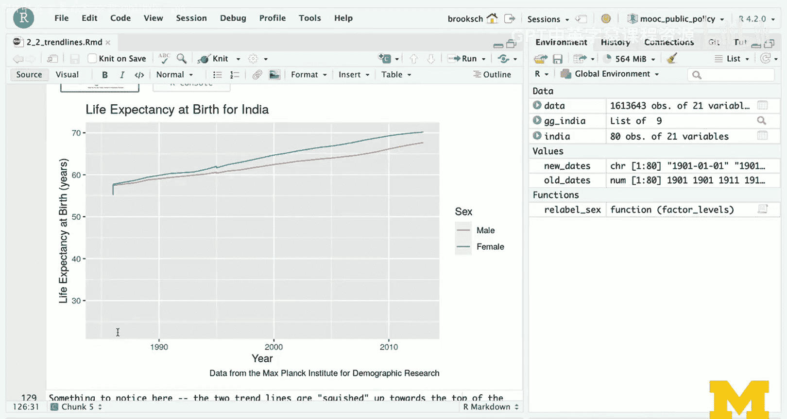
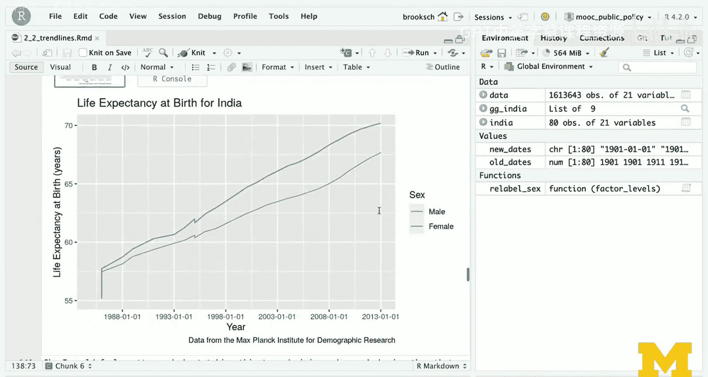
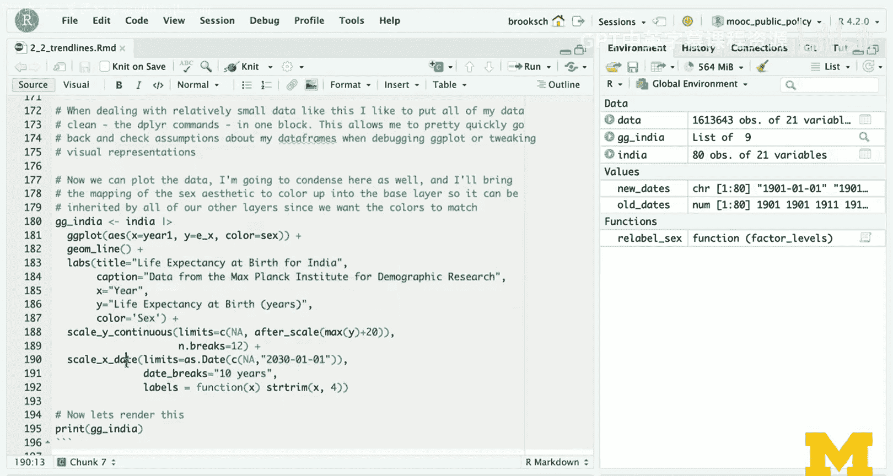
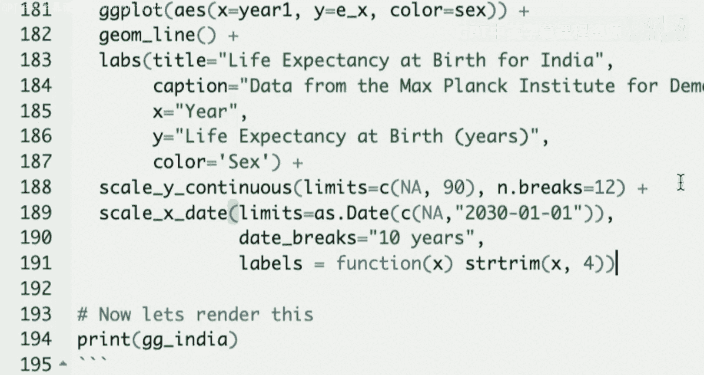

# 公共部门的R数据分析：13：趋势线深度解析与高级应用 📈

在本节课中，我们将学习如何对已绘制的图表进行深度分析，并应用高级技巧，如缩放坐标轴、格式化日期以及添加基于线性模型的预测趋势线。我们将使用印度男女人口预期寿命的数据作为示例。

## 图表解读与缩放

上一节我们完成了图表的绘制和标注。现在，我们可以开始解读数据的含义。

从图表中可以看出，从1900年到1975年，男性的预期寿命更高，并且两性的预期寿命总体呈上升趋势。大约在1985年之后，情况发生了变化，女性的出生时预期寿命变得更高。

为了更清晰地观察这一变化，我们可以放大图表的特定区域。这可以通过设置绘图的比例尺来实现。请记住，比例尺的设置会应用于图层的所有元素。如果我们有多个图层，它们都会被统一缩放。这一点稍后会很重要。

目前，我们的X轴数据是整数格式的年份，而非日期格式。我们可以将其转换为日期格式，也可以保持为整数。这里我们选择前者，这似乎是 `lubridate` 包的工作。因此，我需要加载这个包。

我们当前的数据值只是作为字符串的年份，例如“1901”代表1901年。但在R中，日期的表示至少需要包含月和日。我将手动为所有年份添加“-01-01”，使它们都对齐在每年的第一天。这意味着我需要通过拼接字符串“-01-01”来修改数据中的日期变量，然后 `lubridate` 可以轻松地转换它。

首先，如何获取数据？我们的绘图对象 `ggi_india` 将数据存储在名为 `data` 的变量中，而数据中的年份存储在名为 `year_one` 的变量里。我们可以通过 `ggi_india$data$year_one` 来提取年份。你可以使用环境面板来探索这个对象，查看 `ggi_india` 包含的其他可访问内容。这是一个非常方便的功能，我强烈建议你使用环境面板来探索创建的不同对象。

现在，`old_dates` 是一个包含我们字符串值的向量。接下来的问题是，如何连接字符串？在R中，我们可以使用 `str_c` 函数，它会将所有输入连接在一起。如果我们把日期列作为第一个参数传递给 `str_c`，然后传入一个我们想要添加的字符串向量，`str_c` 会循环使用这个字符串向量，并将其应用到数据列的每个元素上。

这里，我将调用 `str_c` 函数，传入所有的 `old_dates`（即年份向量，如1901, 1902, 1903），然后传入一个单元素向量“-01-01”。`str_c` 会将其与第一个元素连接，然后移动到 `old_dates` 的第二个元素，并循环使用这个较短的向量。我们也可以为每个日期创建一个包含所有“-01-01”的向量，但这没有必要。我们将结果赋值给 `new_dates`。

现在，我们可以使用 `lubridate` 来转换它，并将其赋值回我们的数据。我们将使用 `ymd` 函数，并将其直接赋值给 `ggi_india` 绘图对象中 `data` 里的 `year_one` 列。

如果我们现在绘图，看起来不会有任何不同，但现在我们可以将X轴限制设置为日期格式。因此，我们将使用 `scale_x_date`，并在此过程中全程使用日期。

这是我们的图表，我们已按日期缩放，并从1985年开始显示，一直到数据的末尾。

这里需要注意一点，两条趋势线被挤到了图表的顶部。我们没有更改Y轴比例来修正这一点。我们还需要设置Y轴的下限。此外，目前底部坐标轴只显示了三个年份，但显示更多年份可能信息量更大。我们可以告诉 `ggplot2` 更明确地控制这一点。但当我们添加一个新的 `scale_x_date` 时，它实际上会删除旧的。因此，我们也必须确保适当设置限制。

请记住，当你缩放一个坐标轴时，它会缩放你的 `ggplot` 内部所有图层的坐标轴。对于给定的坐标轴，你只能有一个比例尺。所以，如果你想替换或更改它，就必须替换它。

我们将Y轴的下限值设置为55，然后使用 `scale_x_date` 的 `date_breaks` 参数设置为每5年一个刻度。请记住，我们的Y轴是连续值，而不是日期，所以我们将使用 `scale_y_continuous`。在开始缩放坐标轴时，这一点可能会让你有点困惑。对于X轴，我们将使用 `scale_x_date`。我们必须始终考虑坐标轴上的数据类型。

因此，我将对 `ggi_india` 使用 `scale_y_continuous`，设置从55开始到自然上限。然后我将添加 `scale_x_date`，这会覆盖我们已有的那个。所以我们必须确保按照我们的意愿适当设置限制。对于 `date_breaks`，我们使用一个有趣的格式，尝试用英语给出格式，例如“5 years”。然后我们可以打印它。

现在，我可以比较有信心地将这个图表展示给决策者，向他们展示不仅预期寿命在增加，而且男性和女性之间的预期寿命差距正在扩大。到2013年，女性平均比男性多活约5年，平均寿命达到70岁，尽管在20世纪80年代末，两性的预期寿命大致相等，约为57或58岁。随后可以调查各种社会、经济、政策和就业问题，以试图理解造成这些差异的原因。

## 添加预测趋势线

决策者的主要兴趣之一是进行预测。我之前谈到了预测的技术挑战性，但我想用这些数据向你展示，如果你有一个模型，如何可视化和进行预测。

最常见的方法是为每个感兴趣的人群创建一个线性模型。在线性模型中，一个变量的输出与另一个变量直接相关。我们这里的数据非常适合线性模型，因为线条的斜率在整个长度上似乎大致恒定。

一旦确定了模型，我们就必须考虑如何将其可视化。

在 `ggplot2` 的图层图形语法中，这自然应该是一个新图层。因此，我们可以获取一个模型，然后将其作为一个新的 `geom_line` 图层绘制在这个图表之上。

但 `ggplot2` 实际上有一个特殊的几何对象叫做 `geom_smooth`，它旨在为我们创建模型并进行绘图。它有很多选项，可以节省大量时间。它还允许你指定一个已有的模型，这非常强大。

让我们看看如何在这个数据上使用 `geom_smooth`。

由于我逐步构建了 `ggplot` 对象，我想在这里重写部分代码，以便你看到一个更完整的解决方案。

首先，我必须决定在我的数据中包含哪一组日期。这很重要，因为所有那些日期的数据都将用于计算预测线，而不仅仅是渲染的数据。在这种情况下，我将从1920年开始取数据，并在我的数据集中将其设置为日期值。

我将使用与作业相同的参数集进行筛选，并再次专门查看印度的数据。你会注意到，这里我将直接使用 `fct_recode` 来更改因子水平。我之前展示了如何编写自定义函数来执行此操作，当然你不必编写自定义函数。因为只有几个类别，我们可以在这里直接指定它们。我还将在这里通过 `mutate` 操作来更改年月日格式。

在处理像这样相对较小的数据时，我喜欢将所有数据清洗和 `dplyr` 命令放在一个代码块中。这使我在调试 `ggplot` 或调整视觉呈现时，能够快速回顾并检查我对数据框的假设。

现在我们可以绘制数据了。我也会在这里进行压缩，并将性别美学映射到颜色的设置提升到基础图层，以便我们所有其他图层都可以继承它，因为我们希望颜色匹配。

因此，这里我将把所有美学映射传递到 `ggplot` 中：将年份作为x，预期寿命作为y，颜色映射到性别。然后，对 `geom_line` 的第一个调用实际上只是一个空调用，意思是“绘制那些数据”，它将继承上面的一切。

我将在 `labs` 中设置所有标签，包括标题、说明文字以及X、Y和颜色美学的映射。这里我完全不使用 `xlab` 或 `ylab`。然后，我将设置 `scale_y_continuous` 和 `scale_x_date`。

现在让我们渲染这个图表。

我在这里做了一些调整。首先，我将Y轴上限硬编码为90岁，因为我们要进行一些预测。当然，我也可以使用 `dplyr` 访问实际数据并将其保存在变量中，但为了简洁起见，我决定以这种方式更改Y轴限制。

接下来，我想更改X轴的标签。由于我想预测到2030年，我希望将日期截断为仅显示年份。我将用来更改标签的函数实际上是基础R函数 `strtrim`，它接受两个参数：要修剪的字符串和要保留的字符数。由于我只想显示年份，我将其修剪为前四个字符。然而，要应用这个函数，我们需要将其包装在一个只接受一个参数的函数中。这是因为 `scale_x_date` 计划使用的是一个只接受日期作为参数的函数。因此，我定义了一个新函数，但没有给它命名并绑定到一个变量，也没有分多行写，而是直接在这里内联定义了它。

对于趋势线，我们将使用 `geom_smooth` 函数。它既是一个几何对象，也是一个统计函数。它将继承基础图层的美学和数据，并且比例尺适用于所有图层，所以我们不必重复设置。相反，我们只需要考虑要显示什么。对于像这样的小数据，`geom_smooth` 函数将构建一个线性模型，将所有值的y映射到x。

我想告诉 `geom_smooth` 跨越坐标轴的整个范围，以便它绘制超出我们实际拥有的数据。在这里，我将关闭默认绘制的标准误差（通常你会需要它，我这样做只是为了清晰），然后将线条改为虚线，以便我们可以将其与实际数据的线条区分开。你看，这看似简单，但如果你打算使用预测模型或线性模型进行预测，你真的应该更详细地了解它们在做什么。这里我说的是，我想绘制一个线性模型，希望它跨越我们数据的整个范围，没有标准误差，并且我想将其更改为虚线。这很有趣，因为 `method` 参数可以以多种方式提供给你，作为预测模型。在未来的课程中，当我们实际演示一种更高级的、由统计学家提供的预测模型时，你会看到这一点。

现在，我们有两个图层，它们具有相同的美学映射集，因为它们继承自它们所基于的基础图层。第一个图层是 `geom_line`，第二个是 `geom_smooth`。我们这里还有一些比例尺转换，但放置它们的顺序无关紧要，因为它们影响所有图层。让我们看一下。

这是一个相当不错的基础图表，包含两个组（男性和女性）的实际数据线，以及基于线性模型的每个性别的简单预测。这很容易解释，并且给人一种感觉：到2030年，印度女性有很高的可能性拥有80岁的预期寿命，而男性的预期寿命较低，为75岁。请记住，我们看的是零岁时的预期寿命，所以这是针对2030年出生的人。此外，图表看起来不错，可读性强，你可以相对快速地为数据集中的其他国家构建类似的图表。

我希望你反思一下我们最后写的两个代码块。它们不是很漂亮吗？我们有一个管道，它读入数据，将其操作成我们可以用来回答问题的格式，并且易于维护。然后，它输入到一个 `ggplot` 中，该图建立在基础之上的两个图层。这些图层共享相同的数据集和美学映射，因此线图的渲染是一致的，我们不需要做任何特殊的事情来实现这一点。我们用一些全图范围的比例尺函数和标签增强了这些图层，将一个基本图表变成了一个预测工具。理解分层的图形语法使我们能够编写简洁而清晰的代码。

关于人口数据的讨论还没有结束，但我想为本周设定一个目标。你认为我们可以构建Lance博士在第一门课程中讨论的人口金字塔吗？我认为我们可以。但首先，我们必须更深入地研究如何用直方图绘制人口样本。

在本节课中，我们一起学习了如何深入解读图表、缩放坐标轴、格式化日期数据，并利用 `geom_smooth` 为数据添加基于线性模型的预测趋势线。这些技能对于数据分析和向决策者清晰传达信息至关重要。