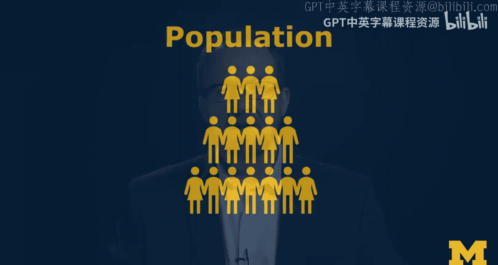
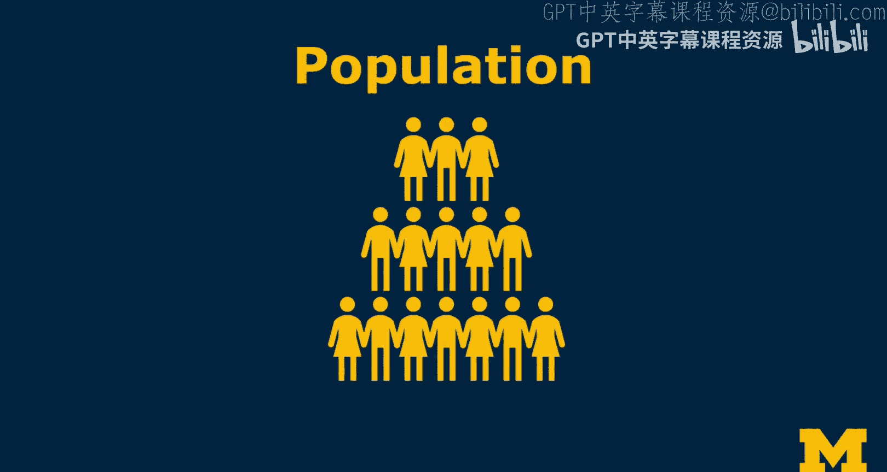
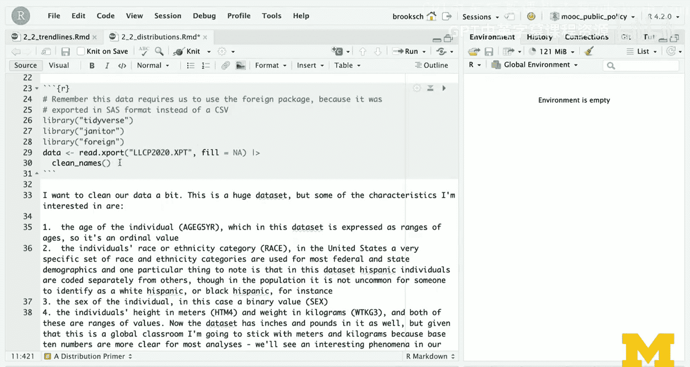
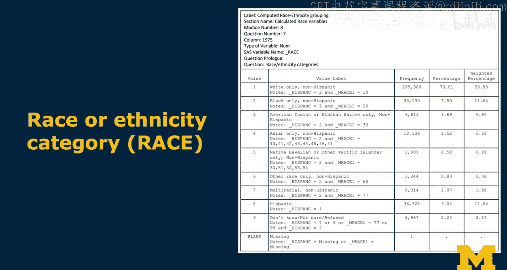
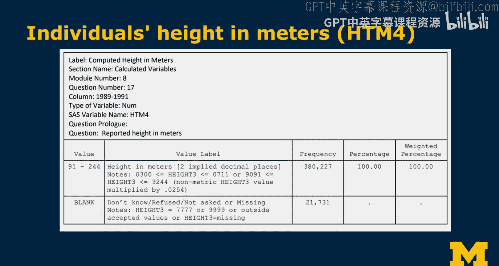
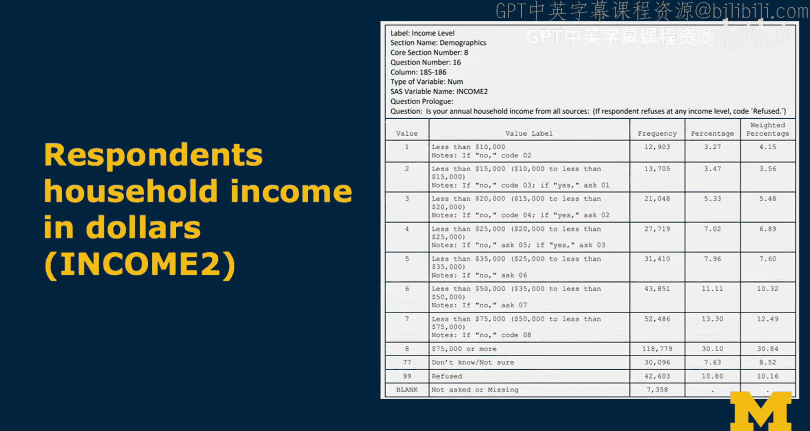
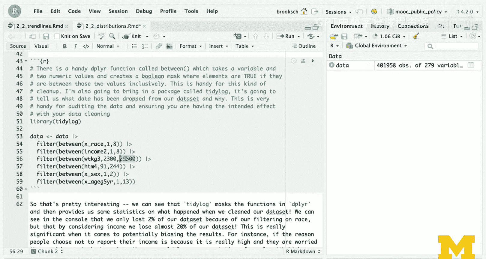

# 14：分布分析与直方图入门 📊


在本节课中，我们将学习如何探索和理解数据的分布。数据分布是数据分析的核心概念，对于公共政策领域尤为重要。我们将从基本概念入手，并使用R语言中的实际数据进行操作。

## 什么是数据分布？




从高层次来看，**分布**就是一组频率观测值的集合。我们之前查看人口和宠物数据时，实际上已经接触过分布。在公共政策中，分布非常常见。例如，人口年龄分布可用于了解可能继续工作的劳动力比例，而财富分布则有助于理解社会公平问题以及税收或其他政策举措的效果。



为了理解分布，有几个核心概念需要掌握。如果您对这些概念感到陌生，建议您探索Coursera平台上的一些统计学入门课程。


## 核心概念：总体与样本

上一节我们介绍了分布的基本概念，本节中我们来看看构成分布分析基础的两个关键术语。

**总体**是我们感兴趣的所有可能观测值的集合。在政策领域，总体通常是所有人，但也可以是鱼类、树木或其他多样化的群体。从统计学意义上讲，总体不一定是有生命的事物。例如，我们可能对世界上的汽车总体感兴趣。然而，在公共政策中，总体通常是人。例如，美国公民的总体可能略高于3亿人。

**样本**是从总体中选取的一部分，我们将对其进行分析。样本通常比整个总体小得多。在上一个课程中我们看到，年度人口普查抽样调查了1%的美国人口，即每年约350万人。样本是我们将要观察和量化的群体。然后，我们将对样本进行可视化和数值分析，目的是将我们的发现推广到我们感兴趣的整个总体。

样本是否具有**代表性**至关重要，这是实现公平和制定良好公共政策的主要关切点。有多种技术可以处理缺乏代表性的问题。例如，**分层抽样**过程旨在改变数据收集方式以提高代表性，而像我们之前查看的BRFSS数据中所做的**变量重新加权**，则旨在数据收集后提高代表性。在本系列关于数据伦理和政治的最后一门课程中，您将看到关于此问题的更多讨论，包括我自己的研究。目前，我们假设我们的抽样方法能反映总体，因此我们的样本只是总体的一个微型版本。

样本是有限的。有时它们有限但很大，因此我们可以将其视为连续的；但通常它们有限且很小，我们会痛苦地意识到它们是多么离散。

## 从样本到数学模型

在统计学中，我们通常希望用数学函数来表示样本。就像我们在上一讲中看到的，这个函数可能是线性的，但通常具有更复杂或更细微的形状。函数的形状由**参数**控制或描述，我们通常希望尝试分析样本数据以生成这些参数，从而估计数学函数。

那么，我们为什么要费心去估计这个数学函数呢？首先，只有对分布施加一些限制，我们才能使用许多不同的统计方法。其次，我们经常希望预测总体中可能发生的变化，为此我们需要一些语言来描述这些变化可能如何发生，为此我们将使用**统计建模**。在下一门课程中讨论实验分析时，您将听到不同统计建模师关于他们所做工作的更多介绍。


在现代学习统计学的优势在于，我们可以模拟数据和函数，甚至可以查看真实数据，而不必经历数学定理和证明。R语言是进行此类操作的绝佳场所。在本讲中，我们将通过查看上一门课程中使用的一些行为风险因素监测系统数据来实现这一点。



## 加载并准备BRFSS数据


现在，让我们加载BRFSS数据并开始分析。首先，我们需要加载必要的包并导入数据。



```r
# 加载必要的包
library(foreign)  # 用于读取SAS格式数据
library(janitor)  # 用于清理列名
library(dplyr)    # 用于数据操作
library(tidylog)  # 用于记录数据操作过程

# 导入并清理数据
brfss_data <- read.xport("path/to/your/BRFSS_data.XPT") %>%
  clean_names()  # 清理列名
```




接下来，我们需要对数据进行一些清理。这是一个庞大的数据集，但我感兴趣的一些特征包括个体的年龄（`age5yr`，在此数据中表示为年龄范围，因此是顺序值）、个体的种族或民族（`race`列）、个体的性别（`sex`，在此为二元值）、个体的身高（`htm4`，单位：米）和体重（`wtkg3`，单位：千克）。这两个值都是范围。请注意，此数据集也包含英寸和磅，但考虑到这是一个全球课堂，我将坚持使用米和千克，因为以10为基数的数字对大多数分析来说更清晰。我们将从这个决定中看到数据中一个有趣的现象。




此外，还有受访者的家庭收入（`income2`，单位：美元），这里我们也有响应带。请注意，在此数据集中，这些带的宽度也不完全相同。

我将通过筛选这些列值来清理数据，然后根据需要将内容转换为因子。

```r
# 使用tidylog记录数据清理过程，并筛选有效数据范围
brfss_clean <- brfss_data %>%
  filter(
    between(x_race, 1, 8),      # 种族编码在1到8之间（含）
    between(income2, 1, 8),     # 收入编码在1到8之间（含）
    between(wtkg3, 2268, 68038) # 体重编码在代码簿提供的最小和最大值之间
    # ... 对其他变量（如身高、年龄）应用类似的筛选
  ) %>%
  mutate(
    age5yr = as.factor(age5yr),
    x_race = as.factor(x_race),
    sex = as.factor(sex),
    income2 = as.factor(income2)
  )
```

这里展示了一个方便的dplyr函数`between`。它接受一个变量和两个数值，并创建一个布尔掩码，如果元素在这两个值之间（包含两端），则为TRUE。这对于此类清理工作非常方便。我还引入了名为`tidylog`的包。它会告诉我们数据集中哪些数据被删除了以及原因。这对于审计数据和确保清理操作达到预期效果非常方便。



从控制台输出中，我们可以看到，根据种族筛选只损失了2%的数据集，但考虑到收入因素，我们损失了近20%的数据集。这在可能**偏差结果**方面非常重要。例如，如果人们选择不报告收入是因为收入非常高，他们担心被视为炫耀者，那么我们就会失去高收入人群的代表性。像收入这样的变量也很有可能与其他变量高度相关，例如年龄，因为年龄较大的个体在劳动力市场工作的时间可能更长。能够报告这些清理方法的效果对于制定良好政策至关重要。

## 总结


本节课中我们一起学习了数据分布的基本概念，包括**总体**与**样本**的区别，以及样本代表性在公共政策分析中的重要性。我们介绍了如何将样本数据与数学模型联系起来，并开始了使用R语言处理真实世界数据（BRFSS数据集）的实践。通过数据清理步骤，我们看到了处理缺失值或无效值时可能引入的偏差，这是进行负责任数据分析的关键一步。在接下来的课程中，我们将更深入地探索如何可视化和分析这些分布。