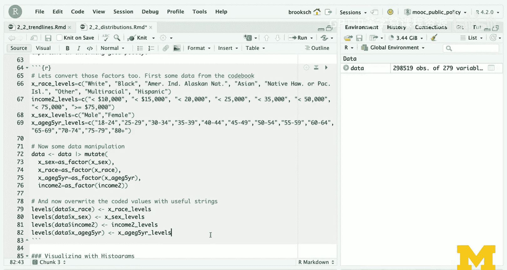
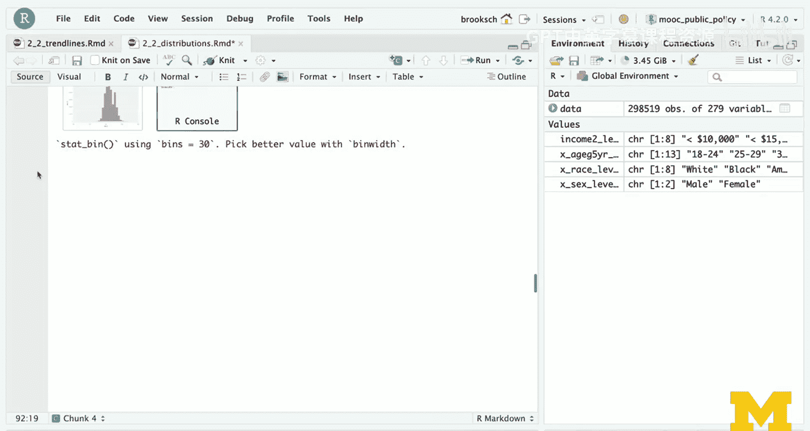
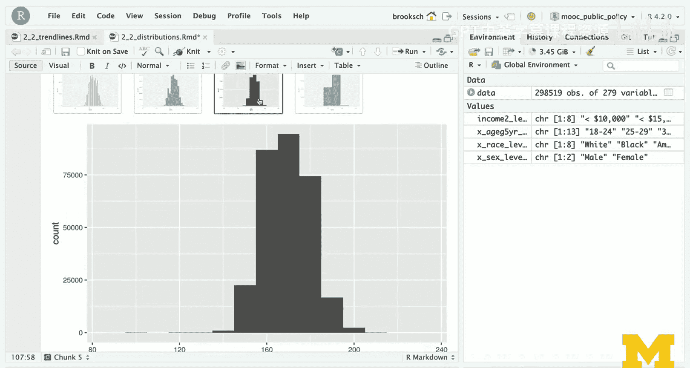
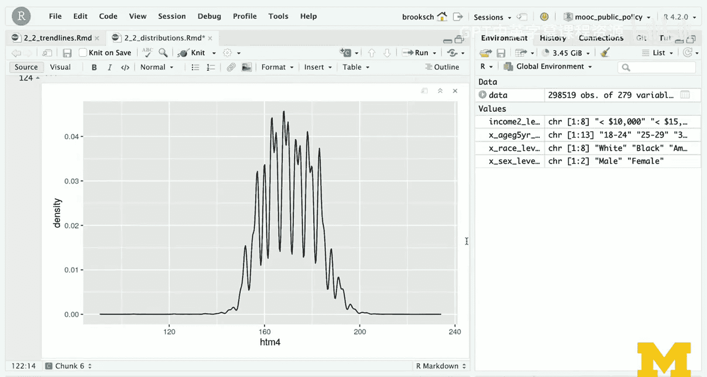
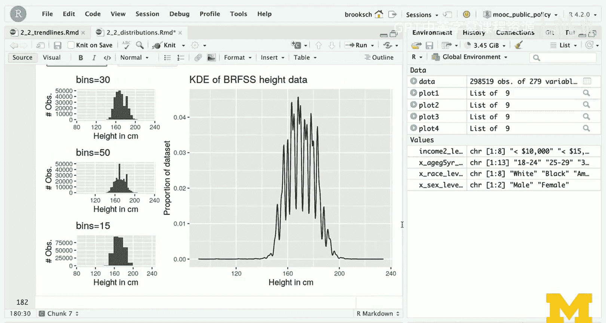

# 15：直方图深度解析 📊


在本节课中，我们将学习如何使用直方图和核密度估计来可视化数据的分布。我们将从数据清理开始，逐步探索如何创建和解读这些图表，并理解不同参数（如箱宽）对图表呈现效果的影响。

## 数据准备与清理

上一节我们介绍了数据导入，本节中我们来看看如何将数据中的数值型分类变量转换为因子。原始数据集中，种族、收入、性别和年龄等变量以代码形式存储。为了在分析中正确使用它们，我们需要参考代码簿，将这些代码转换为有意义的字符串标签，并最终转换为R中的因子类型。

以下是转换步骤：
```r
# 使用dplyr的mutate函数将列转换为因子，并重命名其水平
data <- data %>%
  mutate(
    race = factor(race, levels = c(1, 2, 3), labels = c("White", "Black", "Other")),
    income = factor(income, levels = c(1, 2, 3, 4), labels = c("Low", "Medium", "High", "Very High")),
    sex = factor(sex, levels = c(1, 2), labels = c("Male", "Female")),
    age_group = factor(age_group, levels = c(1, 2, 3, 4, 5), labels = c("18-24", "25-34", "35-44", "45-54", "55+"))
  )
```
这个过程存在挑战：需要人工查阅代码簿并手动输入标签，容易出错。这些错误如果进入最终分析，可能会误导决策者。这凸显了使用CSV或SAS等未将因子编码为字符串值的数据集时面临的问题。



## 理解直方图

现在我们的数据已经加载并清理完毕，我们可以尝试可视化其分布。用于可视化样本分布的主要技术是直方图。


直方图将连续变量映射到X轴，将频率映射到Y轴。其视觉表现形式是条形图。直方图通过**分箱**将连续变量转换为一组有序类别。

我们之所以这样做，是因为像体重这样的连续变量可能变化很大。对于一个给定的样本，我们可能无法看出任何普遍趋势。例如，数据中可能恰好有一个人的体重是100.02公斤，另一个是100.00公斤，还有一个是100.03公斤。直方图本质上将这些数字四舍五入到不同的“桶”中，并允许我们更灵活地控制这些桶（我们称之为**箱**）。这让我们能够感知总体特征的密度。

让我们开始创建第一个直方图，查看样本的身高（厘米）分布。



```r
library(ggplot2)
ggplot(data, aes(x = height_cm)) +
  geom_histogram() +
  labs(title = "身高分布直方图", x = "身高 (厘米)", y = "频数")
```
运行上述代码后，我们得到了第一个直方图。控制台输出显示，`ggplot2`默认使用了30个箱。图中显示，我们数据中的绝大多数人身高在150到180厘米之间（大约5到6英尺），这看起来是合理的。




在180厘米标记附近有一个很小的条带，显示那里的人数要少得多。这揭示了直方图最大的挑战之一：**箱宽的选择会改变图表的外观，有时会产生误导**。

有时我们称之为“梳子效应”，因为图表中的间隙看起来像梳子的齿。让我们尝试几种不同的箱宽来观察效果。

以下是尝试四种不同箱宽的代码：
```r
# 创建包含不同箱宽直方图的图形
p1 <- ggplot(data, aes(x = height_cm)) + geom_histogram(binwidth = 1) + labs(title = "箱宽 = 1 厘米")
p2 <- ggplot(data, aes(x = height_cm)) + geom_histogram(binwidth = 5) + labs(title = "箱宽 = 5 厘米 (~2英寸)")
p3 <- ggplot(data, aes(x = height_cm)) + geom_histogram(binwidth = 10) + labs(title = "箱宽 = 10 厘米 (~4英寸)")
p4 <- ggplot(data, aes(x = height_cm)) + geom_histogram(binwidth = 30) + labs(title = "箱宽 = 30 厘米 (~1英尺)")

# 使用cowplot库并排显示
library(cowplot)
plot_grid(p1, p2, p3, p4, nrow = 2)
```


第一个图（箱宽1厘米）清晰地显示了“梳子效应”。实际上，如果我们查看数据，会发现身高160厘米的观测值有近20000个，而161厘米的只有19个。这是为什么？部分原因取决于受访者如何回答问题，这里涉及很多有趣的行为心理学。例如，如果有人回答他们身高5英尺2英寸，那就是160厘米。但如果他们说5英尺3英寸，则四舍五入到163厘米。样本中只有很少的人会报告像5英尺2又1/3英寸这样的身高，或者直接以厘米报告身高。

随着我们增大箱宽，会看到不同的模式，并对数据的样子有更整体的把握。但当箱变得太大时（如最后一个图中用一英尺作为单位），我们就开始失去粒度。总之，要使用直方图估计数据分布，你必须非常清楚箱宽的大小，并仔细实验和考量。

## 核密度估计


一个常见的需求是尝试通过估计数据的函数来平滑直方图。通常的做法是创建**核密度估计**并将其可视化为一条线。



与直方图不同，核密度估计是平滑且连续的，可以为样本量相对较小的数据提供一些洞见。`ggplot2`有一些内置函数可以将核密度估计创建为一个新图层，我们可以使用`geom_density()`几何函数来调用它，其底层实际上会调用`stat_density`机制来创建函数。

以下是创建核密度估计图的代码：
```r
ggplot(data, aes(x = height_cm)) +
  geom_density() +
  labs(title = "身高核密度估计", x = "身高 (厘米)", y = "密度")
```


我们可以看到在那些常见的报告数字（如160厘米）周围有明显的尖峰。你会注意到X轴与直方图相同（单位是厘米），但Y轴非常不同。

密度估计函数表示的是，在X轴上任意给定点处，数据在整个数据集中的比例或数量。因此，直方图的Y轴是每个箱中的观测值数量（人数），而密度值表示的是在任意给定X点处数据的比例，其数值在0到1之间。

如果将密度估计曲线下的所有数据相加，其总和等于1，因此可以将其视为一个概率函数。从密度估计中可以得出的推断是关于总体比例的，而从直方图中可以得出的推断是关于观测值的确切数量的。

## 结合直方图与密度图

将密度估计函数和直方图绘制在一起是很常见的。但在`ggplot2`中，所有图层必须具有相同的尺度。因此，我们必须将两者之一（以观测值计数的直方图，或以0到1之间比例表示的密度图）转换为另一个的尺度。


但这并不简单，因为直方图的条形有宽度，而密度函数提供的是点估计。创建这种图形意味着我们必须编写一个函数来将直方图转换为密度尺度，或者反之，因为所有图层必须具有相同的尺度。

另一种方法是尝试并排显示两个图表。虽然`ggplot2`本身不直接支持，但我们可以使用由Claus O. Wilke开发的`cowplot`库来扩展`ggplot2`的功能。Claus写了一本名为《数据可视化基础》的书，其中更详细地解释了`cowplot`库。这本书很有趣，因为它不仅关注像`ggplot2`这样的信息可视化库的机制，还深入探讨了本课程最后一周的主题：是什么构成了清晰且信息丰富的可视化。

让我们使用一点`cowplot`来更新这个可视化，使其对决策者也更具吸引力。

以下是使用`cowplot`创建组合图的示例代码：
```r
# 确保已安装并加载cowplot库
# install.packages("cowplot")
library(cowplot)

# 创建三个不同箱宽的直方图
plot1 <- ggplot(data, aes(x = height_cm)) + geom_histogram(bins = 30) + labs(title = "30个箱")
plot2 <- ggplot(data, aes(x = height_cm)) + geom_histogram(bins = 50) + labs(title = "50个箱")
plot3 <- ggplot(data, aes(x = height_cm)) + geom_histogram(bins = 15) + labs(title = "15个箱")

# 创建核密度估计图
plot4 <- ggplot(data, aes(x = height_cm)) + geom_density() + labs(title = "核密度估计 (KDE)")

# 使用plot_grid排列图形：左侧三个直方图堆叠，右侧一个大密度图
left_column <- plot_grid(plot1, plot2, plot3, nrow = 3)
combined_plot <- plot_grid(left_column, plot4, ncol = 2, rel_widths = c(1, 2))
print(combined_plot)
```




效果不错。我们还可以通过为直方图设置共同的Y轴标签或更改一些文本样式来改进它。但总体而言，它既能让人一眼看清直方图以了解人口密度，又能显示带有尖峰的KDE，表明该变量实际上并不像直方图可能暗示的那样连续和平滑。

## 总结

本节课中我们一起学习了直方图和核密度估计的概念。使用直方图来理解总体特征具有重要意义。你可能已经注意到，我们在这里清理了大量数据，但只查看了人们的身高。我认为本周一个好的作业是让你探索为其他一些特征制作直方图，并尝试构建一个比我在这里构建的简单图表更具吸引力的可视化。


