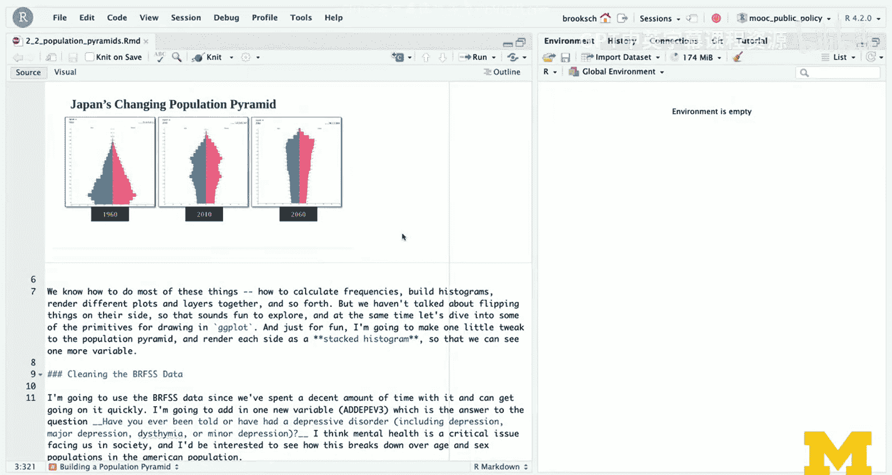
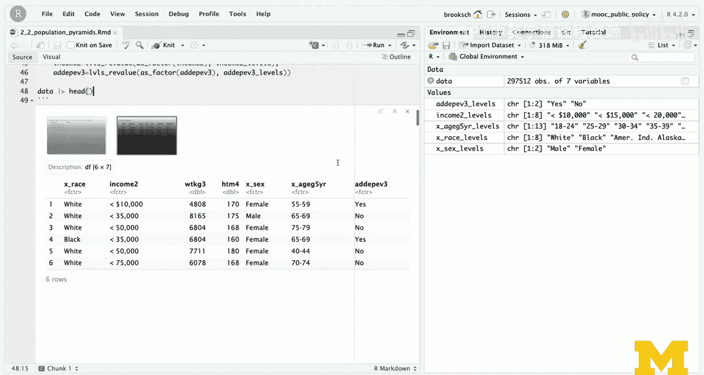
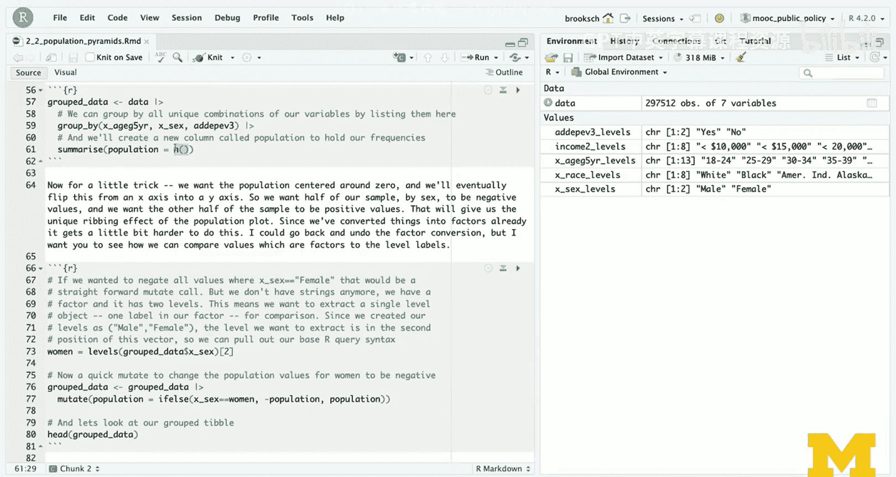
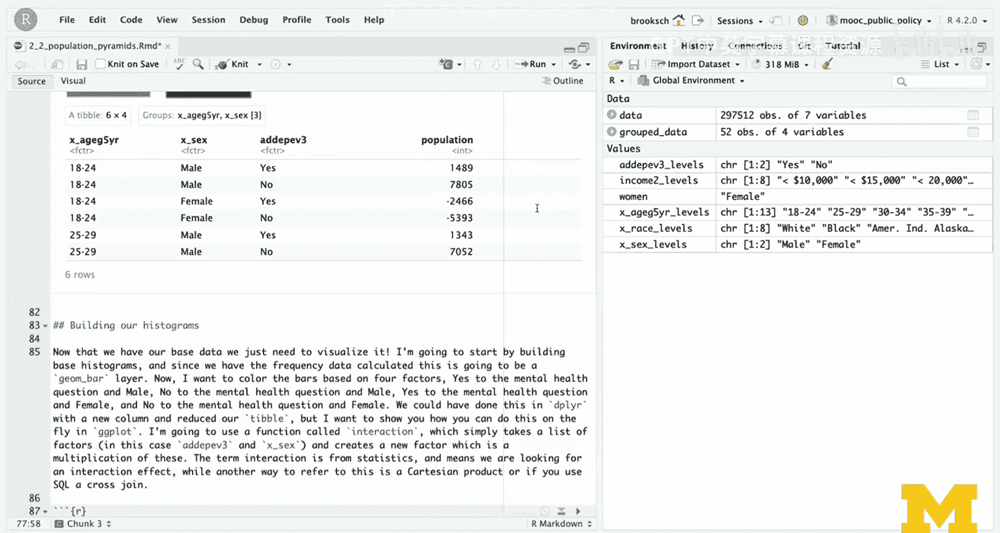
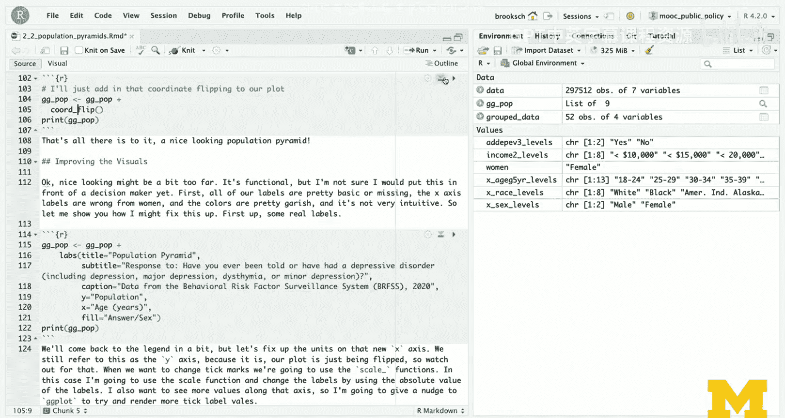
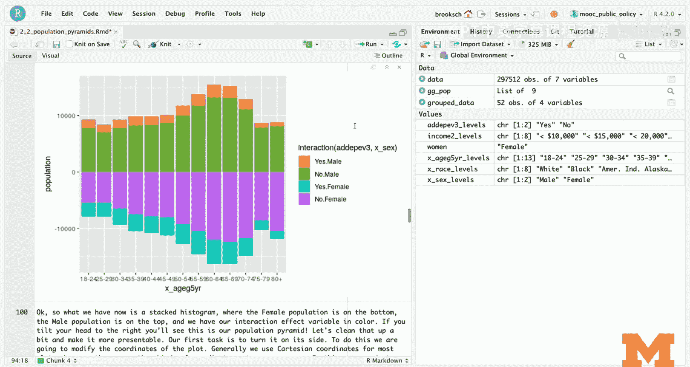

# 16：人口金字塔基础构建 📊


在本节课中，我们将学习如何使用R语言的`ggplot2`包来创建一个基础的人口金字塔图表。我们将回顾直方图的知识，并探索如何通过翻转坐标轴和自定义数据来构建一个展示人口年龄、性别及心理健康状况分布的图表。


## 概述



上一节我们介绍了`ggplot2`的基本绘图功能，并讨论了如何将数据分布可视化为直方图。本节中，我们将尝试创建一个人口金字塔图表。人口金字塔本质上可以看作是两个共享同一坐标轴的直方图，只不过它们被水平放置，一个在左侧，一个在右侧。在大多数人口金字塔中，数据按性别划分，X轴代表人口数量，Y轴代表年龄。


## 数据准备与清理


为了快速开始，我们将使用之前课程中熟悉的BRFSS数据，并引入一个新变量：“你是否曾被诊断患有抑郁症？”。我们认为心理健康是社会面临的关键问题，并希望了解这一指标在美国人口中如何随年龄和性别分布。

以下是数据清理的步骤，我们将使用一系列常用的R包。

```r
library(tidyverse)
library(janitor)
library(foreign)
library(tidylog)
```

首先，我们从代码本中获取人类可读的标签，为收入、种族、性别、年龄和我们的心理健康问题设置清晰的变量名。

```r
# 设置变量标签
income_labels <- c("Less than $10,000", "$10,000 to $14,999", ...) # 示例
race_labels <- c("White", "Black", "Hispanic", ...)
sex_labels <- c("Male", "Female")
age_labels <- c("18-24", "25-34", "35-44", ...)
mental_health_labels <- c("Yes", "No")
```

接下来，我们读取数据并进行清理。我们使用`foreign`包导入数据，立即清理列名，并选择我们感兴趣的变量。

```r
# 读取并清理数据
brfss_data <- read.spss("path/to/your/data.sav", to.data.frame = TRUE) %>%
  clean_names() %>%
  select(income, race, sex, age, mental_health) %>%
  # 过滤掉缺失值
  filter(!is.na(income),
         !is.na(race),
         !is.na(sex),
         !is.na(age),
         !is.na(mental_health)) %>%
  # 将变量转换为因子并设置标签
  mutate(income = factor(income, labels = income_labels),
         race = factor(race, labels = race_labels),
         sex = factor(sex, labels = sex_labels),
         age = factor(age, labels = age_labels),
         mental_health = factor(mental_health, labels = mental_health_labels))
```

我们使用`levels_revalue`函数（来自`forcats`包）来方便地在`tidyverse`流程中重命名因子水平。

```r
# 查看数据前几行
head(brfss_data)
```



## 计算分组频率

虽然`ggplot2`的直方图可以自动计算频率，但为了自定义绘图，我们需要手动计算分组频率。我们希望了解按年龄组和性别分组后，对心理健康问题的回答（是/否）的频率。


这意味着我们需要对`age`、`sex`和`mental_health`这三个变量进行分组，然后计算每组的样本数（`n()`）。



```r
# 分组并计算频率
grouped_data <- brfss_data %>%
  group_by(age, sex, mental_health) %>%
  summarise(population = n(), .groups = 'drop')
```

## 为金字塔图调整数据


为了创建金字塔效果，我们希望数据围绕零值中心化。具体来说，我们希望将女性组的数据值变为负数，这样在图表中它们就会显示在零轴的左侧。

由于我们已经将`sex`转换为因子，直接与字符串比较会失败。我们需要提取因子水平来进行比较。

```r
# 提取“女性”因子水平用于比较
women_level <- levels(grouped_data$sex)[2] # 假设第二个水平是“Female”

# 调整人口数：女性组取负值
grouped_data <- grouped_data %>%
  mutate(population = ifelse(sex == women_level, -population, population))
```

现在查看数据，可以看到男性组的人口数为正，女性组为负。

```r
head(grouped_data)
```

## 构建基础图表



现在我们有了基础数据，可以开始可视化。我们将使用`geom_bar`图层来绘制条形图。我们希望根据四个类别（男性/是、男性/否、女性/是、女性/否）为条形着色。

我们可以在`ggplot`内部使用`interaction()`函数动态创建一个新的因子，它是`mental_health`和`sex`的交互作用（即笛卡尔积）。

```r
# 创建基础图表
base_plot <- ggplot(data = grouped_data,
                    aes(x = age,
                        y = population,
                        fill = interaction(mental_health, sex))) +
  geom_bar(stat = "identity") # 使用数据中已有的y值，不进行统计变换
```

此时，我们得到一个堆叠的条形图，女性人口在底部，男性人口在顶部，并通过颜色区分了心理健康回答。如果将头向右倾斜，这已经初具人口金字塔的形态。


## 翻转坐标轴

为了让图表成为标准的人口金字塔（水平条形图），我们需要翻转X轴和Y轴。`ggplot2`提供了`coord_flip()`函数来实现这一功能。坐标变换会影响图表的所有图层。

```r
# 翻转坐标轴
pyramid_plot <- base_plot + coord_flip()
print(pyramid_plot)
```





## 总结


本节课中，我们一起学习了如何从清理和准备数据开始，逐步构建一个自定义的人口金字塔图表。关键步骤包括：
1.  **数据分组与汇总**：使用`dplyr`计算按年龄、性别和心理健康状况分组的频率。
2.  **数据调整**：通过将女性组数据转换为负值，为金字塔图的左右分布做准备。
3.  **交互因子创建**：使用`interaction()`函数在绘图时动态创建分类着色变量。
4.  **条形图绘制**：使用`geom_bar(stat = "identity")`根据计算好的频率绘制条形。
5.  **坐标轴翻转**：使用`coord_flip()`将垂直条形图转换为水平方向，形成最终的金字塔结构。


通过结合这些技术，我们不仅创建了一个基本的人口金字塔，还通过堆叠条形图额外展示了心理健康状况的分布，使图表能传达更丰富的信息。