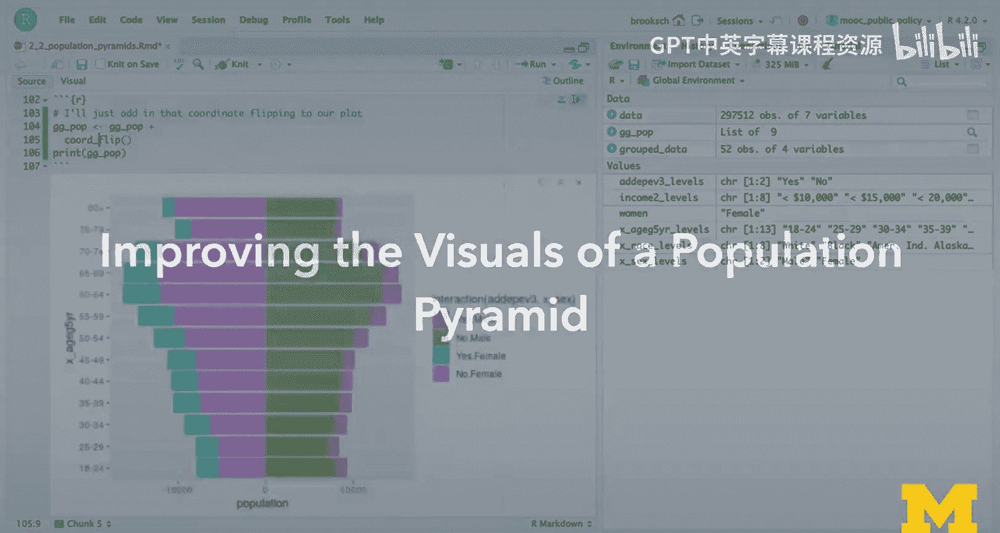
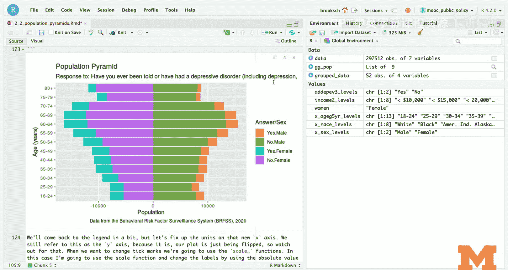
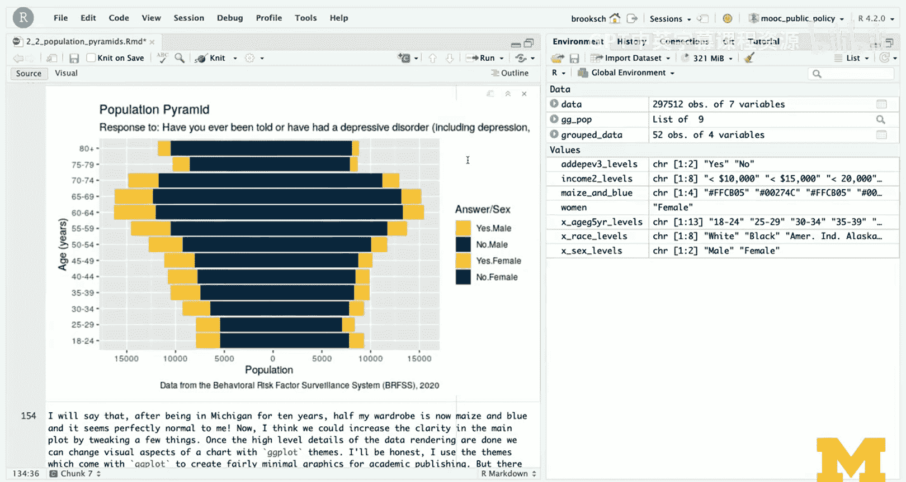
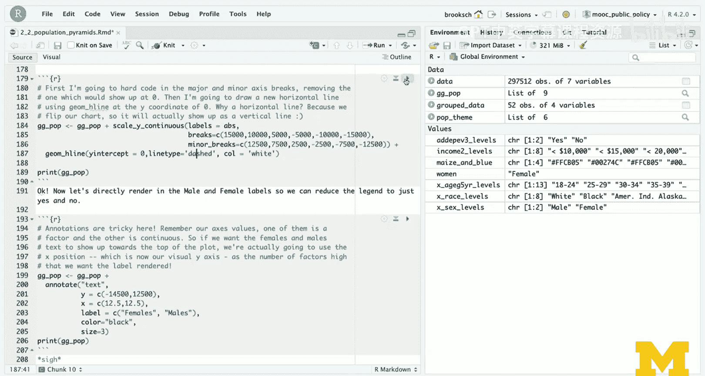
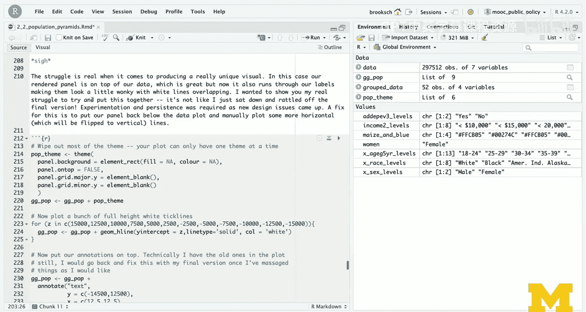
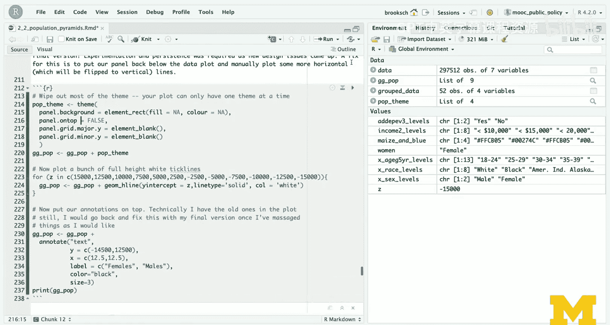
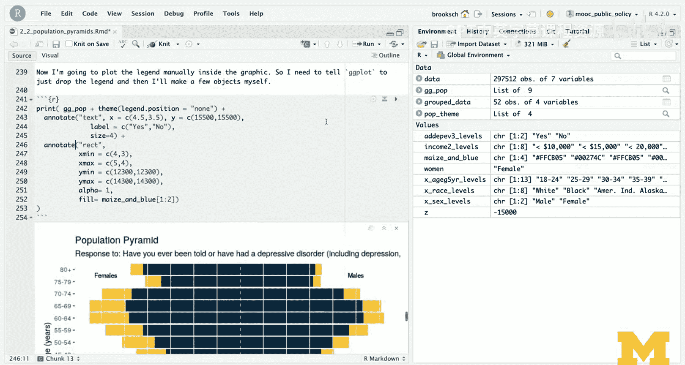
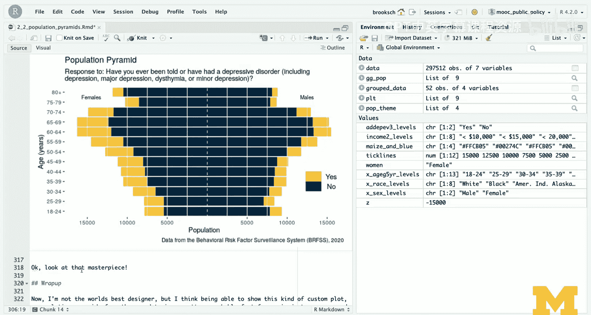

# 17：人口金字塔可视化优化 🏛️📊





在本节课中，我们将学习如何优化一个基础的人口金字塔图表，使其从“功能可用”提升到“适合呈现给决策者”的水平。我们将通过添加标签、调整颜色、优化坐标轴和自定义图例等步骤，来创建一个更清晰、更专业的可视化图表。

上一节我们创建了一个基础的人口金字塔。本节中，我们来看看如何通过一系列优化步骤来提升它的视觉效果和信息传达能力。



## 添加图表标签 📝

首先，我们需要为图表添加有意义的标签，包括标题、副标题和说明文字。

以下是添加标签的代码示例：
```r
labs(
  title = "人口金字塔示例",
  subtitle = "这是一个很长的副标题，用于描述图表的主要内容",
  caption = "数据来源：示例数据集"
)
```
我们使用 `labs()` 函数来添加标签。标题会显示在图表顶部，副标题紧接在标题下方，而说明文字通常放在图表最底部，用于注明数据来源。

## 优化坐标轴刻度 🔢

当前图表的X轴（由于图表翻转，实际上是视觉上的Y轴）刻度标签为负值，这不够直观。我们需要将其转换为绝对值，并调整刻度密度。

以下是优化坐标轴的代码：
```r
scale_y_continuous(
  labels = abs,          # 使用绝对值函数处理标签
  n.breaks = 10          # 提示ggplot尝试生成大约10个主刻度
)
```
`scale_y_continuous()` 函数用于调整连续型Y轴的属性。`labels = abs` 会将所有负值标签转换为正值。`n.breaks = 10` 是一个提示，建议ggplot生成大约10个刻度，但最终结果仍由ggplot的算法决定。

## 自定义填充颜色 🎨

初始的默认颜色对比强烈但不够美观。我们可以将其替换为更符合特定场景（例如机构品牌）的颜色。


以下是自定义颜色的代码：
```r
scale_fill_manual(
  values = c("maize" = "#FFCB05", "blue" = "#00274C")
)
```
我们使用 `scale_fill_manual()` 函数手动设置填充颜色。这里使用了密歇根大学的官方颜色：玉米黄（maize）和蓝色（blue）。你需要根据你的品牌或审美选择相应的十六进制颜色码。



## 应用主题与调整背景 🖼️

当数据渲染的宏观细节完成后，我们可以通过调整主题来改变图表的视觉外观，例如背景和网格线。

以下是调整主题的代码示例：
```r
theme(
  panel.background = element_rect(fill = NA),      # 将面板背景设为透明
  panel.grid.major = element_line(color = "white"), # 将主网格线设为白色
  panel.grid.minor.y = element_blank()              # 移除Y轴的次要网格线
)
```
`theme()` 函数影响图表的所有图层。通过将背景设为透明、网格线设为白色，我们可以让数据条更加突出。注意，面板（panel）是承载网格线和数据的主要区域。


## 精确控制刻度线与添加零线 📏

为了更清晰地标示中心点，我们可以手动设置刻度线位置，并在零值处添加一条明显的参考线。

以下是相关代码：
```r
# 1. 手动设置主次刻度线位置
scale_y_continuous(
  breaks = c(-2000, -1000, 1000, 2000), # 主刻度
  minor_breaks = c(-1500, -500, 500, 1500) # 次刻度
)

# 2. 添加一条垂直的零值参考线（由于图表翻转，使用geom_hline）
geom_hline(yintercept = 0, linetype = "dashed")
```
通过 `breaks` 和 `minor_breaks` 参数可以精确控制刻度线的位置。由于图表是翻转的，我们使用 `geom_hline()` 添加一条水平的几何线，它在最终图表中会显示为垂直的零值参考线，并使用虚线以作区分。



## 在图表内添加标注并简化图例 🏷️


我们可以直接在图表内部标注“男性”和“女性”，从而将图例简化为只显示“是”和“否”（例如，是否抑郁）。

以下是添加文本标注的代码：
```r
annotate("text",
         x = c(12.5, 12.5),        # 在因子坐标上的位置（X轴，即视觉Y轴）
         y = c(1500, -1500),       # 在频数坐标上的位置（Y轴，即视觉X轴）
         label = c("Females", "Males"),
         color = "black",
         size = 4)
```
`annotate()` 函数用于添加几何对象。这里添加的是文本。由于我们的坐标系是翻转的，`x` 参数对应年龄组分（因子），`y` 参数对应人口数量（连续值）。这需要一些调试来确定最佳位置。

## 解决图层覆盖问题与最终调整 ⚙️

在优化过程中，可能会遇到白色网格线覆盖在文字上的问题。一个解决方案是调整图层顺序：将面板背景置于数据之后，并手动绘制参考线。



以下是调整图层和手动绘制线的思路：
```r
# 1. 使用新主题，移除Y轴网格线，并确保面板在底层
theme(panel.grid.major.y = element_blank(),
      panel.ontop = FALSE)

# 2. 使用循环手动在每个刻度位置绘制白色竖线
for(pos in my_break_positions) {
  plot <- plot + geom_vline(xintercept = pos, color = "white", size = 0.5)
}
```
通过设置 `panel.ontop = FALSE` 并将面板背景设为透明，然后手动用 `geom_vline()` 绘制白色线条，可以避免文字被遮盖。


## 手动创建内置图例 🔲

为了节省空间并使图表更简洁，我们可以完全移除默认图例，并在图表内部手动绘制一个简化的图例。



以下是手动创建图例的代码示例：
```r
# 1. 移除所有图例
theme(legend.position = "none")


# 2. 添加“是/否”文本
annotate("text", x = 4.5, y = -2500, label = "Yes", color = "black")
annotate("text", x = 3.5, y = -2500, label = "No", color = "black")

# 3. 添加颜色方块
annotate("rect", xmin = 4.3, xmax = 4.7, ymin = -2600, ymax = -2400,
         fill = "#FFCB05") # maize
annotate("rect", xmin = 3.3, xmax = 3.7, ymin = -2600, ymax = -2400,
         fill = "#00274C") # blue
```
我们首先用 `theme(legend.position = "none")` 关闭图例。然后，使用 `annotate()` 分别添加说明文字和代表颜色的矩形。这需要反复调整坐标和尺寸以达到最佳效果。



## 最终代码整合与换行处理 📄

最后，我们将所有优化步骤整合到一段代码中。注意，ggplot的标题和副标题不会自动换行，需要手动插入换行符 `\n`。

以下是最终代码的核心结构：
```r
# 定义颜色和参数
my_colors <- c("#FFCB05", "#00274C")
tick_positions <- c(...) # 刻度线位置


# 构建基础图表
base_plot <- ggplot(data, aes(x = age_group, y = count, fill = interaction(gender, response))) +
  geom_col()



# 添加手动绘制的刻度线
for(pos in tick_positions) {
  base_plot <- base_plot + geom_vline(xintercept = pos, color = "white")
}

# 添加其他图层：标签、颜色、坐标轴、参考线、标注、主题
final_plot <- base_plot +
  labs(title = "优化后的人口金字塔",
       subtitle = "第一行描述\n第二行描述", # 使用 \n 换行
       caption = "数据来源: XXX") +
  scale_fill_manual(values = my_colors) +
  scale_y_continuous(labels = abs, breaks = major_breaks, minor_breaks = minor_breaks) +
  geom_hline(yintercept = 0, linetype = "dashed") +
  coord_flip() +
  # ... 添加所有annotate标注 ...
  theme_minimal() # 或自定义主题
```

---


本节课中我们一起学习了如何将一个基础的人口金字塔进行深度优化。我们为图表添加了完整的标签，美化了颜色方案，精确控制了坐标轴刻度，并添加了清晰的参考线。通过将标注整合进图表并手动创建简约图例，我们提升了信息的可读性和图表的专业性。最重要的是，我展示了一个真实的、包含调试和问题解决的工作流程。最终，这个图表清晰地显示出样本中老年女性更多，且在各个年龄段，女性对抑郁问题回答“是”的频率都高于男性。请记住，最终采用何种视觉风格，取决于你的沟通对象是统计学家、决策者还是普通公众。