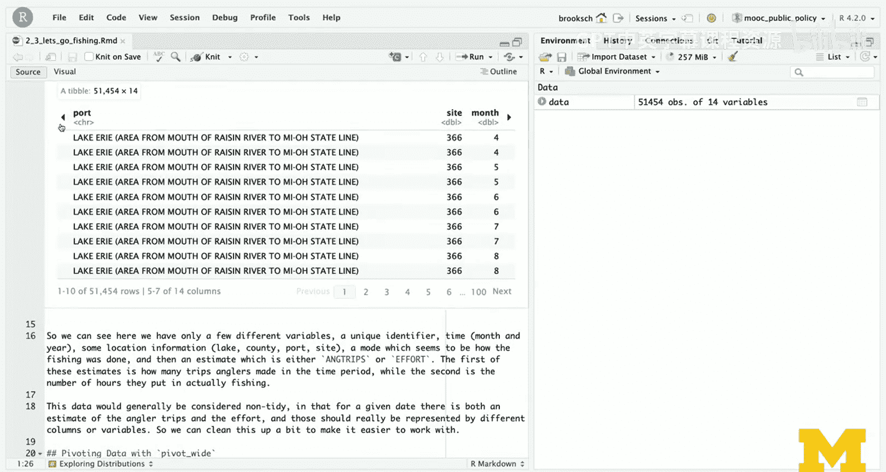
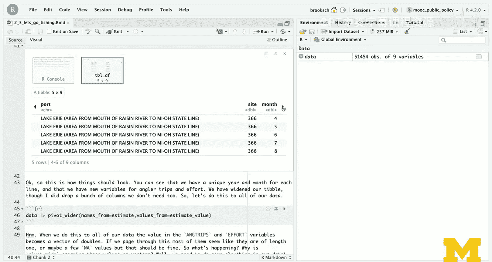
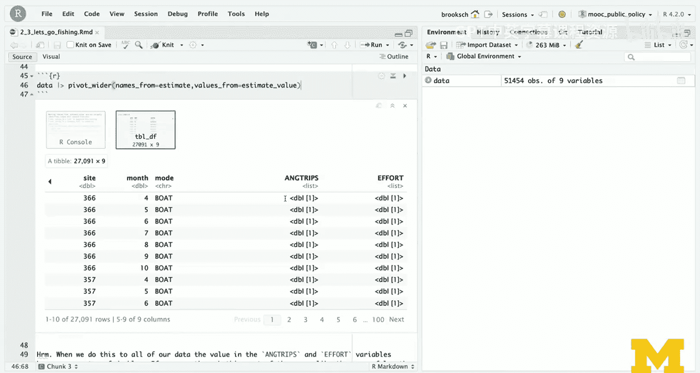
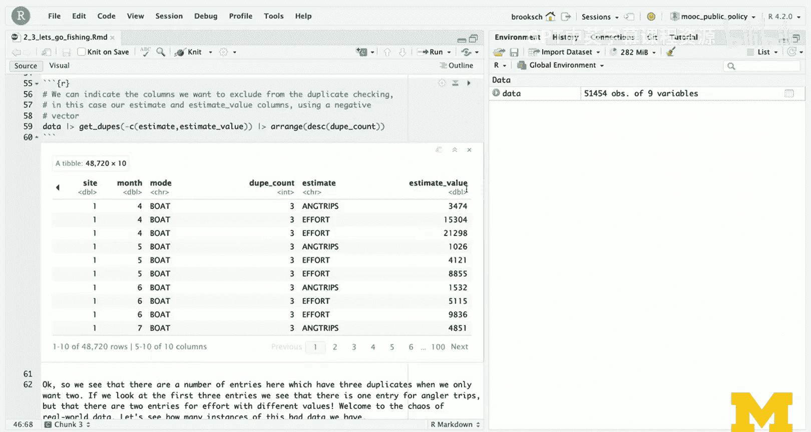
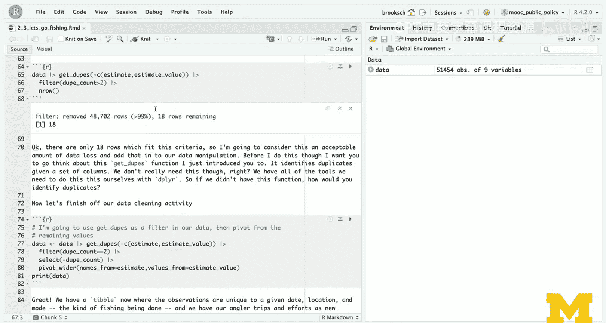
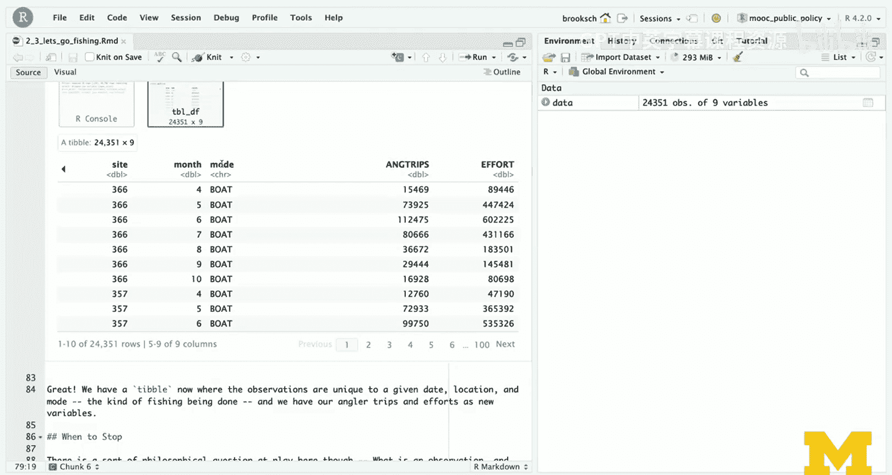
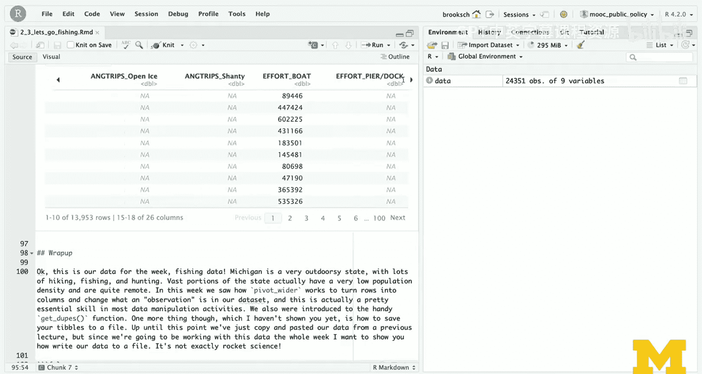
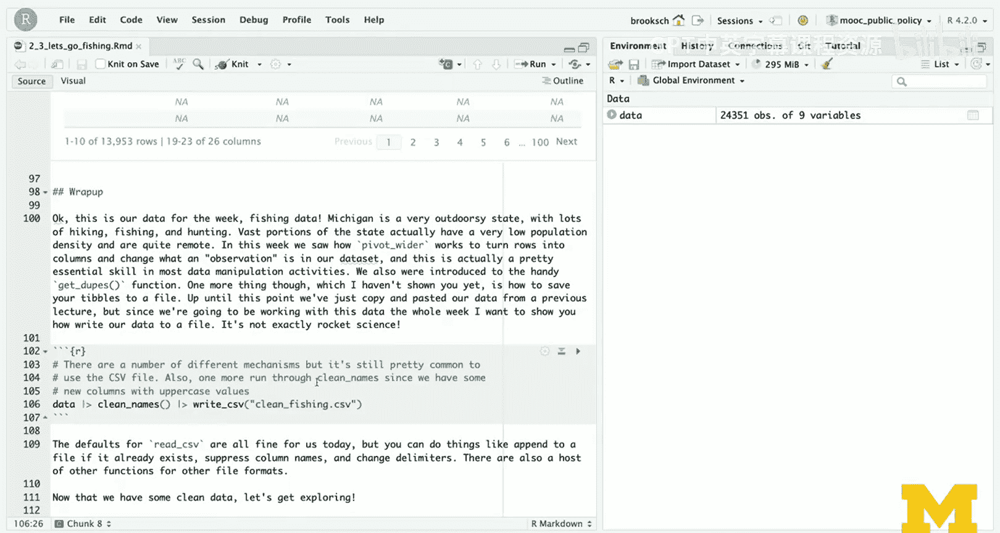

# 公共部门的R数据分析：18：数据探索实战演练 🎣

在本节课中，我们将学习如何使用更高级的可视化方法来探索数据的分布。我们将引入一个新的数据集——密歇根州自然资源部关于五大湖的垂钓数据（Creel数据），并重点学习如何通过数据整理（特别是`pivot_wider`函数）来重塑数据，使其更适合分析和可视化。


上一节我们介绍了基础图表类型，本节中我们来看看如何处理一个现实世界中稍显“混乱”的数据集，并将其整理为整洁的格式。



## 导入与初步查看数据

首先，我们照例加载必要的R包并导入数据。我们将使用`tidyverse`、`janitor`和`tidyr`。

```r
library(tidyverse)
library(janitor)
library(tidyr)


fish_data <- read_csv("your_data.csv") %>%
  clean_names()
```

查看数据后，我们发现数据集包含以下变量：唯一标识符、时间（月、年）、位置信息（湖、县、港口、站点）、垂钓方式（mode）以及两个估计值（estimate和estimate_value）。数据目前是“长”格式，即每个观测日期对应两行数据：一行记录垂钓次数（Angler trips），另一行记录垂钓时长（Effort）。

## 使用Pivot_Wider重塑数据

为了使数据更易于分析，我们需要将其转换为“宽”格式，将“垂钓次数”和“垂钓时长”作为两个独立的列。这可以通过`pivot_wider`函数实现。



以下是`pivot_wider`函数的核心语法：
```r
data_wide <- data_long %>%
  pivot_wider(
    names_from = estimate,        # 新列的名称来自此列
    values_from = estimate_value  # 新列的值来自此列
  )
```




在应用此函数前，我们需要删除不必要的列（如唯一标识符），并处理数据中的重复项问题。

## 识别与处理重复数据

直接应用`pivot_wider`后，我们发现`angler_trips`和`effort`列的值变成了向量，而非单个数值。这通常意味着存在重复的行，导致函数无法确定如何分配值。

我们可以使用`janitor`包中的`get_dupes`函数来识别重复项。该函数能统计指定列组合的重复次数。


```r
# 检查除estimate和estimate_value外的列组合的重复情况
duplicates <- fish_data %>%
  get_dupes(-c(estimate, estimate_value)) %>%
  arrange(desc(dupe_count))
```



检查发现，有少量观测存在两个以上的重复（例如，一个“垂钓次数”对应多个不同的“垂钓时长”值）。对于这个数据集，此类“坏数据”仅占极少数（18行）。我们可以选择在整理流程中过滤掉这些重复数大于2的行。

即使没有`get_dupes`函数，我们也可以使用`dplyr`的组合功能（如`group_by`、`summarise`和`filter`）来识别重复项。


## 完成数据整理流程



现在，我们将数据清洗步骤整合到一个流程中：过滤掉重复项，然后进行数据透视。


```r
clean_fish_data <- fish_data %>%
  get_dupes(-c(estimate, estimate_value)) %>%
  filter(dupe_count == 2) %>%        # 只保留恰好重复两次的行（即一次trips，一次effort）
  select(-dupe_count) %>%            # 删除重复计数列
  pivot_wider(
    names_from = estimate,
    values_from = estimate_value
  ) %>%
  clean_names() # 再次清理列名
```

现在，我们得到了一个整洁的`tibble`，其中每个观测对应唯一的日期、位置和垂钓方式，并拥有独立的`angler_trips`和`effort`列。



## 关于“整洁数据”的思考

什么是“整洁”的数据框？这取决于你的分析目标。在本例中，我们认为一个观测是特定日期、地点和垂钓方式的组合。但也有人认为，观测应只是日期和地点，而垂钓方式应与`angler_trips`和`effort`一起作为变量。

你甚至可以使用`pivot_wider`进一步扩展，为每种垂钓方式都创建独立的“垂钓次数”和“垂钓时长”列。这展示了数据重塑的灵活性，最终形态应由你的分析需求决定。


## 保存整理后的数据

为了在本周后续分析中使用，我们将整理好的数据保存为CSV文件。



```r
write_csv(clean_fish_data, "clean_fishing_data.csv")
```
`write_csv`函数功能丰富，你可以选择是否追加数据、是否包含列名或更改分隔符等。R也支持写入其他多种文件格式。

## 总结


本节课中我们一起学习了数据探索中关键的数据整理步骤。我们引入了密歇根州的垂钓数据集，并重点掌握了如何使用`pivot_wider`函数将数据从长格式转换为宽格式，从而改变数据集中“观测”的定义。这是数据操作中的一项核心技能。



我们还介绍了一个实用工具——`janitor`包中的`get_dupes`函数，用于快速识别数据中的重复项。最后，我们学习了如何将整理好的`tibble`保存到文件中，为后续的可视化与分析做好准备。


现在，我们手头已经有了整洁的数据，接下来就可以正式开始我们的数据探索之旅了。