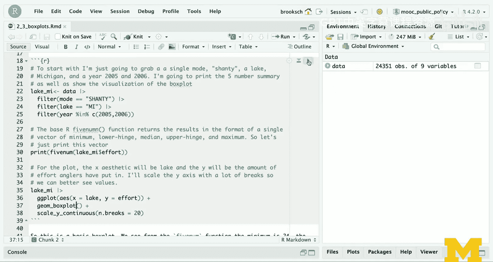
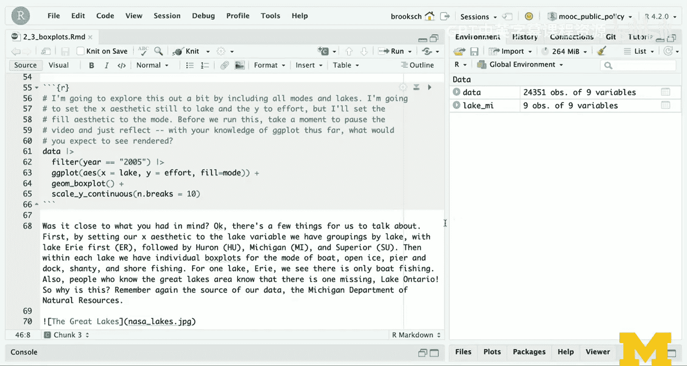

# 19：箱线图绘制与应用 📊


在本节课中，我们将学习一种经典的汇总统计与探索性数据分析技术——箱线图。我们将了解其构成、如何在R中绘制，以及如何解读其结果，为公共部门的决策提供支持。

上一节我们完成了数据格式化，本节中我们来看看如何使用箱线图来可视化数据的分布。

## 箱线图简介

箱线图的目标是通过可视化所谓的“五数概括”来总结数据的分布。这五个数包括：
*   **极值**：通常是数据的最小值和最大值。
*   **中心**：通常是数据的中位数。
*   **四分位数**：数据的第一和第三四分位数。


四分位数将数据大致分为四个大小相似的区间。第一和第三四分位数的标记（有时称为“铰链”）通过箱体部分，展示了数据的中间50%。通过箱线图，我们可以在一个相当紧凑的视觉呈现中了解数据的权重分布。

## 绘制基础箱线图

我们将像上次一样导入钓鱼数据。首先，我们选取单一模式（shanty，即冰钓小屋）和单一湖泊（密歇根湖），并限定在2005和2006年。我们将同时打印五数概括并展示箱线图的可视化结果。

以下是实现此操作的代码：

```r
# 过滤数据
lake_michigan_shanty <- data %>%
  filter(lake == "Michigan", mode == "shanty", year %in% c(2005, 2006))

# 计算并打印五数概括
five_num_summary <- fivenum(lake_michigan_shanty$effort)
print(five_num_summary)



# 绘制箱线图
ggplot(lake_michigan_shanty, aes(x = lake, y = effort)) +
  geom_boxplot() +
  scale_y_continuous(breaks = pretty_breaks(n = 10)) # 设置Y轴刻度以便更好地查看数值
```

`fivenum`函数以单个向量的形式返回结果，顺序为：最小值、下铰链（第一四分位数）、中位数、上铰链（第三四分位数）、最大值。绘图时，我们将`lake`映射到X轴，将钓鱼者投入的`effort`（努力小时数）映射到Y轴，并使用`geom_boxplot()`进行绘制。

## 解读箱线图结果

从`fivenum`函数的结果和生成的箱线图中，我们可以看到：
*   最小值为24小时。
*   下四分位数（箱体底部）约为1200小时。
*   中位数约为1300小时。
*   上四分位数（箱体顶部）约为42000小时。
*   最大值略低于60000小时。

这对于制定政策的自然资源部人员意味着什么？这意味着，在该湖泊某一年份的某个月份，从一个冰钓小屋记录的钓鱼努力小时数最低仅为24小时。但更重要的是，有50%的时间（即箱体覆盖的范围），努力小时数的区间实际上非常大，在13000到近60000小时之间。

箱线图的每个部分（有时称为“须”的线段和箱体本身）大致包含了25%的观测值。因此，箱线图让我们对观测值的分布和数据点的权重有了直观感受。


## 结合数据背景进行思考

然而，我们必须始终记住数据的性质。让我们看看数据中实际包含什么。

我们发现这些数据实际上相当稀疏，重要的是，**只有使用了冰钓小屋的月份才有记录**。如果我们使用数据透视表（pivot wider），会得到一个包含大量`NA`值的表格。原因在于，当湖面冰层不够厚时，无法进行冰钓。因此，夏季月份的出行次数、努力小时数和冰钓小屋使用数实际为0。

所以，我们从这个箱线图中得出的结论，实际上仅限于使用了冰钓小屋的月份。如果这与你的研究问题相符，那没有问题。我们还注意到，在2005年，只有一个县有冰钓小屋钓鱼记录。另一个县记录次数很少，这可能为利益相关者提供一些重要线索。

## 绘制分组箱线图

你可能已经猜到，我们不必一次只看一个箱线图。我们可以通过更改筛选条件和设置更多的美学映射来增加变量数量，从而进行更深入的探索。

接下来，我将通过包含所有模式和所有湖泊来扩展分析。我将X轴美学映射仍设置为`lake`，但将填充颜色`fill`美学映射设置为`mode`。在运行代码之前，请暂停视频，根据你目前对ggplot的了解，思考一下你期望看到什么样的图形。

```r
# 绘制分组箱线图：按湖泊分组，并按模式填充颜色
ggplot(data, aes(x = lake, y = effort, fill = mode)) +
  geom_boxplot()
```



## 解读分组箱线图

结果接近你的预期吗？有几点需要我们讨论：
1.  通过将X轴设置为`lake`变量，我们得到了按湖泊分组的箱线图，顺序为伊利湖（Erie）、休伦湖（Huron）、密歇根湖（Michigan）和苏必利尔湖（Superior）。
2.  在每个湖泊内部，我们有针对不同钓鱼模式（boat, open ice, pier and dock, shanty, shore）的独立箱线图。
3.  对于伊利湖，我们看到只有船钓（boat）模式。此外，熟悉五大湖区域的人会注意到缺少安大略湖（Ontario）。为什么？

**再次强调，请记住数据的来源**：密歇根州自然资源部。数据范围可能受管辖权或数据收集范围的限制。

---


本节课中我们一起学习了箱线图的原理与绘制方法。我们了解到箱线图通过五数概括（最小值、第一四分位数、中位数、第三四分位数、最大值）直观展示了数据的分布、中心趋势和离散程度。我们使用`ggplot2`的`geom_boxplot()`函数绘制了基础箱线图和分组箱线图，并强调了结合具体数据背景（如数据稀疏性、收集范围）进行解读的重要性。箱线图是探索数据分布、发现潜在模式并为公共政策讨论提供信息支持的强大工具。