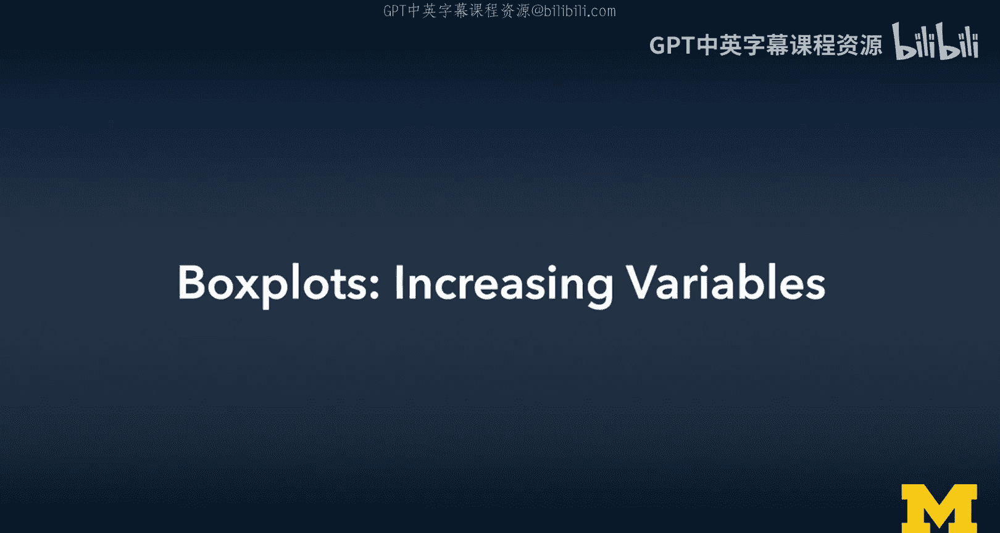
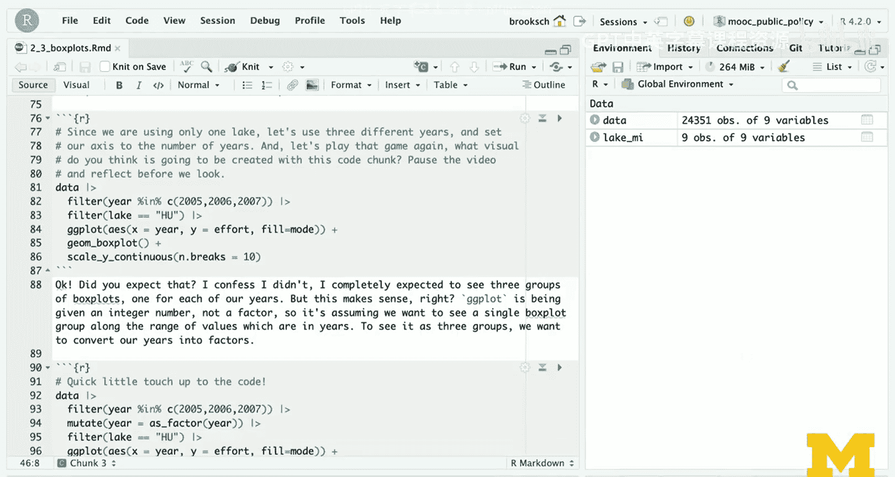
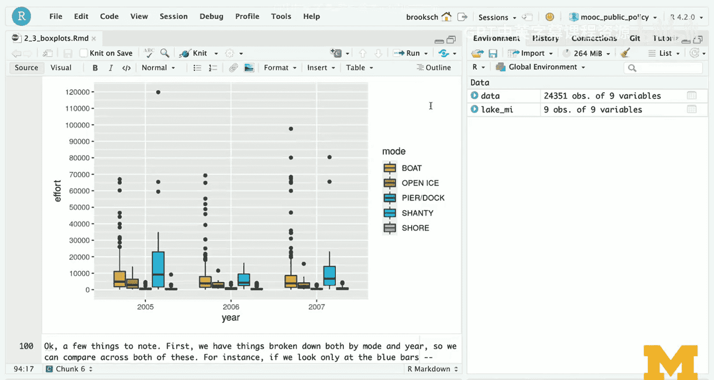
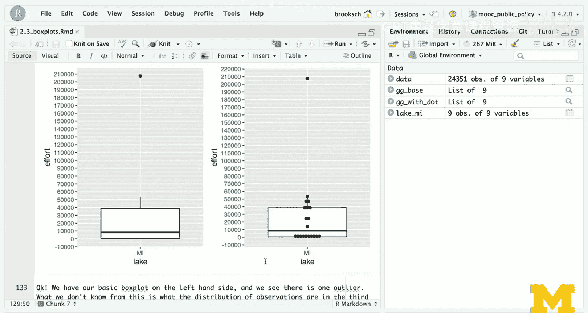

# 公共部门的R数据分析：20：多变量箱线图拓展



## 概述

在本节课中，我们将学习如何创建和解读多变量箱线图，并探索如何通过叠加点图来增强箱线图的可视化效果，从而更深入地理解数据的分布情况。

## 地理背景与数据来源

上一节我们介绍了箱线图的基础知识，本节中我们来看看如何将其应用于更复杂的多变量场景。首先，了解数据的地理背景至关重要。

密歇根州有时被称为“手套州”，因为它看起来像一只连指手套。该州包括被称为“上半岛”的北部地区。我们的数据集包含了除安大略湖以外的所有五大湖数据。这是因为密歇根州与加拿大的边境线穿过了这些湖泊，因此安大略湖不在数据集中。

伊利湖在数据集中的观测值很少，因为密歇根州与其接壤的部分非常小。上半岛与苏必利尔湖有很长的边境线，但由于该地区人口稀少，观测数量可能看起来不多。我们的数据主要来自密歇根州沿湖的县。

## 创建多变量箱线图

理解了数据背景后，我们开始创建可视化图表。假设我们只关注休伦湖的数据，并使用三个不同的年份。


以下是创建基础箱线图的代码：



```r
# 假设数据框为 `fishing_data`，包含变量 `year` 和 `hours`
ggplot(fishing_data, aes(x = year, y = hours)) +
  geom_boxplot()
```


运行此代码可能会产生一个沿连续年份范围显示的单组箱线图，而不是按年份分组的箱线图。这是因为`year`变量在代码中被视为整数，而非分类变量。

## 将数值变量转换为因子

为了按年份分组显示箱线图，我们需要将年份变量转换为因子。修改后的代码如下：

```r
ggplot(fishing_data, aes(x = as.factor(year), y = hours)) +
  geom_boxplot()
```



现在，图表将显示三个独立的箱线图组，每组对应一个年份。这允许我们比较不同年份间钓鱼小时数的分布。

## 解读多变量箱线图

通过这个图表，我们可以进行多种比较：
*   比较同一钓鱼模式（如“小棚屋”）在不同年份间的差异。
*   比较同一年份内不同钓鱼模式（如“小棚屋”与“船只”）的中位数和四分位距。
*   观察异常值，即远离数据主体分布的个别数据点。

在ggplot2中，异常值的判定基于**公式**：`Q1 - 1.5 * IQR` 和 `Q3 + 1.5 * IQR`。其中，`IQR`（四分位距）是 `Q3 - Q1`。箱须线延伸至此范围，之外的点被视为异常值并单独绘制。


## 叠加点图以增强可视化

当数据量较小时，箱线图可能无法充分展示数据点的实际分布。一种有效的改进方法是叠加点图。

点图将每个观测值显示为一个点。以下是创建叠加点图的代码示例：

```r
library(cowplot)

# 创建基础箱线图
p_box <- ggplot(fishing_data, aes(x = as.factor(year), y = hours)) +
  geom_boxplot()

# 创建叠加了点图的版本
p_dot <- p_box +
  geom_dotplot(binaxis = "y", stackdir = "center", dotsize = 0.5)



# 并排显示两个图表
plot_grid(p_box, p_dot, labels = c("A", "B"))
```

通过叠加点图，我们可以清晰地看到：
*   在某个四分位区间内，数据点是密集聚集还是分散分布。
*   有多少个数据点恰好位于边界值（如0值附近）。
*   异常值周围的数据分布情况。

这种方法能有效防止因数据量少而导致的视觉误导，让数据分布更加透明。

## 总结


本节课中我们一起学习了多变量箱线图的创建与解读。关键步骤包括将连续变量转换为因子以进行分组，以及通过叠加点图来丰富箱线图的信息，尤其是在处理小规模数据集时。这帮助我们更准确、更细致地理解变量在不同类别间的分布差异。