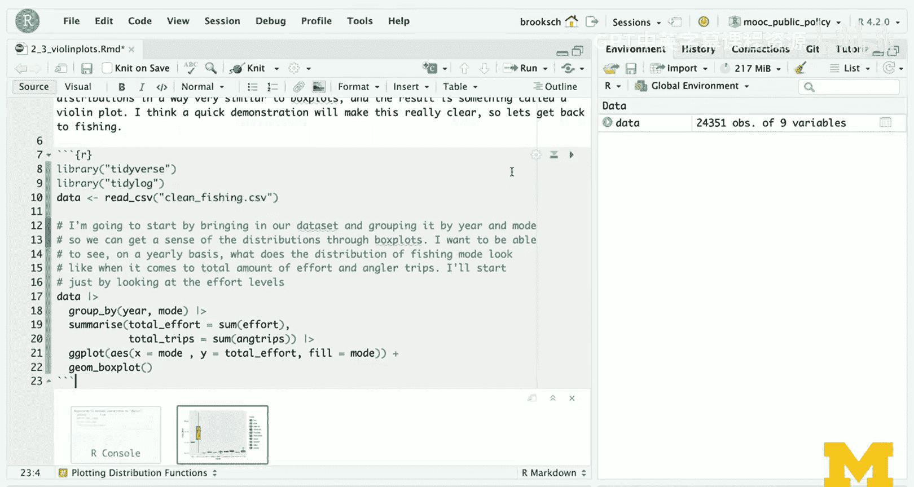
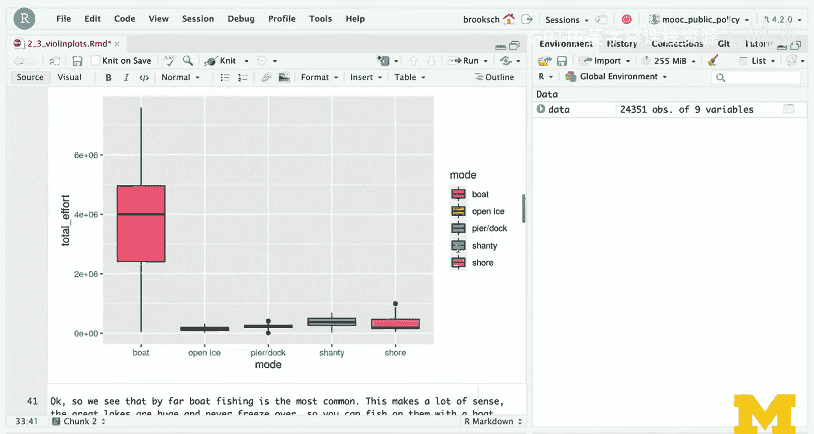
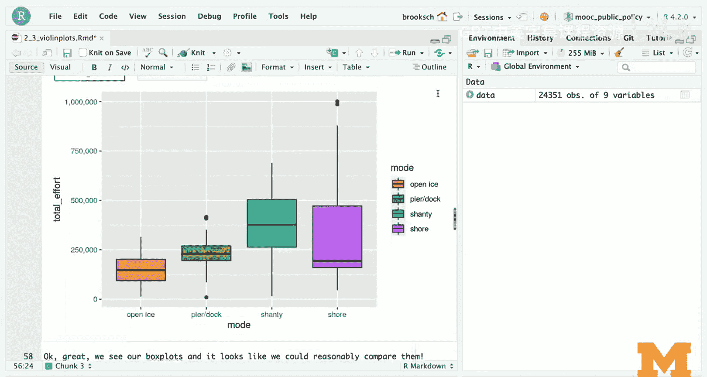
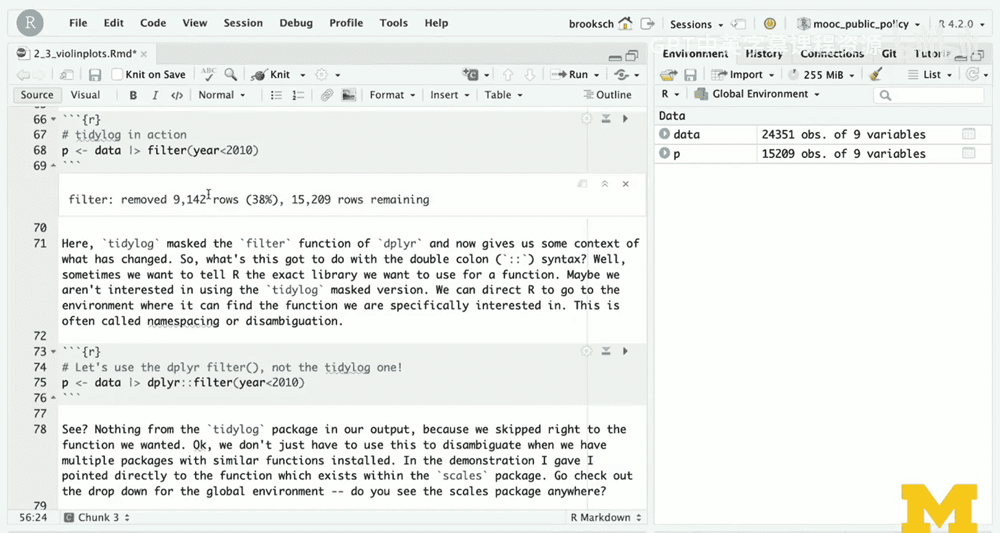
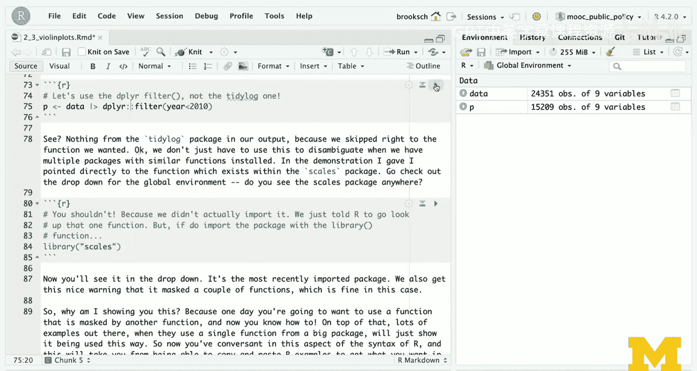
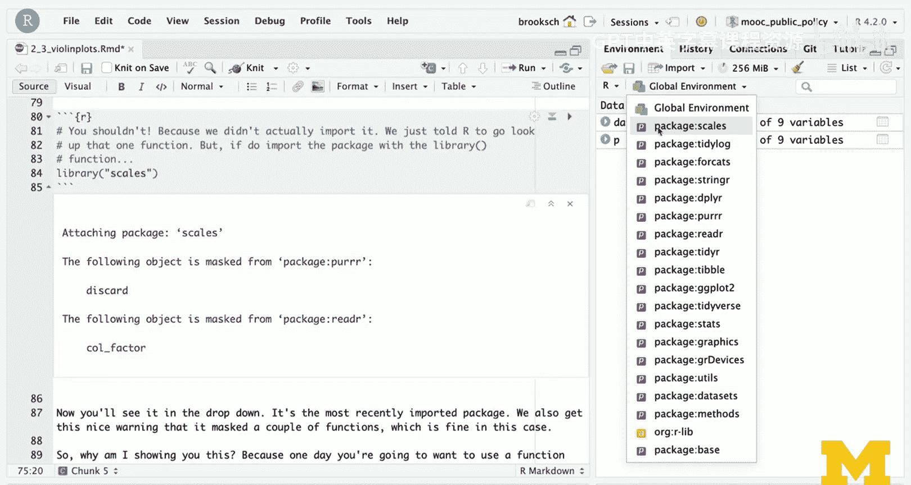
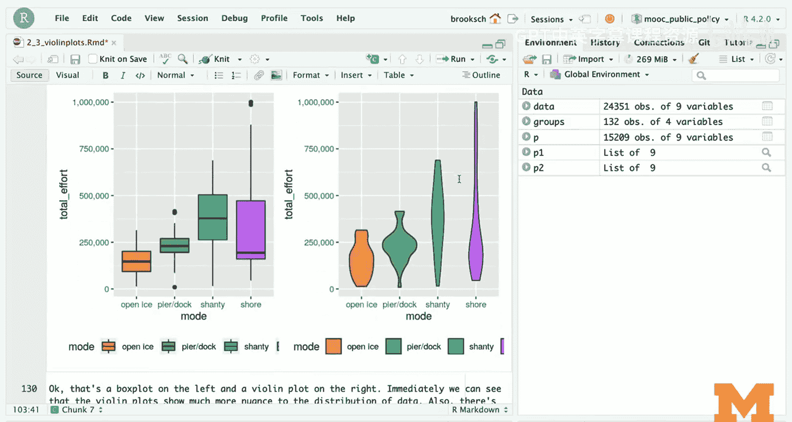
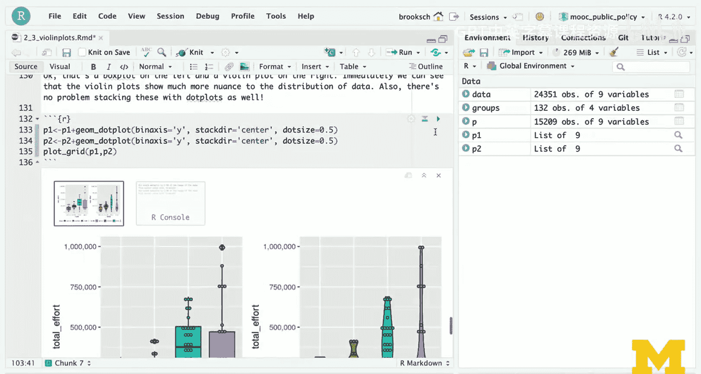

# 21：小提琴图绘制技术 🎻


在本节课中，我们将学习如何使用R语言中的`ggplot2`包来绘制小提琴图，这是一种用于比较多个数据分布的可视化技术。我们将从回顾箱线图开始，然后介绍如何创建和解读小提琴图，并探讨如何结合点图来增强可视化效果。

## 概述与数据准备




上一节我们介绍了如何使用箱线图来展示分布的摘要统计量。本节中，我们将学习一种更直观展示数据分布本身的方法——小提琴图。

首先，我们需要导入并准备数据。我们将使用一个关于钓鱼活动的数据集，目标是按年份和钓鱼模式查看总努力量和钓鱼者出行次数的分布情况。

```r
# 导入数据并分组
library(tidyverse)
# 假设数据已加载为 `fishing_data`
grouped_data <- fishing_data %>%
  group_by(year, mode) %>%
  summarise(total_effort = sum(effort),
            total_trips = sum(trips), .groups = 'drop')
```


在初步绘制箱线图时，我们发现“mode”列的数据格式不一致（例如全大写和首字母大写混用），这会影响分组和可视化。因此，我们需要先进行数据清洗。



## 数据清洗：字符串处理

以下是R中处理字符串的一些常用函数：
*   `nchar()`：计算字符串中的字符数。
*   `strsplit()`：根据特定值分割字符串。
*   `paste()` / `str_c()`：连接字符串。
*   `tolower()` / `toupper()`：将字符串转换为全小写或全大写。


对于本例，我们将“mode”列统一转换为小写：



```r
cleaned_data <- grouped_data %>%
  mutate(mode = tolower(mode))
```

清洗后，我们可以绘制箱线图。为了更清晰地比较非“boat”模式，我们将其过滤掉，并调整Y轴刻度标签的格式，使其更易读。

```r
filtered_data <- cleaned_data %>%
  filter(mode != "boat")

# 绘制箱线图
ggplot(filtered_data, aes(x = mode, y = total_effort)) +
  geom_boxplot() +
  scale_y_continuous(labels = scales::label_comma())
```

## R函数调用与命名空间


在调整Y轴标签时，我们使用了`scales::label_comma()`的语法。这引出了R中一个重要的概念：函数命名空间。

当使用`library()`加载包时，该包的函数会被放入一个独立的环境中。R在查找函数时，会从当前环境开始，按加载顺序搜索这些环境。如果多个包包含同名函数，先加载的包中的函数会“屏蔽”后加载的。






双冒号`::`运算符允许我们直接指定从哪个包中调用函数，这被称为命名空间解析或消歧义。例如：
*   `dplyr::filter()` 直接调用`dplyr`包中的`filter`函数，即使它被其他包（如`tidylog`）屏蔽了。
*   即使没有用`library(scales)`加载`scales`包，我们也可以使用`scales::label_comma()`来调用其函数。

了解这一点有助于你更精确地控制代码行为，并理解他人代码示例。


`scales`包是`ggplot2`的一个辅助包，专门用于以对人类友好的方式格式化坐标轴标签（如添加千分位逗号、显示百分比、调整日期格式等）。

## 创建与比较小提琴图

现在，让我们回到可视化本身，将箱线图与小提琴图进行比较。小提琴图旨在展示相同的信息——数据的分布和密度，但它不使用五数摘要，而是直接展示核密度估计。



以下是创建并排比较图的步骤：

```r
# 存储分组数据
plot_data <- filtered_data

# 创建箱线图
p1 <- ggplot(plot_data, aes(x = mode, y = total_effort)) +
  geom_boxplot() +
  scale_y_continuous(labels = label_comma()) + # 此时scales包已加载，可直接调用
  theme(legend.position = "bottom")


# 创建小提琴图
p2 <- ggplot(plot_data, aes(x = mode, y = total_effort)) +
  geom_violin() +
  scale_y_continuous(labels = label_comma()) +
  theme(legend.position = "bottom")



# 使用cowplot包并排显示
library(cowplot)
plot_grid(p1, p2, labels = c("Box Plot", "Violin Plot"))
```




通过对比可以立即看出，小提琴图能更细致地展示数据分布的形态。我们还可以轻松地在这些图形上叠加点图，以显示每个实际的数据点。

```r
# 创建带点图的小提琴图
ggplot(plot_data, aes(x = mode, y = total_effort)) +
  geom_violin() +
  geom_jitter(width = 0.2, alpha = 0.5) + # 添加点图，并设置轻微抖动和透明度
  scale_y_continuous(labels = label_comma())
```

## 总结

本节课中我们一起学习了小提琴图的绘制技术。我们首先回顾了箱线图，然后通过数据清洗实践了R的字符串处理函数。接着，我们深入了解了R的函数命名空间和`::`运算符的用途。最后，我们创建并比较了箱线图与小提琴图，并演示了如何叠加点图。


小提琴图是一种强大的可视化技术，用于比较一系列数据的分布。虽然箱线图仍被频繁使用，但小提琴图因其能捕捉数据分布的细微差别而日益流行。得益于`ggplot2`的分层图形语法，在其上叠加点图变得非常简单。当数据量较大时，点图的效用会降低，但在数据量较小的情况下，它能有效揭示箱线图或小提琴图可能掩盖的细节（例如，在某个具体值上是否真的存在观测点）。