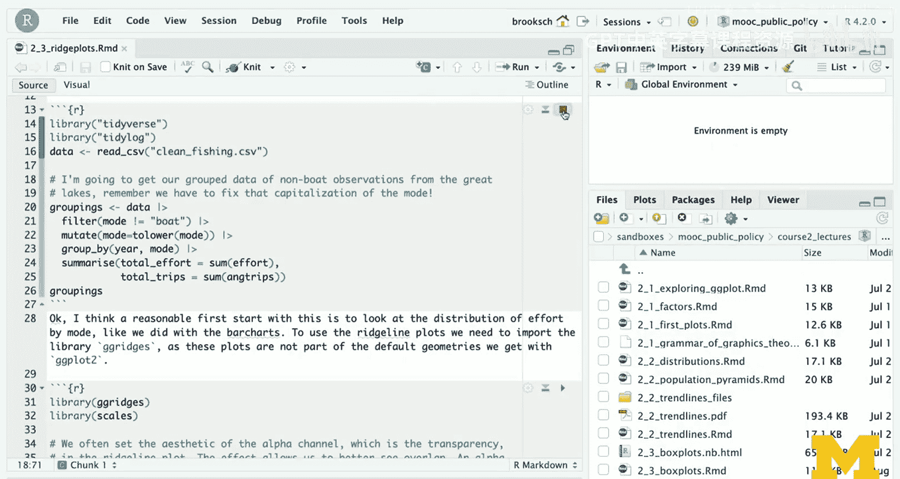
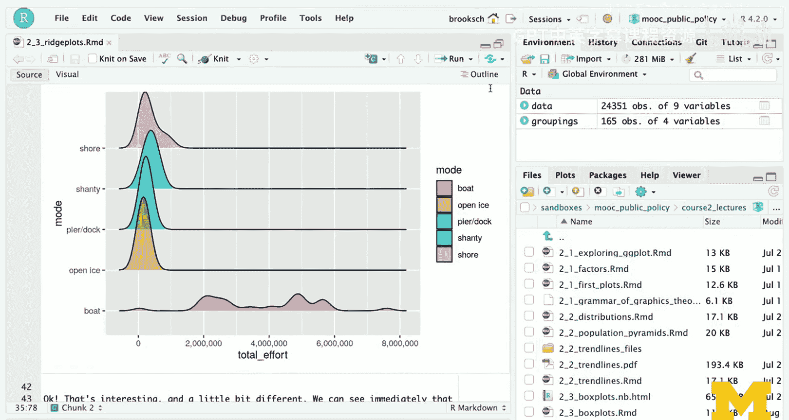
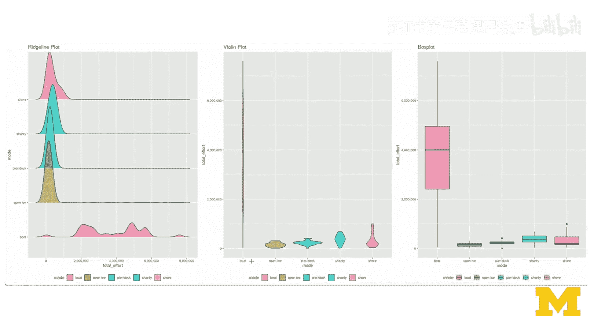

# 22：山脊图可视化方法 📊


在本节课中，我们将要学习一种名为山脊图（Ridge Plot）的数据分布可视化方法。这是一种比箱线图和小提琴图更紧凑的表示方式，特别适用于比较多个分布。

## 概述

上一节我们介绍了箱线图和小提琴图，它们都能帮助我们比较数据分布。本节中我们来看看一种更紧凑的表示方法——山脊图。它本质上是一系列垂直切割、挤压并翻转90度的小提琴图，结果形成类似山脊的系列，便于快速比较不同分布的差异。

## 山脊图简介


山脊图可以想象为一组被垂直切成两半、挤压在一起然后翻转90度的小提琴图。结果形成一系列“山脊”，每个山脊代表一个我们正在比较的项目，它们显示了重叠的分布函数。这使你能够快速了解哪些分布不同以及差异程度。



事实上，这种图表类型并不新鲜。最早的例子之一可以追溯到1805年，出现在威廉·普莱费尔（William Playfair）的著作《强大富裕国家衰落的永久原因探究》中。该书包含许多精心绘制的图表，包括堆叠折线图和各国财富随时间变化的图像。每个国家在视觉上占据单独一行，很容易在任何时间点与其他国家进行比较。

虽然这个视觉图没有显示重叠的山脊，更接近于我们下周将讨论的“小倍数”技术，但它非常接近现代山脊图的外观。

## 在R中创建山脊图




现在，让我们看看如何在R中实现山脊图。

首先，我们需要加载必要的库并准备数据。以下是操作步骤：

1.  **加载库与数据**：我们将导入`tidyverse`和`tidylog`，并获取五大湖的非船只观测数据组。需要记住修正`mode`列的大小写问题。
    ```r
    library(tidyverse)
    library(tidylog)
    # 假设 fishing_data 是您的数据集
    group_data <- fishing_data %>%
      filter(location == "Great Lakes", mode != "boat") %>%
      mutate(mode = str_to_title(mode)) # 修正大小写
    ```

2.  **加载山脊图专用库**：山脊图不是`ggplot2`默认的几何图形，因此需要导入`ggridges`库。我们通常还会导入`scales`库来辅助调整。
    ```r
    library(ggridges)
    library(scales)
    ```

3.  **设置透明度**：在山脊图中，我们经常设置alpha通道（即透明度）的美学属性，以便更好地观察分布的重叠部分。`alpha = 0.5`表示50%透明度，`alpha = 1`表示100%不透明。这个参数可以用于多种可视化图形。
    ```r
    # 基础山脊图代码框架
    ggplot(group_data, aes(x = effort, y = mode, fill = mode)) +
      geom_density_ridges(alpha = 0.6) # 设置填充透明度
    ```

运行上述代码后，我们可以立即观察到，除了船只（boat）分布外，其他所有分布看起来都相似。海岸线（shoreline）分布在一侧尾部有一个小凸起，但除此之外，这些分布都围绕峰值相对对称。寻找分布特征进行分类，然后应用适当的统计检验，是统计学家的常见活动，你可以看到如何辅助这些工作。

正如我们之前所见，船只的分布确实不同，在200万和500万小时标记附近有一些质量块。

## 综合比较：山脊图、小提琴图与箱线图

现在是将我们刚看到的三种技术（箱线图、小提琴图、山脊图）用`cowplot`库组合起来进行比较的好时机。在尝试之前，我们先介绍一些代码块（chunk）参数。


代码块的第一行告诉R Markdown我们正在使用R，然后可以传入各种参数。参数本身来自`knitr`包。例如，我们可以关闭警告、错误和信息消息（通常不建议，但在为他人创建文档且已理解所有警告时可以这样做），并设置图形尺寸。

以下是创建组合图的步骤概述：

1.  **设置代码块参数**：例如，设置图形宽度为12英寸，高度为5英寸，并关闭消息。
    ````markdown
    ```{r fig.width=12, fig.height=5, message=FALSE, warning=FALSE}
    # 你的R代码在这里
    ```
    ````

2.  **创建三个图形对象**：
    *   **山脊图**：使用`geom_density_ridges`。
    *   **小提琴图**：使用`geom_violin`。注意，山脊图和小提琴图的x轴和y轴映射是互换的。
    *   **箱线图**：使用`geom_boxplot`。



3.  **使用cowplot组合**：使用`plot_grid()`函数将三个图并排排列。

关于这三种方法，我们可以做一些观察：
*   **山脊图**：允许我们看到数据的密度函数。它比箱线图信息量更大，因为我们可以看到平均值（约400万小时）附近的值实际上很少。
*   **小提琴图**：当绘图区域变小时，水平空间非常有限，可能变得不太有用。
*   **箱线图**：当图形尺寸变小时，由于所有硬线条的存在，变得极难阅读。除了知道均值与“chore”或“shanty”不同之外，我们很难说出更多信息。

小提琴图和山脊图都能清楚地显示两者之间的分布差异，但方式略有不同。山脊图由于重叠特性提供的额外垂直空间，使我们能比小提琴图更清楚地看到分布形状。

## 总结

本节课中我们一起学习了如何使用`ggplot2`探索数据分布的旅程。您看到了许多不同且互有重叠的技术：
*   用于分箱连续值的**直方图**。
*   用于基于直方图估计函数的**核密度估计**。
*   用于可视化变量五数概括的**箱线图**。
*   允许我们查看多个变量分布函数的**小提琴图**和查看个体观测值的**点图**。
*   以及本节课重点介绍的**山脊图**，它在紧凑的可视化中比较分布时特别有用。


通过掌握这些工具，您可以更有效地探索和理解数据，为公共部门的决策提供更深入的支持。