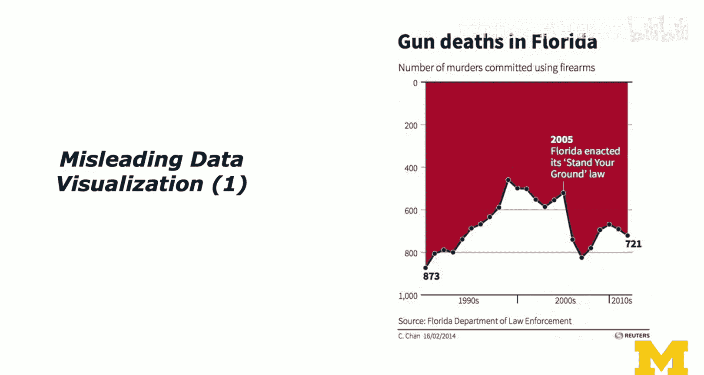
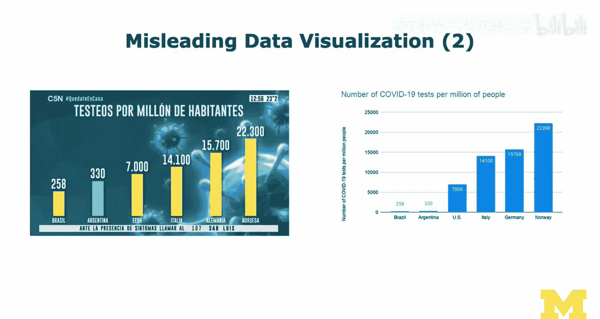
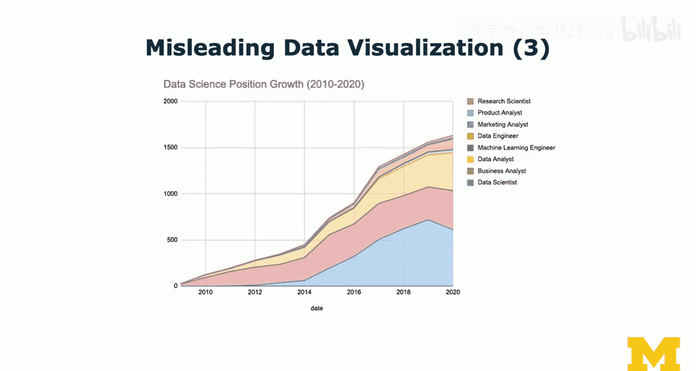
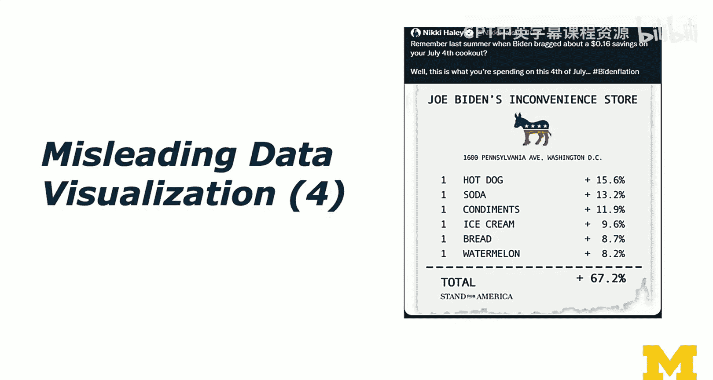

# 公共部门R数据分析：23：警惕误导性数据可视化 📊

在本节课中，我们将探讨数据可视化在公共部门中的重要性，以及如何识别和避免常见的误导性图表。数据是强大的工具，但若使用不当，也可能传递错误信息，甚至被用于支持有问题的政策或观点。

上一节我们介绍了数据可视化在决策支持中的作用，本节中我们来看看数据可视化如何被误用，以及我们应如何保持警惕。

## 概述

数据在公共部门中扮演着至关重要的角色，被用于支持关键职能和决策。然而，这也意味着数据可能被以强有力的方式误用。公共部门中常常存在压力，促使人们以误导性的方式使用和呈现数据，有时是细微的，有时则是蓄意且显著的。本节课将通过几个具体案例，展示误导性数据可视化的常见形式及其潜在危害。

## 案例分析

以下是几个被公认为具有误导性的数据可视化案例。我们无法仅从图表本身判断其设计是否蓄意误导，但可以清楚地看到其结果所产生的问题。

### 案例一：佛罗里达州枪支谋杀案趋势图

第一张是臭名昭著的图表，显示了佛罗里达州涉及枪支的谋杀案数量随时间的变化，涵盖了2005年一项名为“不退让法”的新法律颁布前后的时期。

该法律允许佛罗里达州公民在感到生命或身体受到严重威胁时，可以使用枪支进行反击而免于起诉。一些团体担心这项政策实际上会增加枪支造成的伤亡。

如果你快速浏览这张图表，看起来佛罗里达州的枪支死亡人数在2005年新法律生效后有所下降——趋势线在1990年上升后，在此时开始下降并趋于平稳。

然而，如果你仔细观察Y轴，会发现Y轴上的数字是向下递减的。这很奇怪，对吗？坐标轴底部起点是1000，数值随着向上移动而变小。

因此，对这张图的正确解读实际上与你第一眼看到的相反：佛罗里达州的枪支死亡人数在“不退让法”生效后确实增加了。

这张图表的设计者是否试图混淆或误导我们？这一点并不明确。有一种说法是，他们并非试图误导：如果你注意到，他们选择用红色作为图表中趋势线上方的背景色，或许是为了表明政策变化后流了更多的血。你怎么看？

由此得出的一个要点是：如果你试图在可视化中做一些非典型或非标准的创意设计，最好先与你的目标受众一起研讨和测试草稿。无论这张图表设计者的意图如何，公众的强烈抗议是合理的，大多数人认为它是有意误导，并是在支持一项有问题的政策时对数据可视化的滥用。

### 案例二：阿根廷政府新冠疫情检测率对比图

下一张图表也受到了公众的严厉评判。左侧图表显示了疫情早期，少数几个国家每百万人口中进行的COVID-19检测数量。

图表显示阿根廷在某个时间点略微落后于其他一些国家。你应该知道，这张图表是由阿根廷政府制作的。

如果你仔细观察，图表上每个条形的高度与实际检测数量关系不大。实际上，这张图上没有带数字的Y轴。因此，虽然图表显示了各国检测率的一些差异，但并未显示检测率的绝对差异。

当像右侧图表那样呈现数据时，你会注意到阿根廷当时的检测率远低于对比国家。

因此，这属于试图淡化问题严重性的可视化类别。这张数据可视化似乎在说：是的，阿根廷落后于其他国家，但差距并不大。而实际上，问题要严重得多。

### 案例三：数据科学工作岗位增长图

下一张图表显示了2010年至2020年间不同类型数据科学工作岗位的增长情况。

乍一看，图表似乎表明数据科学工作及其多个子类别的数量在时间序列末期（即2020年）趋于平稳或下降。然而，这张图表也存在一些问题。

首先，这个恼人的Y轴经常带来很多问题，而在这里它没有标签。那么这张图到底显示的是什么？结果发现，这里绘制的是工作岗位增长的百分比增长率，而不是实际的工作岗位数量、面试数量或此类劳动力分析中使用的其他指标。

因此，是某些类型的数据分析和数据科学工作岗位的**增长率**放缓了，而不是实际的工作岗位数量。此外，这张图表没有告诉我们数据来源，或者衡量工作岗位增长的主要指标是如何测量的。

遗憾的是，我们很难解读这张图表并得出任何结论。我们从其他信息中得知，该图表的数据实际上来自某种网络调查。但媒体获取了这张图表并广泛传播，讲述了一个关于新冠疫情在2020年减少了数据科学和数据分析领域工作岗位的故事。

你会很高兴知道，更好的数据表明，虽然该领域的增长率确实有所放缓，但这仍然是一个在全球范围内（包括公共和私营部门）不断增长的领域。

### 案例四：美国独立日购物清单通胀图

最后是2022年夏天在美国发生的一件事。妮基·黑利是南卡罗来纳州前州长兼美国前驻联合国大使。她在7月4日（美国独立日）前发布了这张名为“乔·拜登的不便商店”的收据图片。

这张收据显示了一系列美国人通常在独立日庆祝野餐中购买的产品的价格以及过去一年的通胀百分比。根据这张收据，热狗的价格自去年夏天以来上涨了15.6%，苏打水上涨了13.2%，冰淇淋上涨了9.6%，等等。收据暗示，对于列出的6件商品，总通胀率为67.25%，意味着今年的独立日庆祝活动由于通胀，成本比去年高出67%以上。推文写道：“谢谢你，拜登总统。”

当然，这里有一个非常基本的数学错误。他们没有计算收据上列出的六种产品的平均通胀率，而是将通胀百分比简单相加。这当然是一个非常基本的数学错误，看起来像是故意的。一位受过教育的政治家怎么会犯如此基本且具有误导性的错误？

这张图片在社交媒体上发布后，立即遭到了强烈反对，人们称其有意误导、不道德等等。在公众压力下，妮基·黑利的公关团队让她的工作人员背了黑锅。他们的声明是：“这是一个工作人员的错误，本不应发布。我们意识到了计算错误，并立即删除了图片。”

因此，这里的最后一个教训是：如果你曾经被迫创建误导性图表，首先，尽量不要这样做（我们将在第4课中更多地讨论如何抵制并拒绝制作你认为具有误导性或不道德的作品）。其次，如果你最终按照他人的命令或授权制作了误导性数据可视化，请准备好最终承担指责，如果面临公众审查或被指控歪曲事实的话。

## 总结

本节课中我们一起学习了几个误导性数据可视化的典型案例。我们看到了Y轴刻度误导、缺少关键坐标轴标签、错误的数据呈现方式（如用增长率代替实际数量）以及基本的计算错误如何扭曲事实、误导公众。这些案例提醒我们，在创建和解读数据可视化时，必须保持批判性思维，仔细检查图表的设计和数据的呈现方式，确保信息的准确性和完整性。在公共部门，秉持诚信和透明地进行数据沟通至关重要。