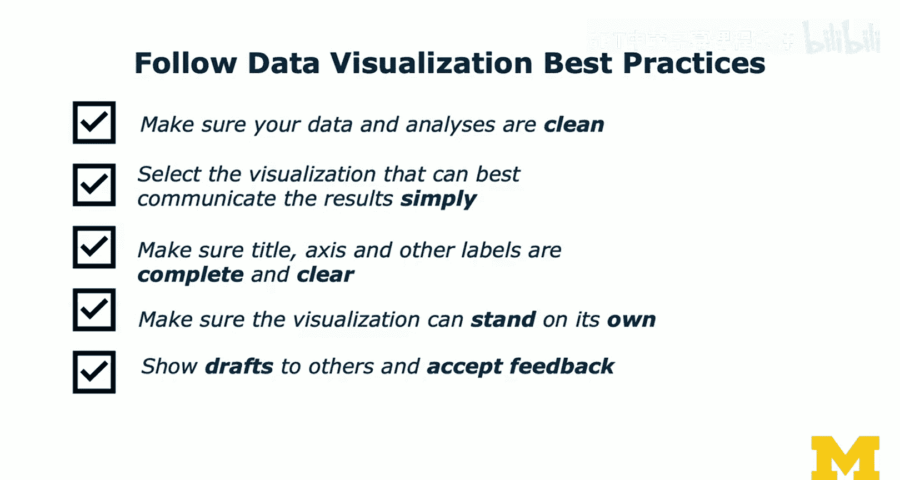
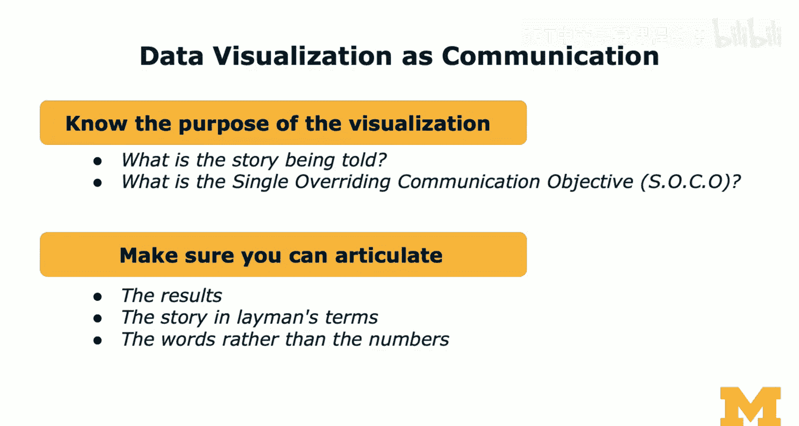
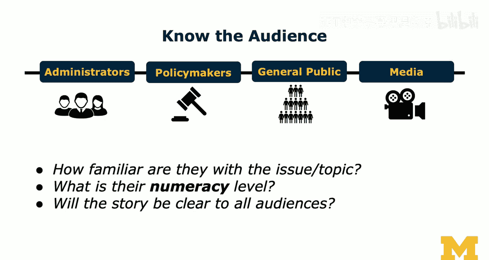
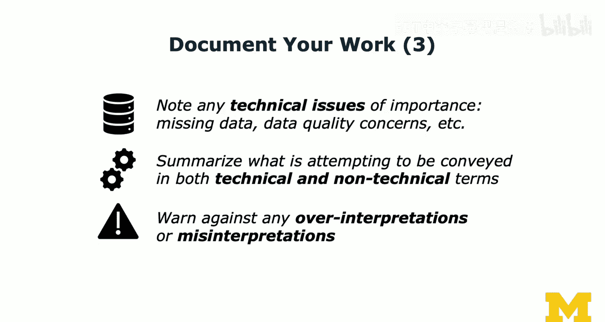
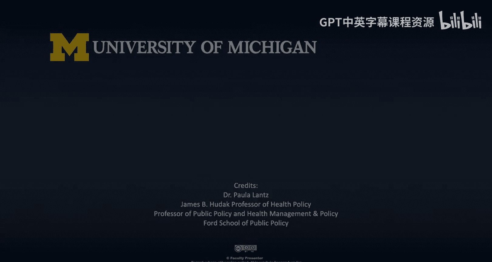

# 24：数据分析师沟通准则 📊

在本节课中，我们将学习数据分析师在沟通工作成果时应遵循的最佳实践准则，特别是关于数据可视化的创建与呈现。我们将探讨如何确保可视化清晰有效，以及如何为不同受众准备和记录你的工作。

---

你已经学习了许多关于探索性数据分析的最佳实践，以及在公共部门背景下多种不同类型的数据可视化方法。

上一节我们介绍了数据分析的基础，本节中我们来看看如何有效地沟通你的分析成果。首先，让我们回顾一些数据可视化的核心最佳实践。

以下是创建有效数据可视化的关键步骤：

1.  **确保数据质量与分析方法的恰当性**：在开始可视化之前，必须保证数据是高质量且干净的。同时，所选择的分析方法必须适合数据所要回答的问题。公式可以表示为：`有效可视化 = 高质量数据 + 恰当的分析方法`。
2.  **选择最清晰、最简单的可视化形式**：选择最能清晰、简洁地传达结果的可视化类型。虽然创建复杂花哨的图表更有趣，但“少即是多”通常是公共部门工作的最佳方法。图表越不复杂，其影响力往往越大。
3.  **确保所有标签清晰易懂**：确保图表的标题、坐标轴标签以及其他所有标签都清晰且易于理解。
4.  **确保可视化能够独立传达信息**：你的图表应该能够独立存在，目标受众无需他人额外解释或提供补充信息就能理解和解读。
5.  **通过草稿与反馈进行迭代**：为了确保可视化达到所有目标，应创建草稿并与他人分享以获取反馈。重要的是，要倾听这些反馈并进行必要的调整。数据可视化的根本目的是向受众传达信息。

---

了解了创建可视化的基本原则后，我们接下来看看如何将数据可视化作为一种沟通工具和策略来使用。

以下是将数据可视化作为沟通策略的实践要点：

1.  **明确可视化的目的**：在制作图表前，你需要知道它的目的。你要讲述什么故事？这里引入一个新的缩写：**SOCO**，即 **单一首要沟通目标**。对于你创建的每个图表，你都应该能回答这个问题：它的SOCO是什么？重点是什么？沟通目标是什么？
2.  **能用通俗语言阐述故事**：作为设计者，你必须能够用通俗的语言（而不仅仅是数字）来阐述故事或沟通目标，谈论你所展示的结果。
3.  **深入了解你的受众**：要成为良好的沟通者，必须了解你的受众。在创建可视化之前，你需要知道受众是谁。是行政人员、内部文件，还是媒体和公众？是立法者吗？受众对该主题以及数字（如百分比、比率、增长趋势等）的理解程度如何？代码层面可以体现为在规划时考虑 `audience_knowledge_level` 这个变量。
4.  **考虑多受众的理解能力**：如果一个可视化面向多个受众（这很常见），他们是否都能理解同一个图表？

---

我的最后一条建议是：始终为你制作的任何数据可视化做好背后的工作记录。

尽管如前所述，你的可视化应该能够在没有额外信息的情况下，独立面向不同受众。但你仍然需要为你创建的每个可视化准备笔记和完整的文档。

试想，如果你的老板或其他人需要解释或为你制作的数据可视化辩护，他们是否了解创建过程中的所有细节？他们能回答问题吗？

你的文档应包括以下内容：

*   **数据来源与时间范围**：记录使用的数据源及数据覆盖的时间段。
*   **数据质量与问题说明**：注明你对数据质量、覆盖范围乃至数据缺失问题的任何担忧。
*   **重要测量问题**：记录图表中变量或项目的测量方式。这包括任何比率的计算方式（比率总是有分子和分母，例如 `rate = numerator / denominator`）。如果你使用了复合指标（如基尼指数、社会脆弱性指数、政府信任度全球指标等），必须记录其构成要素和最终计算方法。
*   **重申沟通目标**：用技术和通俗两种语言，再次总结主要的沟通目标（即你的SOCO）。
*   **预警可能的误读**：在你的笔记中，提醒他人注意你对数据可视化可能存在的过度解读或误解的担忧。

---

本节课中我们一起学习了数据分析师在沟通，特别是通过数据可视化进行沟通时应遵循的核心准则。我们回顾了创建清晰有效图表的最佳实践，探讨了以SOCO为核心的沟通策略，并强调了深入了解受众和进行详尽文档记录的重要性。遵循这些原则将帮助你在公共部门的工作中更专业、更有效地传达数据洞察。