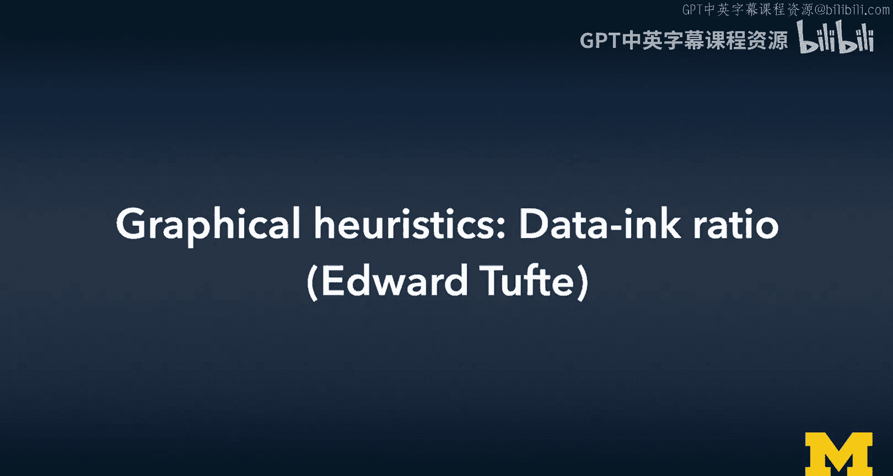
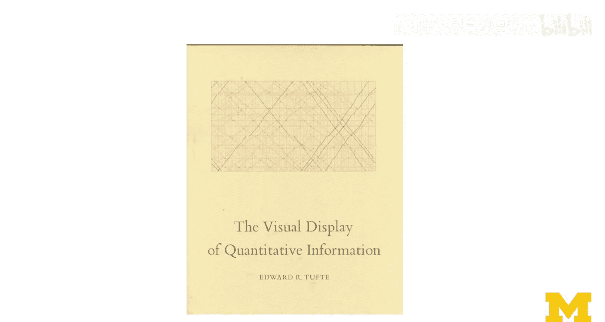
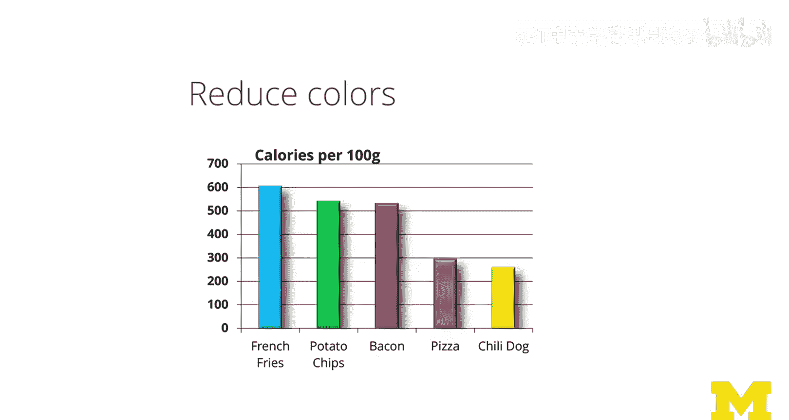
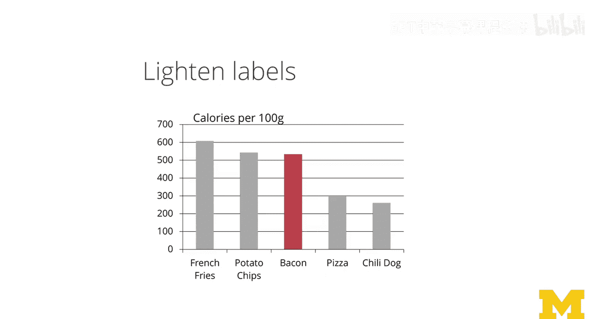
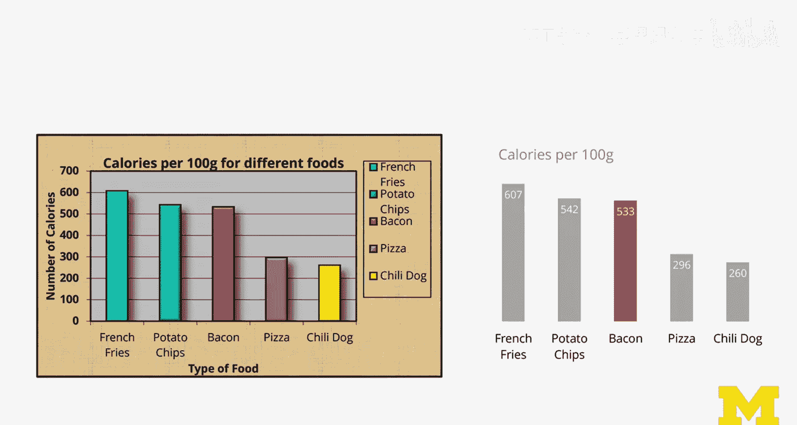

# 公共部门的R数据分析：26：图形启发式：数据墨水比（Edward Tufte理论）📊

在本节课中，我们将学习Edward Tufte提出的一个重要图形设计启发式——数据墨水比。我们将了解其定义、核心思想，并通过一个具体示例来掌握如何应用这一原则来优化图表，使其更清晰、更有效地传达信息。

Edward Tufte是定量信息可视化设计领域的开创性人物。他撰写了一本名为《定量信息的视觉展示》的著作，这本书非常值得推荐。

在这本书中，他介绍了两个有趣的图形启发式：数据墨水比和图表垃圾。

首先，什么是启发式？启发式是一种旨在指导决策的过程或规则。它本质上并非最优或完美，但非常实用。在你有理由偏离它们之前，启发式是值得遵循的。

Tufte提出的第一个图形启发式是数据墨水比。Tufte将数据墨水定义为一个图形的不可擦除的核心，即那些为响应所代表数字的变化而排列的、非冗余的墨水。换句话说，数据墨水是理解给定变量所必需的部分。

Tufte将数据墨水比定义为数据墨水量除以打印该图形所需的总墨水量。他并非建议我们实际测量页面上的墨水量，而是建议我们移除那些没有为图表增添新信息的元素。

展示如何提高数据墨水比最著名的例子之一，来自加拿大阿尔伯塔省埃德蒙顿市的信息可视化与设计公司Darkhorse Analytics。

他们整理了四个示例来展示如何提升数据墨水比。我们将在下一个阅读任务中提供链接，但这里我们先详细讲解第一个示例。

以下是优化图表、提升数据墨水比的具体步骤：

我们从一个关于食品及其卡路里含量的数据表格开始。

第一步是移除无用的背景图像，因为它对理解图表毫无价值。

我们同时移除了条形图后面的灰色背景，因为它没有提供任何概念上的价值。

接着，我们消除整个图表中的冗余信息。这包括移除图例，因为每个条形图都可以直接在坐标轴上标注。

标题和Y轴标签也被精简，因为整个图像中有足够的线索表明这是关于食品卡路里的图表。

这样我们就得到了一个更简洁的图像。但还有一些构成边框的粗线，它们同样没有价值，因此也可以移除。

在图表中使用颜色是一个需要谨慎处理的问题。我们将在本课程中深入探讨色彩理论。但对于色觉缺陷或色盲人士来说，颜色可能带来挑战。有一些应对策略，例如，过去的最佳实践是用图案（在图形中有时称为“影线”）来替代颜色。但这本身也会带来新的挑战，我们稍后会看到。

因此，解决方案几乎总是移除所有颜色，只保留一种用于强调，并在文本中明确引用这种颜色。这样，即使有人脱离上下文查看图表，也能感受到重点，而不会被数据的“彩虹”所淹没。

所以，让我们移除除培根（假设文本中明确引用了此数据）之外的所有颜色。

三维条形图和投影也可以去掉，因为它们没有增加额外价值。我们还可以去掉整个图表的描边。

图像中仍然保留了很多网格线，但不太清楚这些网格线的价值是什么，所以我们决定移除它们。网格线有时是有价值的，但它们常常只是一种干扰。

现在，请研究一下图像：我们感兴趣的数据点培根，与薯片或辣热狗之间的卡路里数量差异是多少？

仅仅移除线条并没有让图表更容易阅读。

但由于这里的数据值相当简单，让我们直接在图形中为每个条形图添加标签。

现在，培根和薯片，或者培根和辣热狗之间的差异有多大？你当然需要做一些计算，但通过直接比较数字，你仍然可以快速估算出精确值。

就这样，通过提高数据墨水比，我们不仅使图形更简洁、更易读，还增加了观众看到的信息量。

我们鼓励你查看下一个阅读材料中链接的Darkhorse Analytics的其他示例，因为他们为包括地图在内的各种不同视觉图形进行了这种清理工作。

在下一讲中，我们将通过探讨图表垃圾来继续学习Tufte的启发式原则。

本节课中，我们一起学习了Edward Tufte的数据墨水比原则。我们理解了其核心是最大化图表中用于传达核心数据的“墨水”比例，并移除所有冗余和非信息性元素。通过一个从复杂条形图逐步简化为清晰直接标签图的示例，我们掌握了应用这一原则的具体步骤，从而创造出信息更密集、更易于理解的视觉展示。