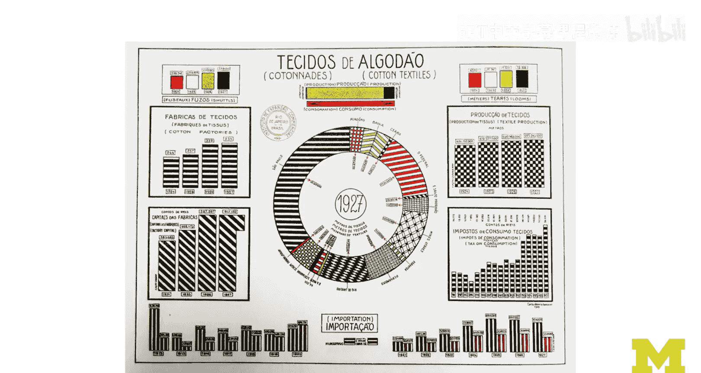
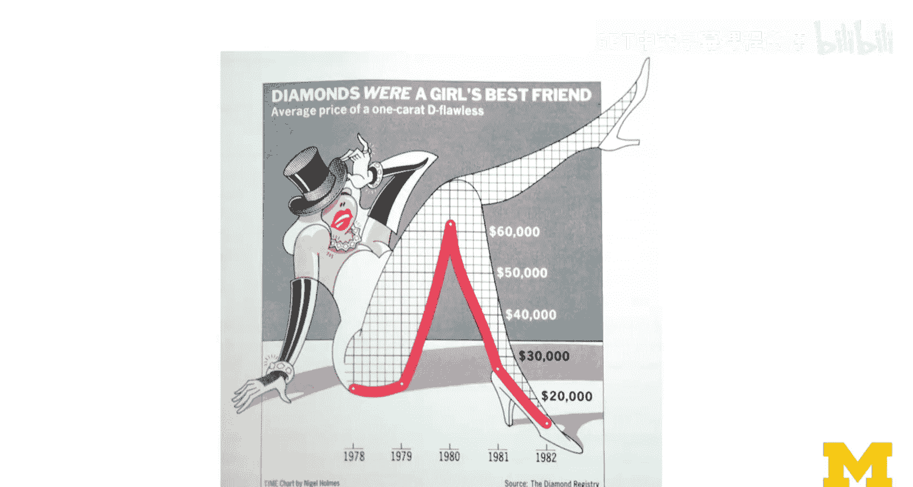

# 27：图形启发式：冗余图表元素（Edward Tufte理论）📊

在本节课中，我们将要学习Edward Tufte提出的一个重要概念——“图表垃圾”。我们将了解它的定义、三种主要类型，并通过一个用户研究案例，探讨装饰性图表元素的实际效果。

## 概述

Edward Tufte引入的另一个启发式概念被称为“图表垃圾”。Tufte对图表垃圾的批评远甚于其他形式的非数据墨水。他认为，统计图表上的艺术装饰就像数据图形中的杂草。

## 图表垃圾的三种类型

Tufte指出，图表垃圾主要有三种类型。

以下是第一种类型：**无意的视觉艺术**。

*   例如，对图表特征进行过度的阴影或图案填充。
*   正如Tufte在其著作《量化信息的视觉展示》中分享的经济学图表所示，这些图案会导致人眼跳动并引起视觉疲劳。
*   这种现象被称为“莫尔条纹”，这也是为什么在拍摄像本慕课这样的视频内容时，通常不会看到人们穿条纹衬衫的原因，因为视频的低分辨率会加剧莫尔条纹问题。
*   Tufte建议，与其用图案填充内容，不如直接在图表图形上添加标签。我们在Dark Horse Analytics的“数据与图形”示例中看到了这种做法的应用。

上一节我们介绍了无意的视觉艺术，本节中我们来看看第二种类型：**网格线**。

*   Tufte认为，网格线作为数据墨水是不必要的，并且会与所分享的实际数据形成竞争。
*   淡化、移除或降低网格线的饱和度，可以让人更容易看清数据，而不会被页面上的大量线条所淹没。
*   直接标注数据是减少这种图表垃圾的另一个好方法。

在了解了前两种类型后，第三种图表垃圾是我们讨论的重点，它通常也是人们提到“图表垃圾”时首先想到的。Tufte称之为“鸭子”。

*   广义上，他指的是非创造性的图形，无论是线条艺术还是照片，以及它们在图表中的包含。
*   报纸和杂志是经常使用这类图像的地方。
*   一位知名的图形艺术家Nigel Holmes，曾用“鸭子”以一种令人难忘且具有美学趣味的方式展示数据。
*   他创作的最令人难忘的图像之一名为《钻石是女孩最好的朋友》，于1982年出现在《时代》杂志上。
*   该图表显示了1978年至1982年钻石价格的趋势。虽然具体的美元金额很容易被遗忘，但由于女性腿部线条的形状，人们很容易记住趋势曾出现过一个峰值。

## 关于“鸭子”的用户研究

那么，“鸭子”真的是一种有用的启发式方法吗？还是说只是“鸭子”本身令人难忘？

我曾是Scott Bateman领导的一个团队的一员，我们希望更详细地理解这个问题，因此我们进行了一些用户测试。本周的阅读材料中链接了完整的学术论文。

简而言之，我们向参与者提供了各种Holmes的图像（包括刚才展示的那张，可被视为图表垃圾），以及一系列具有高数据墨水比例、没有装饰性修饰的普通图表。

我们将24名受试者带入实验室，并分配他们查看Holmes的图表或高数据墨水比例的图表。

我们要求受试者通过一系列引导性问题来描述和总结这些图表。

随后进行了回忆测试，包括立即进行的测试，以及两到三周后的第二次测试。最后，我们使用眼动追踪来确定受试者在查看这些图表时的注意力所在。

我们的发现很有趣：虽然在立即测试时没有回忆差异，但在两到三周后，对于展示“鸭子”类图表垃圾的Holmes图表的回忆明显更好。

此外，受试者主观上表示Holmes图表更令人愉快、更有吸引力、更容易记住且更容易记住细节。他们认为描述和记忆Holmes图表的速度更快。非装饰性设计在任何方面都没有比Holmes的设计表现得更好。

## 总结与思考

本节课中我们一起学习了Edward Tufte的“图表垃圾”理论。我们探讨了它的三种类型：无意的视觉艺术、冗余的网格线以及装饰性的“鸭子”图形。通过一个用户研究案例，我们发现装饰性图表在长期记忆和主观体验上可能具有优势。

这是否意味着你应该在图表中使用装饰性元素呢？也许吧。我不知道是否有人在更大、更多样化的人群中复制了我们的发现。当然，还有其他类型的图表垃圾，比如无意的视觉艺术和网格线，这些似乎是非常好的启发式原则。但我认为这个故事还有更多内容有待讲述，更多细微差别有待厘清。

至此，你应该至少对来自设计师的观点，以及针对特定类型图表的用户研究有了一些思考。在你创建数据科学图形时，值得反思的不仅是你所使用的原则和你所分享的结果，还包括你构思和创建图形的过程。

如今，借助Crowdflower和Amazon Mechanical Turk等众包服务，设置用户研究要简单得多。对于普通的数据科学家来说，测试更具装饰性的视觉设计是否可能更有效（无论是在时间、记忆性还是准确性方面），已经变得非常可行。

在下一讲中，我们将继续探讨Tufte提出的另外两个概念：数据墨水比率和火花图。