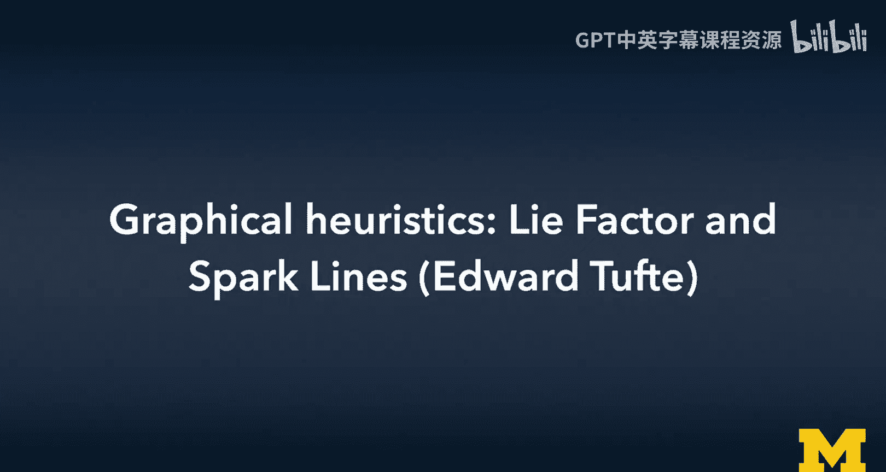
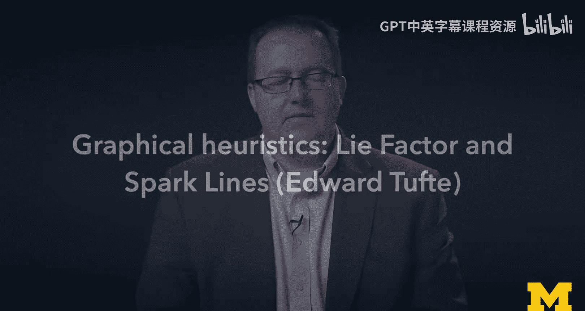
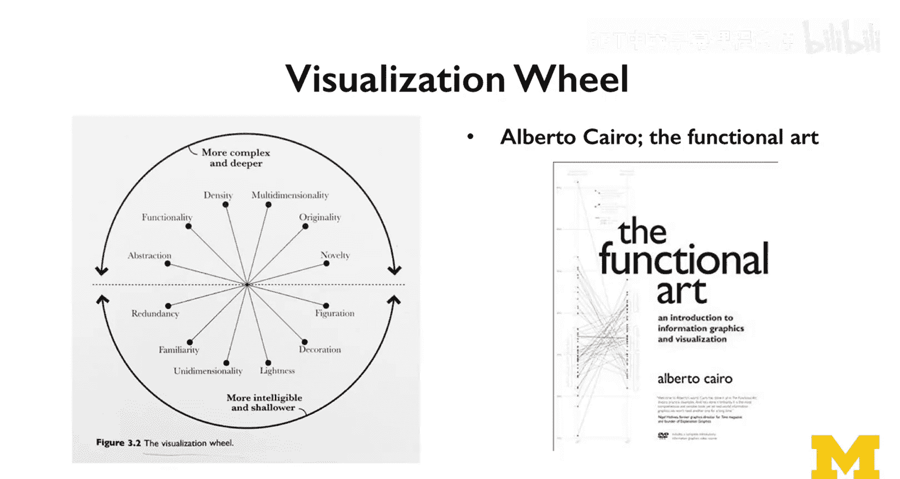
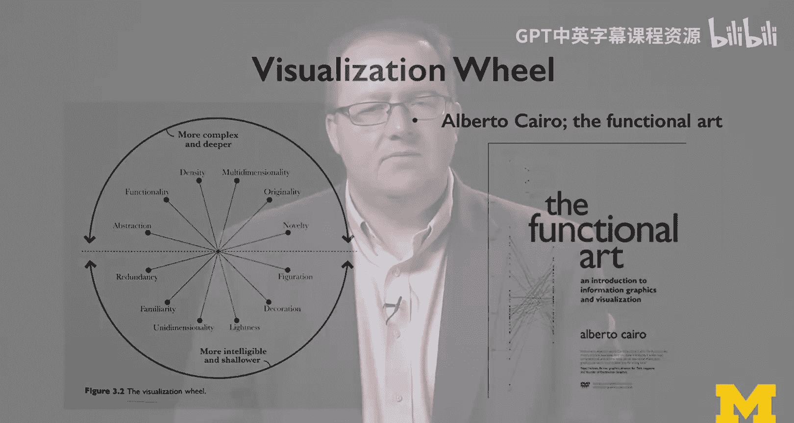
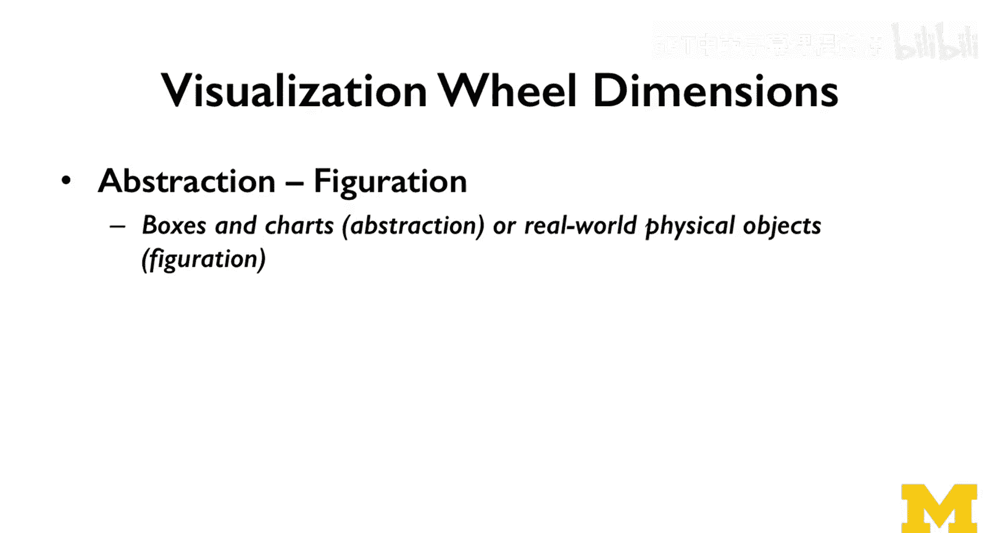
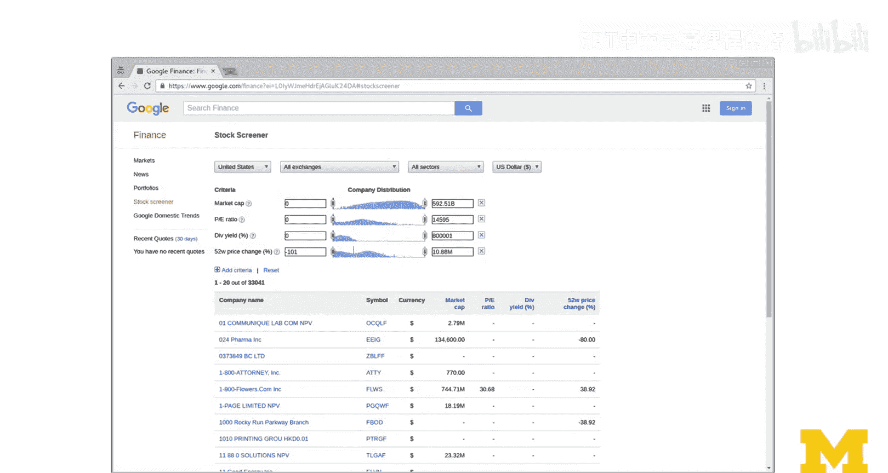
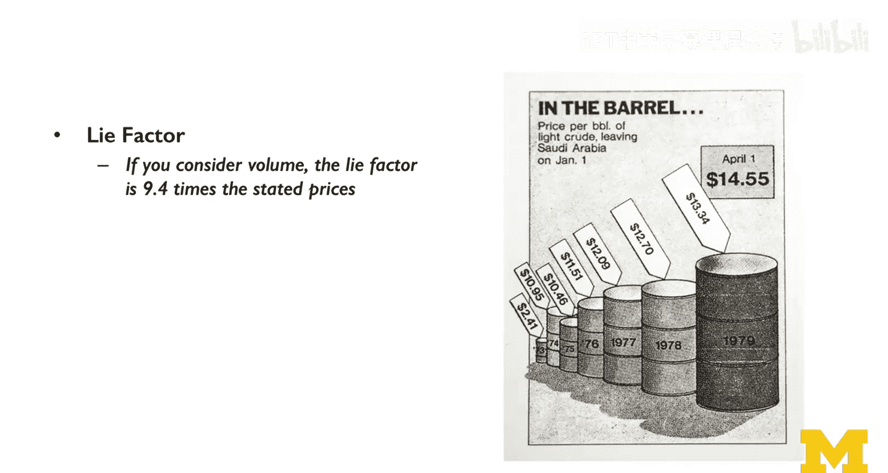

# 28：图形启发式：失真系数与迷你折线（Edward Tufte理论）📊

在本节课中，我们将学习爱德华·塔夫特提出的两个重要图形设计概念：迷你折线图和失真系数。这些概念旨在帮助我们更清晰、更诚实地呈现数据。

爱德华·塔夫特对简洁和极简主义的强调赢得了大量追随者。他被广泛认为是图表和图形可视化领域最具影响力的作家之一。

在他的著作《美丽的证据》中，他提出了一个将图表极简主义提升到新高度的想法。他建议，不应将图表作为一个独立的、需要单独研究的对象，而应将其简化并嵌入到讨论的上下文中。他认为，一个小的图形，例如一个时间序列折线图，可以快速传达更多信息，这对读者来说是无价的。他将这些元素称为“迷你折线图”，并称之为“数据词汇”，这是一种弥合文本与图形之间差距的有趣方式。

他提出，迷你折线图不仅可以直接呈现在文本中，还可以与它们所描述的数据一起嵌入到表格里。这个想法变得如此自然，以至于它甚至被最常用的电子表格分析软件之一——微软Excel所采纳。

## 迷你折线图的应用实例 📈

以下是迷你折线图在数据呈现中的具体应用。

上一节我们介绍了迷你折线图的概念，本节中我们来看看它的实际应用。以下是一个来自纳斯达克股票交易所的表格数据图片，显示了四只科技股在一个月内的开盘价。

花点时间思考一下这些数据。哪只股票本月表现不佳，呈下降趋势？哪只股票表现良好，呈上升趋势？

如果我在下面的单元格中添加迷你折线图呢？

现在，这些迷你折线图并不能帮助我们回答谁的股价最高，或者谁获得了最大的收益或损失，但它们确实让我们对数据背后的趋势有了一个总体的感觉。实际上，迷你折线图用于那些趋势或分布特征很重要的数据。

以下是迷你折线图在谷歌财经网站上的另一个例子。

请注意，你实际上可以快速放大这些迷你折线图的某些部分，因此它们不仅仅是数据的表示，也是一种与之交互的方法。

迷你折线图有许多不同的用途，定制化界面（如电子游戏）就是一个很好的例子。我认为一个现代版的、很酷的迷你折线图变体叫做“Spark T”，它使用Unicode块字符在Twitter分配的1到40个字符内显示条形图。

例如，这里一位用户将她四月份的睡眠时间以条形图的形式发布在推特上。

## 失真系数：识别图形误导 🔍

了解了如何用迷你折线图高效展示趋势后，我们还需要警惕图形可能带来的误导。接下来要分享的最后一个塔夫特原则叫做“失真系数”。

失真系数是图形中显示的效果大小除以数据中实际效果的大小。其公式可以表示为：

**失真系数 = 图形效果大小 / 数据效果大小**

这通常是无意识地为了帮助讲述一个故事而做的。然而，这对观察者来说是具有误导性的。失真系数有很多不同的例子。我认为1979年《时代》杂志的这个例子提供了一个很好的例证。

在这张图中，显示了不同油桶，展示了六年间的石油价格，但观察者不清楚一个油桶的大小与其他油桶的关系。部分原因是这里存在透视元素。这些油桶是大小不同，还是仅仅因为有些在前、有些在后而显得不同？是油桶的体积代表了成本的增长，还是油桶的高度？

## 总结 📝

本节课中我们一起学习了爱德华·塔夫特提出的两个核心图形设计工具。迷你折线图和失真系数是爱德华·塔夫特为我们提供的另外两个工具，用于理解和传达数据。

迷你折线图鼓励我们将简洁的图形嵌入上下文，快速传达趋势。而失真系数则是一个重要的检查工具，提醒我们确保图形表示与底层数据真实匹配，避免无意或有意地误导观众。掌握这两个概念，能帮助我们在公共部门的数据分析中制作出既高效又诚信的可视化图表。

