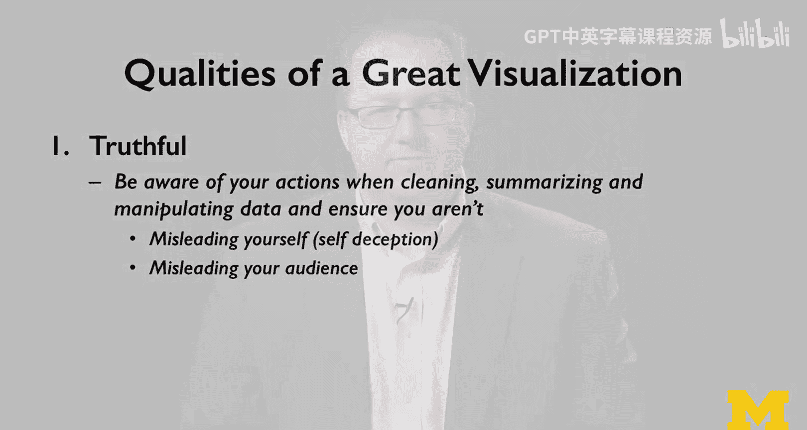
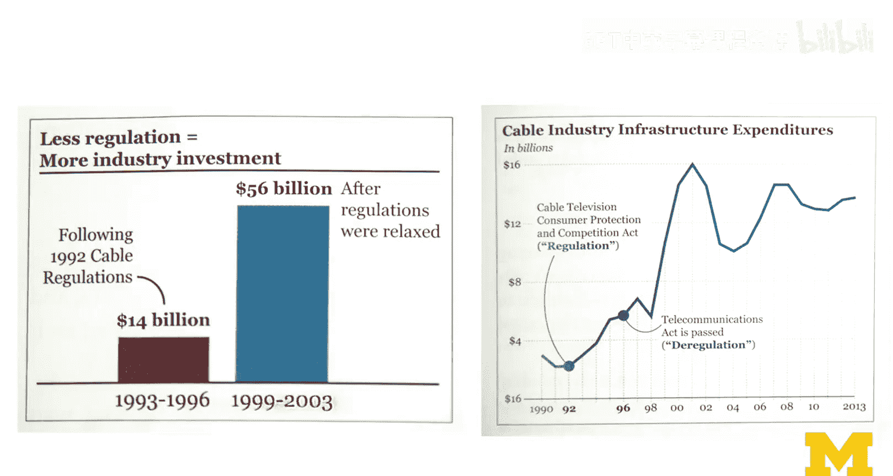
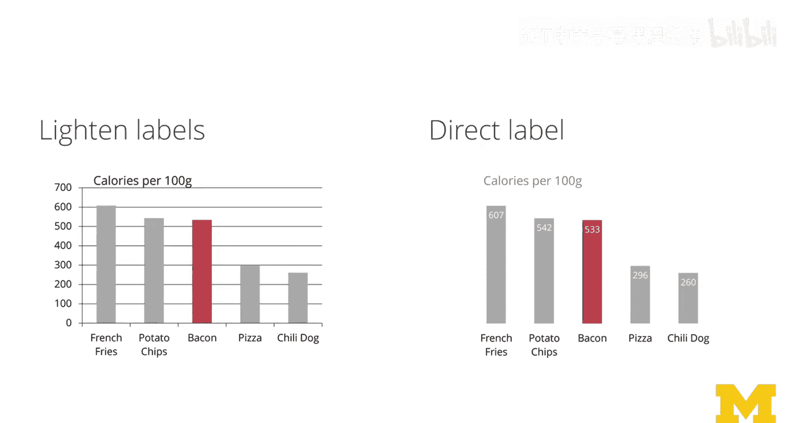
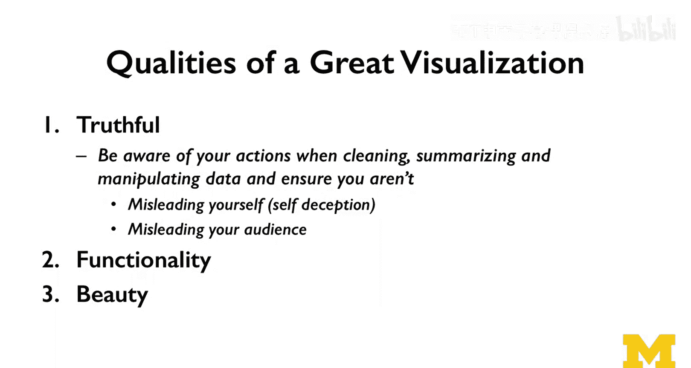
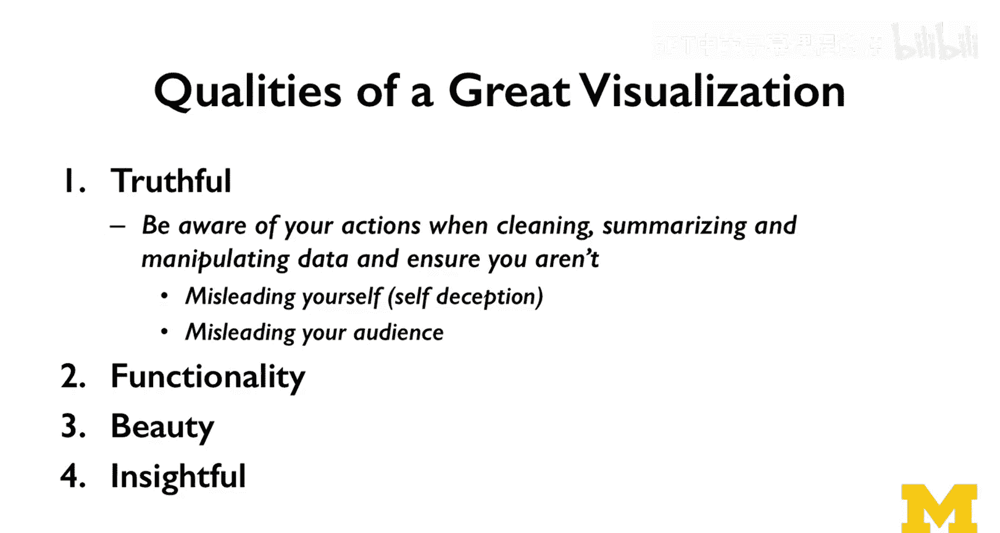
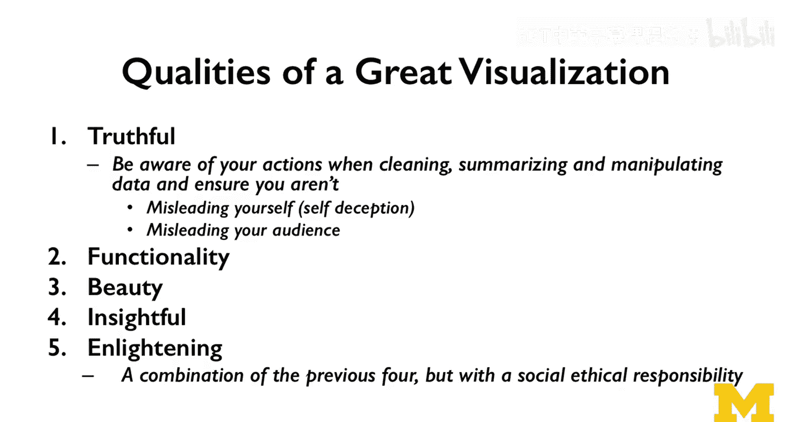

# 数据可视化基础：1.3：Alberto Cairo的《真实艺术》设计理念 🎨

在本节课中，我们将学习Alberto Cairo在其著作《真实艺术》中提出的核心设计理念。Cairo为评估信息图表的质量构建了一个五维框架，这对于任何数据科学家而言都至关重要。我们将逐一探讨这五个相互关联的品质，并通过实例理解如何将它们应用于实践。

---

## 真理性的重要性 📊

上一节我们介绍了评估信息图表的整体框架，本节中我们首先来看看第一个，也是最重要的品质：**真理性**。

Cairo承认“真理”可能具有主观性，且存在于一个连续谱系中，要确立绝对真理或许是不可能的。但他认为，作为数据科学家，我们在维护真理方面有两项义务。

以下是数据科学家在维护真理性时的两项核心义务：

1.  **对自身诚实**：在清洗和汇总数据时，我们必须审视自己的行为。我们所做的修改是否会因为施加的限制而模糊了信息？我们应该明确考虑对数据的每一次修改，确保自己没有陷入所谓的“自我欺骗”。怀疑精神是数据科学家的重要技能，我们常常过于专注于寻找模式，以至于以不符合所描述现象本质的方式来简化或呈现数据。
2.  **对受众负责**：数据科学和信息可视化领域存在一些技术，可以用来突出特定的数据片段。这通常是这些领域的目的。但如果我们剥夺了读者更全面探索现象的能力，就会引发怀疑和不信任。

Cairo提供了一个由美国有线电视和电信协会发布的图表作为反面案例。该图表试图暗示放松监管后，有线电视公司的行业投资增加了四倍。

该原始图表存在几个明显问题：

*   货币数值是否经过通货膨胀调整不明确。
*   两个柱状图所代表的时间跨度不同（一个三年，一个四年），但宽度相同，这在设计上是不可原谅的。
*   图表缺失了1997和1998年的数据，且止于2003年，而该信息发布于2014年。

Cairo追踪数据后提供了一个更诚实的折线图。该图显示，监管后确实有持续的投资年份，放松监管后支出有短暂下降和巨大峰值，随后从2002年后显著下降——而原始图表排除了这部分数据。

这里的教训是：虽然可能没有绝对真理，但存在比其他方式更真实的**数据呈现方法**。

---

## 功能性的考量 ⚙️

在理解了真理性的核心地位后，我们接下来探讨第二个品质：**功能性**。这同样是一个连续谱系。

我们之前见过一个例子，即Datawrapper提供的“数据墨水比”幻灯片。如果你预期受众需要比较两个数据序列，直接为它们添加标签是提高理解度的一种方法。

虽然有许多提高功能性的启发式方法，但希望你记住我们使用“图表垃圾”进行的用户测试。我认为，现在是理解特定情境下人类行为的激动人心的时刻。网络极大地提高了我们在不同人群中大规模测试社会和行为假设的能力，CrowdFlower和Amazon Mechanical Turk就是其中的两个例子。

理解某种可视化方法的功能性如何，不一定需要昂贵的人种学研究。现在通过众包直接测试假设要容易得多。

---

## 美观性的作用 🖼️

一个图表仅仅功能完备还不够，它是否赏心悦目也同样重要。这就是Cairo提出的第三个品质：**美观性**。

我认为这需要非常了解你的受众。基于人们的生活经历以及性别、文化等自身因素，会有不同的感知。构建一个美观的信息可视化体验涉及很多方面，这也取决于情境和背景因素。

例如，如果你在为一份报告制作图表，你所选择的颜色、样式乃至字体，可能更多地与美观性而非功能性相关。但这些元素的相互作用是难以忽视的。我在想，美观性这个广泛的主题，是否是导致“图表垃圾”与“记忆性”问题研究结论相冲突的混淆因素之一？

虽然Tufte认为图表垃圾会分散注意力并产生误导，但Bateman等人的研究表明它可以使可视化更令人难忘。这种脱节是否源于信息图表中的美观性问题？

关于美观性和信息，这里有一个发人深省的思考，或许能阐明这一品质。最受欢迎的科技杂志之一《连线》，以其整版的信息图表而闻名。在《连线》的网站上，他们将这些文章标记为“信息色情”，意指他们希望读者在阅读文章时能产生一种发自内心的反应。

---

## 洞察力的价值 💡

一个美观的图表能吸引眼球，但真正优秀的图表能引发思考。这就是Cairo提出的第四个品质：**洞察力**。

信息图表不应仅仅复制数据和表格，而应吸引观看者，使其产生“啊哈！”或“我发现了！”的顿悟时刻。我主要在学术论文的背景下思考这一点。

该领域的新手作者常犯的一个错误是，为他们拥有的每一份数据都配上一张图。这完全没有必要，会增加冗余并导致读者疲劳。但恰当的图表能迅速阐明研究结果。在我的领域，同行评审很常见，但评审者在翻阅投稿论文时并没有大量时间进行完整评审。当一个图像跃然纸上并立即给予他们洞察时，这便为他们理解论文其余部分所要讲述的更细致入微的故事做好了准备。

---

## 启迪性的社会责任 🌍

最后，Cairo提出的第五个品质是：信息图表应具有**启迪性**。

这与洞察力不同。事实上，Cairo认为这一品质由前四个品质（真实、功能、美观、洞察）构成，但它是独立的，因为它增加了一个社会责任维度。

我认为这个问题没有明确的答案。但毫无疑问，Cairo提出的优秀可视化的五个品质——真实、功能、美观、洞察、启迪——非常值得考虑。Cairo有更多杰出的工作。在本讲座之后，我布置了一篇他的阅读材料以及一个讨论问题，鼓励你们就信息可视化与数据科学相关的非道德性发表看法。

---

## 总结 📝

本节课中我们一起学习了Alberto Cairo在《真实艺术》中提出的信息图表五维评估框架。我们探讨了**真理性**的核心地位，**功能性**的实用考量，**美观性**对受众体验的影响，**洞察力**在传达信息时的关键作用，以及最终**启迪性**所承载的社会责任。这五个品质相互关联，共同构成了优秀数据可视化的基石。掌握这些理念，将为我们在后续课程中专注于应用数据科学技能打下坚实的基础。