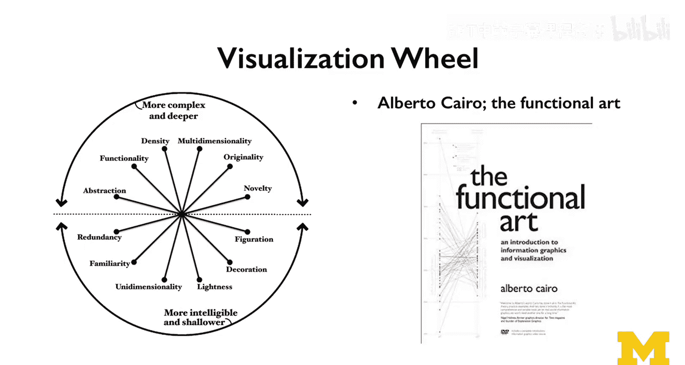
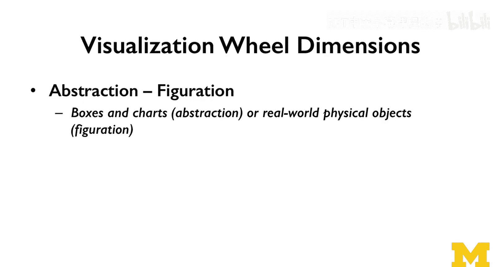
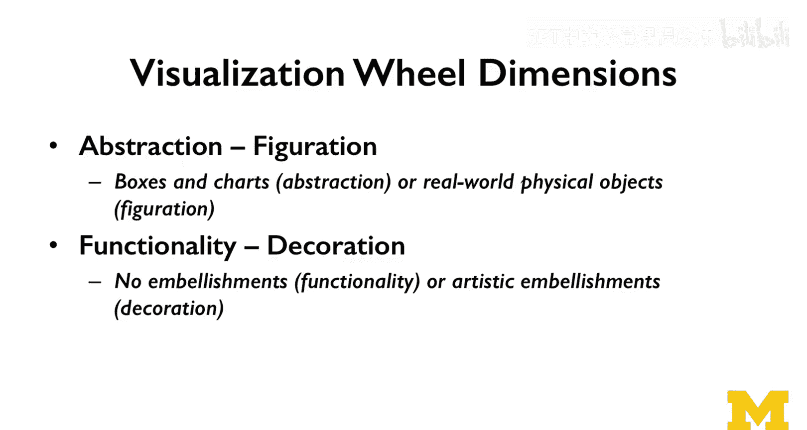
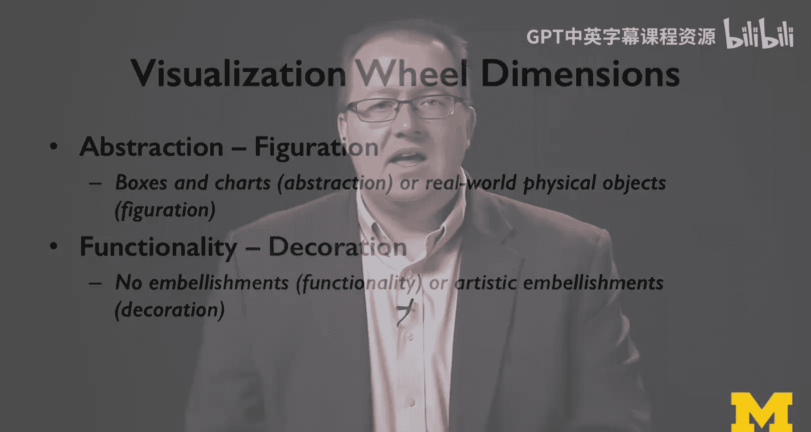
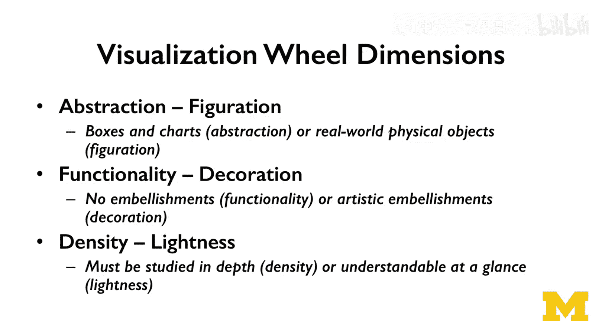
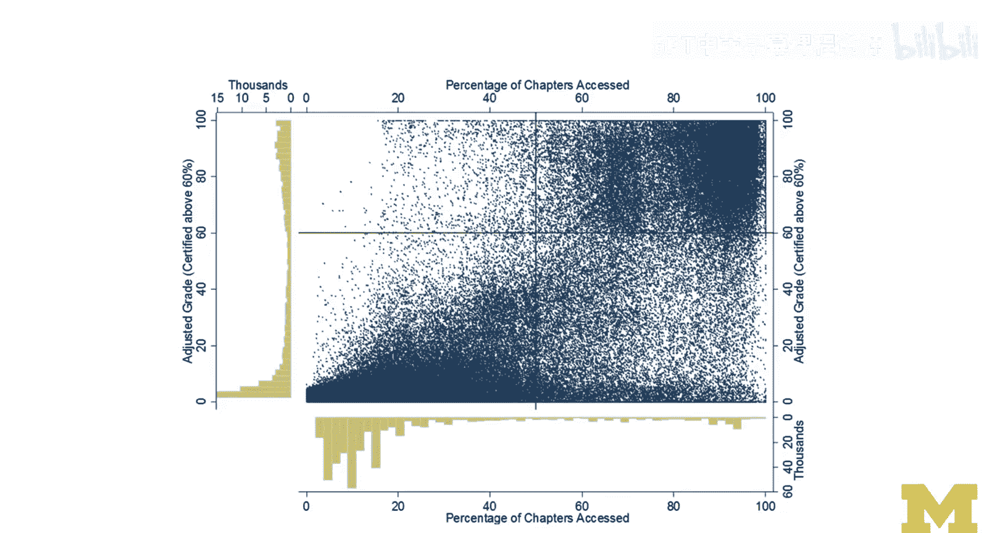
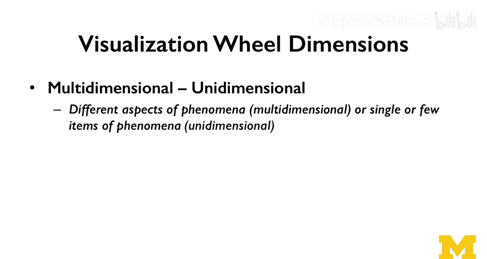
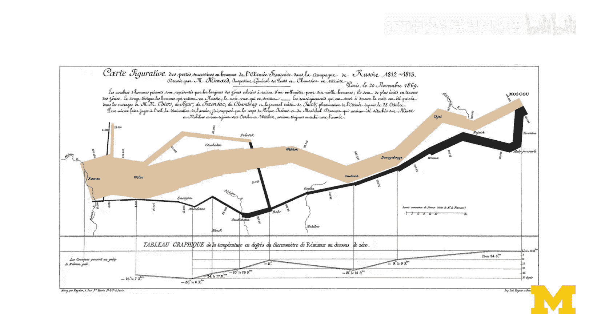
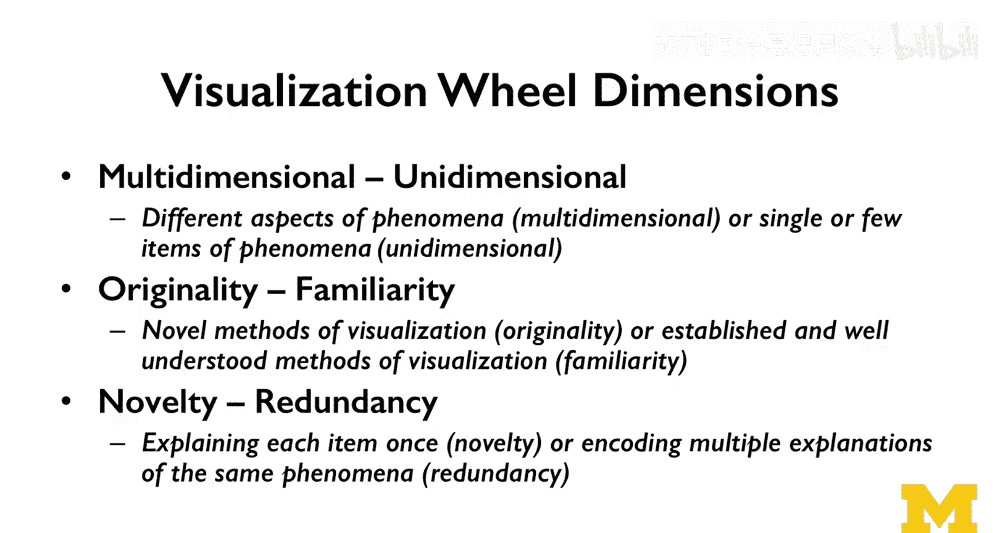

# 公共部门的R数据分析：30：设计思维工具集 📊

在本节课中，我们将学习阿尔贝托·开罗在其著作《The Functional Art》中提出的一个用于思考信息图表设计权衡的工具——**可视化轮**。我们将探讨该工具的核心概念及其多个设计维度，并通过具体案例理解如何应用这些维度来分析和比较不同的可视化设计。

---

阿尔贝托·开罗在其著作《The Functional Art》中，提供了一个思考信息图表设计权衡的工具。他称这个工具为“可视化轮”。

在这个概念模型中，一个圆环有两个极点。顶部的极点代表高度复杂的数据，能提供深层次的信息。底部的极点则提供更易获取数据的方式，但信息深度较浅。圆环内包含多个维度，这些维度描述了两种不同设计方法之间的权衡。虽然开罗提供了许多有趣的维度，但需要强调的是，这是一个供设计者思考其可视化作品的工具，其本身并非严格意义上的分析工具。

针对任何特定问题的需求，都可能改变哪些维度是重要的，或者可能引入需要考虑的新维度。开罗认为，我们在组织中的角色或专业背景也可能影响我们想要制作的图表类型。因此，我想问正在学习数据科学的你：你试图通过你的可视化作品触达谁？

---

让我们深入探讨开罗所考虑的几组设计权衡。

以下是第一组权衡：**抽象与具象**。高度具象的视觉作品使用现象本身的物理表现形式来描述现象，例如照片或绘画。当表现形式变得不那么真实、更具概念性时，重点就从具象转向了抽象。

他讨论的第二个维度是**功能与装饰**。一个完全功能性的图表没有任何修饰，更接近于数据的直接呈现。而一个装饰性很强的图表则具有更多的艺术修饰。

与所有这些维度一样，这里没有绝对的好坏之分。装饰可能会增加观看者思考视觉作品的时间，探索其细微差别并形成心理联想，这可能会增加熟悉度和记忆性。

第三个维度是**密度与轻量**，这与所展示的信息量有关。科学视觉作品中有很多很好的例子，其中一些图表旨在深入研究，而另一些则旨在快速补充叙述。

在比较杂志中的信息图表时，可以看到这个维度在起作用，因为读者可能更深入地参与内容。而在同一本杂志中比较广告时，读者可能只会快速浏览广告。

以下是我研究领域的一个例子，由哈佛大学和麻省理工学院发布，描述了edX大规模开放在线课程平台用户的访问模式。

花点时间研究这张图片。你能从这张图片中理解到什么？

如果我们考虑开罗的第三个维度，很难不说这是一张相当密集的图表。图表的主要部分是一个散点图，有两个带标签的轴。左侧和底部的两个子图是直方图，同样有轴。直方图的轴可能有点令人困惑，因为它们与散点图的轴重叠，但改变了度量单位和测量方向。例如，散点图顶部的X轴使用“访问章节百分比”作为度量单位，并随着向图形右侧移动而增加。然而，图表左侧直方图的同一个X轴的单位是“千人”，并随着向图形左侧移动而增加。图表上叠加了一些红线，将散点图大致划分为四个象限。但由于标签极少，这些象限最终代表什么并不十分清楚。

无论这是否是一个好图表，它肯定可以被视为一个密集图表的例子。

开罗提出的第四个方面是图表的**维度性**。一个多维度的图表将现象作为一个整体来描述，并邀请观看者探索现象的许多不同方面。而一个单一维度的图表则专注于一个或少数几个项目，并以一种或多种方式探索它们。

第五个维度是**原创性与熟悉性**。在现代世界，我们习惯于看到各种各样的信息图表，比如条形图和折线图。以这些表现形式进行思考在很小的时候就被教授。例如，我快五岁的女儿前几天从学前班带回一页纸，上面展示了她和其他同学在课堂上制作的条形图。为了庆祝了解美国大选，全班同学一起投票决定吃什么零食：巧克力冰淇淋还是薄荷巧克力片冰淇淋。当然，薄荷巧克力片冰淇淋赢了，正如人们所料。但我想说的是，这些是以图形形式思考数据的基本方式，现在很早就开始教授了。这使得它们为广泛人群所熟悉。

然而，情况并非总是如此。可以说，条形图对大多数人来说是相当熟悉的，但一个更具原创性的图表包含需要用户解释或研究的元素。

以下是查尔斯·米纳德绘制的一张非常著名的图表。它描述了拿破仑1812年进军俄罗斯的情况。花点时间研究这张图表。

广义上讲，这张图表中可视化了五种不同类型的信息。你看到了这五种信息中的多少种？

以下是我看到的。首先，是地理元素，表现为沿途的各种河流和城镇。顶部浅色条带的宽度代表拿破仑军队的规模，你可以看到它在战役开始时从42.2万人减少到法军抵达莫斯科时的仅10万人。底部的黑色条带显示了拿破仑从俄罗斯的撤退，沿途有多个点，这些点与日期和摄氏温度相对应。我们看到随着军队规模急剧缩小，条带也急剧变细。

因此，米纳德可视化中的五种数据包括：位置、方向、温度、军队规模和日期。

开罗分享的最后一个维度是**新颖性与冗余性**维度。冗余性是指图表倾向于以多种不同方式讲述同一个故事。例如，你可能会在条形图中使用条形的高度（配合坐标轴）以及颜色来强调最大的条形。

这个维度有点棘手。你不想让读者感到无聊，也不想让你的图表过于复杂，但你确实希望以支持读者理解你所描述现象的方式来编码信息。在这个维度上，新颖性是指以唯一一种方式描述图表中的每个现象。

在可视化轮中没有绝对的对错，该轮的目的是帮助你理解和比较你可能采取的可视化方法。

作为一项反思活动，开罗建议你可以沿着这些维度绘制你的有序思考，然后将这些点连接起来创建一个雷达图。

这里，开罗提供了两个可视化轮的实际应用示例。在左侧，你可以看到更侧重于复杂视觉，即那些密集、多维且功能性高的图表。在右侧的可视化轮中，则包含了更多装饰、轻量和具象的元素。

开罗认为，左侧的轮更倾向于科学家和工程师所做的工作，而右侧的轮则更倾向于艺术家、平面设计师和记者所做的工作。科学家和工程师看待数据可视化的方式与艺术家和记者看待的方式之间的这种张力非常有趣，我们将在下周结束时再次讨论。

---

在下一讲中，我们将更深入地探讨爱德华·塔夫特关于什么构成良好可视化的一些启发式方法。可视化轮是我们用来更好地比较两种不同信息可视化方式的工具之一。在下一讲中，我们将深入探讨，看看你如何使用可视化轮来评估自己的图表。

---

**本节课总结**

本节课我们一起学习了阿尔贝托·开罗提出的“可视化轮”设计思维工具。我们了解了该工具用于权衡可视化设计的六个核心维度：**抽象与具象**、**功能与装饰**、**密度与轻量**、**维度性**、**原创性与熟悉性**以及**新颖性与冗余性**。通过具体案例的分析，我们认识到没有绝对“正确”的设计，关键在于根据目标受众和沟通目的，在这些维度之间做出有意识的权衡。可视化轮是一个强大的反思工具，能帮助我们分析和改进自己的可视化作品。