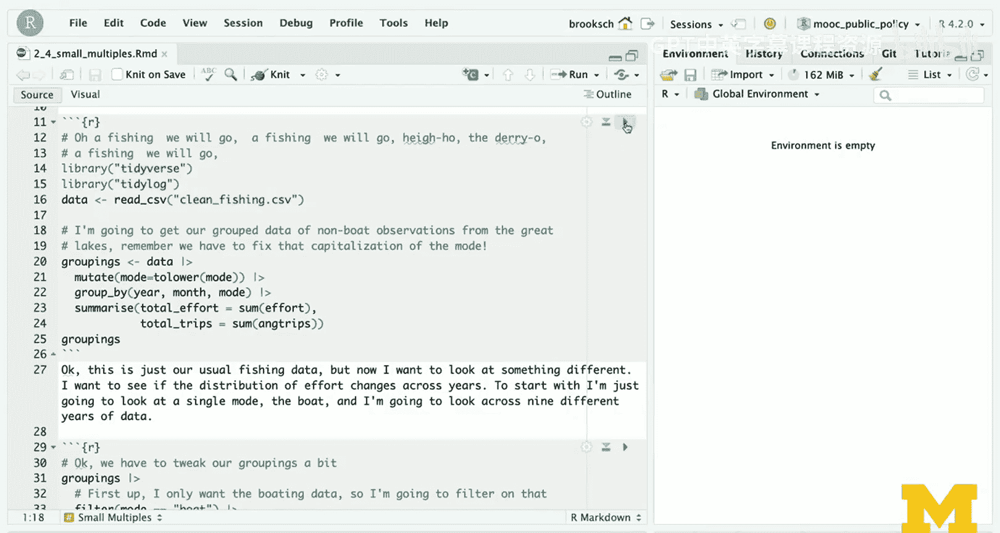
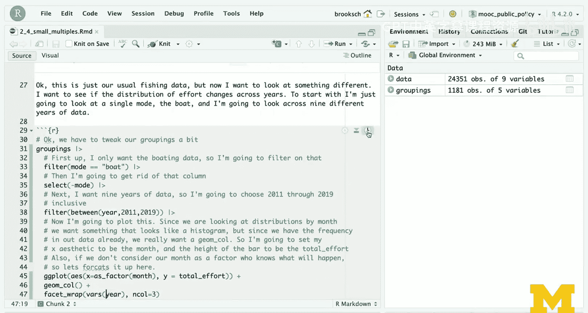
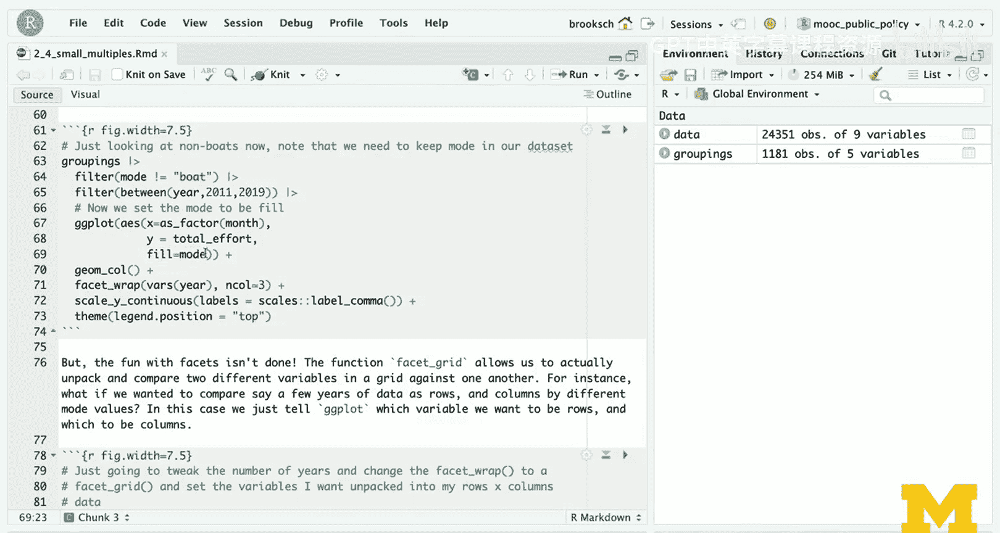
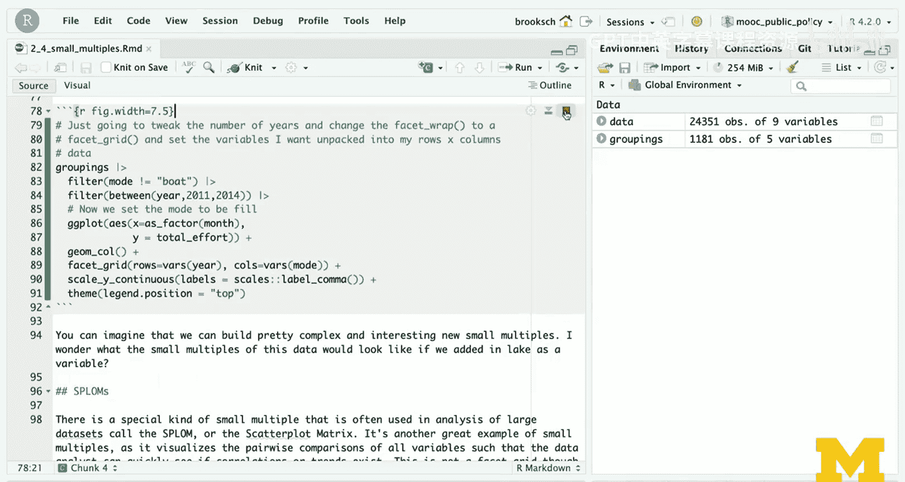

# 31：小型多图展示技术 📊


在本节课中，我们将要学习一种名为“小型多图”的数据可视化技术。这种技术由爱德华·塔夫特在其著作中提出，能够高效地展示高密度信息，并帮助我们快速识别数据中的趋势。我们将重点学习如何在R语言的`ggplot2`包中，通过“分面”功能来实现小型多图。

---

## 小型多图的概念

爱德华·塔夫特在其著作《量化信息的视觉展示》中介绍了小型多图技术。他将小型多图描述为类似于电影帧的序列，即一系列展示相同变量组合的图形，这些图形通过其他变量的变化进行索引。

虽然这个概念在应用上可能有一些灵活性，但其核心贡献在于，它允许我们一眼看到高密度的图形，并从中识别出感兴趣的趋势。在`ggplot2`中，实现小型多图的功能根植于其分层的图形语法。

---

## `ggplot2`的图形语法回顾

从本课程的第一讲我们就知道，`ggplot2`中每个图层内部有五个核心语法概念：**数据**、**美学映射**、**几何对象**、**统计变换**和**位置调整**。

除了这些核心概念，还有三个跨图层工作的语法元素：**标度**、**坐标系**和**分面**。我们已经见过如何使用标度来更改坐标轴标签，以及如何使用坐标系来翻转坐标轴。坐标系的功能还有很多，例如从笛卡尔坐标系转换为极坐标系，但这相对少见，本课程不做深入探讨。本节课，我们将重点介绍最后一个语法元素——**分面**。

分面是指根据一个或多个变量将数据分割成子集，然后在网格中独立绘制每个子集。这正是塔夫特所描述的小型多图。

---

## 实践：创建小型多图


接下来，我们通过一个实际的数据集来演示如何创建小型多图。我们将使用渔业数据，并首先关注非船只观测数据。

以下是数据准备步骤：
1.  导入渔业数据。
2.  筛选出非船只的观测数据。
3.  修正“模式”变量的字母大小写。



```r
# 假设数据已加载为 `fishing_data`
non_boat_data <- fishing_data %>%
  filter(mode != "boat") %>%
  mutate(mode = str_to_title(mode)) # 修正大小写
```

---


## 单变量分面示例

我们想探究不同年份间“努力量”的分布是否发生变化。首先，我们仅查看“船只”这一模式，并观察九个不同年份的数据。

以下是具体步骤：
1.  筛选出“船只”模式的数据。
2.  选择2011年至2019年（包含首尾）的数据。
3.  绘制图形，x轴为月份，条形高度为总努力量。
4.  使用`facet_wrap()`函数按年份进行分面。

```r
boat_data_years <- non_boat_data %>%
  filter(mode == "Boat", year %in% 2011:2019)

ggplot(boat_data_years, aes(x = factor(month, levels = 1:12), y = total_effort)) +
  geom_col() +
  facet_wrap(vars(year)) +
  labs(x = "Month", y = "Total Effort")
```

运行上述代码后，我们将得到一组按年份排列的小型多图。每个子图共享相同的坐标轴标签，但通过年份标签进行区分。我们可以清楚地看到，船只活动的分布在2011年达到峰值，到2019年已大幅下降。

---

## 分面与复合图的区别

上一节我们介绍了`facet_wrap`的基本用法。这里需要注意，分面图看起来可能与我们之前用`cowplot`包拼接的复合图类似，但两者有本质区别。



使用`plot_grid`拼接时，是将多个独立的`ggplot`对象组合在一起，它们不共享底层图层。而从图形语法的角度来看，分面图中的所有子图共享同一套图层设置。`facet_wrap`只是选择了一个额外的变量来分割数据，这本质上是一个单一的图形。

---

## 添加更多变量

我们当然可以在分面图中添加更多变量。例如，我们可以根据不同的“模式”为条形图设置不同的填充颜色。

以下是具体步骤：
1.  保留数据集中的“模式”变量。
2.  将“模式”映射到填充颜色。
3.  同样使用`facet_wrap()`按年份分面。

```r
ggplot(non_boat_data, aes(x = factor(month, levels = 1:12), y = total_effort, fill = mode)) +
  geom_col() +
  facet_wrap(vars(year)) +
  labs(x = "Month", y = "Total Effort", fill = "Mode")
```


---

## 使用`facet_grid`创建网格分面



分面的乐趣不止于此。`facet_grid`函数允许我们在一个网格中，从行和列两个维度来比较两个不同的变量。

例如，如果我们想比较少数几个年份的数据，并以不同的模式值作为行和列，我们可以通过指定行变量和列变量来实现。

以下是具体步骤：
1.  减少选取的年份数量，以便于在网格中展示。
2.  将`facet_wrap`改为`facet_grid`。
3.  指定行方向为年份，列方向为模式。

```r
selected_years_data <- non_boat_data %>%
  filter(year %in% c(2015, 2017, 2019))


ggplot(selected_years_data, aes(x = factor(month, levels = 1:12), y = total_effort)) +
  geom_col() +
  facet_grid(rows = vars(year), cols = vars(mode)) +
  labs(x = "Month", y = "Total Effort")
```

你可以想象，通过添加更多变量（例如湖泊），我们可以构建出相当复杂且有趣的小型多图来深入探索数据。



---

## 总结


本节课中，我们一起学习了“小型多图”这一强大的数据可视化技术。我们了解了它的概念，并重点掌握了在`ggplot2`中通过`facet_wrap()`和`facet_grid()`函数实现分面的方法。分面允许我们基于一个或多个变量分割数据，并在同一框架下并排比较多个子图，这有助于高效揭示数据中的模式和趋势。