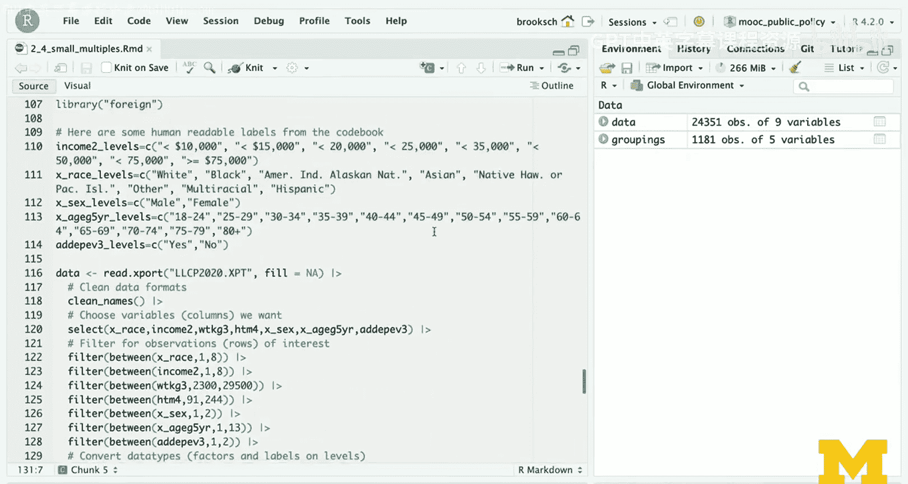
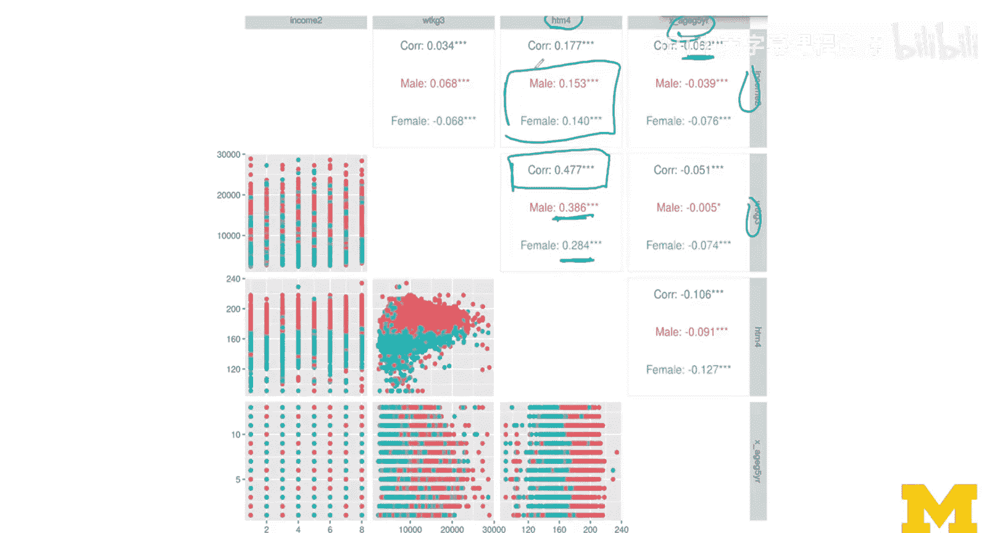

# 32：散点图矩阵应用 📊

在本节课中，我们将要学习一种常用于分析大型数据集的特殊小倍数图——散点图矩阵。我们将了解它的概念、与分面图的区别，并通过一个实际案例演示如何使用R语言创建和解读散点图矩阵。

散点图矩阵是一种强大的数据探索工具，它通过可视化数据集中所有变量之间的两两比较，帮助分析师快速发现变量间可能存在的相关性或趋势模式。

## 散点图矩阵与分面图的区别

上一节我们介绍了小倍数图的概念，本节中我们来看看散点图矩阵这一具体应用。散点图矩阵和分面图都是小倍数图的例子，但它们在概念上并不相同。

分面图会根据你变量中的值，将其展开为行或列，从而创建更多的图表。然而，这些图表中的每一个都可以任意复杂，并且可以包含许多不同的变量。


另一方面，散点图矩阵一次只创建两个变量的散点图，但它会为数据集中的所有变量都这样做。因此，分面图和散点图矩阵虽然都属于小倍数图，但概念上并非同一事物。

## 数据准备

我们的钓鱼数据（phishing data）缺乏许多连续变量或有序值，而散点图需要这类数据才能有意义。然而，我们从BRFSS获取的人口数据则具备这些条件。因此，我将引入我们在人口金字塔讲座中使用过的数据集，进行一个快速的演示。



以下是来自人口金字塔讲座的代码，我做了一些更新，以便只查看有序或连续的数据。


```r
# 代码示例：导入并筛选数据
# 这里导入了各种不同的变量：收入水平、种族水平、性别水平、年龄，以及关于心理健康问题的答案。
# 然后进行过滤，关键点在于我只保留了“性别”作为因子变量，其他变量不作为因子使用。
```

运行这段代码可以完成快速的数据清理工作。

## 创建散点图矩阵

要创建散点图矩阵，我们可以使用`GGally`包，它引入了多种新的绘图方法，包括`ggpairs`方法。

```r
# 代码示例：使用GGally包创建散点图矩阵
library(GGally)
```

R语言的一个令人困扰之处是缺乏统一的命名规范。与其他大多数库不同，这个包名以两个大写字母“GG”开头，请注意这一点。

我们不需要为这个图使用`ggplot`基础图层，可以直接调用`ggpairs`函数。我们需要提供数据，但提供美学映射是可选的。X和Y轴的美学实际上将由其他参数选择。

我们没有“列”参数（指绘图布局的列），但我们有一个`columns`参数，重要的是，它指的是我们数据表中的列或变量，而不是图表的列。

以下是创建散点图矩阵的代码步骤：

1.  调用`ggpairs`函数并传入数据。
2.  设置美学映射，例如按性别着色。
3.  通过`columns`参数指定要包含的变量列表，例如收入、体重、身高和年龄分组。
4.  可以添加其他参数进行自定义。

```r
# 代码示例：创建散点图矩阵
ggpairs(data = my_data,
        mapping = aes(color = sex),
        columns = c("income", "weight", "height", "age_band"))
```

我将把这个图保存到一个文件中，以便打开并进行解读。

## 解读散点图矩阵

现在，我们可以从散点图矩阵中观察到哪些模式呢？目前，唯一立即引起我注意的是身高和体重之间的关系。

我们可以看到身高变量在这里，体重变量在这里，它们的交互作用图就在这个位置。图中似乎有一条对角屏障。我们的两种性别用颜色区分，这是男性，这是女性。

我们可以观察到身高和体重之间的关系：一个人很难同时非常高又非常轻（像右下角这个点），这种情况几乎不存在。相反的情况则不必然成立，你可以又高又重，也可以又高又轻，这些都分布在这个区域。

从着色中我们还能看出，男性往往比女性更高。这通过颜色分布得以体现，男性（桃色）集中在更高的身高区域，而女性（深色）则分布在较矮的身高区域。

我们可以在多个图表中看到这一点，任何与身高有交互的变量都是如此。例如，观察身高和收入这个图，我们也能看到一个明显的区分：总体上男性更高，女性更矮。但这并不能告诉我们太多关于收入的信息，因为收入是横轴（请注意这些是因子，我们没有标记它们，所以显示的是数值）。

同样，在身高和年龄的图中，沿着散点图矩阵看下来，这里再次有一条明显的区分线，男性倾向于更高，女性倾向于更矮，但这对于了解年龄信息本身并不十分具有启发性。

## 矩阵中的相关性分析

`ggpairs`的一个优点是它会自动计算并显示一些相关性统计检验结果。我们尚未深入讨论这些检验，但它们会自动呈现在此图表中。

以下是我们可以从矩阵中解读的一些相关性：



*   **身高与体重**：计算出的相关性显示它们呈正相关。随着人们身高增加，体重也倾向于增加，反之亦然。我们可以看到，这种相关性在男性中比在女性中更强。
*   **年龄与收入**：如果观察年龄和收入，会发现存在轻微的负相关，这对男性和女性都成立。随着年龄增长，收入在此数据集中呈现下降趋势。
*   **身高与收入**：最后，这里还存在一个正相关关系，同样对男性和女性都适用：随着身高增加，收入也增加。

需要强调的是，**相关性不等于因果性**。我们并不知道是身高导致一个人赚更多钱。事实上，如果我们要因果性地联系这两个变量（很可能它们之间根本不存在任何因果联系，而是都与第三个变量相关），另一种可能的因果解释是：随着人们赚更多钱，他们变得更高——当然，这听起来不太可能，也许只是他们觉得自己更高了。请记住，这些都是自我报告的数据。

## 总结


本节课中我们一起学习了散点图矩阵的应用。我们了解了散点图矩阵作为小倍数图的一种，用于可视化数据集中所有变量对之间的关系，帮助快速识别趋势和相关性。我们区分了它与分面图的不同，并通过实际数据演示了如何使用`GGally`包的`ggpairs`函数创建散点图矩阵。最后，我们学习了如何解读矩阵中的散点图模式以及自动计算的相关性统计，并再次强调了相关性与因果性的区别。散点图矩阵是探索性数据分析中的一个强大工具，能够为后续的深入分析提供初步的洞察和方向。