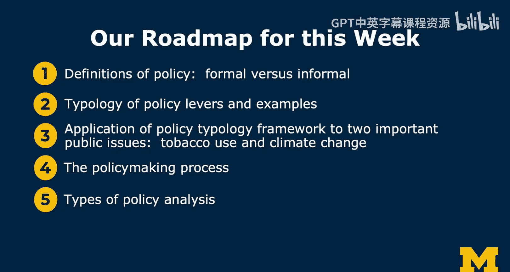
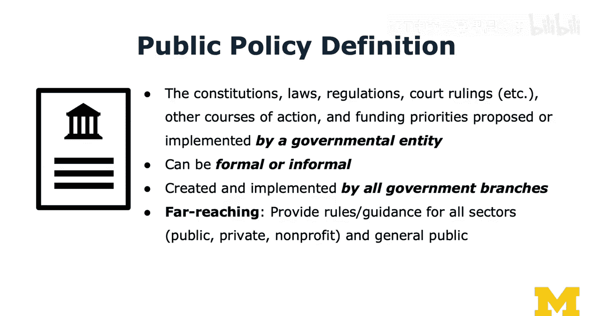
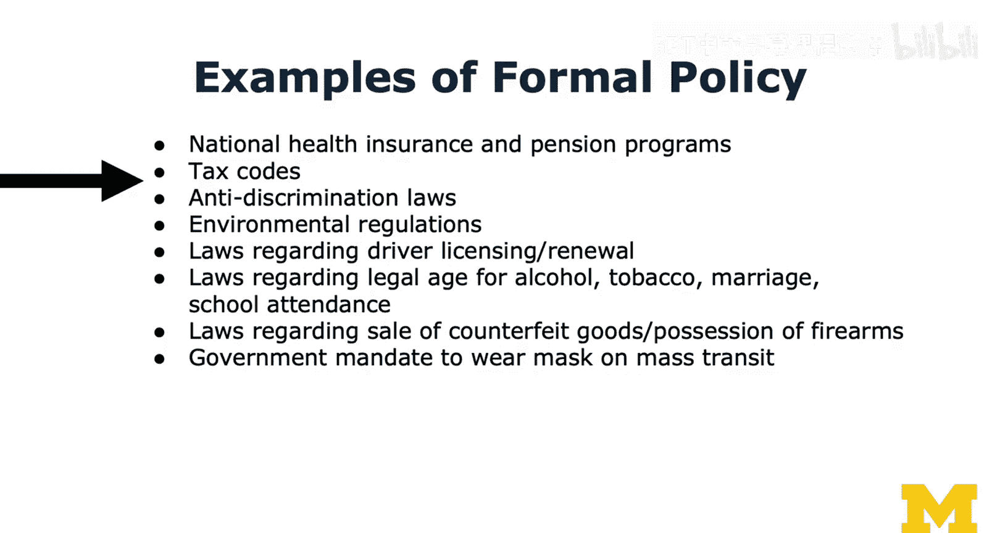
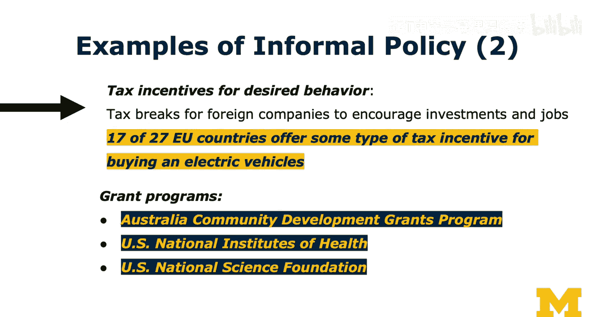

# 1：政策定义及其重要性 📚

在本节课中，我们将要学习公共政策的基本概念，包括其定义、不同类型以及为何它在公共部门工作中至关重要。理解政策是进行有效政策分析的第一步。

## 什么是政策？🤔

在最普遍的层面上，政策是政府、政党、商业组织甚至个人所采纳或提议的行动方针或行动原则。个人也可以有自己的个人政策。为了我们的目的，我们专注于公共政策。公共政策包括政府及其下属部门的宪法、法律、法规、行政规则、法院判决以及政府实体采取的其他行动方针。这同样包括资金分配的优先事项。

公共政策可以是正式的，也可以是非正式的，我们稍后会详细讨论。公共政策由政府的各个分支——立法、行政和司法——共同创建。公共政策的影响范围非常广泛，不仅对公共部门本身，也对私营部门、非营利部门和普通公众产生深远影响。公共政策以积极和消极的方式塑造着我们社会中的所有系统、机构、组织和社区。

## 政策类型：正式与非正式 📋

公共政策领域中最简单的政策类型学是区分正式政策（大P政策）和非正式政策（小P政策）。

### 正式政策（大P政策）

正式政策或大P政策包括法律、法规、行政命令、法院裁决、行政规则、预算规则、福利计划等等。正式政策最重要的特点是，不遵守政策会产生后果。这些后果可能包括罚款、吊销执照或其他特权，甚至刑事处罚。正式政策往往会影响大量人群，但其最重要的特征仍然是不遵守政策会带来后果。

以下是正式政策的一些例子：
*   国家健康保险和养老金计划。
*   税法。
*   反歧视法律。
*   环境法规。
*   所有与驾驶相关的法律。
*   关于许多活动（如饮酒、吸烟、结婚、购买枪支、上学）法定年龄的法律。
*   关于销售假冒或仿冒商品的法律。
*   疫情期间政府要求在公共交通上佩戴口罩的强制令。

### 非正式政策（小P政策）

另一方面，我们还有非正式政策或小P政策。非正式政策包括专业协会或政府发布的指南、专家小组的建议、机构内部的规则、针对青少年的各类地方性项目、政府用于能力建设的拨款等。非正式政策比正式的大P政策更不正式或更灵活。它的范围往往更小，使用的资源也通常更少。但同样，非正式政策最重要的部分是，不遵守政策通常没有后果。

以下是非正式政策的一些例子：
*   公共信息或教育活动。例如，葡萄牙有一个针对儿童的反仇恨运动，名为“无仇恨忍者”运动。巴西有一个关于如何保护个人数据的公共信息宣传活动。
*   政府和专家组织发布的关于佩戴口罩的所有指南和建议。政府的口罩强制令是正式的大P政策，如果不遵守（例如不戴口罩被禁止进入某些场所，有时甚至会被罚款），会有后果。但关于佩戴口罩以防止新冠病毒传播的指南和建议是非正式政策的例子。
*   许多国际机构发布的各种建议、最佳实践、报告和指南。这包括联合国政府间气候变化专门委员会发布的报告和指南。该小组为正式和非正式的政策变革提出了许多建议。

让我们再举几个简单的例子。虽然我们都被要求纳税，这是一种非常正式的公共政策，但也存在一些税收激励措施，这些是非正式政策，旨在“助推”而非要求或强制某些类型的行为。例如，欧盟17个国家为购买电动汽车的消费者提供税收减免。这不是强制要求，如果你不这样做也没有后果，但如果你做了，就可以在税收上获得优惠。此外，用于社区发展、健康及其他类型科学研究、艺术等的政府拨款计划，也可以被视为非正式政策。

## 总结 📝

本节课中，我们一起学习了公共政策的基本定义，并区分了正式政策（大P政策）和非正式政策（小P政策）。正式政策具有强制力，不遵守会带来明确后果；而非正式政策则更具引导性，通常以建议、指南或激励措施的形式出现。理解这一区别对于后续深入探讨政策分析至关重要。在接下来的课程中，我们将应用这些概念，并学习如何利用数据分析来支持政策制定和评估。