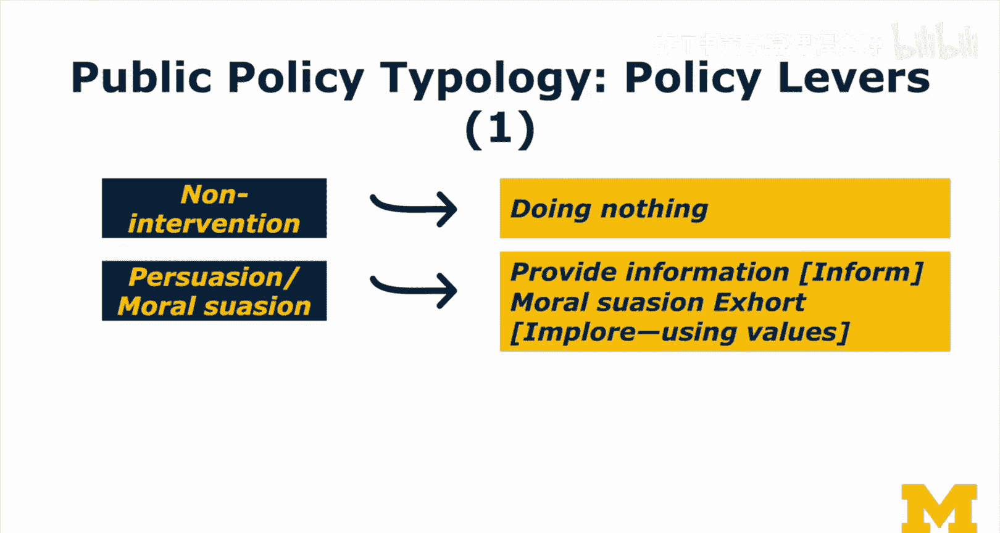
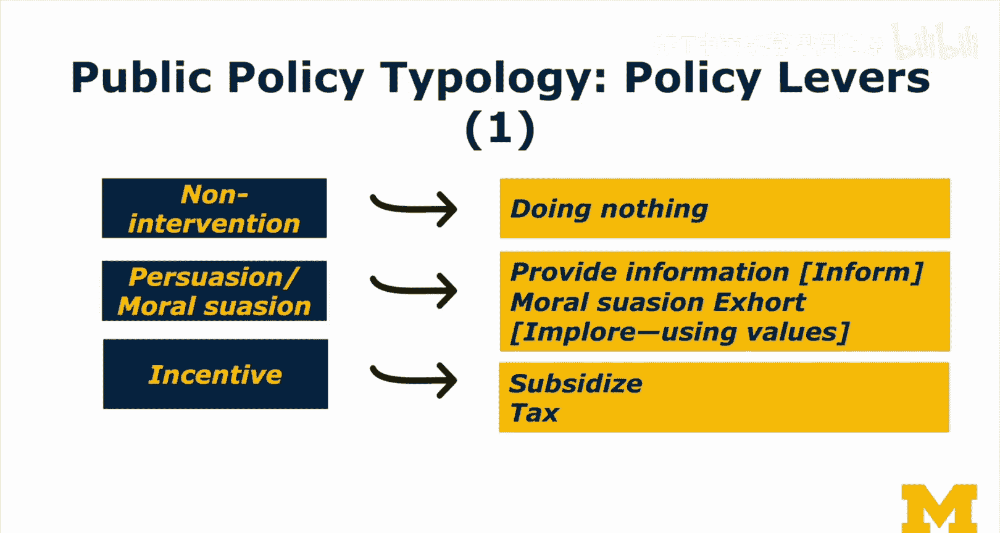
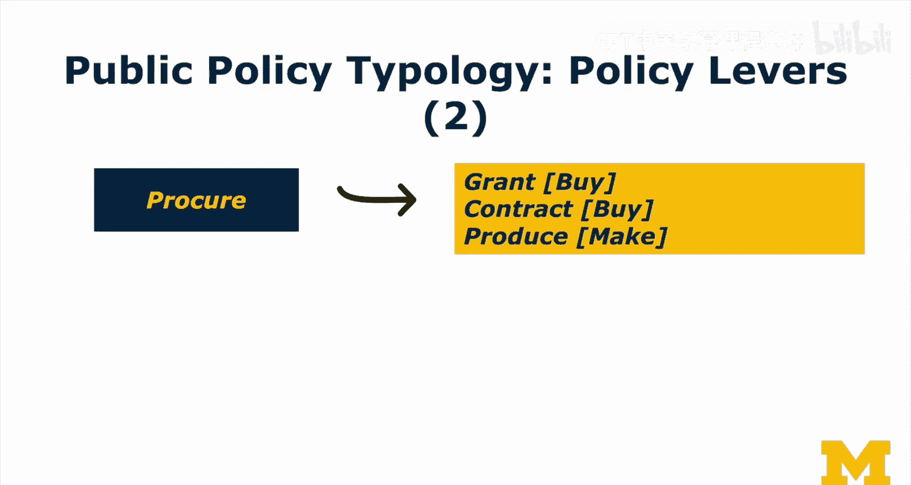
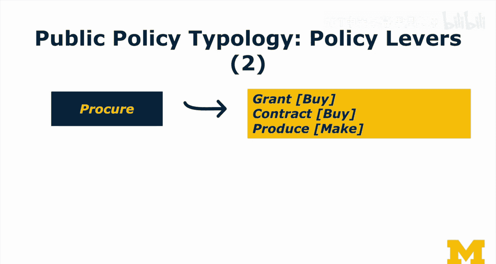
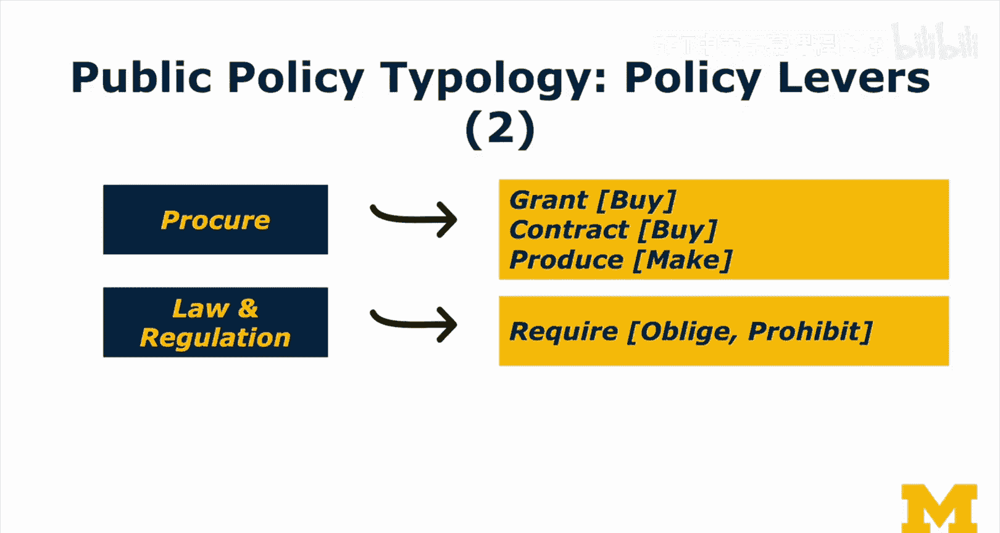
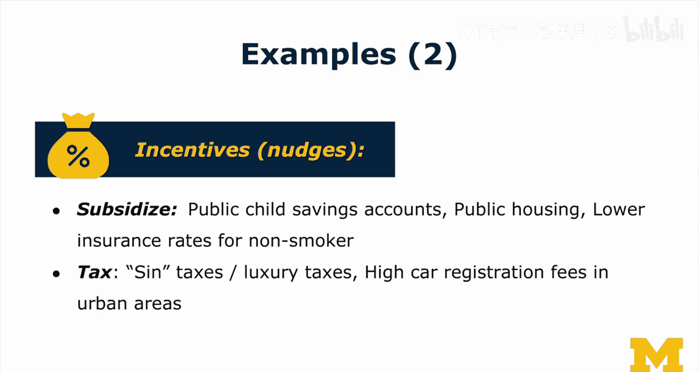
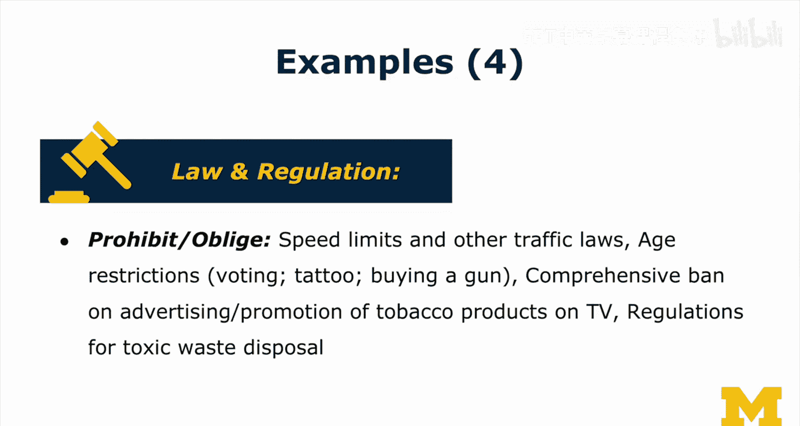
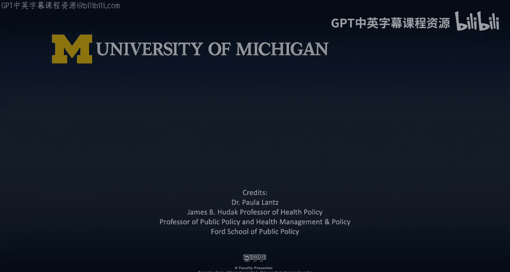

# 公共政策分析：2：政策类型学框架 🏛️

在本节课中，我们将学习一个详细的政策类型学框架。该框架指出，政府通常拥有八种不同类型的政策或政策杠杆可供使用。我们还将探讨每种政策类型的具体含义和实例。

上一节我们介绍了正式与非正式政策的区别，本节中我们将更详细地探讨政策的具体类型。

## 政策类型学概述

首先需要记住，政府实际上有第九种政策选择，即维持现状或无所作为。因此，在讨论各类政策选项时，必须意识到保持政策环境不变本身也是一种政策选择。现在，让我们深入探讨这个类型学框架。

## 八种政策杠杆类型

以下是政府可用的八种主要政策类型，分为几个大类。

### 1. 劝说与道德劝诫 🗣️

这类属于非正式政策，旨在通过劝说影响个人或组织的行为，而不强制要求。主要包括两种方式：

*   **告知**：政府向公众提供信息、数据和推荐，以期影响行为，但不作强制要求。例如，政府发布数据称：“去年本地区有75人死于酒驾，酒驾的处罚是...”，并列出具体处罚。
*   **劝诫**：在提供信息的同时，诉诸价值观或情感，甚至使用警示策略。例如，宣传运动称：“酒驾去年夺走了75条无辜的生命，其中包括30名儿童，摧毁了无数家庭。请交出车钥匙，指定一名代驾。”劝诫与告知的区别在于，告知提供事实，而劝诫则诉诸价值观并建议具体行动。

### 2. 经济激励 💰

这类政策通过经济手段影响行为，主要包括两种：

*   **补贴**：通过降低商品或服务的价格来鼓励消费或行为。例如，儿童储蓄账户、公共住房补贴、保险公司对非吸烟者提供更低费率。
*   **税收**：通过提高商品或服务的价格来抑制需求。这包括常见的“罪恶税”（如对香烟、酒精、赌博收入的税收），以及对游艇、皮草等奢侈品的更高税率。此外，使成本增加的费用或罚款也属于此类，例如，城市地区更高的车辆注册费，就是为了减少该区域的汽车数量。

### 3. 采购与生产 📦

这是政府的一项重大活动，涉及在公共部门经济中提供商品和服务。政府需要做出“制造或购买”的决策。

*   **采购**：政府通过**赠款和合同**从外部供应商（私营企业）购买商品或服务。例如，政府合同聘请私营媒体公司设计公益广告；政府付费请私营公司进一步研发和生产疫苗。
*   **生产**：政府利用自身部门和雇员来制造产品或提供服务。例如，政府运营公立学校系统并制定标准课程；政府提供邮政服务、修建和维护道路；政府负责国家安全相关的军事、网络安全和情报事务。

### 4. 法律与监管 ⚖️

这是最重要的正式政策行动，通过法律和法规要求或禁止某些行为，否则将面临后果。

*   **禁止**：禁止某些行为。例如，禁止在电视上播放烟草广告；制定有毒废物处理法规。
*   **强制**：要求必须采取某些行为。例如，车速限制和其他交通法规；对投票、纹身等行为的年龄限制。

## 总结

本节课中，我们一起学习了公共政策的八种主要类型：**告知**、**劝诫**、**补贴**、**税收**、**采购**、**生产**、**禁止**与**强制**。理解这个框架有助于我们系统地分析政府可能采取的政策工具，并认识到“维持现状”本身也是一个重要的政策选项。每种类型都有其独特的应用场景和影响方式，是公共部门决策与分析的基础。