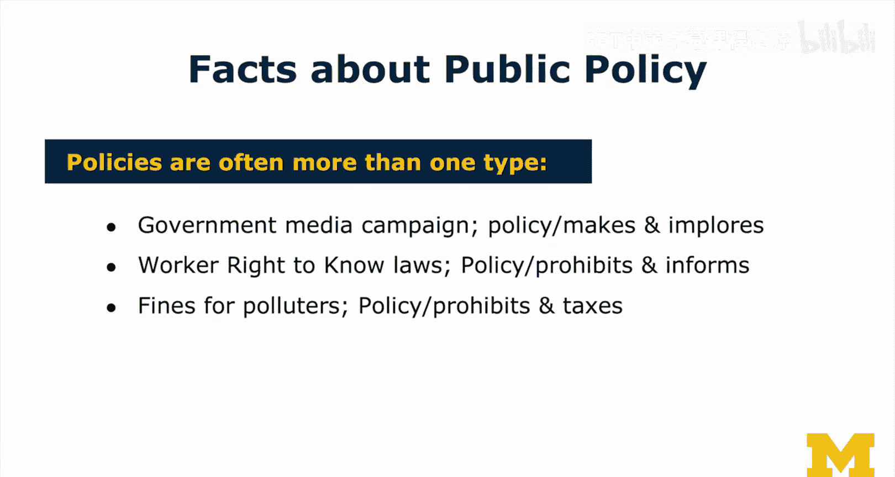
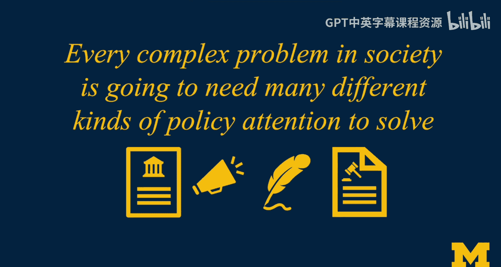

# 公共政策分析：3：公共政策的基本事实 🏛️

在本节课中，我们将学习公共政策的一些基本事实。这些事实跨越了不同国家和政府类型，有助于我们理解公共政策的普遍性和复杂性。

## 公共政策的复杂性

公共政策在国家内部实际上相当复杂，并且在国家之间确实存在差异，且非常复杂。公共政策在制定方式以及政策本身方面都大不相同。

然而，这里有一些关于不同类型公共政策的基本事实，这些事实确实跨越了不同国家和不同类型的政府。

## 政策的复合性

首先，许多政策不止一种类型，或者同时运用了不止一种政策杠杆。

以下是几个例子：

*   **例子一：** 如果政府设计自己的教育媒体宣传活动，这是一种非正式政策，既**制定**了信息，也**影响**了公众。
*   **例子二：** 工人知情权法律，即要求企业以书面形式告知其员工在工作中可能面临的风险、危险和潜在伤害的法律。这是一个正式政策的例子，它**禁止**企业不提供此信息，否则将面临罚款，同时也**告知**了工人。
*   **例子三：** 当政府对污染企业处以罚款时，这是一项正式政策，它做了两件事：**禁止**企业污染（通常有非常明确和详尽的规定），并且如果企业违反该政策，还会通过罚款对其进行**征税**。

## 应对复杂社会问题

接下来，我们思考公共政策在不同国家之间的另一个共同点。

社会上的每一个复杂问题都需要来自许多不同政策杠杆的多种不同类型的政策关注，以应对问题、缓解问题并尝试解决它。

因此，如果你在政府中从事特定领域的工作，例如教育、交通、环境保护、住房、公共卫生等任何领域，你需要了解与你的议题相关的所有不同类型的政策活动。

## 总结

本节课中，我们一起学习了公共政策的一些基本事实。我们了解到政策常常具有复合性，可以同时运用多种杠杆（如告知、禁止、征税）。同时，我们也认识到，解决复杂的社会问题需要综合运用多种不同类型的政策工具。理解这些基本事实，是进行有效公共政策分析的第一步。