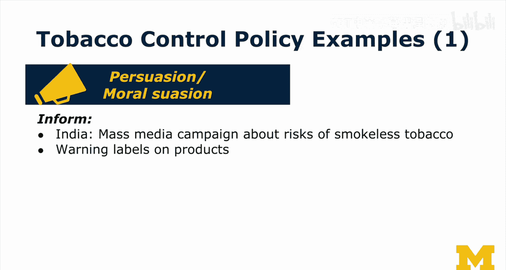
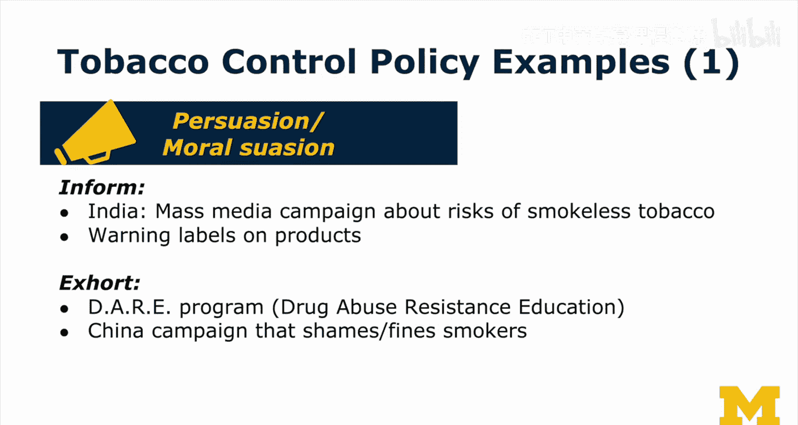
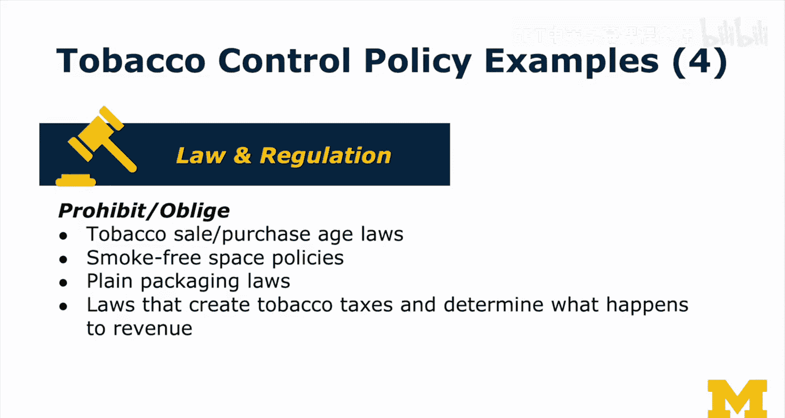
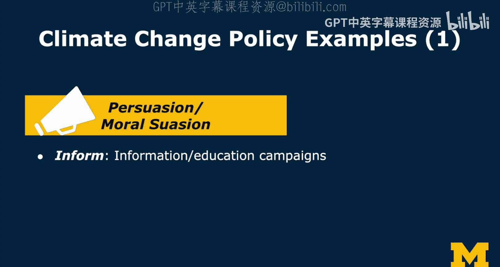
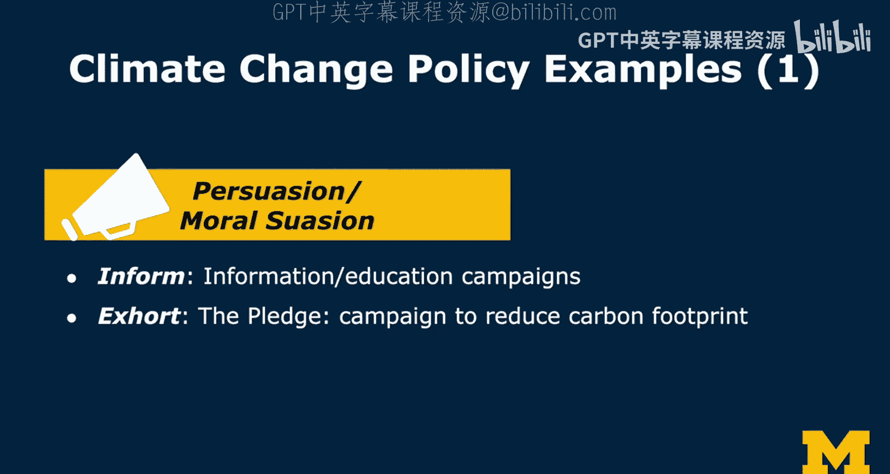
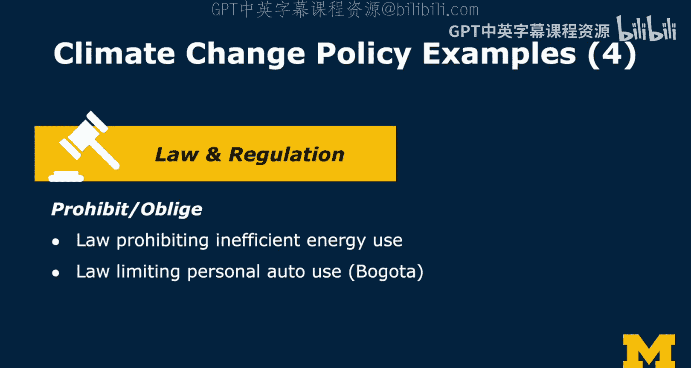

# 公共部门的R数据分析（基础、数据探索、决策支持）：4：政策类型学实例解析 📚

在本节课中，我们将学习如何运用公共政策类型学框架来分析具体的社会问题。我们将通过两个实例——烟草使用控制和气候变化缓解——来演示如何为每个政策杠杆找到对应的政策实例。

当我们思考社会问题和公共政策应对时，我们知道这些问题总是以某种方式受到现有公共政策的影响。同时，这些问题需要通过额外的政策来应对、补救甚至解决。我们还知道，解决复杂的社会问题需要运用多种不同的政策杠杆。

我们已经讨论过公共政策的类型学框架。这个框架可以用来帮助从政策角度思考和理解政府关注的社会问题或议题。在接下来的作业中，我们将要求你运用这个框架。

## 作业任务 📝

以下是作业要求：你需要选择一个你感兴趣的社会问题或公共议题。选择一个你关心、或许已经在工作中或志愿工作中着手处理、或希望处理的问题。为了从政策角度理解这个议题，本次练习旨在考察你能否为问题的某些方面，找出所有不同政策杠杆下已实施或正在讨论的公共政策实例。

我将通过几个例子来展示具体做法。我将使用的例子是旨在减少烟草使用的公共政策，以及与缓解气候变化影响相关的公共政策。

## 实例一：烟草使用控制政策 🚭

让我们进入第一个政策议题：烟草使用控制政策。

### 信息提供类政策

以下是针对此社会问题的“信息提供”政策杠杆的一些实例。

*   在印度，实施了一项关于无烟或咀嚼烟草风险的大众媒体宣传活动。
*   “信息提供”的另一个例子是烟草产品包装上关于使用风险的文字警告标签，例如香烟包装侧面印有“吸烟增加心脏病风险”的微小字体。

### 劝诫敦促类政策

现在从“信息提供”转向“劝诫敦促”。

*   一个例子是全世界许多国家使用的非常形象的警告图片和信息。这从仅仅提供事实信息，升级为发布戏剧性的、带有价值判断的、实际上非常形象的关于吸烟带来的重要且深远的健康影响的警告。
*   另一个超越单纯告知的例子是美国曾广泛使用的DARE项目。DARE代表“抵制药物滥用教育”。这是一项干预措施，美国75%的小学都曾实施，涉及穿制服的警察进入小学，开展为期18周的项目，提供有关毒品、烟草和酒精使用风险的信息，同时也旨在吓阻孩子们。
*   还有一个例子是在中国，曾有一项大众媒体宣传活动，旨在羞辱在公共场所吸烟的人并对其进行罚款。

### 激励诱导类政策

好的，让我们继续思考“激励”类别下的政策实例。我们有许多与烟草使用政策相关的补贴例子。

以下是补贴实例。

*   为非吸烟者降低保险费率。
*   为旨在预防青少年开始吸烟的社区干预措施提供公共资金。
*   另一个例子是公共卫生保险计划，其福利涵盖戒烟药物和其他类型干预措施的费用。

对于“税收”政策杠杆，我们显然有实际的税收。

*   提高价格的烟草产品税是最有效的烟草控制政策之一。
*   然而，另一个例子是提高租住公共住房公寓的吸烟者的租金。

关于“采购”，大多数政府通过赠款和合同购买研究和示范项目，以帮助开发和评估预防吸烟或帮助人们戒烟的干预措施。这方面有很多很多例子。

### 法律规制类政策

关于“法律和监管”，也有很多政策禁止的例子。

*   包括烟草销售和购买的年龄限制法律。
*   关于公共场所无烟区的法律。
*   另一个例子是平装法。这些是关于香烟包装上可以出现什么内容的严格规则和法规。在许多国家，答案是“不多”。平装法禁止公司在包装上实际展示其品牌标识，对烟草香烟包装上必须有多大比例是图形图像、多大比例必须是警告等有非常严格的规定。
*   这里的另一个例子是法律不仅规定了烟草税的税率，还规定了从烟草税产生的收入用于何处。

## 实例二：气候变化政策 🌍

好的，让我们转到另一个例子，这是一个重大的社会世界性问题：气候变化。我们如何再次从政策角度思考气候变化？我们可以采用八种不同政策杠杆的类型学，并为每一种思考与气候变化相关的例子。

### 信息提供与劝诫敦促类政策

对于“信息提供”政策杠杆，一个例子是公共教育活动，它们向人们提供关于臭氧层空洞大小、气温上升、海平面上升、极地冰盖融化速度、火灾发生率增加等信息，真正提供将地球变化与气候变化相关联的科学信息。

但是，超越信息提供，大多数气候变化运动更属于“劝诫敦促”的阵营，因为它们不仅提供信息，而且以提高警惕和呼吁采取非常强烈的行动改变的方式进行。

*   一个例子是“承诺”活动，要求人们估算自己的碳足迹，然后尝试减少它。

### 激励诱导类政策

关于“激励”或“助推”，全球有很多很多补贴的例子。

*   这包括为抵消企业或个人绿色能源投资成本而提供的税收补贴。

关于“税收”，也有很多例子。

*   这包括对碳排放征税。
*   然后，与此相关的还有所谓的“碳限额与交易”政策。

### 采购与政府行动类政策

对于政府通过赠款和合同“购买”东西的政策杠杆。

*   许多城市正在为其公共交通系统购买更节能的公交车。
*   政府也通过开展或投资自身的可再生能源研究来采取政策行动。这由政府机构及其员工进行，但也与政府外部的大学、智库和其他研究人员及其他地方合作。但当政府自己进行时，这就是“政府行动”的一个例子。
*   政府还在其公共交通系统中提供更多的服务和线路给更多的人，以激励人们放下汽车，乘坐公共交通。

### 法律规制类政策

对于“法律和监管”，同样有很多很多例子。

*   仅举几例：禁止低效能源使用的法规和法律，以及限制个人汽车使用的法律。
*   例如，在哥伦比亚波哥大，2014年实施了一项政策，限制车牌以偶数（如0、2、4、6或8）结尾的汽车在月份为偶数的日子的高峰时段行驶。然后，车牌以奇数结尾的车辆在月份为奇数的日子的高峰时段被限制行驶。

当然，对于我们讨论的两个议题——烟草控制政策和气候变化政策——的每一个政策杠杆，都有很多很多其他例子。而且，有些例子不止一种政策类型。这里的重点只是让你开始从政策角度思考你关心的问题。

## 总结 ✨

本节课中，我们一起学习了如何运用公共政策类型学框架分析具体社会问题。我们以烟草使用控制和气候变化为例，详细拆解了“信息提供”、“劝诫敦促”、“激励诱导”、“法律规制”等不同政策杠杆下的具体政策实例。希望你在选择一个你关心的问题，然后思考正在使用或正在辩论的不同类型的公共政策时，能有所收获并感到有趣。