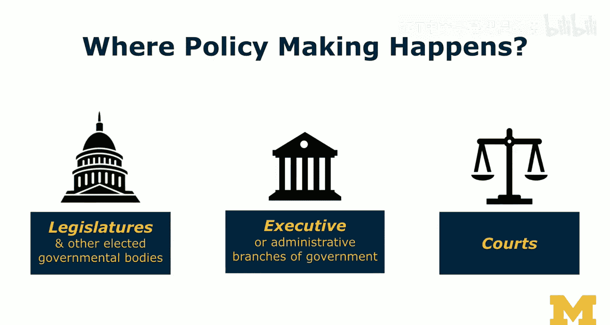
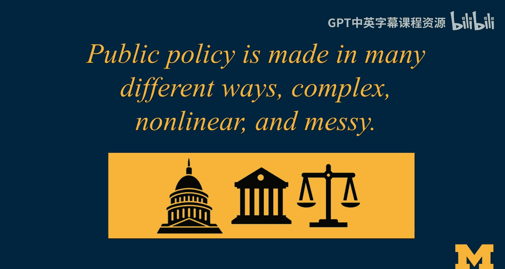
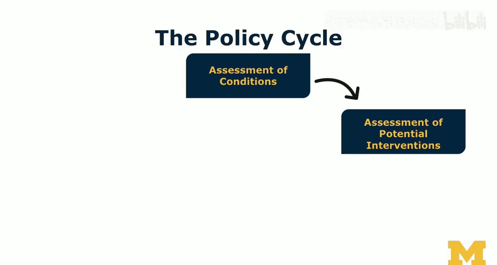
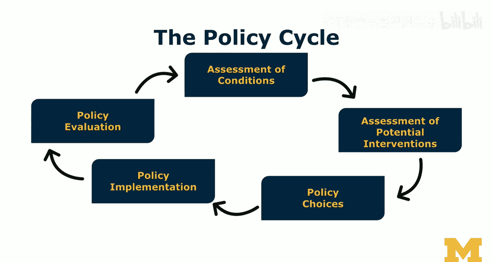
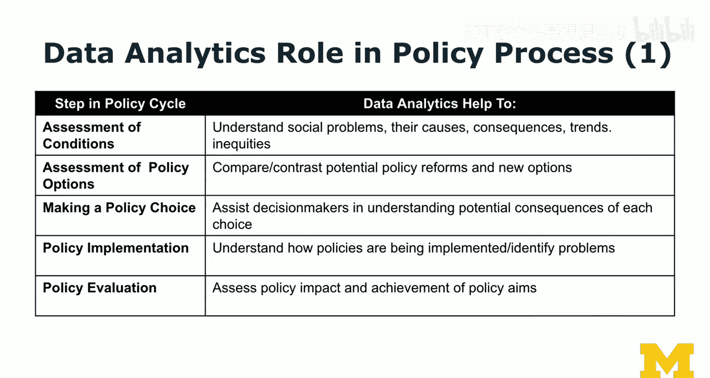
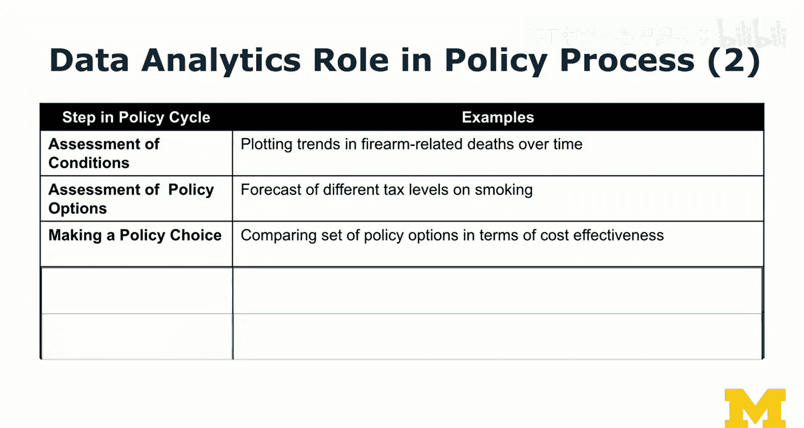
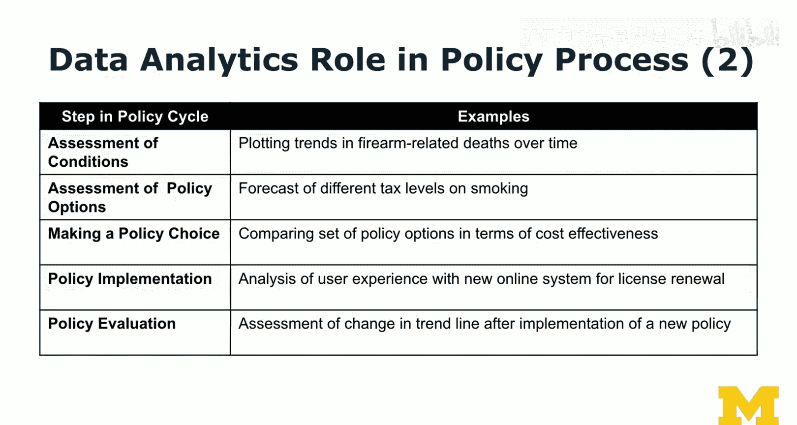
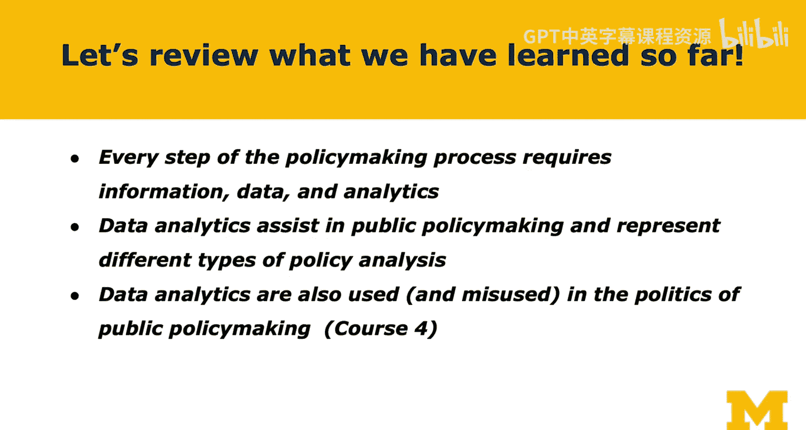

# 5：政策制定流程解析 📊

在本节课中，我们将要学习公共政策是如何制定的。我们将探讨政策制定的场所、一般流程，并重点了解数据分析在政策周期的每一步中所扮演的关键角色。

## 政策制定的场所 🏛️

上一节我们介绍了数据分析的背景，本节中我们来看看政策制定的具体场所。公共政策在政府的多个部门中制定。

政策当然在立法机构中制定。这是立法机构的主要工作。

政策也在政府的行政或管理部门中制定。

此外，政策也在法院中制定。

## 政策制定流程：政策周期 🔄

公共政策的制定方式多种多样，过程相当复杂，绝非线性，且非常混乱。世界各地的政策制定方式也大不相同。

尽管如此，我们可以通过思考所谓的“政策周期”来理解政策及其制定方式的一般规律。这虽然比较概括，但反映了公共政策制定中普遍存在的主要步骤。

以下是政策周期的主要阶段：

首先，在政策周期中，必须对现状进行评估。情况进展如何？是否存在需要解决的问题？是否存在一个日益严重、让更多人担忧的问题？在此，我们还需思考哪些议题能进入政策制定者的议程。

其次，需要对潜在的干预措施进行评估。我们定义了一个问题，现在有哪些可能的干预措施范围？我们可以采取哪些应对行动？

在评估了潜在的政策选项后，需要做出选择。选择可能包括维持现状、不作为，但有时也会进行政策改革，决定实施新政策。

然后，这些政策需要得到执行。因此，政策周期的另一个阶段是政策执行。

政策执行后，我们希望进行评估：所做出并执行的政策选择，是否对那些被定义为有问题或需要政策关注和资源投入的状况产生了影响？显然，之后整个周期会重新开始。这个过程复杂且混乱。

## 数据分析在政策周期中的重要性 📈

接下来我想讨论的是，数据分析对政策周期的每一步都至关重要。

**第一步，现状评估**：数据分析对于理解和可视化正在发生的事情极为重要。人们担忧的问题是什么？原因是什么？有哪些后果？趋势如何？以及我们在这个问题上可能看到哪些不平等现象？

**第二步，政策选项评估**：数据在这里非常重要。我们需要使用数据来比较和对比不同的潜在政策改革和新选项。

**第三步，做出政策选择**：我们希望数据和信息是有用的，能帮助决策者理解其决定可能带来的积极影响，也可能理解一些负面后果。因此，数据分析有助于决策者做出政策选择。

**第四步，政策执行**：这非常重要。我们需要了解政策是如何执行的。它们是否按设计者的意图执行？执行是否存在问题？是否覆盖了正确的人群？某些政策的用户体验如何？因此，政策执行需要大量的数据分析。

**第五步，政策评估**：评估政策影响和实现政策目标的程度，完全依赖于数据。收集数据，然后将其传达给政策制定者和公众，以便我们再次评估现状，判断是否需要重新开始整个周期。

## 实例分析 🔍

让我们看一些例子。

**现状评估**：绘制与枪支相关的死亡人数随时间变化的趋势图，就是当前美国正在进行的此类活动的一个很好的例子。这是利用数据来理解社会问题现状的典范。

**政策选项评估**：我们可以考虑一个政策模拟模型，用于预测不同烟草税水平对吸烟行为的影响。

**做出政策选择**：比较一组政策选项的成本效益，并据此做出决策，就是一个例子。我们将在后续课程中更详细地讨论所有这些内容。

**政策执行**：使用数据分析用户对新上线的驾照续期系统的体验，是说明数据分析如何提供帮助的例子。

**政策评估**：评估新政策实施后趋势线的变化。数据分析在这类评估中极其重要。

## 总结 📝

本节课中我们一起学习了政策制定的流程。政策制定过程的每一步都需要信息、数据以及对信息和数据的良好分析。数据分析有助于公共政策制定，并代表了不同类型的政策分析。数据分析可以在公共政策制定中被使用，但也可能被误用。我们将在本系列的第四门课程中更详细地探讨这一点。