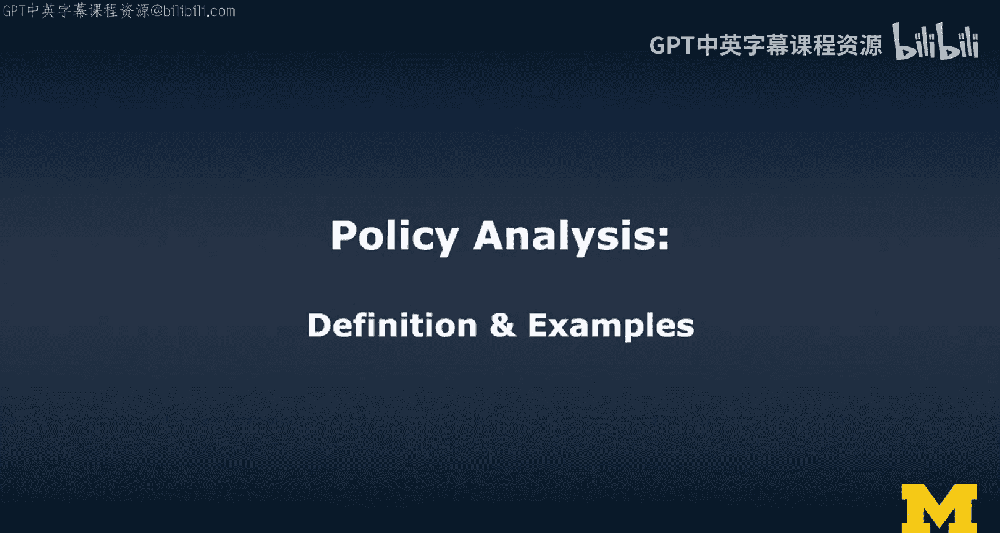
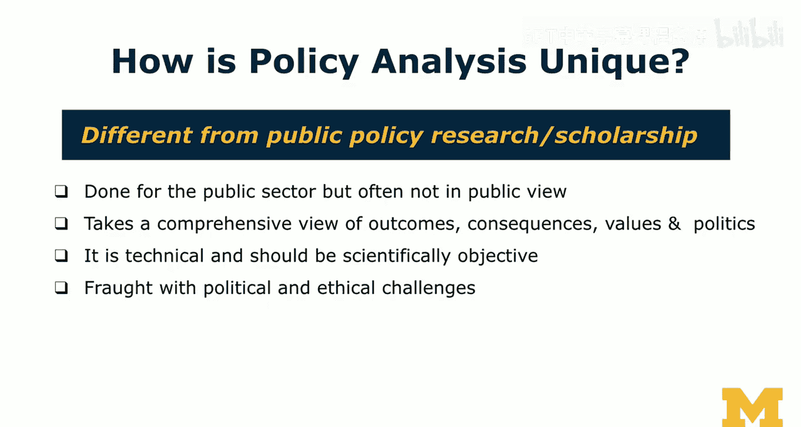
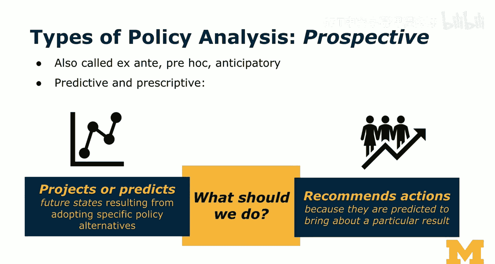
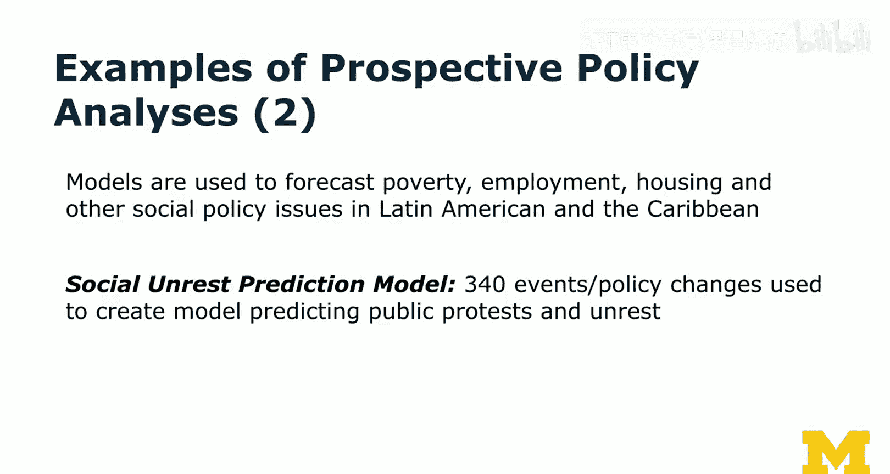
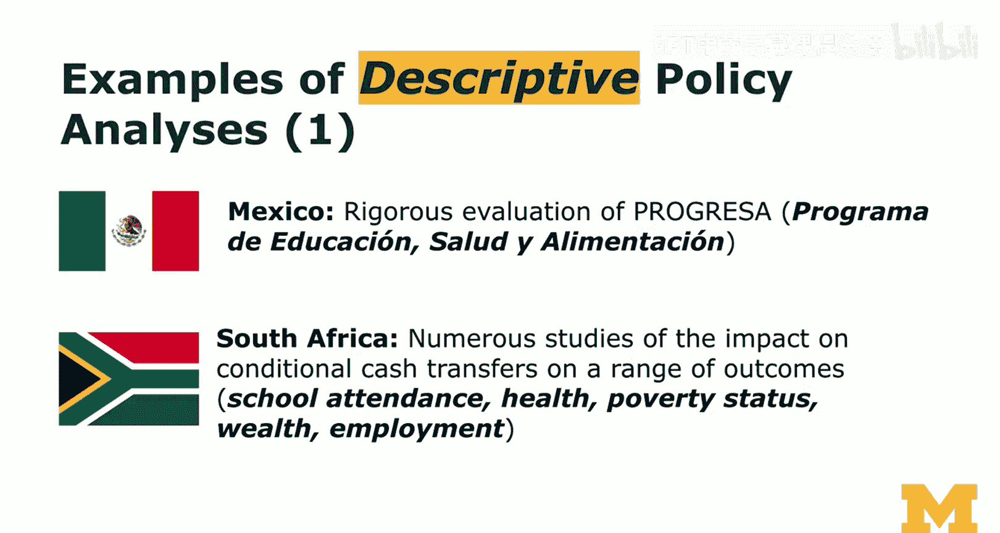
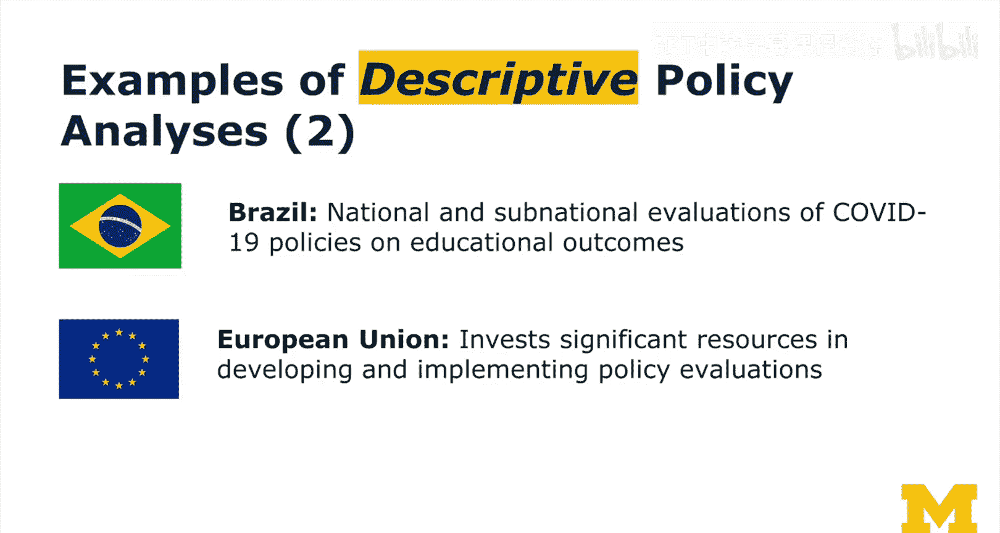

# 6：政策分析：定义与典型案例 📊

在本节课中，我们将学习政策分析的定义、其独特性，并了解前瞻性与回顾性政策分析这两种主要类型及其典型案例。

---

## 政策分析的定义

继续讨论政策制定过程，现在我们来谈谈政策分析。政策分析是为利益相关者或客户提供的、与公共决策相关且受社会价值观影响的建议。

那么，政策分析有何独特之处？它与公共政策研究或学术研究有何不同？首先，政策分析是为公共部门服务的，但通常不公开进行。这与大学或智库的研究人员不同，他们进行研究后，会试图在报告和同行评审期刊上发表。政策分析试图全面审视**结果**、**后果**、**价值观**以及**政治因素**。它具有技术性，应保持科学客观，但也充满了政治和伦理挑战，我们后续将详细讨论。

---

## 政策分析的类型

政策分析主要有两种类型：**前瞻性分析**和**回顾性分析**。

### 前瞻性政策分析

前瞻性政策分析也称为事前分析或预期性政策分析。它是**预测性**和**规定性**的。在前瞻性政策分析中，我们试图预测采纳不同政策方案后可能出现的未来状态。它旨在回答“**我们应该做什么？**”这个问题。分析完成后，目标是推荐行动方案，因为预测这些行动会带来特定结果。

以下是前瞻性政策分析的一些例子：

*   **宏观经济模型**：大多数国家以及联合国、经合组织等国际组织都使用宏观经济模型进行货币和财政政策预测。这些模型试图预测，如果实施不同类型的货币和财政政策，未来会是什么样子，不仅对特定国家，也对全球经济产生什么影响。例如，利率变化对通货膨胀或私营市场表现的影响，或者不同税收变化对消费者行为的影响。
*   **社会预测模型**：在拉丁美洲和加勒比地区，使用一种名为“社会动荡预测模型”的模型。该模型利用社会中发生的不同类型事件以及政策变化，来创建模型，试图预测可能导致多少公众抗议和动荡事件，例如暗杀企图、骚乱等。

### 回顾性政策分析

回顾性政策分析有时也称为事后分析。与试图预测不同政策情景下未来的前瞻性分析不同，回顾性分析旨在回答“**已实施的政策是否有效？所做之事产生了什么影响？**”这个问题。它是对过去政策的评估，以非常技术性的方式进行描述，但重点是评估已实施政策的影响，看其是否达到了目标。

以下是回顾性政策分析的一些例子：

*   **墨西哥PROGRESA计划评估**：墨西哥有一个大型社会福利计划（实际上是一系列计划），称为PROGRESA（教育、健康和营养计划）。已对PROGRESA进行了非常严格的评估，以了解其对所针对的不同社会福利领域的影响。我们将在本课程后面更多地讨论PROGRESA。
*   **有条件现金转移支付的影响研究**：在南非和许多其他国家，进行了大量关于“有条件现金转移支付”干预措施对家庭和住户一系列结果影响的研究，包括儿童入学率、医疗资源使用、贫困状况、财富增长以及就业等。这些项目和政策评估试图告诉我们，当这些政策和项目实施时发生了什么。
*   **其他案例**：在巴西，对国家及地方各级不同类型的COVID-19政策对儿童入学率及其教育成果的影响进行了多项评估。另一个例子是，欧盟投入大量资金和资源，用于制定和实施对许多不同欧盟政策的评估。

---

## 总结

本节课中，我们一起学习了政策分析的核心定义，它旨在为公共决策提供基于社会价值观的建议。我们重点区分了两种主要类型：**前瞻性政策分析**（预测未来，回答“应做什么”）和**回顾性政策分析**（评估过去，回答“效果如何”），并通过全球范围内的具体案例加深了对这两类分析应用场景的理解。