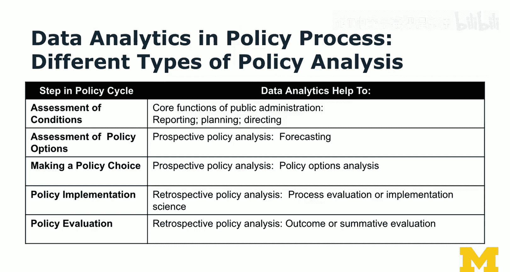
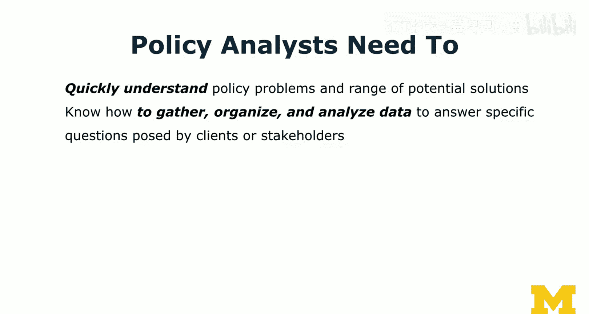
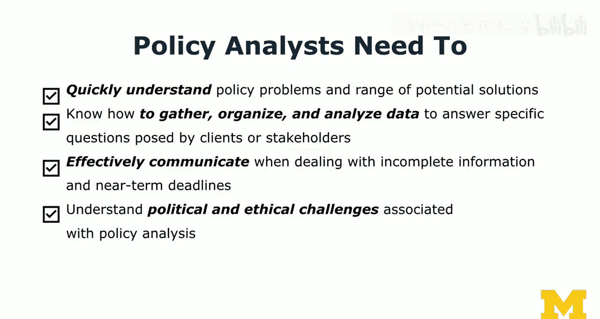
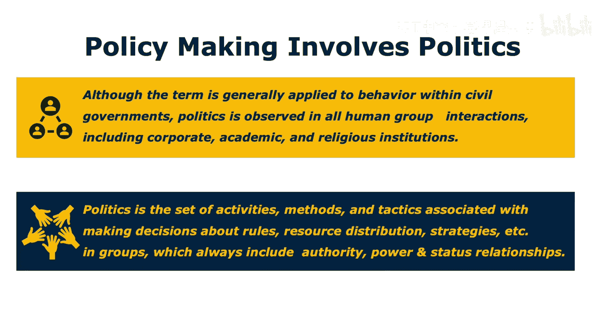
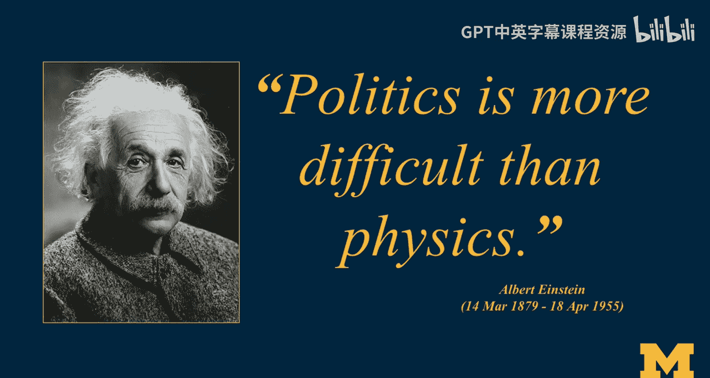
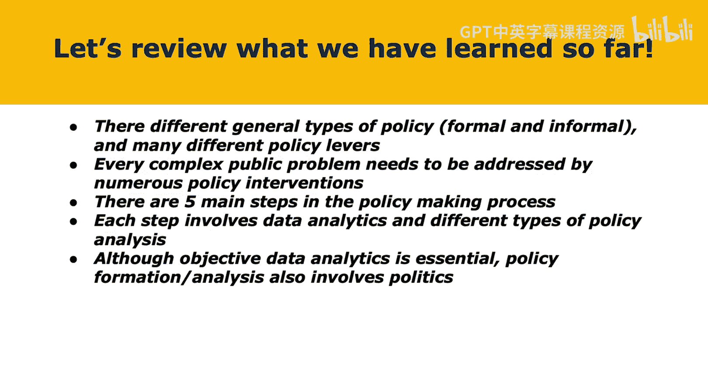

# 7：数据分析在政策分析中的核心作用 📊

在本节课中，我们将要学习数据分析如何成为政策分析各个阶段的核心，以及政策分析师在运用数据技能时需要考虑的更大背景。

---

上一节我们介绍了政策周期的步骤，本节中我们来看看数据分析如何具体应用于这些步骤，并映射到不同类型的政策分析中。

首先，在政策周期的第一步——**现状评估**中，数据分析有助于公共行政的核心职能，包括报告、规划、指导。其作用是使用数据来理解一组现状问题的当前状态、成因、是否需要更多关注以及相关方的关切等。

接下来，政策周期的第二步是**政策选项评估**。

这属于**前瞻性政策分析**。它利用数据和分析来思考我们的政策选项有哪些，以及如果这些选项得以实施，未来可能会是什么样子。这涉及到预测，是前瞻性的。在评估选项并做出选择时，我们使用一种特定的前瞻性分析，称为**政策选项分析**。我们很快将详细讨论政策选项分析和政策预测模型。

然后，在政策实施后，我们需要对其进行评估，这属于**回溯性政策分析**。这包括所谓的**过程评估**或**实施科学**，即评估政策实施的过程。政策周期的第五步是**评估政策的影响**，这也属于回溯性政策分析，我们可以称之为**结果评估**或**总结性评估**。

我们将花大量时间更详细地讨论前瞻性和回溯性政策分析。但此处的要点是，数据分析是政策周期各步骤的核心，因为数据分析是这些不同类型政策分析的核心。

---

现在，如果你要成为一名政策分析师，而不仅仅是数据分析师，那么除了精明敏锐的数据分析技能外，你还需要什么？

以下是政策分析师所需的关键能力：

*   **快速理解政策问题及潜在解决方案范围的能力**：这有助于迅速把握工作背景。
*   **以特定方式收集、组织和分析数据的能力**：这种方式旨在回答客户、利益相关者或决策者提出的具体问题。在这里，你通常需要团队合作，你的职责不是决定人们需要什么数据，而是与他们协作，帮助他们收集、组织和分析数据。
*   **沟通数据的能力**：尤其是在处理不完整信息时，清晰传达数据含义至关重要。
*   **在紧迫时限内工作的能力**：有时政策分析师需要在数小时或数天内完成数据整理、分析和汇报，这类工作节奏可能非常快。

在进行这项工作时，你还需要理解政策分析伴随的政治和伦理挑战。利益相关者通常对数据“应该”说什么有自己的想法，如果数据与他们的认知不符，就会引发政治挑战。此外，虽然令人遗憾，但政策分析师确实常被要求去寻找符合某些人对问题定义或他们想推行的政策的数据，而不希望看到与其观点相悖的数据。我们后续会详细讨论这些内容。

此处的要点是，政策分析师需要有更广阔的视野。

这也是我们花大量时间探讨的原因。你需要理解数据分析所处的**背景**，这不仅仅是技能问题，更关乎这些技能为何被使用，以及你作为分析师在此过程中将扮演什么角色。

---

因此，政策制定必然涉及**政治**。这里的“政治”不一定是贬义词，它通常指代政府内部与权力动态相关的行为，但也存在于所有人类群体互动中，包括企业、学术环境、宗教机构，甚至在家庭中也有所体现。其本质是一系列与制定规则、资源分配、策略和行为决策相关的活动、方法和策略。

简单来说，政治就是当一群人聚在一起试图做决定时发生的事。当存在不同的权威、权力和地位关系时，政治会变得尤其具有挑战性。阿尔伯特·爱因斯坦有一句我很喜欢的名言：“政治比物理更难。”我倾向于同意这一点。这并不意味着我们必须害怕政治，但我们必须意识到，即使你作为一名分析师身处公共政策领域， ostensibly 以尽可能客观、中立的方式处理数据，其中也必然涉及政治因素。

---

在本课程的第一个模块中，我们目前已经涵盖了以下内容：

以下是本模块的核心要点总结：

*   政策有不同的一般类型（正式与非正式），每个复杂的公共问题都需要多种不同类型的政策干预来解决。
*   政策制定过程包含五个主要步骤，每个步骤都涉及数据分析，并对应不同类型的政策分析。
*   虽然客观的数据分析至关重要，但政策的形成和分析也涉及政治因素。

---

本节课中我们一起学习了数据分析在政策周期各步骤（现状评估、选项评估、实施后评估）中的核心应用，区分了前瞻性分析与回溯性分析，并探讨了政策分析师所需的综合能力及其工作的政治背景。理解这些背景是有效运用数据分析技能支持决策的关键。