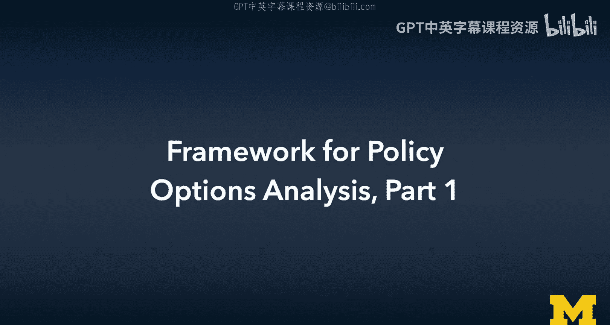
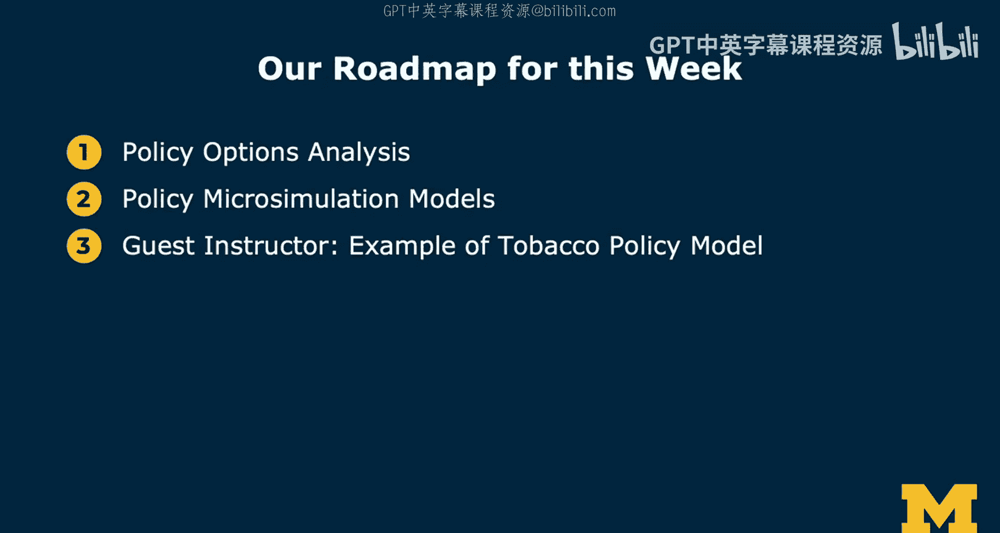
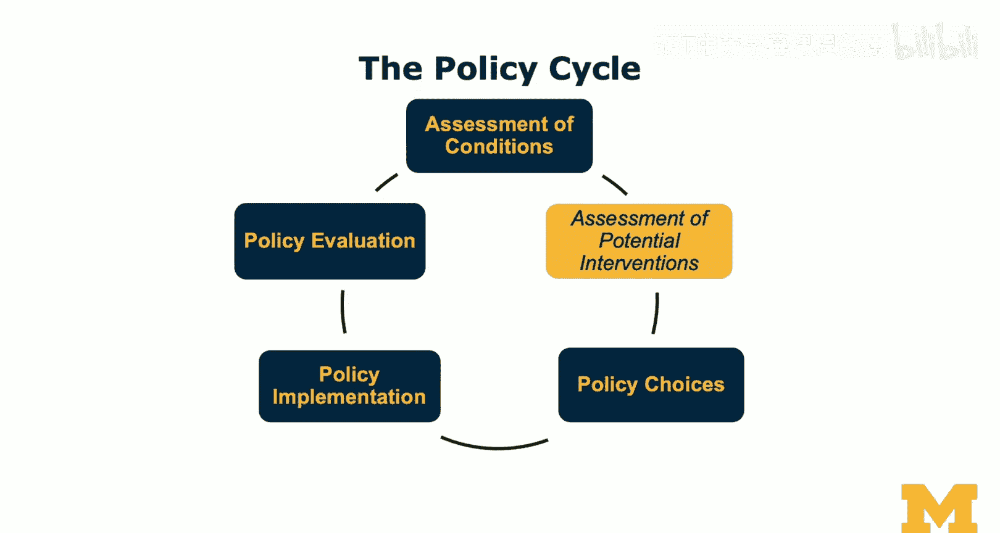
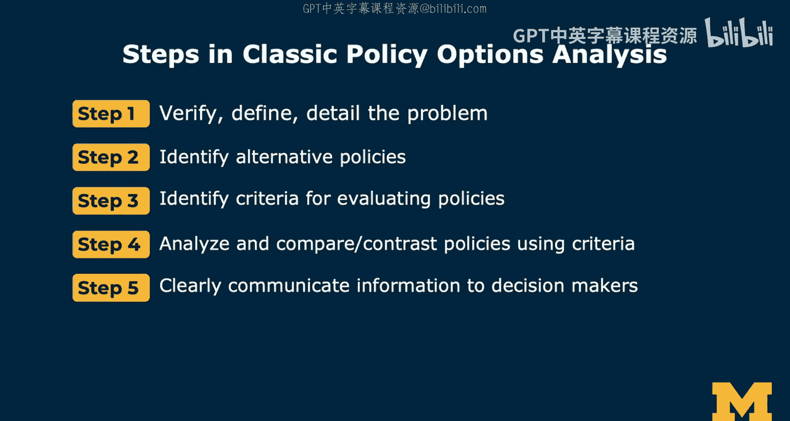
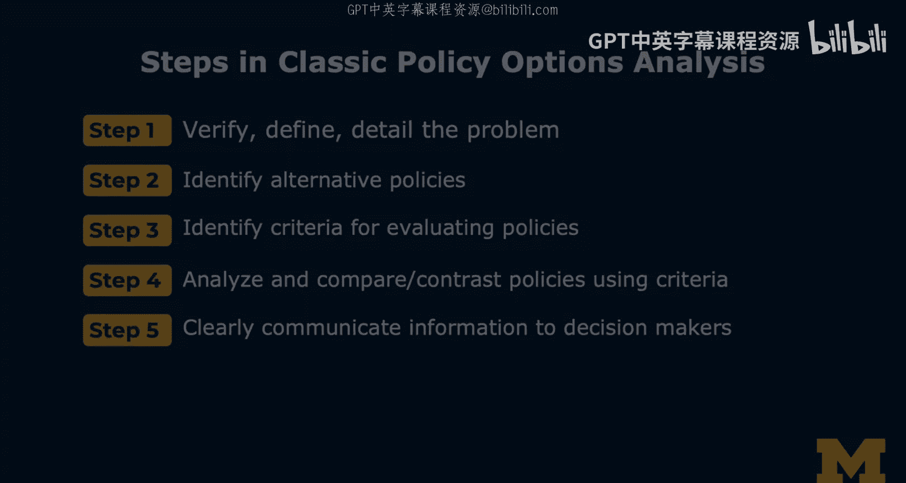
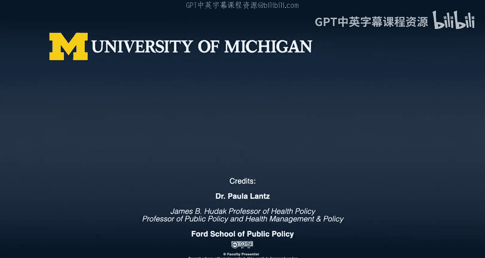

# 8：政策选项分析框架（第一部分）🎯

在本节课中，我们将要学习前瞻性政策分析的一种核心方法——政策选项分析。我们将了解其定义、在政策周期中的位置，并详细拆解其标准实施步骤。

---

欢迎回来。我们继续讨论不同类型的政策分析。

本节课我们将聚焦于**前瞻性政策分析**，即帮助决策者决定“我们应该做什么”的分析。

首先，我们来看看学习路线图。

---

## 学习路线图🗺️

首先，我将解释什么是政策选项分析。

接着，我们将讨论另一种前瞻性政策分析——**政策微观模拟模型**。

之后，我的同事兼朋友大卫·门德斯教授将作为客座讲师，介绍他设计并已被广泛用于辅助决策的烟草政策模型。

---

## 什么是政策选项分析？🤔

政策选项分析是一种前瞻性政策分析。它也被称为预期性分析。

顾名思义，这种分析是**预测性**或**规定性**的。我们试图预测未来，即预测采纳不同政策方案后可能产生的未来状态。

基于这些预测，我们尝试为决策者提供行动建议。其核心目的是回答决策者的问题：针对某个需要解决的社会问题或政策议题，**我们应该做什么**？

---

## 在政策周期中的位置🔄

我们之前讨论过政策周期，它包括：评估现状、评估潜在干预措施、做出政策选择、实施一项或多项政策，然后进行评估，循环往复。

今天，我们正处于第二步——**评估潜在干预措施**。这正是前瞻性、规定性的政策分析。

---

## 政策选项分析的标准步骤📝

以下是经典政策选项分析的步骤。

### 第一步：核实、定义、细化问题

首先，必须核实、定义并细化问题。决策者认为需要解决的具体问题是什么？正如我们之前讨论的，数据对于定义问题至关重要。

### 第二步：识别备选政策

第二步，需要识别有哪些备选政策。需要记住，有一个政策总是被包含在内：**现状**。即我们可以选择维持现状。除了现状，还有哪些可以考虑和实施的政策变更？

### 第三步：建立评估标准

第三步，需要使用**可衡量的标准**来评估我们在第二步中识别出的不同政策方案。

### 第四步：分析比较备选方案

第四步，使用这些标准来分析和比较我们的一系列政策备选方案。

### 第五步：清晰传达信息

第五步，需要将这些信息清晰地传达给决策者。

总结来说，我们需要识别一小部分备选政策，确定一些用于比较它们的标准，然后进行分析，最后将结果传达给决策者。

---

## 总结📚

本节课中，我们一起学习了政策选项分析的基础框架。我们明确了它是一种前瞻性分析，旨在预测不同政策选择的未来结果以辅助决策。我们回顾了它在政策周期中的位置，并详细拆解了其五个核心步骤：定义问题、识别备选方案、建立评估标准、分析比较方案以及传达结果。

下一节，我们将继续探讨另一种强大的前瞻性分析工具——政策微观模拟模型。