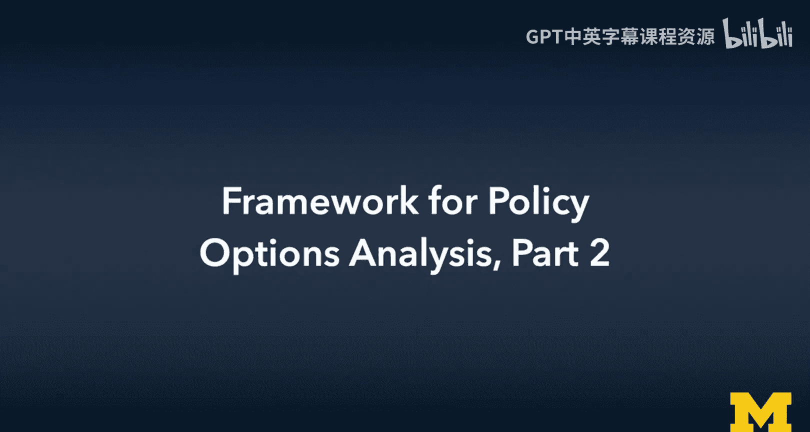
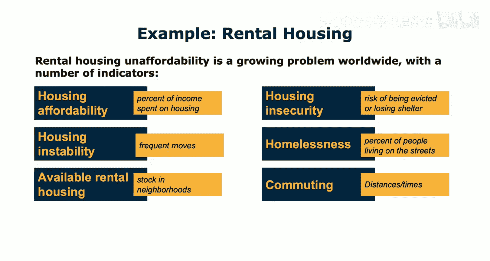
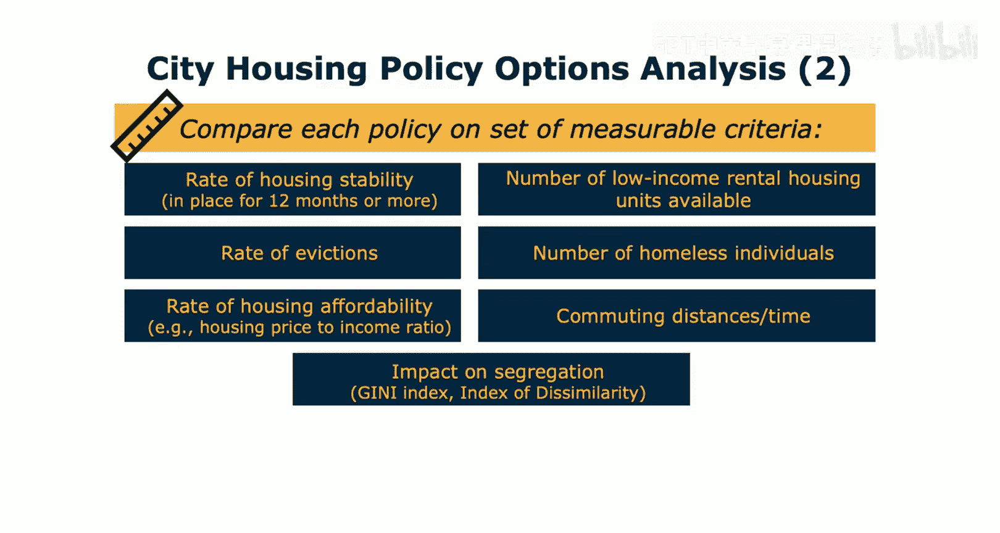
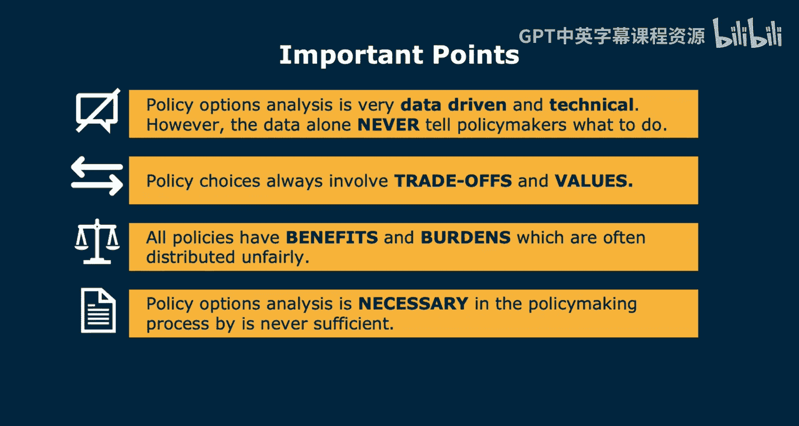
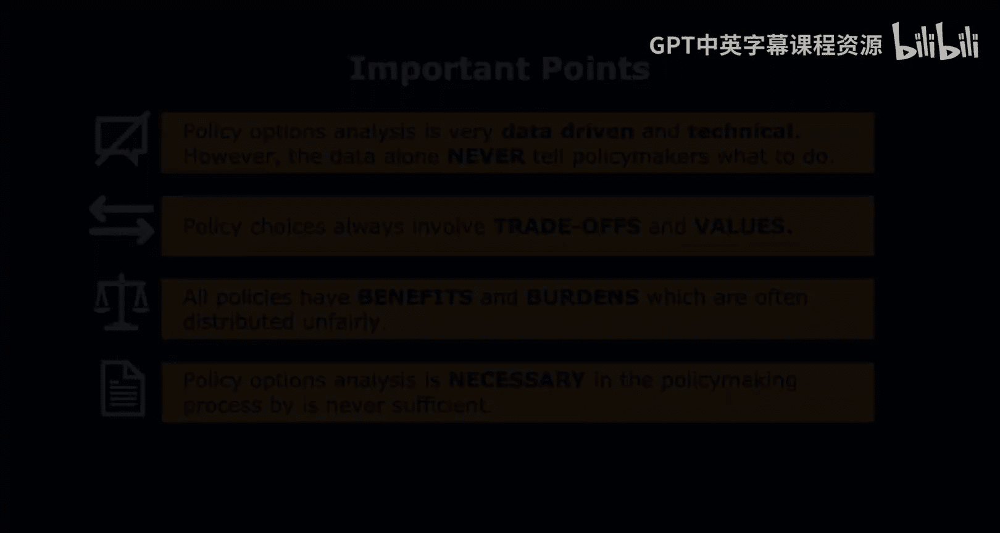

# 9：政策选项分析框架（第二部分）🏠

在本节课中，我们将继续探讨政策选项分析，并以城市租赁住房问题为例，学习如何构建一个具体的分析框架。

上一节我们介绍了政策选项分析的基本概念，本节中我们来看看如何将其应用于一个实际的社会问题。

## 租赁住房问题概述

租赁住房负担能力不足是一个全球性的问题。我们可以通过多个数据指标来了解这一问题的严重性。

以下是衡量租赁住房问题的几个关键指标：

*   **住房可负担性**：通常定义为家庭收入中用于住房支出的百分比。
*   **住房不安全性**：指被驱逐或失去住所的风险。
*   **住房不稳定性**：通常以个人或家庭在一定时间内被迫搬家的次数来衡量。
*   **无家可归者**：通常定义为没有固定住所（包括庇护所）的人口比例或比率。
*   **住房供应量**：特定社区的租赁住房存量。
*   **通勤时间与距离**：人们为了找到负担得起的安全住房，需要居住在离工作地点多远的地方，以及由此产生的通勤时间。

## 潜在的政策选项

面对城市的租赁住房问题，政府可以考虑多种政策选项。许多城市都已认识到住房可负担性和安全性方面的问题。

以下是政府可以实施的一些潜在政策选项：

*   **租金管制**：对房东在一定时间内的租金上涨次数和涨幅百分比进行限制。
*   **政府租金补贴**：政府为租客提供租金补贴，并直接支付给房东。例如，美国的“第8条款住房券”计划。
*   **调整分区法规**：例如，规定大型公寓楼必须有X%的单元用于政府补贴的租赁计划。
*   **公共部门建设补贴**：为公共部门建造更多经济适用房提供补贴和激励。
*   **激励私人开发商**：通过提供低息贷款等方式，激励私人建筑商建造更多低收入住房。
*   **防止居民被迫搬迁**：在租金上涨或社区高档化的地区，通过协助房东承担法规合规成本，防止他们将成本转嫁给租客，从而避免居民被迫搬离。

在住房政策选项分析中，我们首先要考虑决策者真正愿意讨论的一组可行选项。这个选项集不宜过大，需要精简、合理。通常，“维持现状”总是一个备选方案，然后我们将其他政策选项（政策A、B等）与现状进行比较。

## 分析与比较标准

确定了精简的政策选项集后，下一步是在一组可衡量的标准上对每个政策选项进行比较和对比。

在住房问题上，我们可以使用以下标准来比较不同的政策选项：

*   住房稳定率
*   驱逐率
*   住房可负担性比率
*   可用的低收入租赁单元数量
*   无家可归者人数
*   通勤距离和时间
*   对居住隔离的影响：这些政策是会加剧还是会减少种族居住隔离？我们可以使用**基尼指数**或**相异指数**等指标来衡量。

公式示例：基尼系数是衡量不平等程度的常用指标，其值介于0（完全平等）和1（完全不平等）之间。

## 重要总结

本节课中我们一起学习了如何针对具体问题（如租赁住房）构建政策选项分析框架。

最后，总结一些重要观点：

首先，政策选项分析是高度数据驱动和技术性的，数据分析师在其中扮演重要角色。

然而，数据本身永远无法告诉政策制定者应该做什么。这是因为政策选择总是涉及权衡取舍，以及对那些取舍的价值判断。所有政策都同时带来收益和负担，而且这些影响往往分配不均。

因此，虽然政策选项分析在政策制定过程中是必要的，因为它为决策者提供了重要的信息和数据，但其本身永远是不充分的。我们将在未来更深入地探讨所有这些内容。

---

**本节课中我们一起学习了**：如何以城市租赁住房问题为例，具体应用政策选项分析框架，包括识别问题指标、列举潜在政策选项、以及确定用于比较这些选项的可衡量标准。我们认识到，数据分析为决策提供了关键依据，但最终的 policy 选择仍需结合价值判断和权衡取舍。