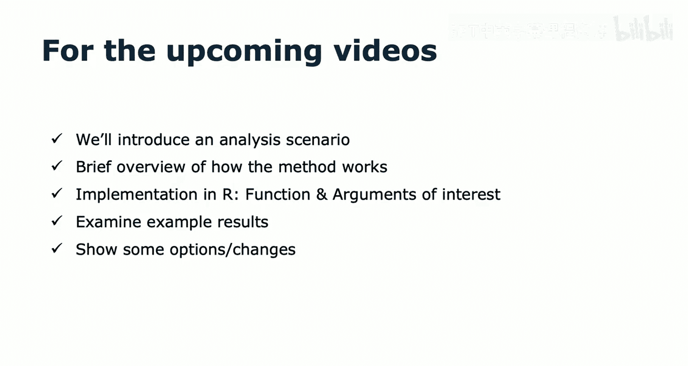

# 公共部门的R数据分析：10：R语言推断性统计分析导论 🎯

在本节课中，我们将学习如何在R环境中进行推断性统计分析。我们将从基础的工作流程开始，介绍如何使用脚本和项目来组织分析，为后续深入学习R语言打下基础。

大家好，我是Alton Worthington。我是一名政治学家，也是福特公共政策学院的公共政策讲师。我在公共部门、私营部门和学术界都有数据分析的经验，并且喜欢教授人们新的方法，以帮助他们更好地理解世界。

今天，我将教大家如何使用R语言中的方法进行统计分析。我们将只探讨R语言功能的一小部分，但这是进入R环境进一步学习的大门。

## 工作环境与方式 🖥️

我们将采用一种与之前略有不同的方式工作。之前大家使用的是笔记本（notebooks），而今天我们将更直接地使用代码。

我们将学习如何在控制台（console）和脚本（script）中与代码交互。我们会编辑脚本，将代码传递到控制台运行，并查看结果。其中一些部分大家会感到熟悉，另一些部分则会有些不同。但无论如何，我们都是在大家已经熟悉的同一环境中工作。

以下是我们的工作环境布局示意图：

*   在右上方，我们将看到熟悉的代码脚本区域。它看起来不会像笔记本，而更像一个分析脚本。
*   在右下方，是我们的数据环境区域，我们创建的对象会在这里显示。
*   控制台位于左下方，我们运行代码的结果会在这里呈现。
*   在截图中的左下方是文件区域，但当我们创建图表时，图表会在这里弹出显示。

## 使用项目组织分析 📁

我们将尝试使用项目（projects）来组织我们的数据和代码，这是一种略有不同的方式。

本系列视频的所有分析都将以项目的形式分享。因此，你会看到一个 `.Rproj` 文件，并在一个文件夹中看到其他文件。

我们所有的分析内容都将集中在一个文件夹中，包括：
*   数据文件
*   用于进行分析的脚本
*   我们创建的任何输出文件（例如图表或其他图像）

所有这些都与一个单一的项目相关联。

不过，你并非必须使用项目。只要你将脚本和所有文件放在同一个工作目录下，也可以顺利进行。本系列视频中所有要执行的操作都包含在脚本中。

## 课程内容预告 📋

在接下来的视频中，我们将：
1.  **引入分析场景**：设定具体的数据分析问题。
2.  **方法概述**：简要介绍我们将要使用的方法是如何工作的。
3.  **R语言实现**：具体介绍相关的函数及其参数。
4.  **结果检验与探索**：查看分析结果，并在必要时调整选项，观察变化。

我期待与大家一起学习，我们很快再见。😊

---

**本节课总结**

在本节课中，我们一起学习了R语言推断性统计分析的入门知识。我们了解了新的工作环境布局，包括脚本、控制台和数据环境的交互。我们还介绍了使用R项目来组织分析文件的好处，确保数据、代码和输出结果井然有序。最后，我们预览了后续课程的结构，为学习具体的统计分析方法做好了准备。