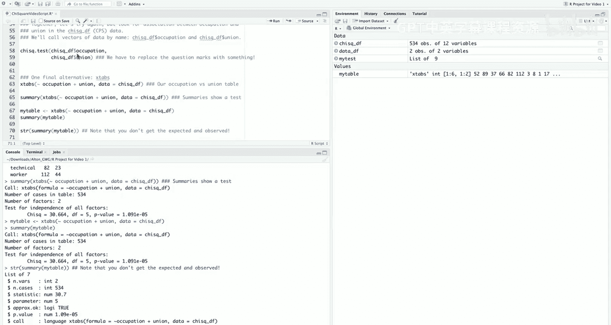

# 公共部门的R数据分析：11：卡方关联性检验 📊

在本节课中，我们将学习如何处理分类数据，并检验两个分类变量之间是否存在关联。我们将重点介绍列联表的创建、比例表的计算以及执行卡方独立性检验的方法。

## 创建列联表

上一节我们介绍了分析分类数据关联性的需求，本节中我们来看看如何创建列联表。列联表（也称为交叉表）是分析两个分类变量关系的基础工具。在R中，我们可以使用 `table()` 函数来创建它。

以下是如何在R中创建列联表的步骤：

1.  **导入数据**：首先，我们需要导入包含分类变量的数据集。本例使用的是1985年5月《当前人口调查》中关于个人就业特征的数据。
2.  **使用 `table()` 函数**：该函数接受一个或多个分类变量作为参数，并生成一个显示各组合频数的表格。
3.  **使用 `with()` 函数简化**：为了避免重复输入数据框名称，可以使用 `with()` 函数来指定数据环境。
4.  **计算比例表**：使用 `prop.table()` 函数可以基于已创建的列联表计算行比例或列比例，这有助于更直观地理解数据分布。

## 卡方检验原理

在创建了列联表并观察了数据分布后，我们可能需要从统计上判断这种关联是否显著。这时就需要用到卡方独立性检验。

卡方关联性检验用于检验一个分类结果的比例是否与另一个分类因素相关联。其核心思想是比较观测频数与期望频数之间的差异。

*   **零假设 (H₀)**：行变量和列变量之间没有关联（相互独立）。
*   **检验统计量**：卡方值 (χ²)。其计算公式基于观测频数 (O) 和期望频数 (E) 的差异：
    `χ² = Σ[(Oᵢⱼ - Eᵢⱼ)² / Eᵢⱼ]`
*   **决策**：如果计算出的卡方值足够大，导致其对应的P值小于显著性水平（通常为0.05），我们就有理由拒绝零假设，认为两个变量之间存在关联。

## 在R中执行卡方检验

了解了检验原理后，我们来看看如何在R中实际操作。R中的 `stats` 包提供了 `chisq.test()` 函数来执行卡方检验。

以下是执行卡方检验的几种方法：

1.  **对已创建的列联表进行检验**：将 `table()` 函数生成的矩阵直接传递给 `chisq.test()` 函数。
2.  **对两个向量进行检验**：直接将来自同一数据框的两个分类变量（向量）传递给 `chisq.test()` 函数。
3.  **使用 `xtabs()` 函数**：`xtabs()` 函数使用公式语法创建列联表。其优势在于，可以方便地对生成的表格使用 `summary()` 函数来直接获得卡方检验结果，并且能处理两个以上的因素。

检验结果会提供卡方值 (X-squared)、自由度 (df) 和P值 (p-value) 等关键信息。我们可以将检验结果保存为一个对象，该对象包含观测频数、期望频数等元素，便于后续分析或报告。

---

本节课中我们一起学习了如何利用R分析分类变量间的关联。我们掌握了创建和解读列联表与比例表的方法，理解了卡方独立性检验的原理，并实践了使用 `chisq.test()` 和 `xtabs()` 函数进行统计检验的多种途径。这些技能是探索公共政策干预效果、群体行为差异等分类数据问题的有力工具。