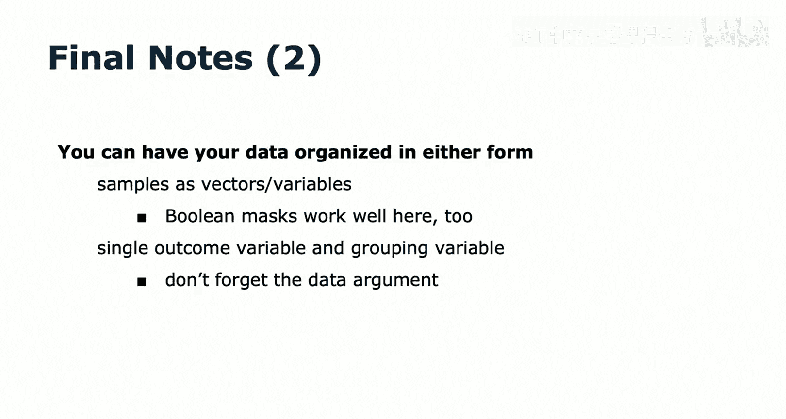

# 公共部门的R数据分析：12：均值差异t检验 📊


在本节课中，我们将学习如何使用R语言进行均值差异的t检验。这是一种用于比较两个独立组或配对样本之间连续型变量均值是否存在显著差异的统计方法。我们将介绍t检验的基本概念、在R中的实现方式，以及如何解读结果。

## 概述

当我们有一个连续型的结果变量，并希望比较它在两个不同组别（例如，干预前与干预后、实验组与对照组）之间的差异时，t检验是一个常用的工具。本节将介绍两种主要的t检验：独立样本t检验和配对样本t检验。

## t检验的基本原理

上一节我们介绍了数据分析的背景，本节中我们来看看t检验背后的统计思想。

t检验的核心是评估从两个组别中观察到的样本均值差异，是否大到足以让我们相信这两个组别所代表的总体均值也存在真实差异。其通用检验统计量公式为：

**t = (样本均值1 - 样本均值2) / 缩放因子**

缩放因子用于考虑数据的离散程度（即标准差）和样本量。如果计算出的t统计量绝对值足够大（即远离0），并且对应的p值小于预设的显著性水平（通常为0.05），我们就有理由拒绝“两组总体均值无差异”的零假设。

## 在R中进行独立样本t检验

理解了基本原理后，我们来看看如何在R中执行最常见的独立样本t检验。R中的`t.test()`函数（来自`stats`包）可以完成此任务。

以下是使用`t.test()`函数进行独立样本t检验的两种主要方式：

*   **使用公式语法**：当数据框中的一个变量是连续型结果变量，另一个是仅有两个水平的分组变量时，这种方法非常方便。
*   **使用向量语法**：直接提供两个分别代表不同组别的数值向量。

我们将主要关注公式语法，因为它更清晰且与数据框结构结合紧密。公式的基本形式为：`结果变量 ~ 分组变量`。

让我们切换到R环境，通过一个示例来具体操作。首先，我们加载并查看数据。

```r
# 加载数据
load("data_workspace.RData") # 假设数据已保存
# 或者从CSV导入
# data3 <- read.csv("your_data.csv")

# 快速查看数据结构
str(data3)
# 绘制直方图初步观察数据分布
hist(data3$outcome)
```

现在，我们使用公式语法进行独立样本t检验。以下是关键参数的说明：

```r
# 执行独立样本t检验
t_test_result <- t.test(outcome ~ group,  # 公式：结果变量 ~ 分组变量
                        data = data3,     # 指定数据来源
                        alternative = "two.sided", # 双侧检验（默认）
                        mu = 0,           # 零假设的均值差为0（默认）
                        paired = FALSE,   # 非配对样本（默认）
                        var.equal = FALSE, # 假设方差不相等（Welch检验，推荐默认）
                        conf.level = 0.95) # 95%置信区间（默认）

# 打印检验结果
print(t_test_result)
```

执行上述代码后，控制台会输出检验结果。让我们解读一下关键部分：

*   **`t`**：计算出的t统计量值（例如，-5.555）。
*   **`df`**：自由度，与样本量相关（例如，167.51）。
*   **`p-value`**：p值（例如，1.069e-07）。**如果p值小于0.05，通常拒绝零假设**，认为两组均值存在显著差异。
*   **`95 percent confidence interval`**：总体均值差异的95%置信区间（例如，[-10.5, -4.5]）。如果该区间不包含0，也支持存在显著差异的结论。
*   **`sample estimates`**：分别显示两组的样本均值。

我们可以将检验结果保存为一个对象（如`t_test_result`），它是一个列表，包含了所有上述信息，便于后续提取和使用。

```r
# 查看结果对象的结构
str(t_test_result)
# 提取特定结果，例如p值
t_test_result$p.value
```

## 在R中进行配对样本t检验

上一节我们介绍了独立样本的比较，本节中我们来看看另一种常见场景：配对样本t检验。它适用于比较同一组对象在干预前后（或两种相关条件下）的测量值。

对于配对数据，我们通常有两列数值变量，分别代表“前测”和“后测”。以下是进行配对t检验的方法：

```r
# 查看配对数据
str(paired_df)

# 执行配对样本t检验
paired_test_result <- t.test(paired_df$pre,        # 前测向量
                             paired_df$post,       # 后测向量
                             paired = TRUE,        # 关键：指定为配对检验
                             alternative = "two.sided",
                             mu = 0,
                             conf.level = 0.95)

# 打印结果
print(paired_test_result)
```

配对检验的结果解读与独立样本检验类似，关注t值、自由度和p值。其零假设是“配对差值的总体均值为0”。

## 重要参数与注意事项

以下是关于`t.test()`函数的一些关键参数和选择建议：

*   **`paired`**：`TRUE`为配对t检验，`FALSE`（默认）为独立样本t检验。
*   **`var.equal`**：`TRUE`假设两组方差相等（执行Student‘s t检验），`FALSE`（默认）不假设方差相等（执行Welch’s t检验）。**通常建议保持默认的`FALSE`**，除非有充分理由相信方差齐性。
*   **`alternative`**：指定备择假设方向。`"two.sided"`（默认）检验均值是否不相等；`"greater"`检验第一组均值是否大于第二组；`"less"`检验第一组均值是否小于第二组。应根据研究问题事先确定。
*   **数据组织**：数据可以组织为两个独立的向量，也可以组织为包含一个结果变量和一个二分组的单一数据框。选择对应的函数调用方式即可。

## 总结

本节课中我们一起学习了如何使用R进行均值差异的t检验。我们介绍了：
1.  t检验用于比较两个组别连续型变量均值的差异。
2.  独立样本t检验适用于比较两个独立组的均值。
3.  配对样本t检验适用于比较同一组对象在两种相关条件下的均值。
4.  在R中使用`t.test()`函数执行检验，并重点讲解了公式语法`（outcome ~ group）`和关键参数（如`paired`, `var.equal`）。
5.  学会了如何解读输出结果，特别是t统计量、自由度、p值和置信区间，并依据p值做出统计推断。




掌握t检验能帮助你在公共政策分析中，科学地评估项目效果、比较群体差异，从而为决策提供数据支持。