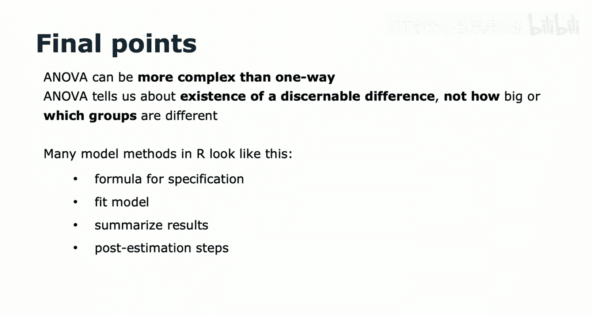

# 13：方差分析模型 📊

在本节课中，我们将学习一种用于比较两个或更多组之间连续型结果变量是否存在显著差异的统计方法：方差分析。我们将了解其核心思想、如何在R中实现，以及如何解读结果。

## 概述

当您有一个感兴趣的连续型结果变量，并希望比较其在两个或更多组之间的测量值，以查看是否存在可辨别的差异时，可能会遇到此类数据分析任务。例如，比较四组家庭的储蓄情况，或比较干预前后的测试分数。虽然T检验适用于两组比较，但对于多组情况，我们需要使用方差分析。

## 方差分析的核心思想

上一节我们介绍了多组比较的需求，本节中我们来看看方差分析如何解决这个问题。我们观察到的数据差异可能来自多种来源。当我们查看结果的分布时，可以认为变异既来自解释性或组间差异，也来自特质性或个体差异。

我们的任务可以这样思考：组间差异是否比个体差异更大或更重要？这是一种思维方式，即我们认为数据中的变异更多地来自组间差异，而非个体差异。如果数据变异更多地来自组间差异，我们可能认为这些组在某些关键方面存在不同。

您可以通过可视化核密度估计来思考。例如，不同组的结果分布可能显示组内相似而组间不同。或者，在某些情况下，组内差异甚至可能大于组间差异。

我们可以利用关于变异来源的思想来思考组间差异。方差分析的核心是比较某个结果中不同来源的方差。对于简单的一元方差分析，我们比较的比率是组间方差与组内方差的比值。

正式地，这产生了一个F统计量：**组间均方 / 组内均方**。

F统计量必须足够大，这取决于我们的样本量和组数。如果F统计量足够大，我们可能拒绝我们的基线假设，即所有组实际上是相同的。我们的零假设是组间没有差异。

需要知道的重要一点是，F分布随着观测数量和组数的变化而变化。它有两个自由度：一个在分子，一个在分母。

为了给您一个直观印象，让我们看看一些不同的F分布。在左侧，我们只改变分母的自由度。您会注意到曲线的形状发生变化，但随着我们接近0，它会渐近地趋向无穷大。在右侧，我们只改变分母的自由度。在这里，曲线的形状也在一定程度上发生变化。如果我们同时增加分子和分母的自由度，您会注意到分布的形状和中心位置都发生了变化。

F分布的形状随着分子自由度、分母自由度以及两者比率的变化而变化。因此，对于任何自由度的组合，思考F分布的形状都稍微困难一些，但幸运的是，我们不必想得太复杂，我们可以计算它。

## 在R中执行一元方差分析

在R中执行一元方差分析相当简单。我们将使用一个适用于R中所有方差分析方法的命令，称为 `aov`。

`aov` 接受一个公式：左边是我们的兴趣变量（结果变量），右边是分组因子。在本例中，我们将指定一个单一的分组因子。我们还需要告诉R我们的观测来自哪个数据框。

对于一元方差分析，您可以将公式指定为 `outcome ~ group`，数据参数指定为 `data = data_df`。

执行方差分析方法的一般工作流程是：拟合模型，为其分配一个名称，然后总结或查看分析摘要。

我们将查看类似这样的代码，所以让我们跳转到R Studio会话中。

以下是当前视频的脚本。首先，让我们加载一些数据。我们将加载两个包含方差分析信息的数据集，您稍后可以尝试使用。我们还将加载一个来自上一会话的数据集 `data2`。

如果您尝试过视频2数据中的代码，您会注意到最后一部分包含对三组数据执行T检验的选项，但它没有成功。如果您想在这里进行比较，我们将重新引入该数据。

方差分析由 `aov` 命令执行。我们的结果是测试分数，分组变量是组。如果我们查看 `anova1_df` 数据框，可以看到分组变量和测试分数，我们可以忽略X列。

当我们执行此操作时，会得到一个摘要表。它告诉我们函数调用是什么以及结果的项是什么，但这并不是特别有帮助。更好的方法是，如果我们对相同的调用分配一个名称，例如 `anova1`，然后查看摘要。

现在我们有一个摘要表，它更多地告诉我们数据中变异的来源。单独的模型调用对我们帮助不大。在这种情况下，我们得到的是模型拟合的摘要，但我们想知道的是具体的变异来源。

现在，如果我们查看结果中的变异来源，我们会看到，在本例中，“group”标识了结果总体变异中来自组间差异的部分。我们会看到一个F值，即方差的F统计量比率。我们还会看到一个P值，在本例中写为 `Pr(>F)`。这又是我们的P值。

通常，如果 `Pr(>F)` 小于0.05，我们可以拒绝组间无差异的零假设。

您的结果可能看起来像这样。让我们跳转回R Studio中的结果并查看一下。

在本例中，我们的组级结果的概率约为0.217。这高于0.05的阈值，因此我们可能不拒绝组间无差异的零假设。

但让我们一起来看一个不同的数据框，并一起编写代码。

让我们尝试对 `anova2_df` 进行相同的测试。如果我们在这里查看，我们现在有组和测试分数。如果我们一起编写这段代码，我们将其称为 `anova2`。

模型名称是 `anova2`。公式是 `test_score ~ group`。数据源是 `anova2_df`。现在，我们可以总结该模型：`summary(anova2)`。

我们看到，在这种情况下，组的P值约为0.91，高于0.05的水平。

如果您想重新查看视频2代码中的数据集 `data2`，可以在这里尝试。思考您将在该数据集中放置每个变量的位置，然后查看摘要。

需要知道的一点是，方差分析本身并不能告诉我们哪个组不同。所有方差分析方法只能告诉我们存在差异，但不能告诉我们哪个组不同。为此，我们执行事后分析。一种分析方法称为Tukey的显著性差异检验。

现在，一旦方差分析表明存在一个不同的组，您可以在组之间进行许多成对的T检验。问题是，如果您进行大量成对的T检验，就会遇到多重比较的问题。多重比较问题意味着您可能会在零假设实际上为真时意外地拒绝它。

因此，我们可以执行这些比较，但调整我们的发现以纠正多重测试。这就是Tukey的诚实显著性差异检验的用武之地。它类似于T检验，但对我们的P值进行了调整，以适应我们比较许多不同组对的事实。

在R中，我们使用 `TukeyHSD` 来实现。这需要一个方差分析模型（一个 `aov` 对象）作为输入，因此我们必须在拟合方差分析模型之后进行。让我们看看在R中如何操作。

在R中，我们首先拟合方差分析模型，然后将其传递给 `TukeyHSD`。如果您希望所有差异都为正值，即希望组间所有差异非负，可以选择 `ordered = TRUE`。您还可以像以前一样，使用 `conf.level` 更改均值差异周围的置信区间。

让我们一起来尝试。这里我们有第一个方差分析模型 `anova1`。如果我们将其传递给 `TukeyHSD`，我们会看到组之间的差异。例如，组1和组4、组2和组4、组3和组4之间的差异都是正的，但置信区间包含0，我们实际上不会确信拒绝无差异的零假设。这与我们的结果一致，因此这些P值都不小于0.05。

如果我们跳转到第二个测试 `anova2`，您会看到，尽管我们的整体拟合表明没有显著差异，但有些组似乎比其他组更不同。然而，在任何情况下，任何组对比较的P值都没有低于我们认为具有显著差异的0.05水平。

但如果其中任何一个低于0.05，我们会说这两组在我们感兴趣的结果上可能存在差异。

您可以在自己的时间重新尝试对变量2和变量3进行方差分析模型。

当您解释Tukey的显著性差异时，请查看每一列。第一列显示被比较的因子水平，第二列显示均值差异，第三和第四列显示该置信区间的下限和上限，最后一列显示均值差异的P值。这是我们关心的东西。通常，如果P值小于0.05，您可以拒绝无差异的零假设。

## 总结

在本节课中，我们一起学习了方差分析模型。我们了解到，方差分析是一种用于比较多个组间均值差异的统计方法，其核心是比较组间方差与组内方差的比率。我们学习了如何在R中使用 `aov` 函数拟合一元方差分析模型，并使用 `summary` 函数查看结果。重要的是，方差分析只能告诉我们是否存在显著差异，但不能指出具体哪些组不同。为此，我们引入了Tukey HSD事后检验，用于在控制多重比较误差的情况下进行两两比较。许多涉及模型的R方法都遵循类似的流程：指定公式、拟合模型、总结结果，然后进行额外的事后估计。因此，方差分析是通往R中更复杂统计模型分析的一个良好入门。