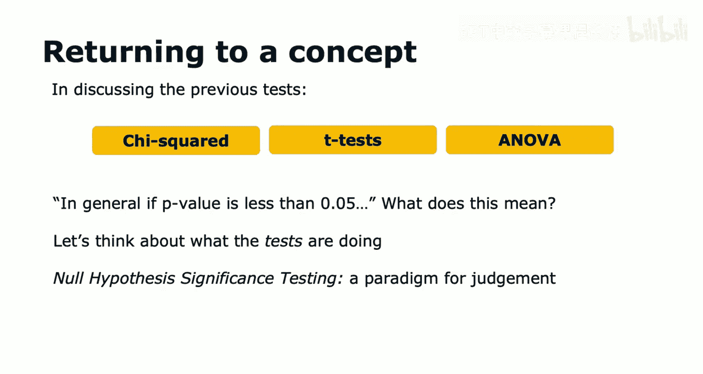
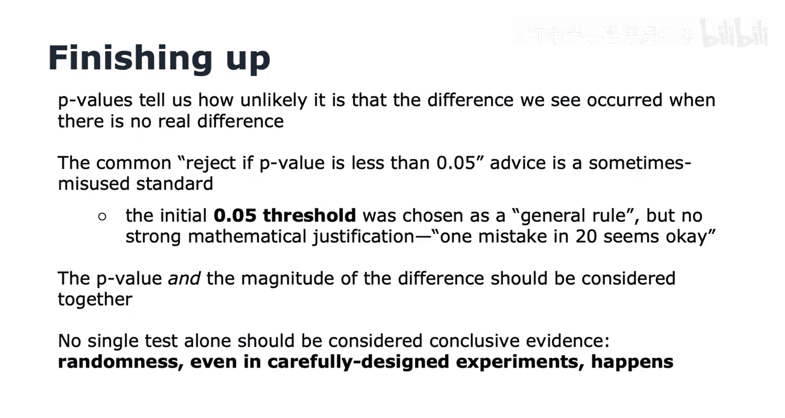

# 14：P值模拟分析 📊


在本节课中，我们将深入探讨统计学中一个核心但常被误解的概念：P值。我们将通过模拟数据的方式，直观地理解P值的含义、计算方法以及如何解读它。

在之前的视频中，我们讨论卡方检验、T检验和方差分析时，都提到了P值的概念。我们曾多次提到，当P值小于0.05时，可以拒绝原假设。为了理解这背后的含义，思考这些检验在做什么至关重要。这种表述源于一种名为“原假设显著性检验”的范式。



## 什么是P值？🤔


P值是一个介于0和1之间的概率。它表示在**原假设为真**的前提下，获得与观测到的检验统计量一样大（或一样极端、一样不同）的结果的概率。换句话说，P值衡量了我们观察到的差异**仅由随机因素（偶然性）导致**的可能性有多大。

一个0.05的P值意味着，如果原假设（例如，组间无差异）实际上为真，我们大约有5%（即20次中有1次）的概率会错误地拒绝它，转而支持备择假设。

理解这一点需要再次思考概率分布。

## P值从何而来？📈

对于每一种检验，我们都会将计算出的检验统计量与特定的概率分布进行比较：
*   对于**卡方检验**，是卡方分布。
*   对于**T检验**，是学生t分布。
*   对于**方差分析**，是F分布。

我们想知道的是：对于一个形状与我们的检验和样本相匹配的分布（这会影响自由度），在原假设为真的前提下，观察到比我们得到的统计量**更极端**的统计量的累积概率是多少？这能告诉我们，观测到的结果仅由偶然性导致的概率。

*   对于**卡方分布**，可以想象一条垂直的蓝色虚线代表卡方统计量（例如7）。该线右侧曲线下的阴影面积，就是观察到大于7的卡方值的累积概率。在本例中，自由度为3，卡方统计量为7对应的P值约为0.072。
*   对于**t分布**，虚线代表t统计量（例如2）。该线右侧的阴影面积（约3.4%）就是P值，即0.034。
*   对于**F分布**，原理相同。一个F统计量（例如3.25）对应的垂直线右侧的面积，就是更极端值的累积概率。

通过模拟我们了解其分布的数据，并观察误差或差异模式可能出现的位置，可以更直观地理解这一点。我们可以在实践中看到这种“错误拒绝”的发生，并借此机会学习R中的几个新技能。

## 在R中模拟数据与可视化 🖥️

我们将创建模拟数据，编写一些表达式，并遇到一个名为 `replicate` 的函数，它允许我们多次迭代执行某个函数。我们将通过两种方式来看待这个问题。

首先，我们将模拟一些样本，并通过可视化其分布和均值来观察密度估计如何暗示组间是否存在差异。

其次，我们将在**假设原假设为真**的前提下，模拟大量样本，并寻找组间出现的极端差异。

为此，我们需要从一个分布中抽取随机数。R的 `stats` 包有许多与概率分布相关的函数，通常以 `d`、`p`、`q`、`r` 开头：
*   `d` 代表密度函数。
*   `p` 代表概率函数。
*   `q` 代表分位数函数。
*   `r` 代表随机抽样，这正是我们需要的。

例如，`rnorm` 用于从正态分布中随机抽样。类似地，`rf`、`rchisq`、`rt` 分别用于从F分布、卡方分布、t分布中抽样。我们需要提供分布的形状参数以及要抽取的样本数量。

需要注意的是，计算机本身并不产生真正的随机数，这是一件好事。为了获得**可重复的**随机样本，我们需要设置一个随机种子。种子是一个用于启动随机数生成过程的数字。设置相同的种子并按相同顺序执行步骤，将得到完全相同的结果。

### 可视化单个样本

让我们跳转到R Studio会话中，看看如何操作。

首先加载必要的包并设置随机种子。

```r
# 加载包
library(ggplot2)
library(dplyr)

# 设置随机种子以确保结果可重复
set.seed(12345)
```

接下来，我们创建一个包含100个观测值的数据框，这些值来自均值为0、标准差为1的正态分布。

```r
# 创建第一个样本数据框
sample1 <- data.frame(randovar = rnorm(n = 100, mean = 0, sd = 1))
```

我们可以查看其直方图，并计算样本均值。

```r
# 绘制直方图
hist(sample1$randovar)

# 计算样本均值
sample_mean1 <- sample1 %>% summarise(mean_val = mean(randovar))
print(sample_mean1)
```

现在，我们创建一个包含1000个观测值的更大样本。

```r
# 创建第二个样本数据框（更大样本）
sample2 <- data.frame(randovar = rnorm(n = 1000, mean = 0, sd = 1))
```

同样绘制直方图并计算均值。你会发现，更大样本的分布中心更紧密地围绕在0附近。

### 可视化多个组

接着，我们创建一个包含5个组的数据框，每组有100个观测值，均来自相同的正态分布。

```r
# 创建包含5个组的样本数据框
sample_groups <- data.frame(
  randovar = rnorm(n = 500, mean = 0, sd = 1),
  group = rep(1:5, each = 100) # 重复1到5，每个数字重复100次
)
```

我们可以计算每个组的均值。

```r
group_means <- sample_groups %>%
  group_by(group) %>%
  summarise(mean_val = mean(randovar))
print(group_means)
```

尽管我们知道所有数据都来自同一个分布（总体均值相同），但每个样本组的均值会略有不同。这就是随机性带来的变异。

### 绘制核密度图与均值线

为了更清晰地展示，我们使用ggplot2绘制核密度图，并添加均值垂直线。

以下是绘制第一个样本（100个观测值）密度图的代码：

```r
# 绘制样本1的密度图与均值线
ggplot(sample1, aes(x = randovar)) +
  geom_density(fill = "blue", alpha = 0.5) + # 密度曲线
  geom_vline(aes(xintercept = mean(randovar)), # 均值垂直线
             color = "red", linetype = "dashed", size = 1) +
  labs(title = "样本1的分布 (n=100)",
       x = "随机变量值",
       y = "密度") +
  theme_minimal()
```

对于包含5个组的样本，我们可以按组绘制并比较：

```r
# 绘制5个组的密度图与各自的均值线
ggplot(sample_groups, aes(x = randovar, fill = as.factor(group))) +
  geom_density(alpha = 0.4) +
  geom_vline(data = group_means, aes(xintercept = mean_val, color = as.factor(group)),
             linetype = "dashed", size = 0.8, show.legend = FALSE) +
  labs(title = "五个模拟组的分布",
       x = "随机变量值",
       y = "密度",
       fill = "组别") +
  theme_minimal() +
  facet_wrap(~group, nrow = 1) # 分面显示
```

从图中可以看到，即使数据生成过程完全相同，不同样本组的分布形状和均值位置也存在自然波动。这初步揭示了P值存在的背景：即使总体无差异，样本间也会因随机抽样而产生差异。

## 模拟P值：观察“错误拒绝” 🔄

上一节我们看到了随机抽样带来的自然变异。本节中，我们通过一个更结构化的模拟来直接观察P值的本质。

我们将设计一个实验：在**已知两个群体均值真实差异为0**（即原假设为真）的情况下，反复抽取多对样本，然后计算每对样本的均值差。我们想知道，**纯粹由于偶然性**，我们观察到大于某个特定阈值（例如0.3）的均值差的频率是多少？这个频率就类似于一个“经验P值”。

我们将改变两个因素来观察P值如何变化：
1.  **样本量**：从30增加到100。
2.  **数据离散度（标准差）**：从1增加到2。

以下是模拟的核心步骤和代码。

首先，我们设定基础参数并进行第一次模拟（小样本，低离散度）。

```r
# 设定模拟参数
num_sims <- 1000      # 模拟次数
n_obs <- 30           # 每组样本量
mean1 <- 0            # 第一组总体均值
mean2 <- 0            # 第二组总体均值（差异为0）
sd1 <- 1              # 第一组总体标准差
sd2 <- 1              # 第二组总体标准差
threshold <- 0.3      # 我们关注的差异阈值

# 使用replicate函数进行模拟
# 每次模拟：从两个分布中各抽一个样本，计算均值差
mean_diffs <- replicate(num_sims, {
  sample_a <- rnorm(n = n_obs, mean = mean1, sd = sd1)
  sample_b <- rnorm(n = n_obs, mean = mean2, sd = sd2)
  mean(sample_a) - mean(sample_b)
})

# 计算“经验P值”：均值差大于阈值的比例
p_val_empirical <- mean(abs(mean_diffs) > threshold) # 这里用绝对值模拟双尾检验
cat(sprintf("模拟次数: %d, 样本量: %d, 标准差: %.1f\n", num_sims, n_obs, sd1))
cat(sprintf("均值差绝对值 > %.1f 的比例 (经验P值): %.3f\n", threshold, p_val_empirical))
```

运行这段代码，你可能会得到大约0.2到0.3之间的值。这意味着，即使真实差异为0，在样本量为30的情况下，仍有约20%-30%的概率会观察到绝对值大于0.3的均值差。

**现在，我们增加样本量到100。**

```r
# 改变参数：增加样本量
n_obs <- 100

# 重新运行模拟（使用相同的随机种子起点可以保证比较的公平性，但这里我们关注趋势）
set.seed(123) # 重置种子，开始新的可比序列
mean_diffs_large_n <- replicate(num_sims, {
  sample_a <- rnorm(n = n_obs, mean = mean1, sd = sd1)
  sample_b <- rnorm(n = n_obs, mean = mean2, sd = sd2)
  mean(sample_a) - mean(sample_b)
})

p_val_empirical_large_n <- mean(abs(mean_diffs_large_n) > threshold)
cat(sprintf("\n模拟次数: %d, 样本量: %d, 标准差: %.1f\n", num_sims, n_obs, sd1))
cat(sprintf("均值差绝对值 > %.1f 的比例 (经验P值): %.3f\n", threshold, p_val_empirical_large_n))
```

你会发现，这个比例（经验P值）显著下降，可能低于0.05。**样本量越大，我们对总体均值的估计越精确，随机波动导致大差异的可能性就越小。**

**最后，我们增加数据的离散度（标准差从1变为2），同时保持大样本量。**

```r
# 改变参数：增加离散度
sd1 <- 2
sd2 <- 2
n_obs <- 100 # 保持大样本量

set.seed(123)
mean_diffs_high_sd <- replicate(num_sims, {
  sample_a <- rnorm(n = n_obs, mean = mean1, sd = sd1)
  sample_b <- rnorm(n = n_obs, mean = mean2, sd = sd2)
  mean(sample_a) - mean(sample_b)
})

p_val_empirical_high_sd <- mean(abs(mean_diffs_high_sd) > threshold)
cat(sprintf("\n模拟次数: %d, 样本量: %d, 标准差: %.1f\n", num_sims, n_obs, sd1))
cat(sprintf("均值差绝对值 > %.1f 的比例 (经验P值): %.3f\n", threshold, p_val_empirical_high_sd))
```

此时，经验P值又会上升。因为**数据越离散（噪声越大），随机抽样的结果波动就越大**，即使在大样本下，也更容易偶然抽到均值差异较大的样本对。

你可以尝试修改代码中的 `num_sims`（模拟次数）、`n_obs`（样本量）、`mean1`/`mean2`（设置真实的差异）、`sd1`/`sd2`（离散度）以及 `threshold`（阈值），来获得对P值工作原理更深刻的直觉。

## 总结与要点 🎯

本节课中，我们一起学习了P值的模拟分析。

1.  **P值的本质**：P值是在原假设为真的条件下，观察到当前数据（或更极端数据）的概率。它量化了**偶然性**所能解释结果的可能性。
2.  **P值的计算**：通过将检验统计量（如t值、卡方值）与相应的理论概率分布进行比较，找出获得该统计量或更极端值的尾部概率。
3.  **模拟的启示**：通过R数据模拟，我们直观地看到：
    *   即使总体无差异，样本间也存在随机变异。
    *   **样本量增大**会减少抽样误差，使得观察到大偶然差异的概率（P值）降低。
    *   **数据离散度增大**会增加抽样波动，使得P值升高。
4.  **对“P < 0.05”的审慎看待**：0.05阈值是一个被广泛采用但并非神圣不可侵犯的惯例。它意味着接受约5%的“假阳性”错误风险。解读结果时，**必须将P值与效应大小（差异的实际幅度）结合考虑**。一个具有极小P值但效应量微乎其微的发现，其实际意义可能有限。
5.  **科学推断的累积性**：没有任何单一检验能提供确凿的证据。科学知识是通过多次实验、多个样本、重复检验的结果累积而成的。P值只是这个持续评估过程中的一个工具。



希望这次模拟练习能帮助你超越对P值“是否小于0.05”的机械判断，更深入地理解其背后的统计逻辑与不确定性原理。