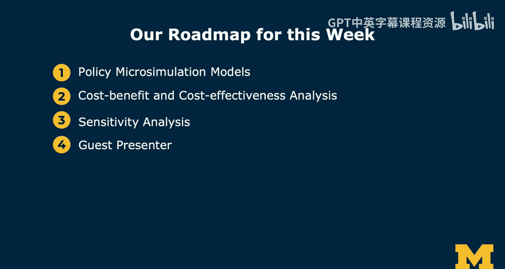
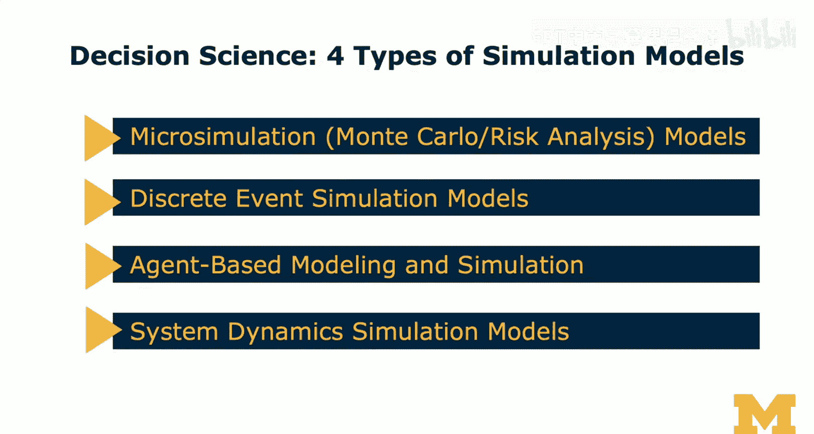
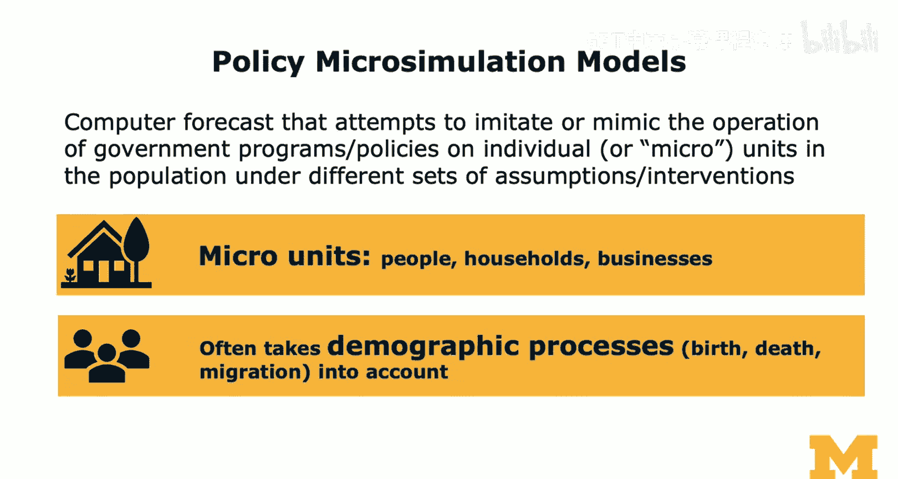
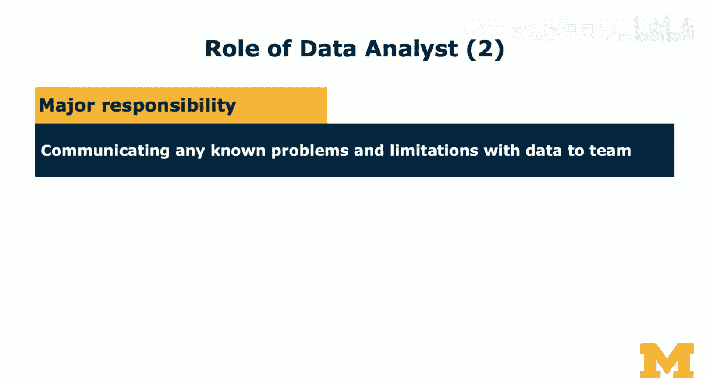
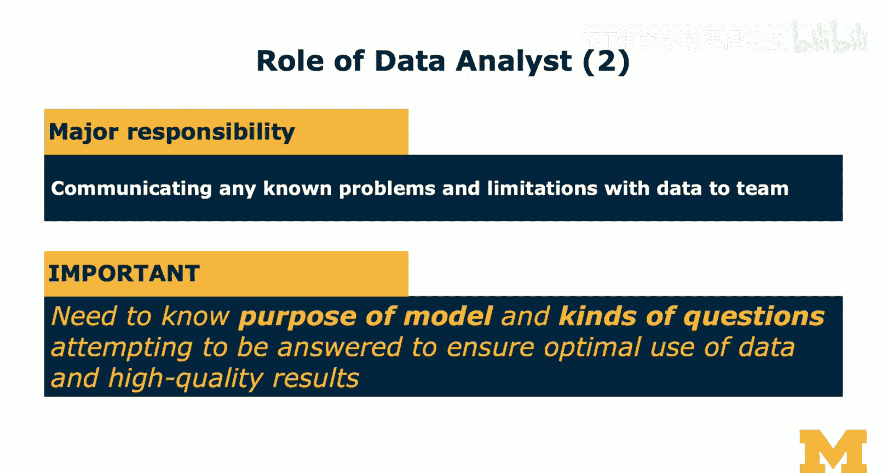
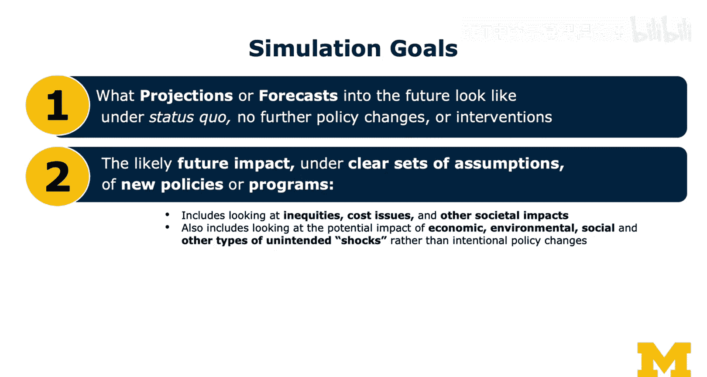

# 15：政策仿真建模导论 🧮

在本节课中，我们将要学习政策仿真建模的基础知识，这是一种用于预测未来政策效果的前瞻性分析方法。我们将了解什么是微观仿真模型，以及数据分析师在其中扮演的关键角色。

上一节我们介绍了政策仿真模型属于前瞻性政策分析，本节中我们来看看其具体类型和定义。

## 什么是政策微观仿真模型？

政策微观仿真模型是一种计算机生成的预测工具。它试图模仿或模拟政府项目或政策在**不同假设**和**不同政策干预**下，对人口中个体或微观单位的影响。

*   **微观单位**：主要指个人，但也可用于分析政策变化对家庭、企业或其他小型组织的影响。
*   **核心目的**：主要设计用于观察政策变化可能带来的效果，并且几乎总是将人口过程（如出生、死亡、迁移）考虑在内。

## 数据分析师的角色

政策仿真建模是一项技术性很强的工作，数据分析师通常是团队中的关键成员。以下是数据分析师可能承担的主要职责：

*   **识别数据源**：寻找并确定用于模型输入的数据来源。
*   **数据清洗与管理**：对数据进行清理、重新编码和管理，这是项目的重要组成部分。
*   **结果可视化**：当模型产生结果后，创建数据可视化图表来展示结果至关重要。
*   **沟通数据问题**：最重要的职责之一是向团队沟通数据的已知问题或局限性。数据分析师通常最了解数据的优缺点，这有助于确保模型使用最优数据并产生高质量结果。

为了胜任这些工作，数据分析师需要了解模型的目标和试图回答的问题。

## 模型的目标与假设

我们需要了解仿真的目标，这通常涉及预测在现状（无进一步政策变化）或不同干预措施下，未来的情况会如何。本质上，我们是在设计一个帮助决策者预测未来的“水晶球”。

作为团队成员，还需要了解模型将基于哪些假设。这些假设不仅包括政策变化的可能效果，还包括：

*   **差异化的有效性**：在创造新不平等或加剧现有不平等方面的差异。
*   **成本问题**：政策实施的成本考量。
*   **社会影响**：其他类型的社会影响。

此外，微观仿真模型也常用于观察非政策变化的“冲击”带来的潜在影响，例如经济冲击（如衰退、通胀）、环境冲击（如自然灾害）或其他社会冲击。

本节课中我们一起学习了政策微观仿真模型的基本概念，明确了它是一种模拟政策对微观个体影响的计算机预测工具。我们重点探讨了数据分析师在模型开发团队中的核心职责，包括数据准备、结果呈现和至关重要的数据质量沟通。最后，我们了解了这类模型的目标在于预测未来，并依赖于一系列关于政策效果、成本和公平性等方面的关键假设。

接下来，我们将有幸向David Mendez教授学习他开发的一个具体微观仿真模型实例。