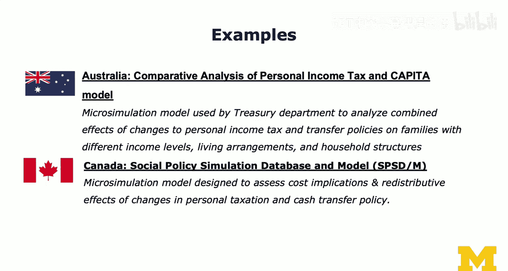
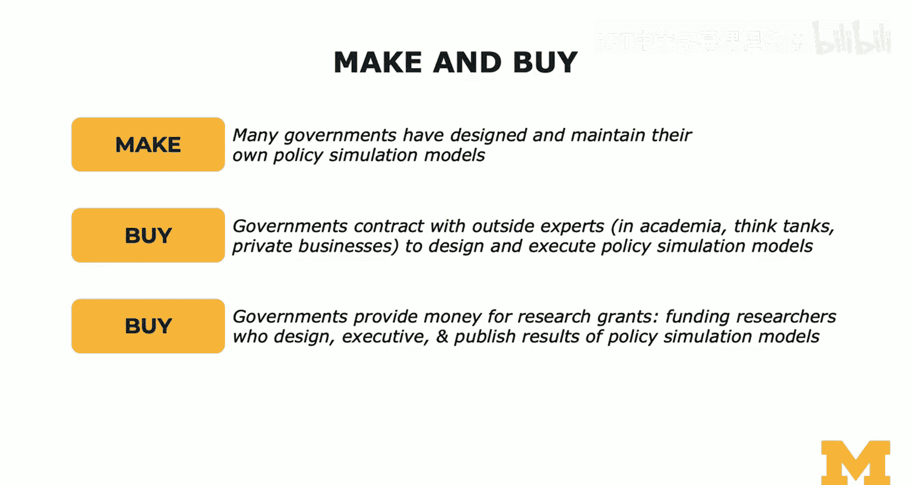
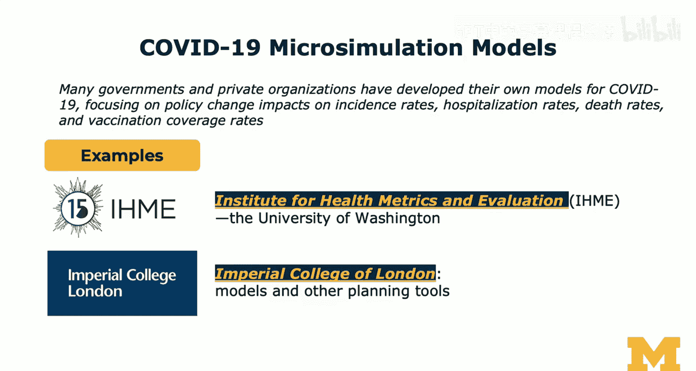
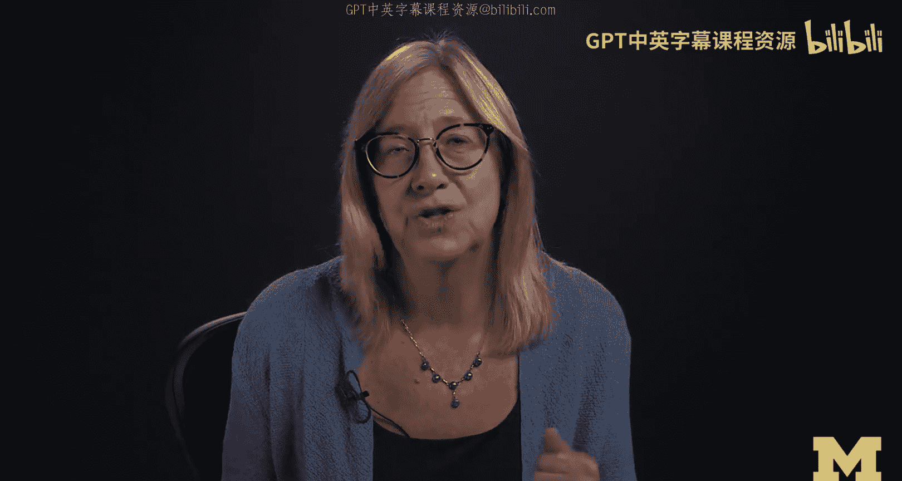

# 公共部门的R数据分析（基础、数据探索、决策支持）：16：政策仿真模型典型案例 🧪

在本节课中，我们将学习政府机构常用的几种政策仿真模型。这些模型帮助决策者预测政策变化可能带来的影响，例如对养老金、医疗系统、税收和家庭的影响。我们将通过具体案例来了解这些模型的应用和构建方式。

## 政府政策仿真模型概述

上一节我们介绍了政策分析的基本概念，本节中我们来看看政策仿真模型的实际应用。许多政府，尤其是联邦政府，都拥有多种政策微观仿真模型。这些模型旨在帮助政府思考未来，例如养老金系统和公共医疗系统的前景。它们也被设计用来评估所得税政策变化可能产生的影响，以及这些变化对家庭、住户和企业的影响。

## 典型案例分析

以下是两个由政府使用的著名政策微观仿真模型案例。

*   **澳大利亚的CAPITA模型**：全称为“个人所得税比较分析”。这是澳大利亚财政部使用的一个微观仿真模型，用于分析个人所得税结构以及收入转移政策变化的单一及综合效应。该模型评估这些变化对不同收入水平、不同生活安排和家庭结构的家庭所产生的影响。
*   **加拿大的社会政策仿真数据库与模型**：这同样是用于分析政策变化的微观仿真模型。它旨在评估个人所得税和现金转移支付政策变化对加拿大公民可能产生的成本影响和再分配效应。

## 模型的开发方式

现在，我想提醒大家回顾我们之前讨论过的不同政策杠杆。政府总是在“自制”与“购买”之间做出决策。政策仿真模型也不例外。

*   许多政府选择**内部开发**并维护自己的政策仿真模型。政府内部的工作人员会全程参与此类模型的创建。
*   同时，许多政府也会通过政府合同和研究资助，借助**外部专业知识**来开发政策仿真模型供其使用。政府有时会与外部专家（包括学术界、智库和私营企业）签订合同，委托他们设计和执行政策仿真模型。
*   此外，正如我提到的，政府也会**资助研究人员**。这些研究人员对不同类型的政策仿真模型有自己的想法，政府为他们提供资源来设计、执行并公开发布这些模型的结果，供公众参考。

## COVID-19疫情中的模型应用

在COVID-19疫情期间，我们看到了多种政策微观仿真模型的出现。

许多政府，连同许多私营组织和学术研究人员，都开发了自己的COVID-19模型。这些模型旨在预测未来的发病率、住院率、死亡率、疫苗接种覆盖率等所有在大流行病中重要的结果指标。因此，这些模型侧重于预测这些指标，同时也基于不同政策变化可能产生的影响的假设进行推演。

你可以仔细思考一下构建这类政策仿真模型所需的各种数据。你可以访问“健康指标与评估研究所”和“伦敦帝国理工学院”的网站，详细了解他们的模型是如何设计的，以及输入了哪些信息。你甚至可以自己稍微操作一下数据，进行一些自己的预测。

## 模型的数据基础

对于这些COVID-19微观仿真模型或许多其他现有模型，你可以深入查看。我希望你能花点时间看看输入这些模型的各种不同类型的数据。

对于COVID-19模型，输入数据包括关于人口年龄结构、当前除COVID-19外其他原因导致的死亡率、医疗设施位置、实验室检测能力等方方面面的信息。构建这些模型需要非常多的数据。当你开始详细查看它们时，你会看到来自众多不同来源的数据，在创建和执行这些模型过程中扮演着多么重要的角色。

## 课程总结

本节课中，我们一起学习了政策仿真模型在公共部门决策中的实际应用。我们了解了政府如何使用微观仿真模型（如澳大利亚的CAPITA模型和加拿大的SPSD模型）来预测税收、福利等政策变化的影响。我们还探讨了这些模型的三种主要开发方式：政府内部开发、委托外部专家开发以及资助学术研究。最后，我们以COVID-19疫情为例，看到了仿真模型在预测公共卫生事件和评估干预措施效果中的关键作用，并认识到多源数据是构建这些复杂模型的基石。