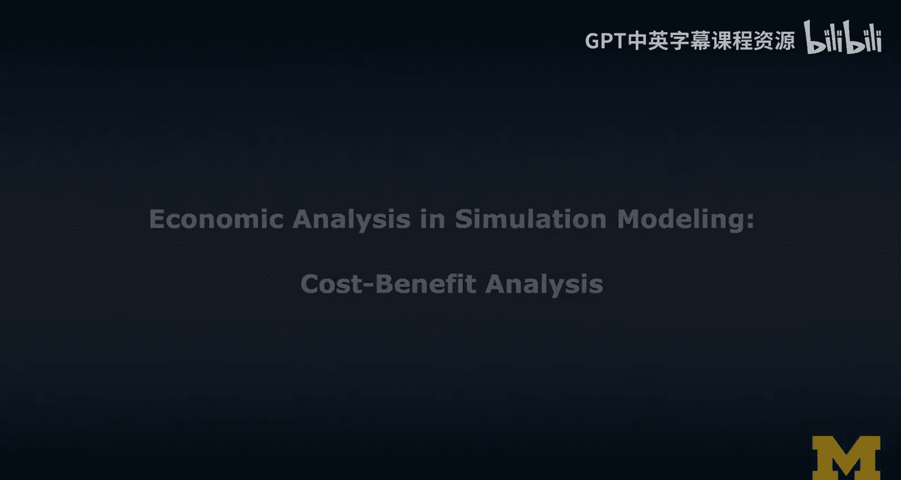
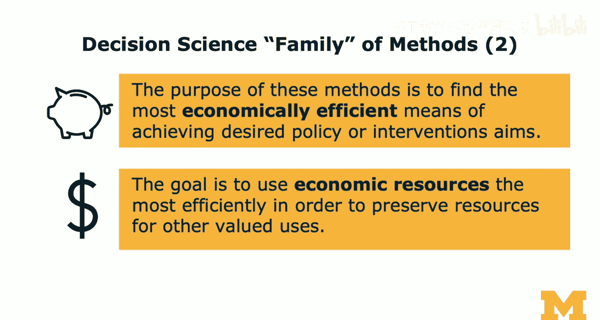
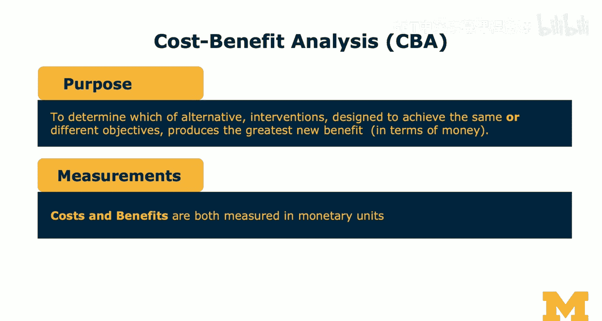
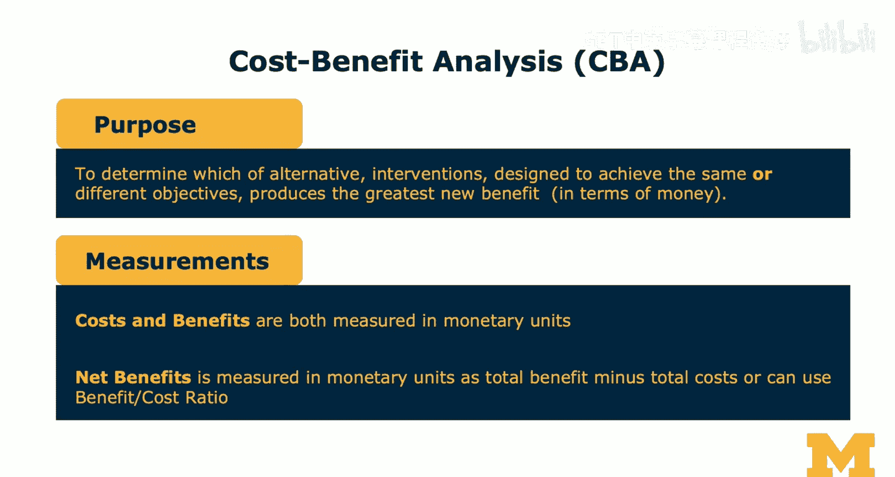
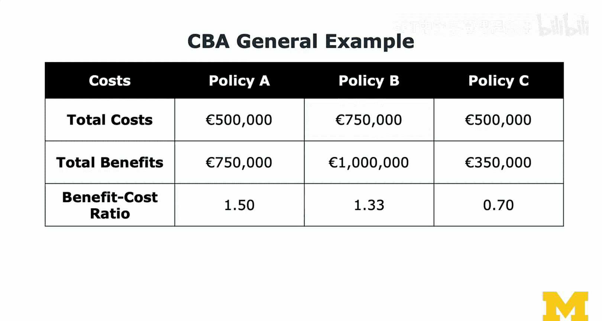

# 公共部门的R数据分析：17：仿真建模中的经济分析：成本效益评估 💰

在本节课中，我们将学习如何在政策仿真建模中融入经济分析，特别是成本效益评估。许多政策仿真模型会考虑各种结果，其中也包括与金钱或成本相关的问题。我们将重点介绍两种最常用的方法：成本效益分析和成本效果分析。

## 公共管理的核心原则与经济分析

上一节我们介绍了仿真建模的基础，本节中我们来看看如何将经济分析融入其中。请记住公共管理的四个核心原则：**经济**、**效率**、**效果**和**公平**。成本指标实际上同时涉及所有这四个原则，而不仅仅是经济和效率。

在不同类型的分析中考虑成本，既适用于我们正在讨论的**前瞻性政策分析**（如微观仿真建模），也适用于**回顾性政策评估**（如项目评估）。在决策科学中，有一系列方法用于考虑不同干预措施的成本。

以下是决策科学中常用的成本分析方法：
*   成本效益分析
*   成本效果分析
*   分布性成本效果分析
*   成本效用分析

今天我们将重点讨论成本效益分析和成本效果分析，因为这两种方法在微观仿真建模中使用最为频繁。这些方法的目的是帮助决策者找到实现预期政策或干预目标的最经济有效的手段。总体目标是最高效地使用经济资源，以便为其他有价值的用途节省资源。

更直白地说，在公共部门，资金永远是不够的。我们总是在资源受限和稀缺的条件下工作。因此，我们始终希望帮助决策者思考如何让有限的资金发挥最大效用，并从用于不同目的的资金中获得最大回报。

## 成本效益分析

好的，让我们从成本效益分析开始。这种分析（CBA）的目的是确定一组旨在实现相同（甚至可能不同）目标的替代干预措施中，哪一个能产生最大的**货币净效益**。

在成本效益分析中，**成本和效益都以货币单位衡量**。在CBA中，一切都归结为金钱。进行成本效益分析的最终结果是为了找出不同干预措施或政策的净效益，它同样以货币单位衡量，并定义为**总货币效益减去干预措施的总成本**。

这也可以表示为**效益成本比**。让我们看一些假设的例子，这里你只需要关注其中简单的数学计算。

假设我们有一组可以实施以解决特定社会问题的政策：
*   **政策A**：成本为50万欧元。其所有成本效益在社会层面被确定能带来75万欧元的效益。因此，在这个案例中，以欧元为货币单位的效益被认为大于特定时间范围内的干预成本（该时间范围需在分析中确定）。其效益成本比为1.50，这意味着每支出1欧元，我们预计能获得1.50欧元的回报。
*   **政策B**：实施成本稍高，为75万欧元。经过技术分析（效益和成本的确定方法非常技术性），确定其效益总计为100万欧元。该政策的效益成本比为1.33，即每支出1欧元，预计可获得1.33欧元的回报。
*   **政策C**：实施成本为50万欧元。在这种情况下，该政策的效益估计累积到35万欧元。这意味着实施该政策的成本将高于我们从中看到的效益。其效益成本比小于1，这并不理想，表明其成本将高于我们预期的回报。

## 成本效果分析

了解了以货币衡量一切的成本效益分析后，我们接下来看看成本效果分析。成本效果分析（CEA）用于比较具有**相同或类似目标**的替代干预措施。

在CEA中，**成本以货币单位衡量，但效果以自然单位衡量**（例如，避免的疾病病例数、获得的工作岗位数、提高的考试分数）。CEA的结果通常表示为**成本效果比**，即**每单位效果的成本**。

例如，假设我们正在评估两种旨在减少青少年吸烟的学校干预计划：
*   **计划X**：每年成本为10万美元，预计能使吸烟率降低5个百分点。其成本效果比为：**$100，000 / 5% = $20，000 每降低1%的吸烟率**。
*   **计划Y**：每年成本为15万美元，预计能使吸烟率降低10个百分点。其成本效果比为：**$150，000 / 10% = $15，000 每降低1%的吸烟率**。

在这个例子中，虽然计划Y的绝对成本更高，但它在“每降低1%吸烟率的成本”这个指标上更有效率。

## 总结

本节课中我们一起学习了在政策仿真建模中融入经济分析的核心方法。我们首先回顾了经济分析如何呼应公共管理的四大原则。接着，我们深入探讨了**成本效益分析**，该方法将成本和效益均转换为货币价值，并通过计算**净效益**或**效益成本比**来比较不同政策。然后，我们介绍了**成本效果分析**，它用于比较目标相似的干预措施，其中成本用货币衡量，而效果则用自然单位（如避免的病例数）衡量，最终结果体现为**成本效果比**。

掌握这些经济评估方法，能帮助我们在资源有限的公共部门环境中，为决策者提供数据支持，识别出最具经济效率的政策方案，从而让公共资金发挥最大价值。