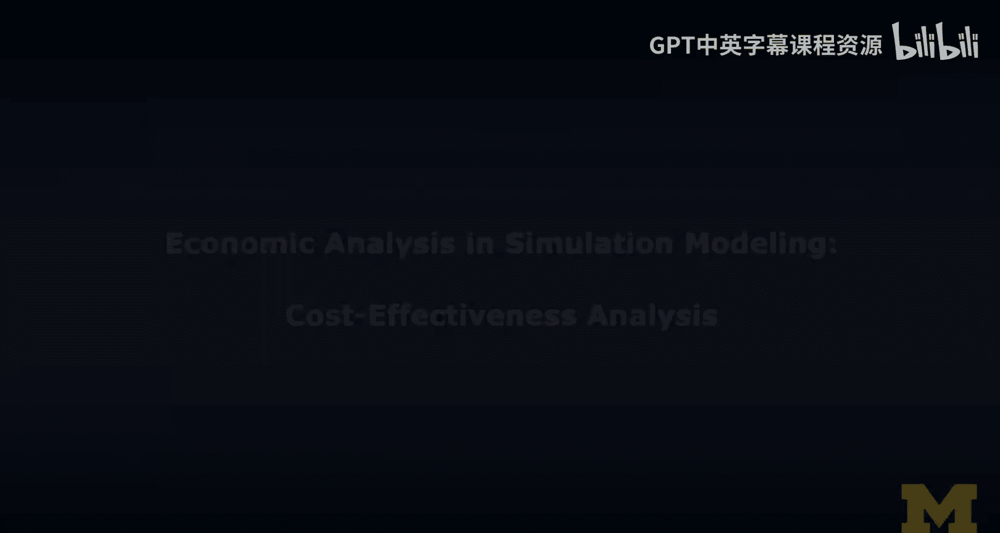
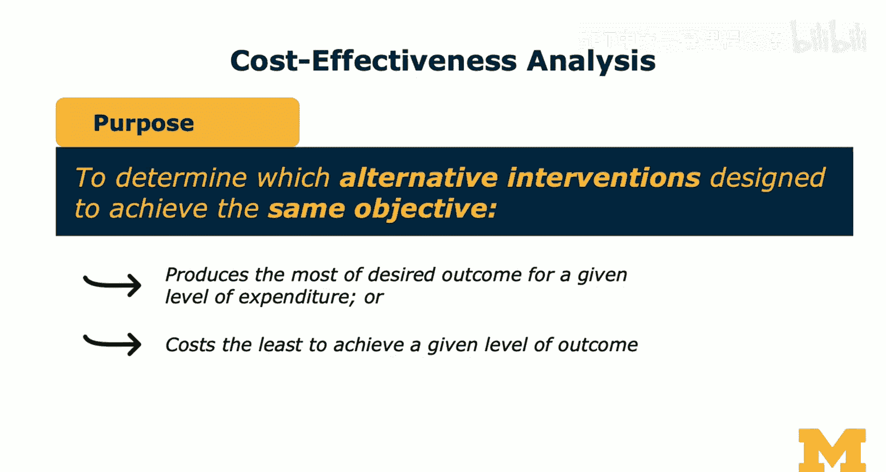
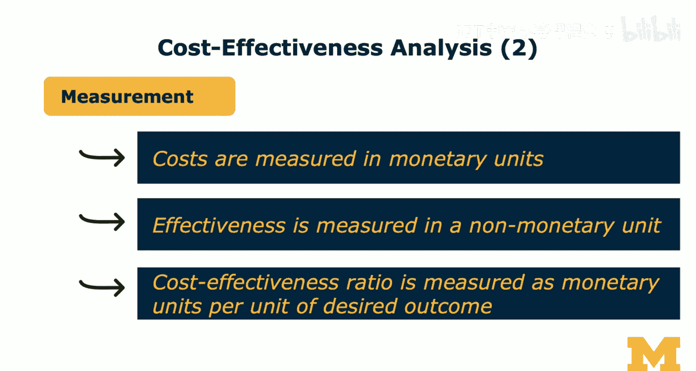
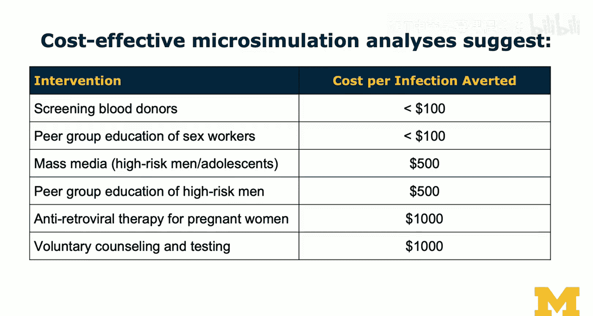
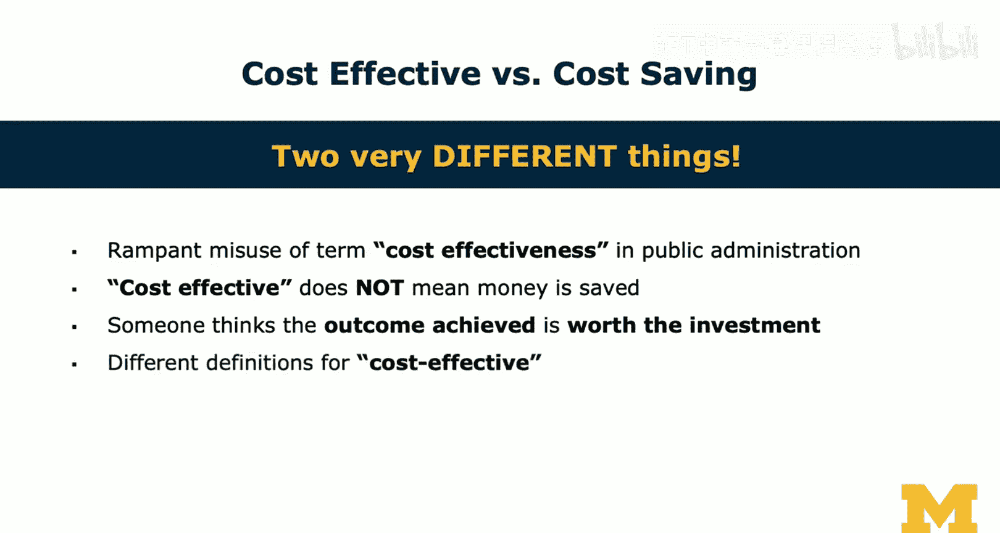

# 公共部门的R数据分析：18：仿真建模中的经济分析：成本效果评估 💰

在本节课中，我们将要学习成本效果分析。这是一种用于评估不同政策或干预措施效率的经济分析方法，尤其适用于公共部门的决策支持。

---

上一节我们介绍了成本效益分析，本节中我们来看看成本效果分析。成本效果分析的目的与成本效益分析相似，但略有不同。其目的是确定，在实现相同目标的不同干预方案中，哪一套方案能在给定支出水平下产生最多的期望成果，或者以最低的成本达到给定的成果水平。这两种视角都归属于成本效果分析。

成本效果分析的一个重要特点是，成本以货币单位衡量，而效果则以非货币单位衡量。这与成本效益分析不同，后者将所有结果都转化为货币价值。

在这种情况下，成本效果被衡量为一个比率，即每获得一个单位的期望成果所需花费的货币单位。有时可以将其理解为“每一分钱能带来多少效果”。

---

以下是成本效果分析的一个应用实例。让我们回到撒哈拉以南非洲，特别是乍得，那里存在非常高的艾滋病毒感染率问题。在本研究进行时，乍得成年人的艾滋病毒流行率为9%。一个微观模拟政策模型被设计出来，用于评估多种不同干预措施的成本效果。这些干预措施使用了不同的政策杠杆，但目标都是减少乍得人口中的艾滋病毒新发感染和流行率。

模型计算了每避免一例艾滋病毒感染所需的成本。以下是不同干预措施的成本效果估算结果：

*   **筛查献血者**：每避免一例感染的成本低于100美元。
*   **对性工作者进行同伴教育**：每避免一例感染的成本低于100美元。
*   **针对高风险男性或青少年的大众媒体宣传**：每避免一例感染的成本约为500美元。
*   **对高风险男性进行同伴教育**：每避免一例感染的成本约为500美元。
*   **为孕妇实施抗逆转录病毒治疗**：每避免一例感染的成本约为1000美元。
*   **自愿艾滋病毒咨询和检测**：每避免一例感染的成本约为1000美元。

所有这些结果都表明，这些干预措施具有很高的成本效果。以预防艾滋病毒感染这一宝贵成果来衡量，它们的成本并不高。决策者通常不会只从列表中挑选一项，而是可能认为所有这些措施都值得考虑。解决复杂问题往往需要在多个层面、运用多种杠杆进行政策干预。

---

接下来，我们来区分“成本效果”与“成本节约”。在政策领域，这两个术语经常被混淆，理解它们的区别至关重要。

**成本效果**并不意味着节省了资金。当我们说一项干预措施具有成本效果时，实际上是指决策者认为所实现的成果值得投入相应的成本。这涉及到价值判断。

**成本节约**则更为直接。它意味着一项干预措施所节省的资金超过了其实施成本。要声称某措施是成本节约的，必须确保其在资金支出方面产生的影响，确实大于实施该措施本身的成本。

---

本节课中我们一起学习了成本效果分析。我们了解了其核心目的是比较实现相同目标的不同方案效率，其特点是以货币单位衡量成本，以非货币单位衡量效果。我们还通过一个预防艾滋病的实例，看到了如何计算和解释成本效果比率。最后，我们明确了“成本效果”与“成本节约”是两个不同的概念，前者关乎成果与成本的比值是否“值得”，后者则直接关乎总支出是否减少。