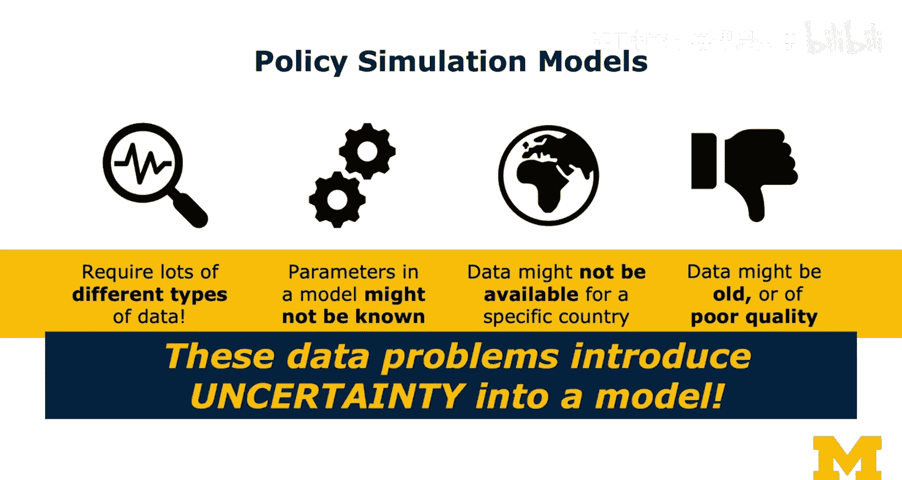
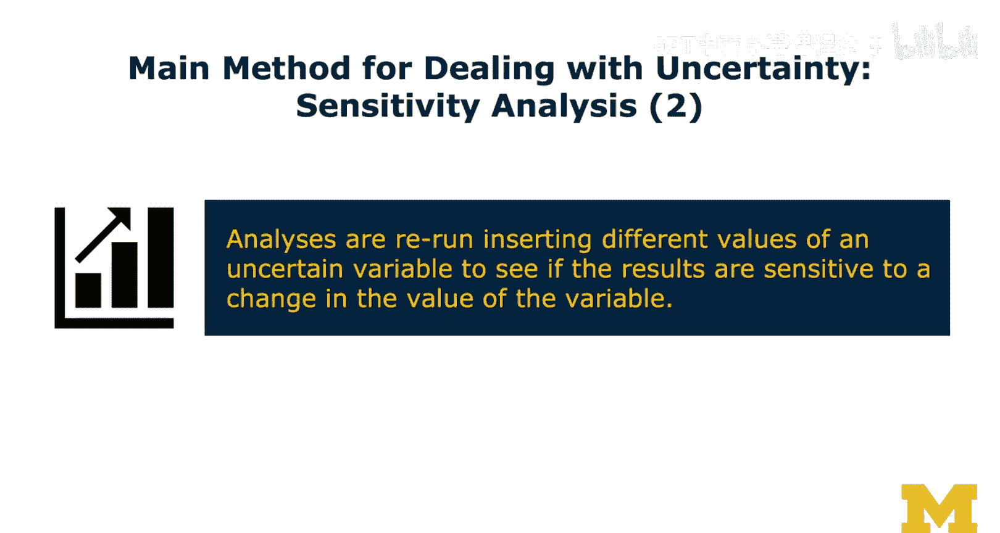
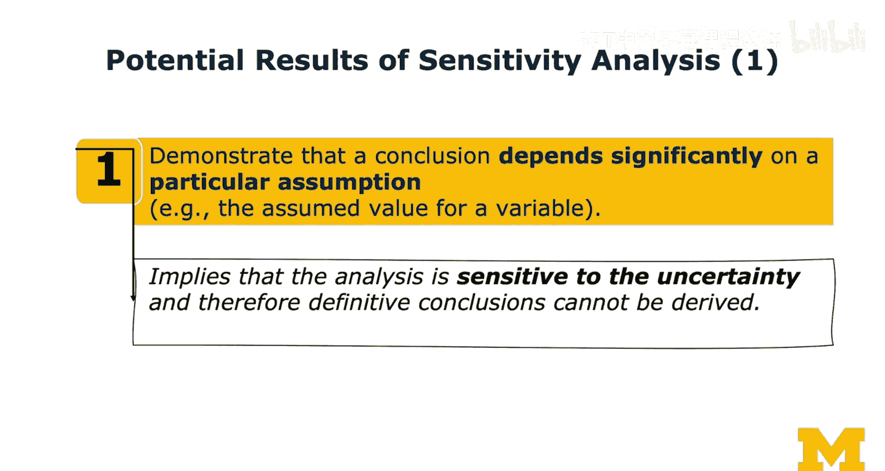
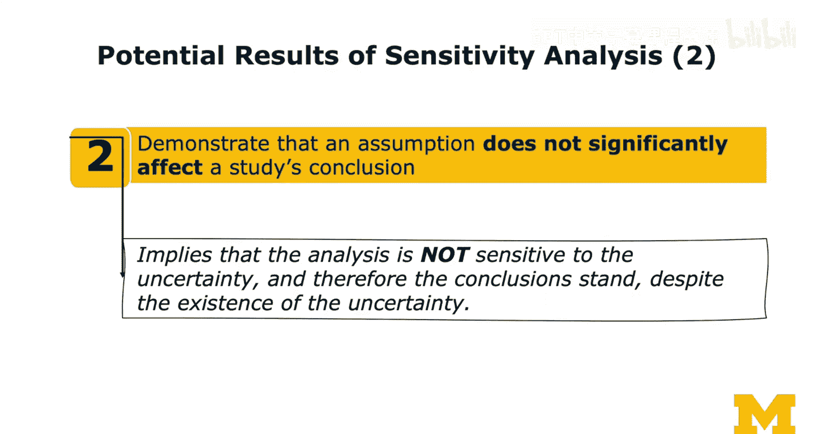
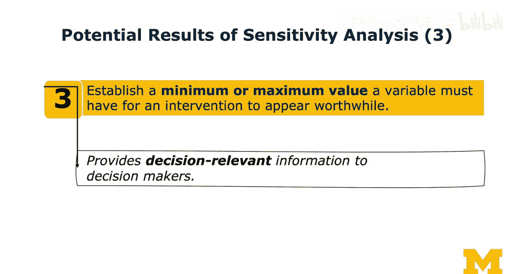
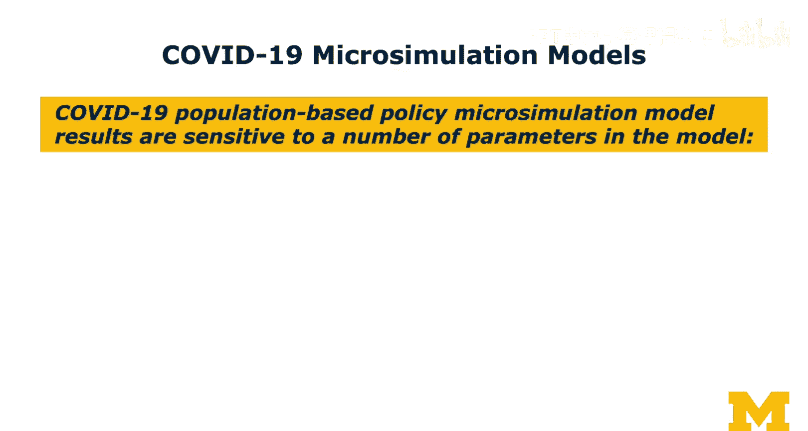
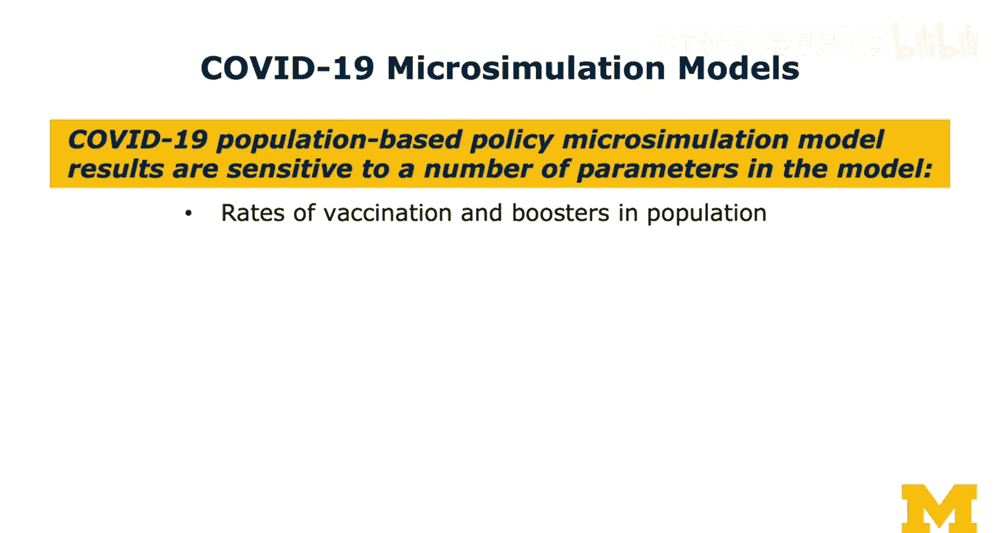
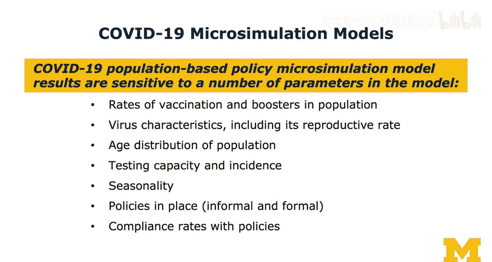

# 公共部门的R数据分析：19：不确定性处理：敏感性分析方法 🔍

在本节课中，我们将要学习政策微观模拟建模中一个至关重要的环节：如何处理模型中的不确定性。我们将重点介绍一种名为“敏感性分析”的核心方法，它帮助分析师理解数据或参数的不确定性如何影响模型的结论。

上一节我们介绍了政策微观模拟模型的基本概念，本节中我们来看看如何应对模型构建中不可避免的不确定性。

## 不确定性的来源

政策微观模拟模型需要多种类型的数据，我们称之为模型的**参数**或**变量**。然而，这些数据可能存在以下问题：
*   数据可能完全未知。
*   数据可能在你所在的国家无法获得，但其他国家有。
*   数据可能过于陈旧。
*   数据质量可能较差。

所有这些问题都会给我们的模型引入**不确定性**。政策模拟师处理这种不确定性的主要方法就是**敏感性分析**。

## 什么是敏感性分析？

敏感性分析是一种测试方法，用于检验**单个变量或一组变量的值存在不确定性时，是否会显著影响分析的结论**。

其核心操作很简单：分析人员会**多次运行模型**，每次为不确定的变量**插入不同的值**，然后观察结果是否因此产生差异，或者说结果是否对该变量值的变化“敏感”。

以下是进行敏感性分析时可能发现的几种情况：

首先，敏感性分析可能证明，你的模型结论**严重依赖于某个特定的假设或变量的假定值**。例如，我们对某项干预措施在不同亚群体中的有效性水平不确定。通过使用不同的值进行测试，我们可能会发现结果对这种不确定性非常敏感。不幸的是，这也意味着我们无法从模型中得出明确的结论，因为不确定性太大，模型结果会随之波动。

其次，敏感性分析也可能证明，某个假设**并不会显著影响研究的结论**。这反过来意味着，我们的分析**对这种不确定性不敏感**。尽管存在数据质量问题、参数缺失，我们不得不做出假设，但如果敏感性分析显示结果没有实质性变化，那么我们的结论即使在不确定性存在的情况下仍然可以成立。模型对我们不确定并赋予了一系列可能值的变量不敏感。

敏感性分析的另一种用途是，分析师可以**确定一个变量必须达到的最小值或最大值，才能使一项干预措施显得有价值**。我们可以测试变量的最低可能值和最高可能值，然后找出介于两者之间的、能使干预产生积极效果的临界值。这一切都是为了向决策者提供与其手头任务相关的信息。我们的模型并非完美无缺的水晶球，数据存在局限，但在不同的假设集（如此处的最小值或最大值）下，决策者可以了解政策路径得以实施所需满足的条件。

## 实例：COVID-19微观模拟模型

让我们回顾一下在全球广泛使用的COVID-19微观模拟模型。这些基于群体的政策微观模拟模型的结果，对模型中的许多参数或变量都非常敏感。

随着时间推移，我们对某些信息的掌握越来越准确，但病毒本身也在变化，仍存在许多未知。因此，这些微观模拟模型被大量用于进行敏感性分析，以评估这些因素对我们试图预测的结果（如感染率、住院人数）的影响。

例如，人群中**疫苗接种率和加强针接种率**对模型结果影响巨大。围绕这些比率进行的敏感性分析，可以让决策者和公众了解，如果接种率达到非常高的水平，病毒的控制情况会比当前观察到的好多少。

COVID-19模型的另一个重要特征是病毒的**基本再生数（R0）**，即其传播能力。随着病毒的不同变异，这个数值在变化。模型结果对COVID-19病毒基本再生数的假设**非常敏感**。了解这一点很重要，同时也有助于我们理解，如果新的变异株传播力更强，对未来疫情可能意味着什么。

COVID-19微观模拟模型中还有许多其他重要变量，这里的重点是：所有这些因素都影响着我们预测未来的准确性，包括在不同政策下以及人们对这些政策的遵守率情况下的预测。

## 总结

本节课中我们一起学习了如何处理政策微观模拟模型中的不确定性。我们了解到，由于数据缺失、质量不佳或参数未知，模型会存在不确定性。**敏感性分析**是应对这种不确定性的核心工具，它通过为不确定的变量输入不同的值并重新运行模型，来检验模型结论的稳健性。分析结果可能显示结论对不确定性敏感（需谨慎解读），也可能显示不敏感（结论更可靠）。此外，敏感性分析还能帮助确定关键变量的阈值，为决策者提供更丰富的信息背景，正如在COVID-19模型中的应用所示。