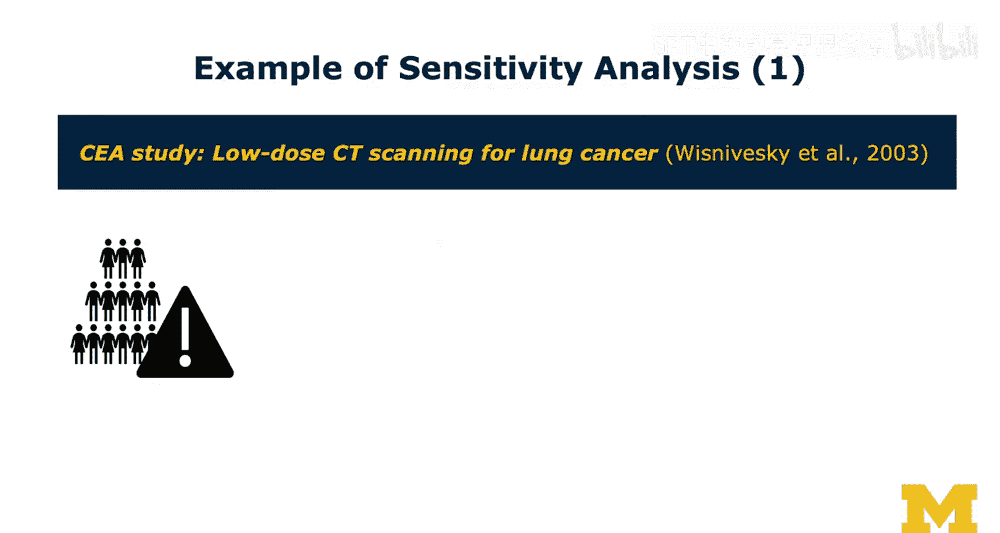
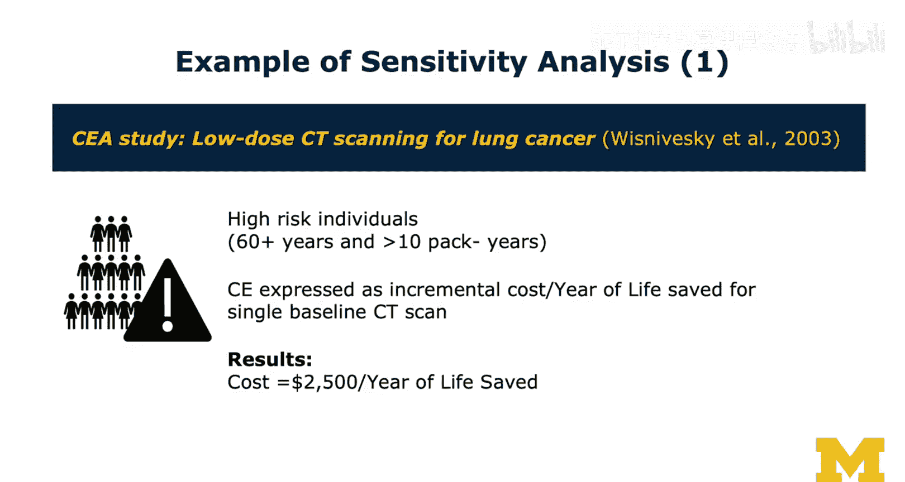
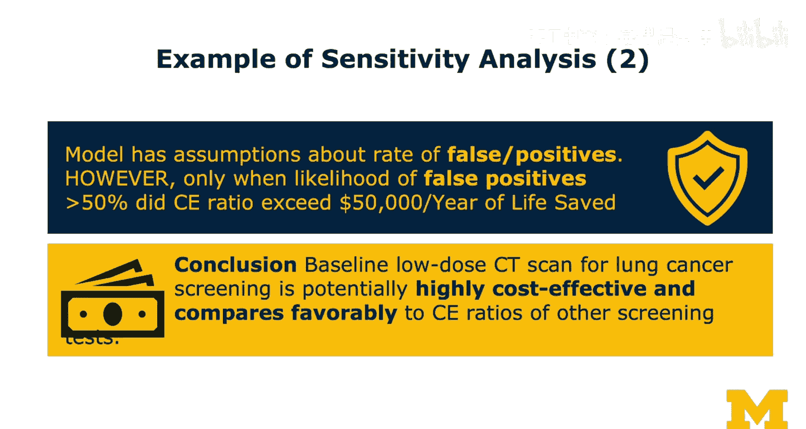
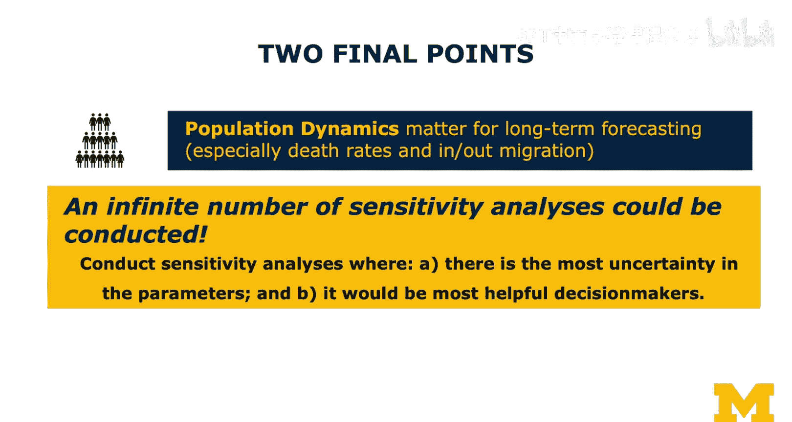

# 公共部门的R数据分析：20：不确定性敏感性分析实例演示 🧪

在本节课中，我们将通过一个具体的政策微观模拟模型案例，学习不确定性敏感性分析的实际应用。我们将探讨一项关于肺癌筛查的成本效益研究，并理解如何通过敏感性分析来评估模型假设对结论的影响。

---

上一节我们介绍了敏感性分析的基本概念，本节中我们来看看它在真实研究中的具体应用。这里有一个关于使用低剂量CT扫描进行肺癌筛查的成本效益研究案例。癌症筛查有多种类型，其共同目的是在癌症早期阶段发现它，以提高治疗成功的可能性。其他癌症筛查的例子包括结直肠癌筛查、女性乳腺X光摄影和巴氏涂片检查。对于肺癌高风险人群——吸烟者，有人提出：如果他们接受低剂量肺部CT扫描以早期发现肺癌，这将对早期诊断和烟草所致肺癌患者的生存率产生何种影响？

这项微观模拟模型研究针对的是高风险个体，即年龄在60岁及以上、平均吸烟史超过10包年（这意味着他们平均每天吸一包烟，至少持续10年）的吸烟者。研究发现，对于单次基线CT扫描，其成本效益（以每挽救一个生命年所需的CT扫描成本表示）为**2500美元/生命年**。这算具有成本效益吗？考虑到其他医疗技术，这非常具有成本效益。正如我之前提到的，医疗干预措施的成本通常高达**10万美元/生命年**，但仍被视为具有成本效益。我们认为花钱延长人们的生命是合理的。

因此，这个微观模拟模型的总体结果相当积极。然而，该模型在许多方面做出了大量假设，其中包括关于CT扫描假阳性率的假设。这意味着，如果一次CT扫描结果为阳性，那么该人需要进行非常昂贵的额外检查以确认是否真的患有癌症。因此，假阳性率会增加总成本。如果许多阳性CT扫描结果最终被证明是假阳性，这可能会改变成本效益的衡量标准。因此，该微观模拟模型的设计者围绕假阳性率进行了一些敏感性分析。

以下是他们的发现：

他们发现，即使假阳性测试结果的比例高达**50%**，在这种极端情况下，成本效益比（每挽救一个生命年的成本）也未超过**5万美元**，而这仍然被认为是具有成本效益的。

这是一个使用成本效益分析来检验模型参数不确定性的例子。即使在一个我们认为现实中远不可能达到的高假阳性率假设下，我们仍然可以得出结论：对肺癌高风险人群进行CT扫描是一种具有成本效益的干预措施。

关于敏感性分析和微观模拟模型，我想最后强调两点：

首先，始终记住人口动态对长期预测至关重要。因此，你的微观模拟模型必须始终包含所有相关的人口动态因素，特别是在预测中的死亡率以及人口的迁入和迁出。

其次，关于敏感性分析，从理论上讲，任何微观模拟模型都可以进行无限次敏感性分析，因为模型中输入的所有数据、变量和参数都存在某种不确定性。因此，建议是：你应该在参数不确定性最大、同时对决策者最有帮助的领域进行敏感性分析。毕竟，这些工具最终是用来帮助分配资源和思考政策改革与变化的。

---

本节课中我们一起学习了如何在一个具体的肺癌筛查成本效益微观模拟模型中应用敏感性分析。我们看到了即使对关键参数（如假阳性率）进行极端假设测试，核心结论（CT扫描具有成本效益）依然稳健，这增强了决策者对模型结果的信心。同时，我们总结了进行敏感性分析时应关注参数不确定性最高且对决策最有价值的领域。