# 21：政策微观仿真：区室模型解析 🧮

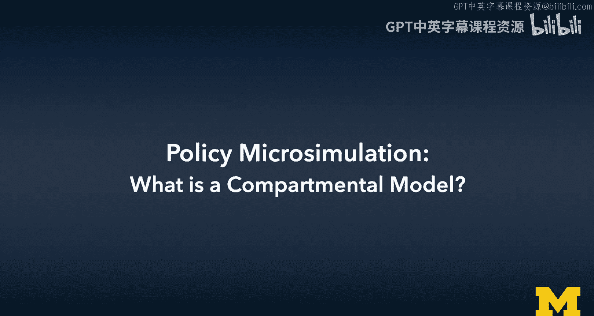

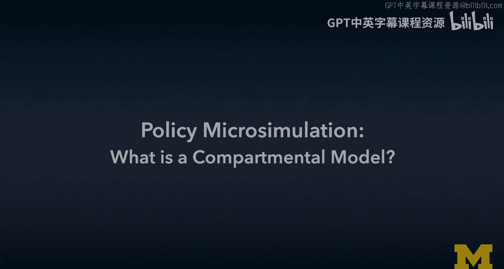

在本节课中，我们将学习一种在健康政策分析中常用的模拟模型——区室模型（或称宏观模拟模型）。我们将以预测未来吸烟率为例，详细解析区室模型的核心概念、工作原理和计算方法。

上一节我们介绍了模拟模型在政策分析中的重要性，本节中我们来看看一种具体的模型类型：区室模型。

## 区室模型概述

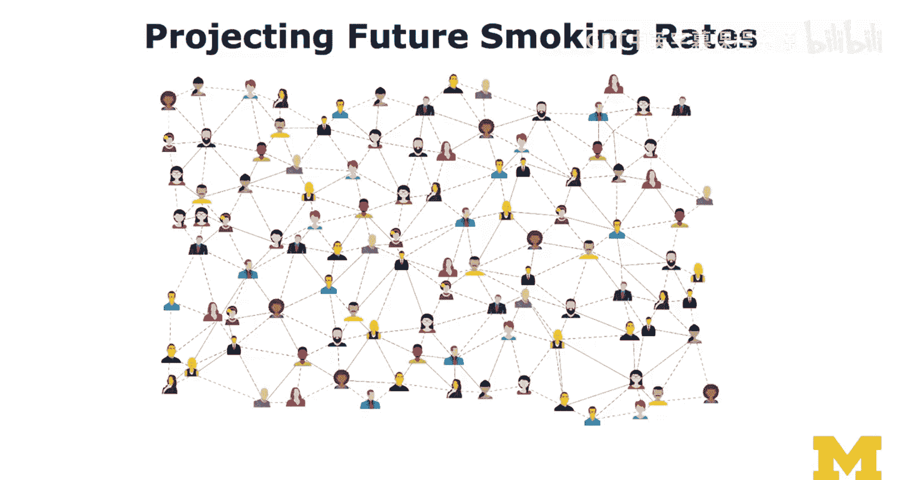

区室模型的核心是追踪特定群体在不同类别（区室）中的数量变化。它主要关注两个关键特征：**存量**和**流量**。

*   **存量**：指在特定时间点，处于某个特定类别中的个体数量。这代表了我们所关注的“现状”。
*   **流量**：指导致个体在不同类别间移动的规则和条件。这决定了“未来”的存量将如何变化。

## 核心动态方程

区室模型的基本思想可以用一个简单的公式来描述：

**未来某一时刻的吸烟者数量 = 当前时刻的吸烟者数量 + 期间发生的变化量**

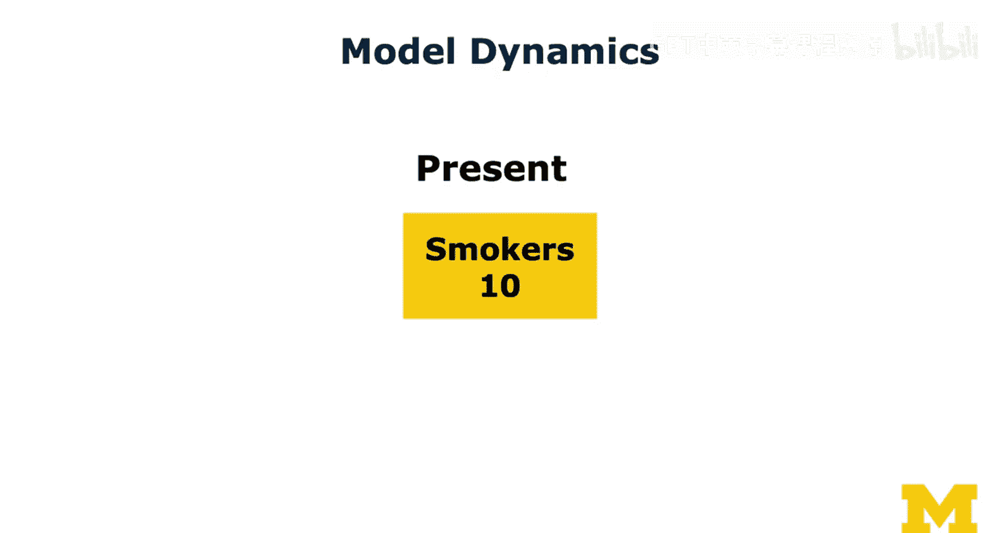

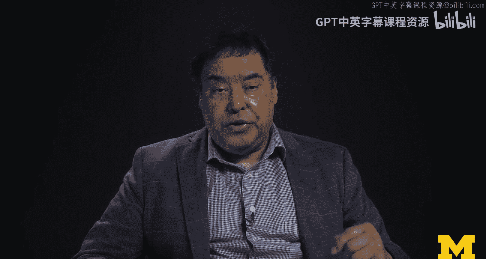

用数学公式表示为：
`Smokers(t+1) = Smokers(t) + Δ`

其中，`Smokers(t)` 代表时间 `t` 时的吸烟者存量，`Δ` 代表从时间 `t` 到 `t+1` 期间吸烟者数量的净变化。

## 变化量的构成

那么，变化量 `Δ` 具体包含哪些部分呢？它由进入和离开“吸烟者”这个区室的个体流构成。

以下是构成变化量的主要流量：

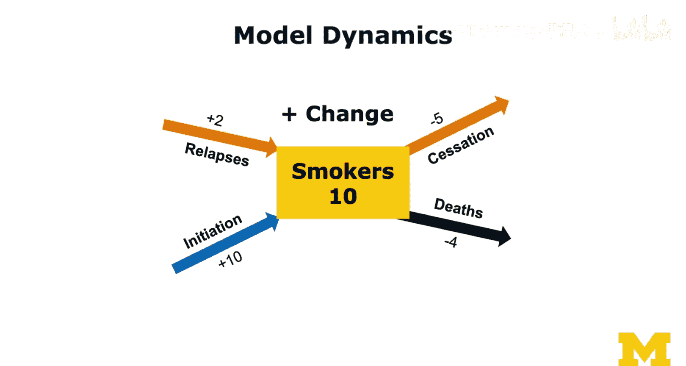

*   **流入量（增加吸烟者存量）**：
    *   **开始吸烟者**：从未吸烟者转变为吸烟者。
    *   **复吸者**：已戒烟者重新开始吸烟。
*   **流出量（减少吸烟者存量）**：
    *   **戒烟者**：吸烟者成功戒烟。
    *   **死亡者**：吸烟者因各种原因死亡。

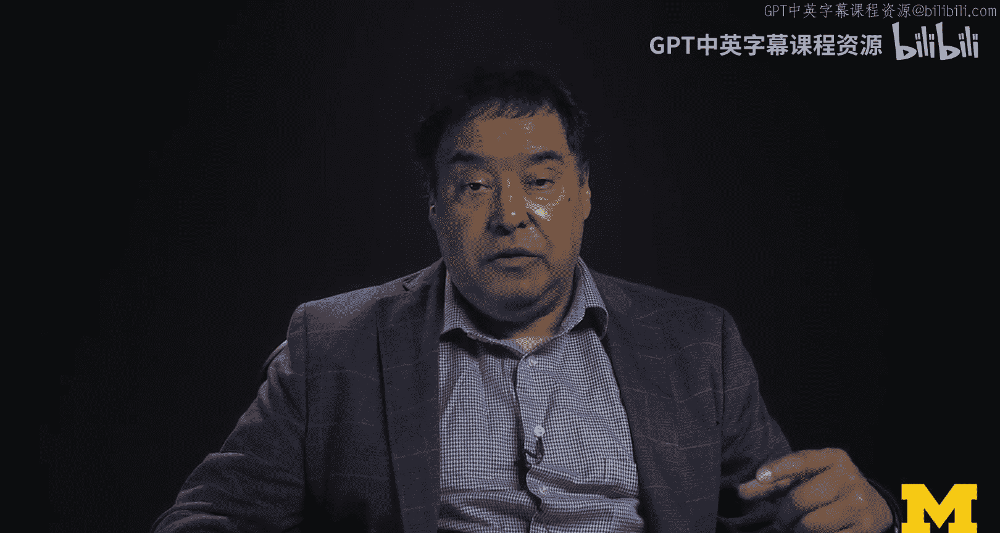

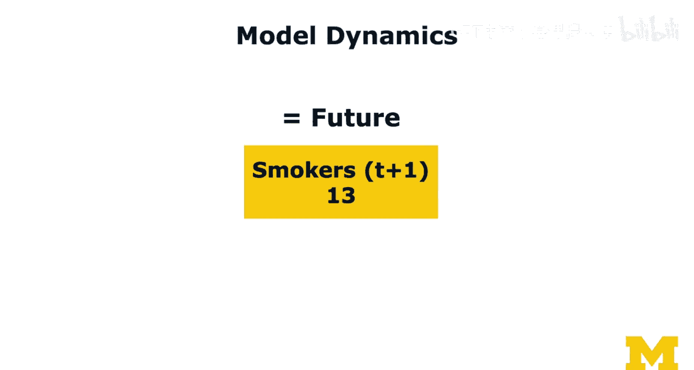

因此，变化量 `Δ` 的计算公式为：
`Δ = (开始吸烟者数量 + 复吸者数量) - (戒烟者数量 + 死亡者数量)`

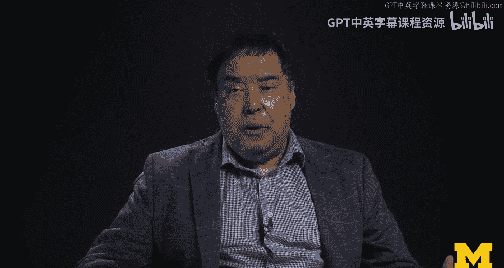

## 参数估计与计算

为了计算上述流量，我们需要借助一系列从数据或文献中估计得到的参数。这些参数通常表示为特定事件发生的概率或比率。

以下是计算各流量所需的关键参数及其应用：

*   **开始吸烟率**：一个从未吸烟者在特定时期开始吸烟的概率。计算公式为：`开始吸烟者数量 = 从未吸烟者存量 × 开始吸烟率`
*   **戒烟率**：一个吸烟者在特定时期戒烟的概率。计算公式为：`戒烟者数量 = 吸烟者存量 × 戒烟率`
*   **复吸率**：一个已戒烟者在特定时期重新开始吸烟的概率。
*   **死亡率**：一个吸烟者在特定时期死亡的概率。

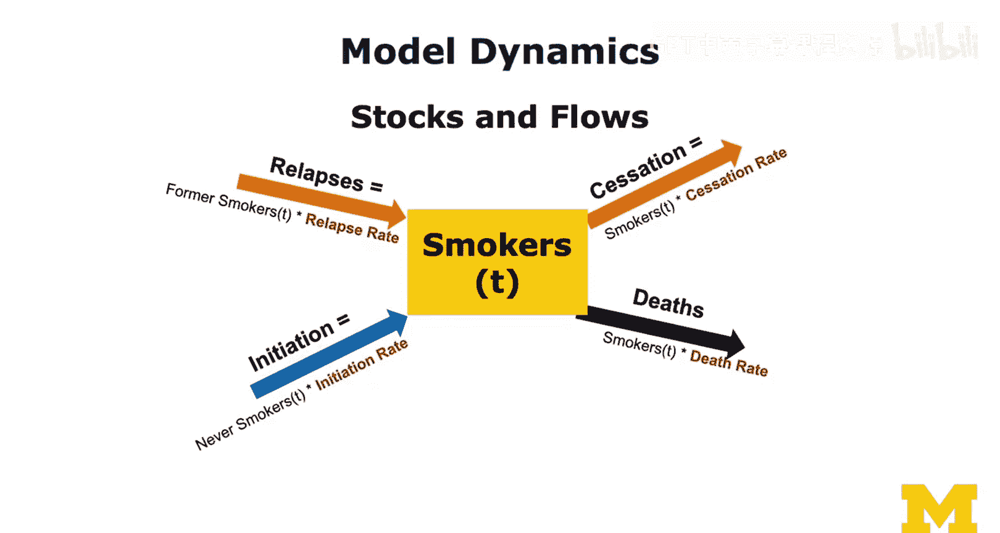

这些参数可以根据年龄、性别、社会经济状况等进行细分，从而使模型能更精确地反映现实情况。当我们掌握了这些参数（通常以红色高亮显示在模型图中），并将其与相应的存量相乘，就能预测出未来每个流量的大小，进而推算出未来的吸烟者存量。

## 总结

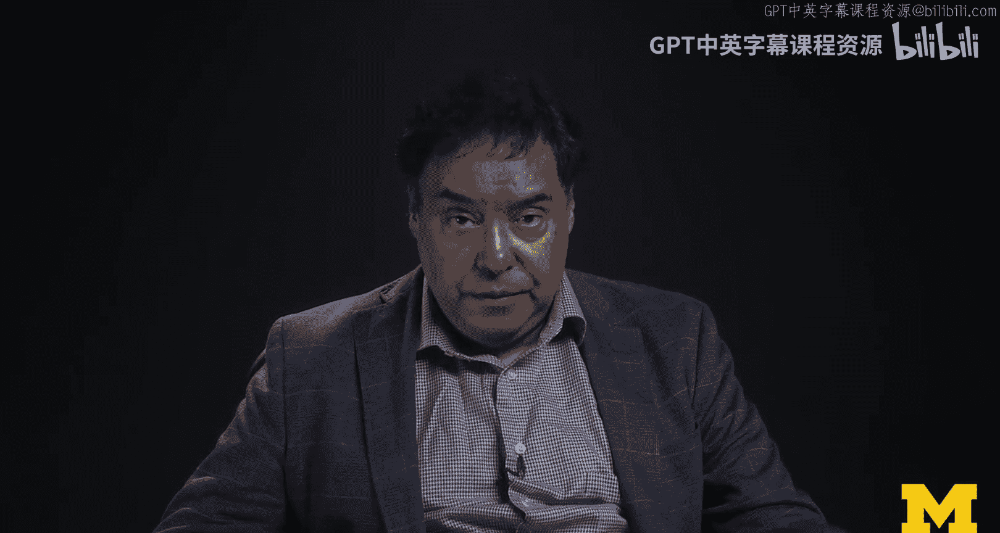

本节课中我们一起学习了区室模型的基本原理。我们了解到，区室模型通过追踪**存量**和模拟**流量**来预测群体行为的变化。其核心是使用一个动态方程 `Smokers(t+1) = Smokers(t) + Δ`，并通过估计开始吸烟率、戒烟率、复吸率和死亡率等关键参数来计算变化量 `Δ`。这种模型结构清晰，是进行健康政策微观仿真和预测的有力工具。