# 22：烟草控制基础区室模型构建 🚬

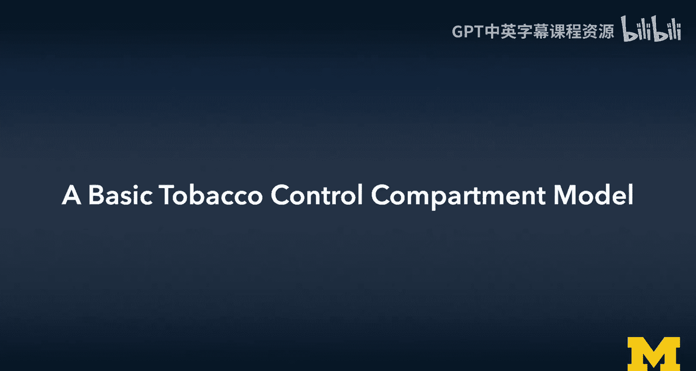

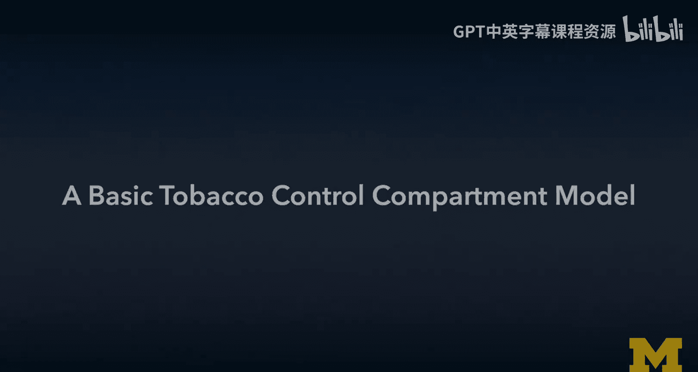

在本节课中，我们将学习烟草控制领域的基础区室模型。区室模型是一种用于追踪人群在不同状态（如吸烟者、戒烟者、从不吸烟者）之间流动的数学工具。我们将了解其核心概念、参数设置、政策应用以及如何利用它来回答重要的公共卫生问题。

大家好，我是大卫·门德斯，密歇根大学公共卫生学院健康管理与政策系的副教授。

在这些模块中，我将讨论烟草控制的基础区室模型。

我们希望通过这个模型来追踪吸烟或处于不同吸烟阶段的人数。

实际上，我们会按年龄、性别和不同类别来追踪他们。

但我们关注的主要特征是吸烟状态。

他们现在是吸烟者，还是曾经吸烟的戒烟者，或是从未开始吸烟的从不吸烟者。

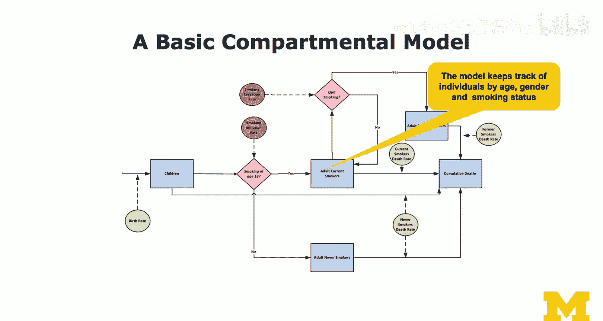

正如我们在上一个模块中讨论过的。

我们有一定数量的参数，这些参数是通过模型内或模型外的数据估计得出的，它们定义了从一个区室到另一个区室的转变率。

我们特别关注这个方框中的开始吸烟率和戒烟率。

开始吸烟率，如果你还记得，是指单个个体在特定年龄开始吸烟的概率。戒烟率是指特定个体在特定年龄停止吸烟的概率。

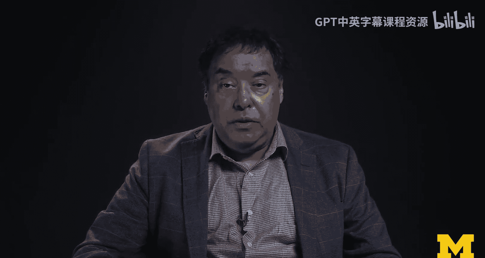

这些参数很重要，因为通过它们，我们可以施加政策干预。

政策会影响这些参数。例如，如果我们实施一项提高香烟税的政策，这将同时影响开始吸烟率和戒烟率。

随后，你会看到各个区室（即存量）将发生变化。

特别是，吸烟者区室的人数会下降，吸烟流行率会以一定的幅度下降。

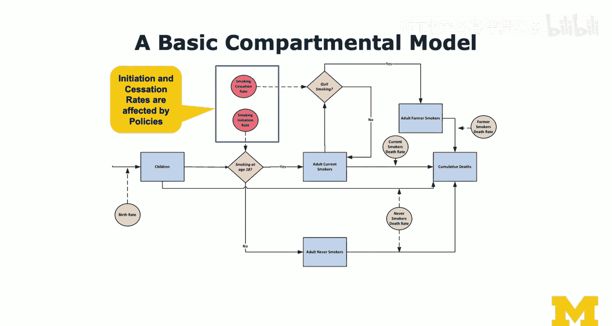

除了这些用于控制的参数，我们还追踪人口的其他特征。

这些特征由模型中嵌入的其他参数来调节。

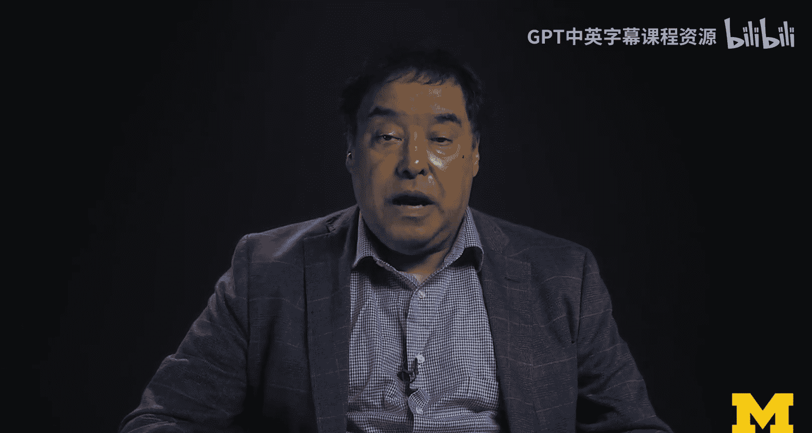

例如，按年龄、性别和吸烟状态划分的死亡率就嵌入在我们的模型中。

一旦模型设置完成，我们就可以预测未来会发生什么。

我们可以追踪随时间推移，从一个类别转移到下一个类别的人数。

然后，我们可以将这个区室模型用于不同的问题，并回答不同类型的疑问。

以下是一些可以用区室模型回答的问题示例。

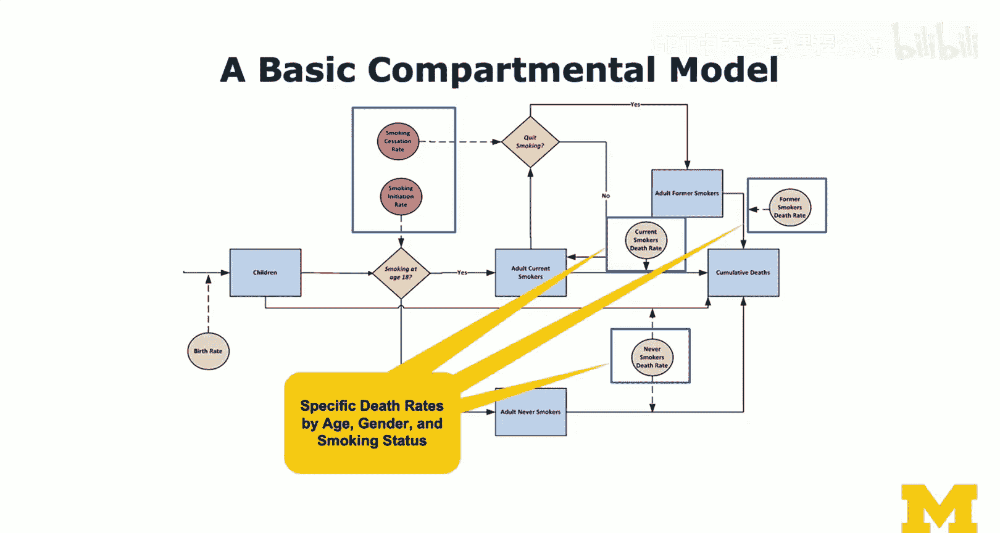

我将从政策效果评估开始介绍。

这是一篇使用名为Simmoke的区室模型的论文，由乔治城大学的大卫·利维教授在2011年提出。

利用这个模型，他预测了薄荷醇香烟禁令的影响。

其结果最近被食品和药物管理局引用，用于支持他们在2022年推动市场禁售薄荷醇香烟的努力。

另一个例子是可行性分析。

在这篇论文中，密歇根大学的肯·沃纳教授和我进行了一项研究。

我们证明，美国疾病控制与预防中心或政府为2010年设定的全国吸烟率目标是无法实现的。

1999年设定的目标是到2010年将吸烟流行率降至12%。

利用我们估计的参数和一个区室模型，我和我的合著者能够证明，在10年内实现这一目标几乎是不可能的。

这提醒了政府注意这个问题，我们为此提出了一个新的目标。

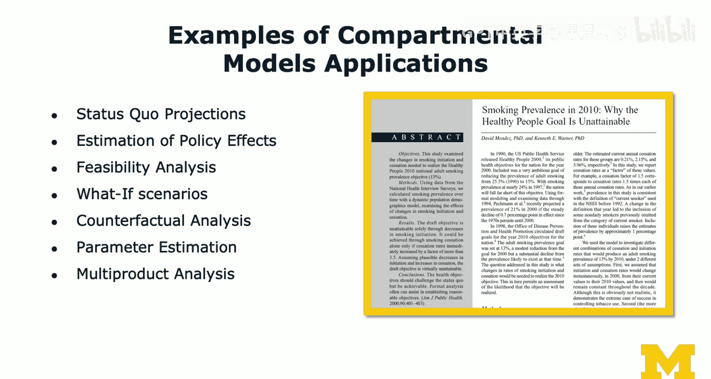

我们的预测非常准确。2010年，我们距离12%的目标还非常遥远。

区室模型的另一个应用例子是“假设”情景分析。

在这篇论文中，肯·沃纳教授和我使用一个模型来探究，如果我们以可行的方式管理开始吸烟率和戒烟率，发展中国家可能实现的最佳情景是什么。

我们期望随着时间的推移，吸烟率会发生怎样的变化。

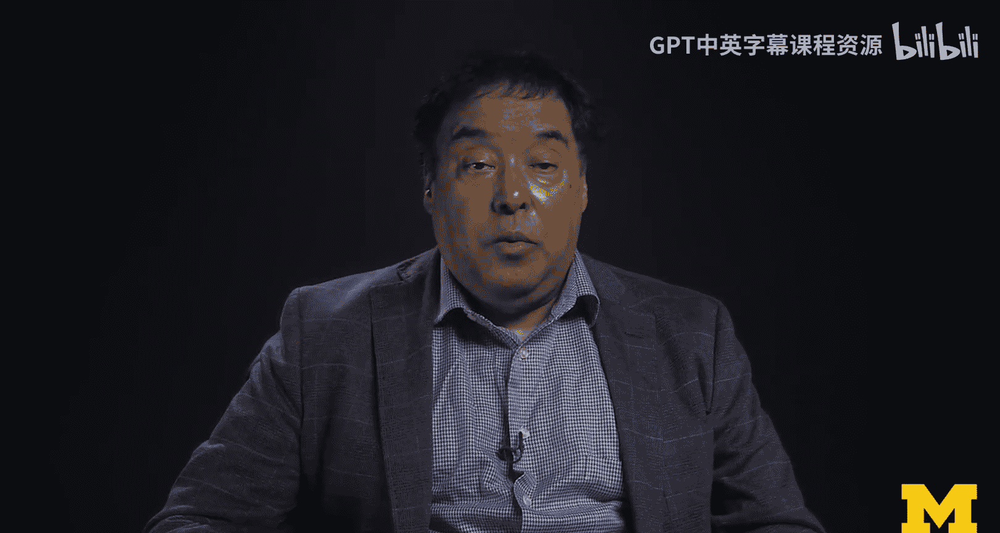

当然，还有许多其他应用，但我希望这三个例子能作为区室模型在卫生政策中作用的入门介绍。

谢谢。

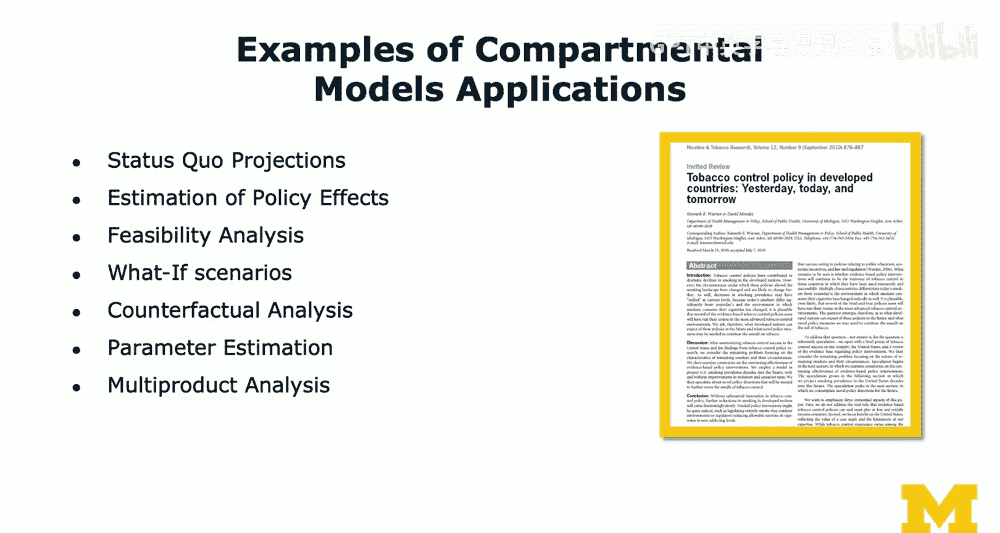

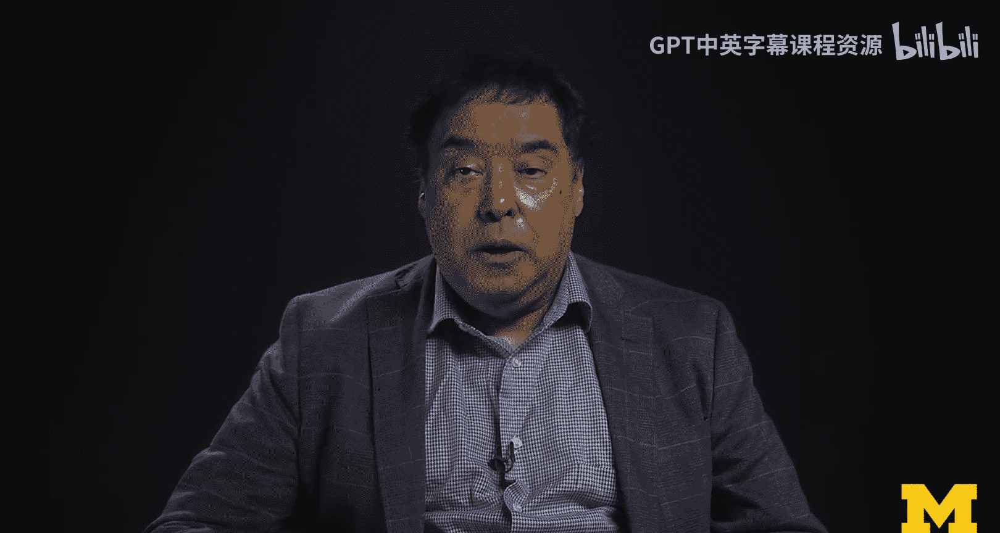

---

本节课中，我们一起学习了烟草控制的基础区室模型。我们了解了模型如何通过追踪人群在“吸烟者”、“戒烟者”和“从不吸烟者”等状态间的流动来工作。核心参数**开始吸烟率**和**戒烟率**是政策干预的关键杠杆。通过嵌入人口特征参数（如死亡率），模型可以用于**政策效果评估**、**目标可行性分析**和**“假设”情景模拟**，为公共卫生决策提供有力的数据支持。