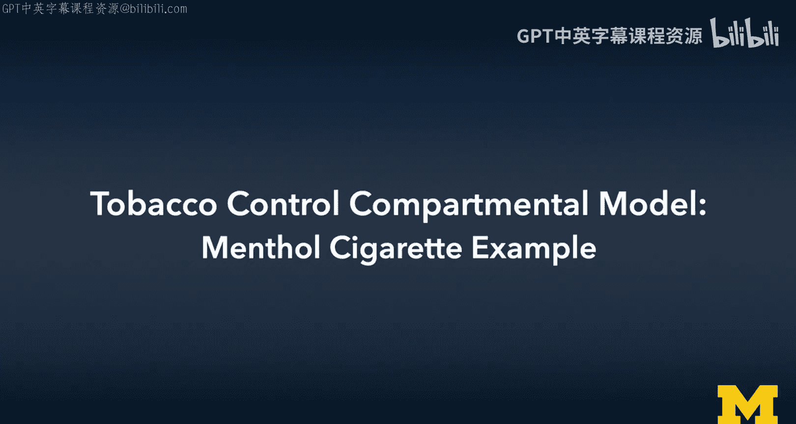
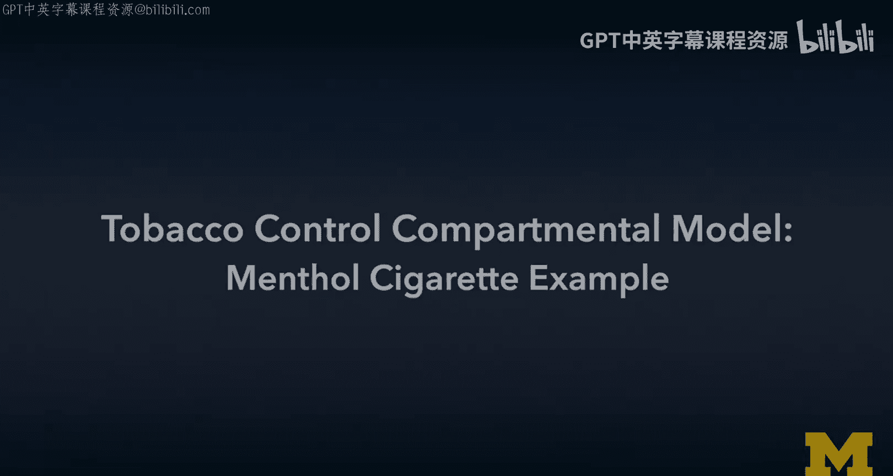
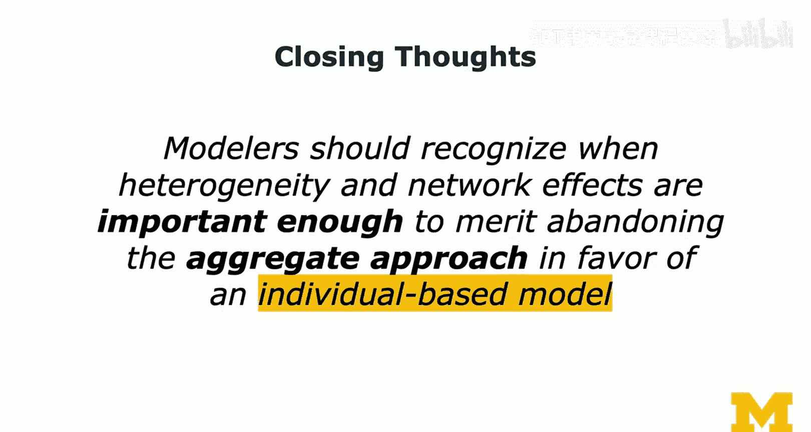
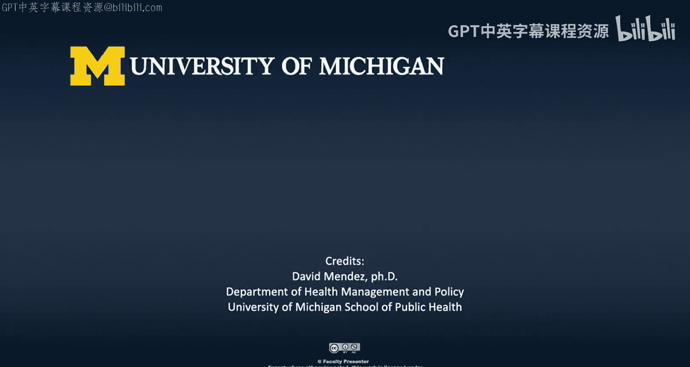

# 公共卫生政策中的R数据分析：23：烟草控制区室模型：薄荷醇香烟案例研究 🚬

在本节课中，我们将学习一个具体的区室模型应用案例，该模型用于追踪薄荷醇香烟吸烟者。我们将了解如何扩展基础模型以区分不同吸烟者群体，并利用模型估算特定烟草产品在历史上造成的公共卫生危害。

大家好，我是大卫·门德斯，密歇根大学公共卫生学院健康管理与政策系的副教授。在本模块中，我将讨论一个用于追踪薄荷醇吸烟者的特定区室模型。

## 模型概述与目标 📊

上一节我们介绍了基础的区室模型。本节中，我们将看看一个扩展模型，它专门设置了薄荷醇吸烟者和非薄荷醇吸烟者区室。

该模型的目标是追踪随时间推移，个体在这两个区室之间流动的数量。在完成模型构建后，我们使用它来估算薄荷醇香烟在1980年至2018年间对美国人口造成的危害。

## 模型估算的危害结果 📉

以下是模型估算出的关键数据。这些数字清晰地展示了薄荷醇香烟的影响。

*   **第一行（总人口影响）**：
    *   **额外吸烟者**：由于薄荷醇香烟，增加了10，137，808名吸烟者。
    *   **额外死亡**：在此期间，美国人口中约有378，000例死亡归因于薄荷醇香烟。
    *   **生命年损失**：这些因吸烟而过早死亡的个体，总共损失了约300万生命年。

*   **第二行（非裔美国人影响）**：
    *   **额外吸烟者**：在非裔美国人口中，有150万额外吸烟者是由于薄荷醇香烟。
    *   **额外死亡**：非裔美国人中归因于薄荷醇吸烟的额外死亡约为156，471例。
    *   **生命年损失**：因薄荷醇吸烟损失了约150万生命年。

*   **第三行（对比分析）**：
    *   这一行列出了如果非裔美国人口未被作为薄荷醇香烟的营销目标，其参数与总人口一致时的预期危害。通过比较第二行和第三行，我们可以量化针对性营销策略造成的额外负担。

模型结果揭示了一个严峻的事实：在1980-2018年间，非裔美国人约占美国总人口的12%，但却承受了因薄荷醇吸烟导致的全部额外死亡的**41%**，以及全部生命年损失的**50%**。这种差异正是通过区室模型分析得出的。

下图直观地展示了表格中的数据，分别是累积的额外吸烟者、过早死亡和生命年损失。

## 区室模型的优势与局限 ⚖️

区室模型在预测、估算未来或假设情景下的损害或收益方面非常有用，正如我们在薄荷醇案例中所做的那样。

然而，我们需要谨慎解释和使用区室模型。在模型开始时我们提到，区室代表的是个体集合，我们将这些个体视为同质的。但现实中人口存在大量异质性，我们在区室模型中忽略了这一点，因为我们通常认为这对特定问题不相关。

但有时，这种异质性非常重要，而使用区室模型我们可能会错过它。此外，区室模型也无法完全体现个体之间的互动。在区室中，我们忽略了那些可能引发人口状态变化的互动。

## 从区室模型到个体模型 🔄

当我们认为个体间的互动很重要，或者需要更深入地考察人口异质性时，这种基于总体的方法可能就不是最佳选择了。

这时，我们会转向**基于个体的模型**。我们不再像区室模型那样追踪群体，而是追踪具体的、具有不同特征的个体。这类模型被称为**微观模拟模型**或**智能体模型**。

*   **智能体模型**：更为灵活，允许个体间互动，并观察这些互动在宏观层面产生的效应。
*   **微观模拟模型**：更侧重于考察具有丰富异质性的个体，但通常不模拟个体间的互动。我们可以为个体设定各种条件，并逐一追踪他们。

例如，如果想研究“一个人有许多吸烟朋友并通过互动说服此人吸烟”这类效应，就需要在智能体模型中进行追踪。

## 总结 📝

本节课中，我们一起学习了：
1.  如何构建和应用一个追踪薄荷醇吸烟者的扩展区室模型。
2.  利用该模型量化了薄荷醇香烟在历史上造成的公共卫生危害，特别是其对非裔美国人社区的不成比例影响。
3.  认识了区室模型的优势（如宏观趋势预测）和局限性（如忽略异质性与个体互动）。
4.  了解了当问题需要考察个体差异和互动时，可以转向基于个体的模型，如微观模拟模型或智能体模型。

感谢大家的学习。