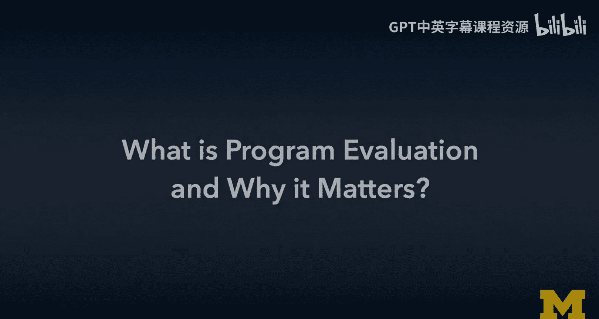
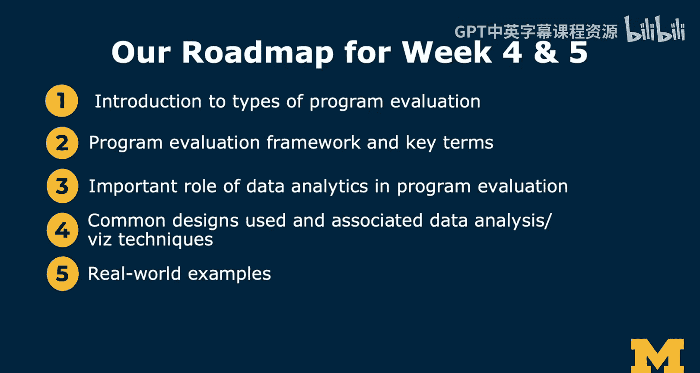
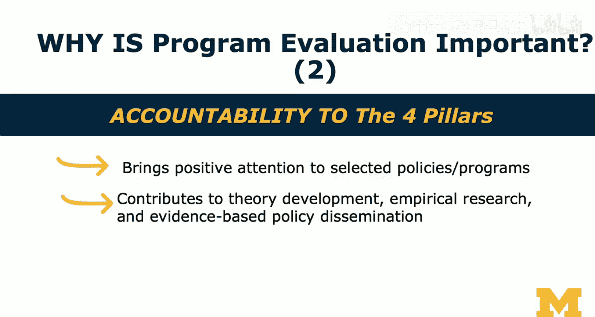
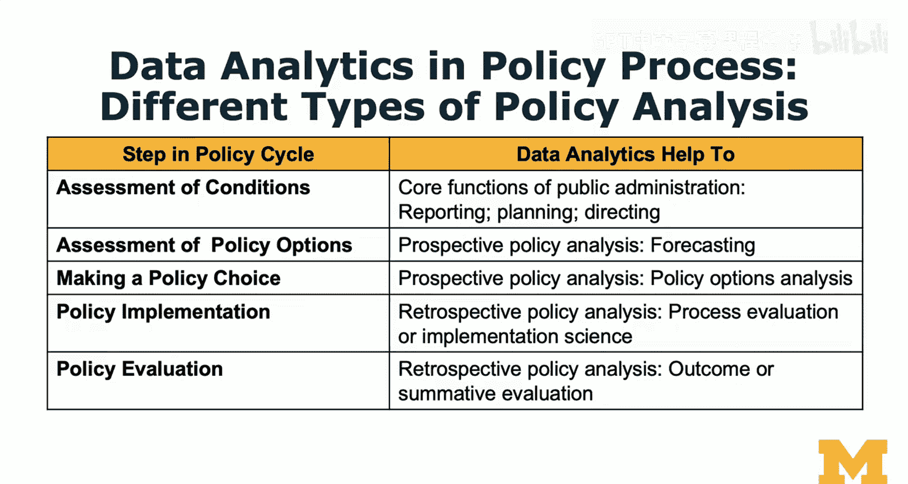
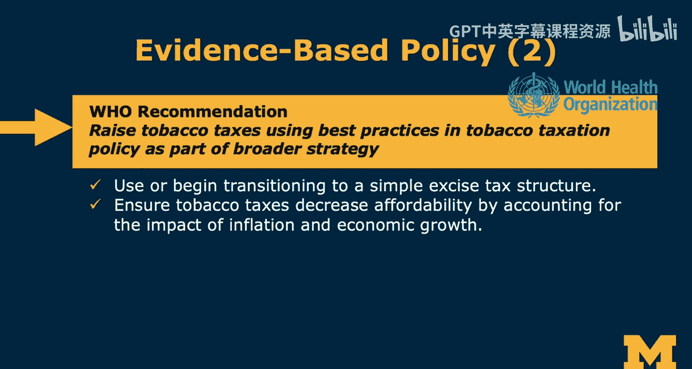

# 公共部门的R数据分析：24：项目评估定义及其现实意义 📊

在本节课中，我们将学习项目评估的基本概念、它在公共政策与行政中的重要性，以及数据分析在其中扮演的关键角色。我们将通过一个清晰的框架来理解不同类型的评估，并探讨数据分析如何支持这一过程。

## 课程概述

我是Paula Lance教授。在我们的系列课程中，现在我们将聚焦于**项目评估**，探讨它为何对公共政策与公共管理至关重要，以及数据分析在此过程中的重要作用。

## 课程路线图

在接下来的几周，我们的学习路线如下：
*   首先，我将介绍不同类型的项目与政策评估。
*   为此，我们将使用一个项目评估框架。需要说明的是，这个过程涉及大量专业术语，我们必须先进行定义，之后会频繁使用它们。
*   同时，我们将详细讨论数据分析在项目与政策评估中的重要作用。
*   我们将探讨一些常用的评估设计，以及相关的数据分析与数据可视化技术。
*   此外，课程将包含大量真实世界的案例，并有一位特邀嘉宾分享经验。

## 什么是项目评估？

我们之前已经简单讨论过。项目评估是一种**描述性**或**回顾性**的政策分析。这意味着，与我们之前讨论的**前瞻性政策分析**（试图预测政策实施后的未来状况）不同，在项目评估中，我们提出的问题是：**已实施的公共项目、政策或干预措施是否有效？**

它可能涉及对项目执行层面、用户体验的分析，但更常见的是聚焦于政策、项目和干预措施的**影响与有效性**、**成本**，以及审视可能出现的各类**伦理、价值观和不公平问题**。

## 项目评估为何重要？

首先，让我们回顾公共管理的四大支柱。项目评估与对这四大支柱的**问责制**息息相关：
1.  **有效性**：政府需要了解正在实施和改革的政策、正在运行的项目是否运作良好，是否达到了目标，并确保它们没有对民众造成伤害。
2.  **经济与效率**：在政府工作中，资源稀缺是常态，因此我们必须确保资源得到高效利用和分配，即以一定的资源投入实现特定目标，并获得相应价值。
3.  **公平性**：这始终是一个重要支柱。我们需要了解正在实施的项目或政策是否引发了公平性问题，或者它们是否真正实现了减少不公平的目标。

项目评估对政府工作至关重要的原因还包括：
*   它可以通过媒体或其他渠道，为特定的政策和项目带来积极的关注，是政府与公众沟通其工作的绝佳方式。
*   从研究的角度看，项目评估也很重要，它有助于多个不同学科的理论发展、实证研究，并推动真正高水平的循证政策设计与传播。

## 数据分析在政策过程中的作用

您之前见过这个图表，但我要再次提醒您数据分析在政策过程中的重要作用，以及政策分析如何融入其中。

正如您可能回忆起的，政策制定过程的第一步是**评估现状**。当我们使用数据来做这件事时，它回溯到公共管理的所有七项核心职能，尤其是**报告、规划和指导**职能。

政策周期的第二步是**评估政策选项**。我们已经讨论过前瞻性政策分析和政策模拟建模在预测特定政策实施后世界可能面貌方面的重要作用。

接着，政策制定者必须做出**政策选择**。同样，在政策选项分析中，数据在比较和对比不同政策选项以及做出选择方面至关重要。

然后是**政策实施**，这正是我们本节要关注的重点，以及**政策评估**（这再次属于回顾性政策分析）。因此，对于政策实施，我们可以进行所谓的**过程评估**、**实施评估**或**实施科学**；而对于评估部分，我们将进行所谓的**结果评估**或**总结性评估**。

不必担心，我将定义所有这些术语，并为所有这些不同类型的评估提供大量示例。现在，让我们快速通过一个例子，来真正强调这类政策分析和政策评估对政府通过政策所进行的工作是多么重要。

## 实例分析：烟草消费税

我们之前讨论过，这是一个使用税收政策杠杆的正式政策示例。它基于经济学理论，即**价格与烟草消费之间存在负的价格需求弹性**。在这种情况下，这意味着价格的单位变化会对烟草产品的消费产生相应的负面影响或导致消费下降。

因此，一个重要的政策问题是：**需要多高的税率才能使烟草产品的价格具有实际产生公共卫生效益的价格弹性？**

一包香烟的价格在世界各地差异很大，这是因为不同的国家、州或省对香烟价格征收了不同水平的税。

已经进行了数十项烟草税收政策评估，其中大多数使用所谓的**时间序列分析**来估计通过征税提高不同价格水平后需求的变化。

总体研究结果确实表明，通过征税提高价格会降低需求，正如经济理论所预测的那样。然而，**价格水平至关重要**，价格弹性确实因税收水平而异。

一些研究表明，全球只有38个国家（仅覆盖全球人口的14%）的烟草税高到足以产生公共卫生影响（其定义是：对香烟征税至少能覆盖烟草相关医疗保健、劳动力损失及其他公共成本的75%）。这是世界卫生组织进行的研究。

因此，世界卫生组织也建议各国或次国家单位（州、省等）将其烟草税提高到能够实现公共卫生影响目标的水平，并将其作为更广泛战略的一部分。这里的要点是，这不仅仅是简单的征税问题，他们还基于证据提出了**如何实施该税收的政策建议**。世界卫生组织建议使其简单化，例如，不要对不同烟草产品（如雪茄、无烟烟草或电子烟产品——它们是尼古丁产品，而非烟草产品或香烟）进行差异化定价；采用简单的税收结构；通过考虑通货膨胀和经济增长的影响，确保税收降低其可负担性。

## 总结

综上所述，这类政策评估研究对于提出建议和真正理解政策如何能对其目标产生最大价值和最佳影响至关重要。在本节课中，我们一起学习了项目评估的定义、其在公共部门中的核心重要性，以及数据分析如何作为关键工具支撑整个评估过程。我们通过烟草税的例子，看到了评估如何将理论、实证研究与具体的政策建议连接起来。