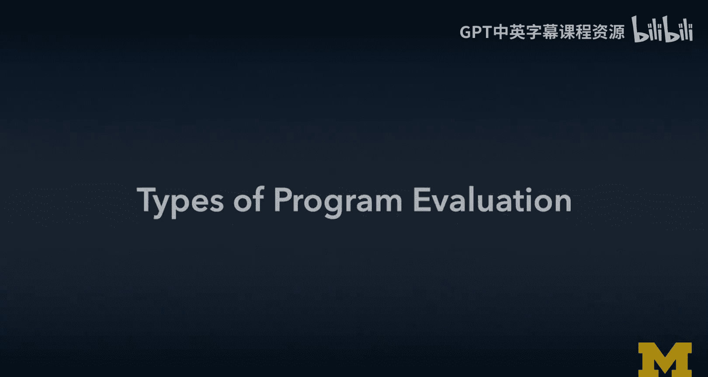
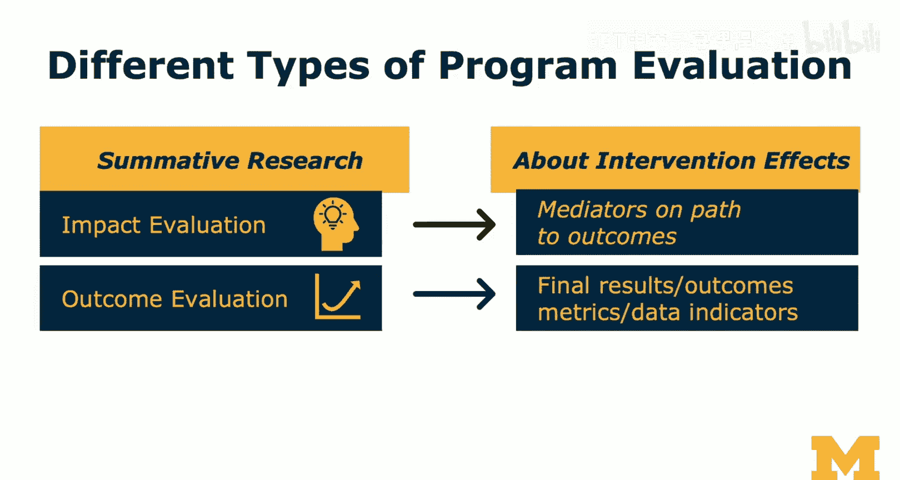
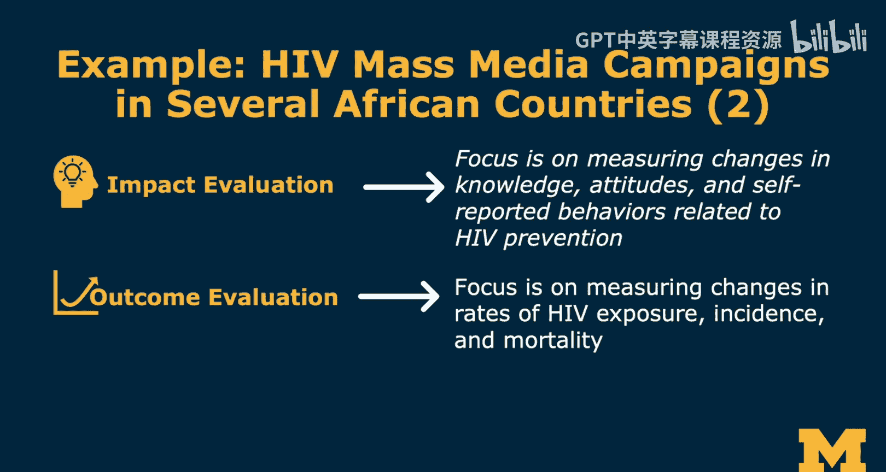
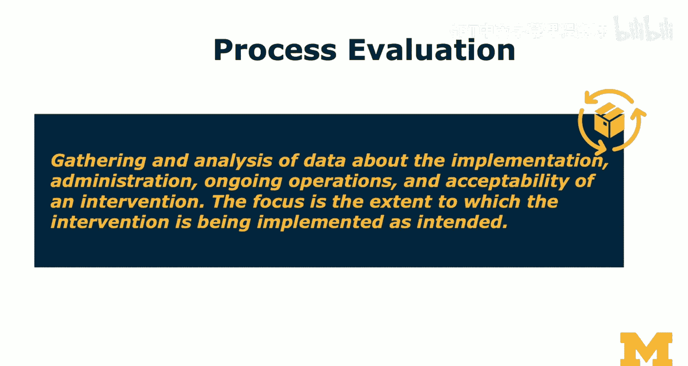
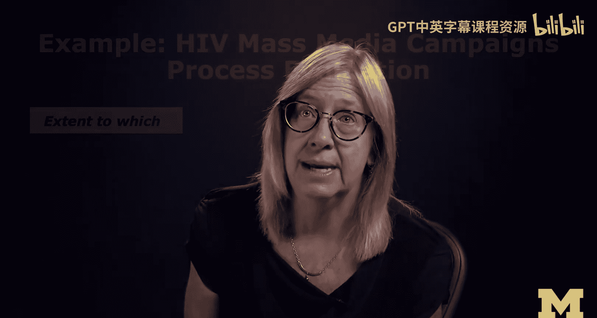
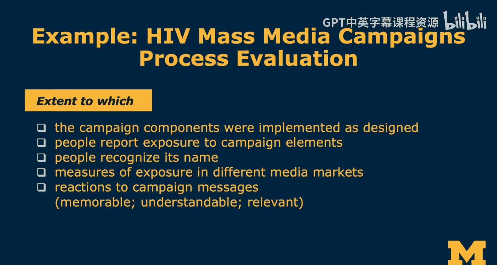
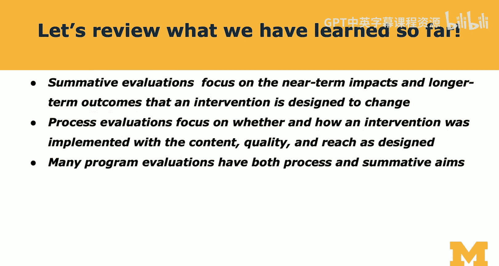
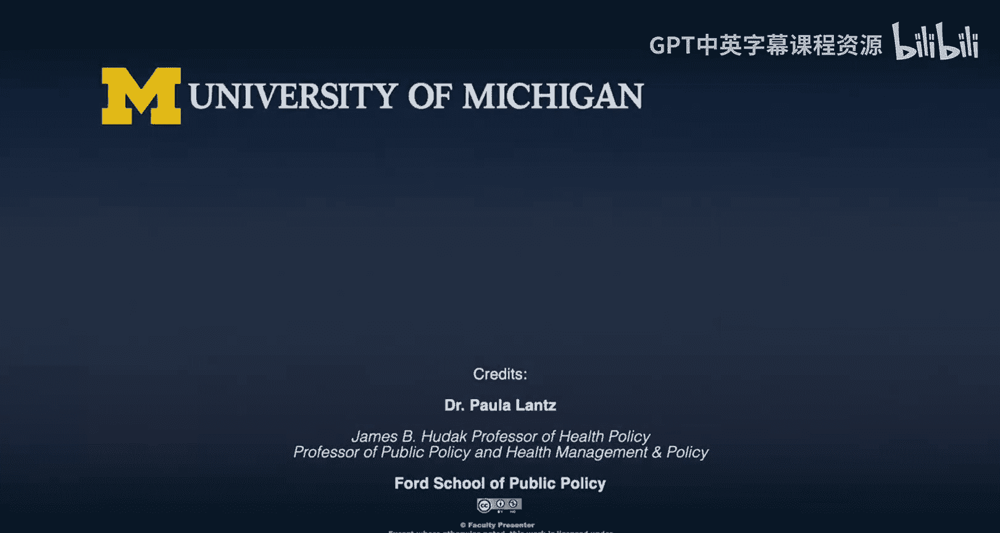

# 公共部门的R数据分析：25：项目评估主要类型 📊

在本节课中，我们将学习项目评估的两种主要类型：总结性评估和过程性评估。我们将通过一个具体的公共卫生案例来理解它们之间的区别与联系。

## 概述

项目评估是衡量政策或项目效果的关键环节。评估主要分为两大类：**总结性评估**和**过程性评估**。总结性评估关注项目带来的“结果”，而过程性评估则关注项目“如何”被执行。理解这两种评估类型，有助于我们更全面地判断一个项目是成功还是失败，以及原因何在。

## 总结性评估：关注结果

总结性评估旨在衡量干预措施或政策的最终效果。它内部又细分为两种：**影响评估**和**成果评估**。

上一节我们介绍了评估的基本分类，本节中我们来看看总结性评估的具体内容。

### 影响评估

影响评估的关注点不一定是干预措施的最终目标，而是那些通向最终成果的**中介因素**或**路径步骤**。有时，一个政策的最终效果需要很多年才能显现，我们无法等待那么久。因此，影响评估旨在检验那些通向最终结果的中间步骤是否按预期实现。

### 成果评估

与影响评估不同，成果评估直接聚焦于研究或评估的**最终目标成果**。它衡量的是干预措施旨在改变的终极状态。

为了更清晰地说明这两种评估的区别，我们来看一个具体的例子。

## 案例：艾滋病防治媒体宣传运动

我们将使用“干预逻辑模型”来阐述这个例子。逻辑模型描述了干预措施预期的工作路径：从实施开始，如何一步步达到最终目标。

过去，一些非洲国家实施了大规模的媒体宣传运动，旨在通过公共教育减少艾滋病病毒（HIV）的暴露、感染和死亡。其逻辑模型如下：

1.  **实施宣传运动**。
2.  **目标人群接触到宣传信息**。
3.  宣传信息**提升人们的知识或意识**，并**改变人们的态度**。
4.  知识和态度的改变导致**风险行为减少**，**安全行为增加**。
5.  行为的改变最终导致**HIV暴露、感染和死亡减少**。

以下是两种评估在此案例中的侧重点：

*   **影响评估**：会侧重于测量逻辑模型中更接近前端的步骤。例如，测量人们在艾滋病预防方面的**知识、态度和自我报告行为**是否发生了改变。
*   **成果评估**：则会侧重于测量最终的指标，例如**HIV感染率和死亡率**的变化。

需要注意的是，一些评估会同时包含影响和成果两部分，二者并非互斥。

## 过程性评估：关注执行

过程性评估则完全不同，它关注的是**干预措施本身及其执行过程**。

上一节我们讨论了项目“产生了什么结果”，本节中我们来看看项目是“如何被执行”的。

过程性评估收集并分析有关干预措施**实施、管理、持续运作**的数据，以及**目标人群对干预措施的接受度**。其核心是评估干预措施是否按照设计初衷被忠实执行。

这一点至关重要，因为项目失败可能有两个原因：
1.  **执行故障**：干预措施本身可能很好，但在执行过程中出了问题。
2.  **设计故障**：干预措施可能被完美执行了，但设计本身无效。

因此，同时进行过程评估和总结性评估，才能帮助我们准确判断：如果没看到预期结果，问题究竟出在**执行过程**还是**干预方案本身**。

让我们回到艾滋病媒体宣传运动的例子，看看过程评估会关注什么。

以下是过程评估可能关注的几个方面：

*   **执行保真度**：宣传运动的所有组成部分（如印刷媒体、电子媒体、社交媒体）是否都按设计意图得到了实施？
*   **覆盖范围**：宣传是否触达了人群？是否覆盖了预期的目标群体（如特定年龄、地理位置）？
*   **公众认知**：通过调查，评估公众对宣传运动的名称识别度、信息理解度以及信息与自身的相关性。

## 总结

本节课中我们一起学习了项目评估的两种主要类型。

首先，**总结性评估**包含影响评估和成果评估。影响评估关注干预措施的**近期效应**和通向长期成果的**中间步骤**；成果评估则直接关注干预措施旨在改变的**最终目标**。

其次，**过程性评估**关注干预措施是否以及如何按照设计的**内容、质量和覆盖范围**得以实施。

许多项目和政策评估会同时包含过程性目标和总结性目标，以便对项目效果做出全面、准确的判断。