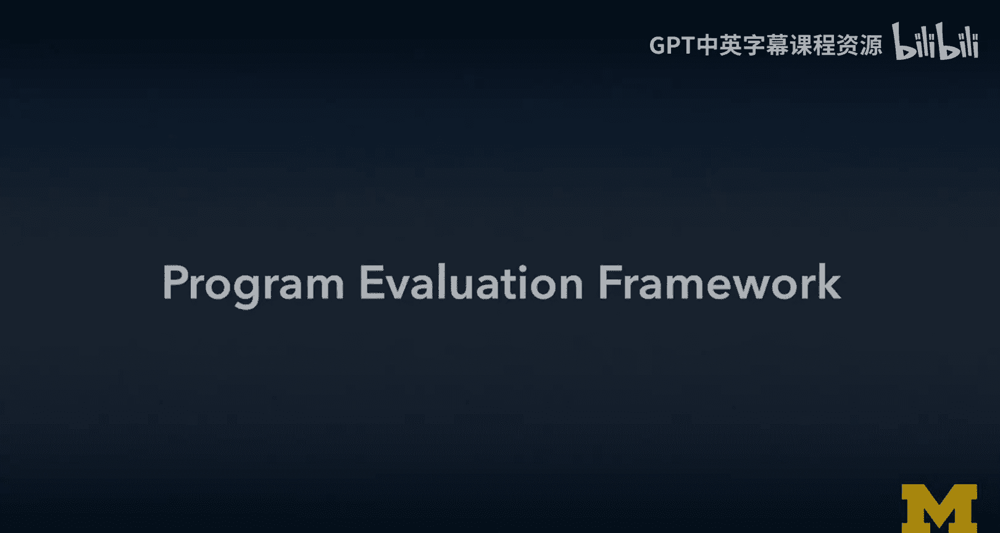
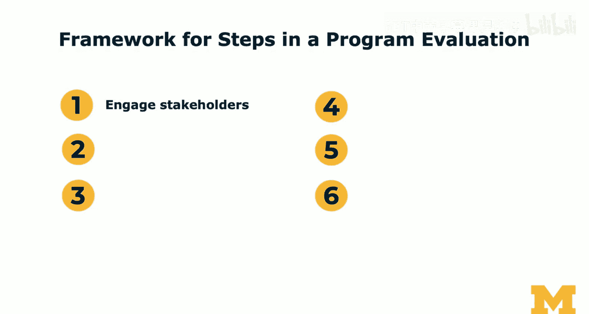
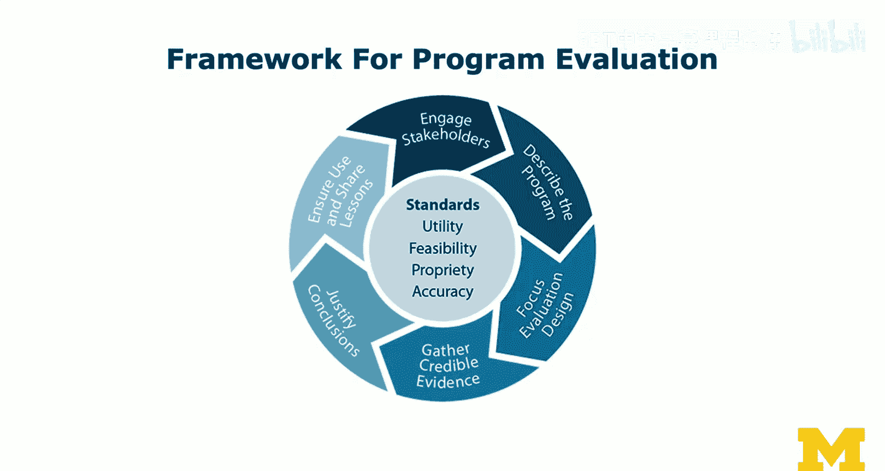
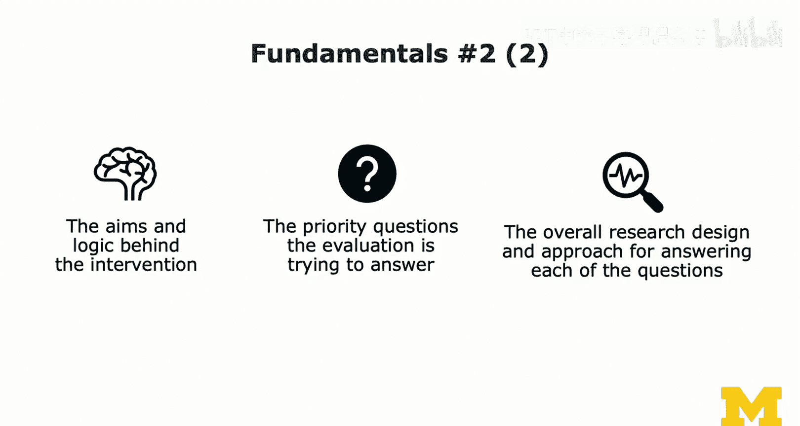

# 26：项目评估方法论框架 📊

在本节课中，我们将学习项目评估的核心方法论框架。这个框架对于本模块后续的政策分析至关重要。我们将介绍一个包含六个步骤的通用流程，并探讨数据分析师在每个步骤中的关键角色。

---

## 概述

项目或政策评估需要遵循一个系统性的框架。本节将详细介绍一个包含六个步骤的循环框架，并阐述数据分析师在评估团队中的重要作用。

---

## 六步评估框架

每个项目或政策评估都需要采取一系列步骤。以下是所有评估都应遵循的六步框架。

### 第一步：让利益相关者参与

利益相关者是指任何对项目、政策或评估结果有利益关系的人。关键的利益相关者通常是那些要求进行评估的人，他们想知道项目是否有效。必须让他们参与进来，以明确他们希望了解的问题。任何干预措施都可能涉及数十个潜在问题，因此从一开始就需要与利益相关者沟通，确定他们想了解什么。

### 第二步：理解干预措施

确保包括利益相关者在内的所有人对干预措施有共同的理解。通常使用逻辑模型来描述干预措施，例如之前展示的关于非洲国家艾滋病大众媒体宣传活动的模型。每个人都需要理解干预措施的设计、逻辑模型中的步骤，以及它预期如何运作并实现目标。在许多项目评估中，并非所有人都对干预措施的工作原理或最终目标达成一致，因此统一认识至关重要。

### 第三步：设计评估

在完成前两步后，评估设计可以更加聚焦。需要明确评估的目标：这是要评估影响和/或结果（总结性评估），还是仅仅评估过程，或者兼而有之？必须确定希望实现什么。

### 第四步：收集与分析证据

此步骤涉及收集和分析支持评估的数据与证据。

### 第五步：得出结论

基于证据得出结论，但必须确保结论是合理且有依据的。

### 第六步：确保结果的使用与传播

确保评估结果将被使用、传播，并且从中获得的经验教训将得到应用。之后，整个循环将重新开始。

---

## 框架的可视化与标准

刚刚介绍的框架步骤并非线性过程，而是一个循环过程。此外，对于每个项目评估，都需要考虑一套统一的标准。

1.  **效用性**：评估必须有用。我们收集、分析和产生的数据，必须有人关心其结果并希望使用它们。
2.  **可行性**：评估必须能够完成。必须存在能够回答利益相关者所提问题的数据。
3.  **合规性**：我们需要遵循研究和项目评估的法律及伦理准则。项目评估是一种研究，在涉及政策和政府项目服务评估时，几乎总是涉及人类，因此必须遵守伦理和法律标准。
4.  **准确性**：我们需要确保产生准确、高质量的研究结果，能够回答所提出的问题。

---

## 数据分析师的角色

数据分析师在项目评估研究团队中的角色非常重要。请记住，作为数据分析师，你不仅仅是后续步骤中分析数据的人。

### 在设计研究方法和聚焦评估方面

你需要确保理解所有步骤中发生的事情。如果你没有直接参与，请花时间了解利益相关者是谁、他们是否已参与、对干预措施的理解如何，以及评估的优先问题是什么。如果不了解评估的背景，你就不能仅仅被要求提供数据。

你需要能够区分过程、影响和结果评估问题。通常，你会发现需要推动一些利益相关者，以可衡量的方式构建评估问题。很多时候，利益相关者会说“告诉我们它是否有效”，但“有效”的定义是什么？我们必须非常具体地将其构建为可衡量的方式。

你还需要能够就拟议数据源的任何局限性进行沟通。作为数据专家，你需要告诉人们拟议使用的数据源有哪些优缺点。

### 在收集和分析数据与证据方面

这更为明显。作为数据分析师，你可能会协助数据收集和准备分析数据，参与执行分析，并可能建议团队其他成员未曾考虑的其他分析方法。

### 在总结结果时

当到了总结结果、说明评估发现的阶段，你需要成为理性的声音，确保结论有数据支持。你比团队中大多数人都更了解数据的优势和局限性，因此需要扮演沟通数据和分
析局限性的角色，以确保人们不会过度解读结果。

### 在沟通结论方面

这是一个非常重要的角色。你可能会负责数据可视化工作，向各类受众传达结果，包括那些没有技术培训、不理解研究和数据问题的受众。因此，你需要确保结果被清晰且真实地传达。

---

## 评估基础要点

我们刚刚回顾了项目评估的一般步骤，现在来谈谈一些基础要点。

项目和政策评估是一种非常重要的政策分析类型，旨在回答一个重要问题：政府实施的干预措施、项目、政策改革或新政策是否产生了任何效果？它是否有效？

然而，任何评估都可能涉及比“它是否有效”更具体的多个不同问题，因为“是否有效”本身不是一个好的研究问题。因此，评估需要聚焦于利益相关者的优先问题，而不是数据分析师、团队中的统计学家或研究人员的优先问题。

所有评估都经历多个步骤，正如这个通用的六步循环框架所概述的那样。

数据分析师是评估研究团队在所有六个步骤中的重要成员，而不仅仅是在人们真正开始处理数据的后期阶段才介入。

---

## 总结

在本节课中，我们一起学习了项目评估的核心方法论框架。我们介绍了一个包含六个步骤（让利益相关者参与、理解干预措施、设计评估、收集与分析证据、得出结论、确保结果使用与传播）的循环流程，并强调了数据分析师在每个步骤中的关键作用，包括确保评估问题可衡量、沟通数据局限性、执行分析以及清晰传达结果。理解评估的背景、干预措施的逻辑以及利益相关者的优先问题，对于进行有效且可靠的政策分析至关重要。