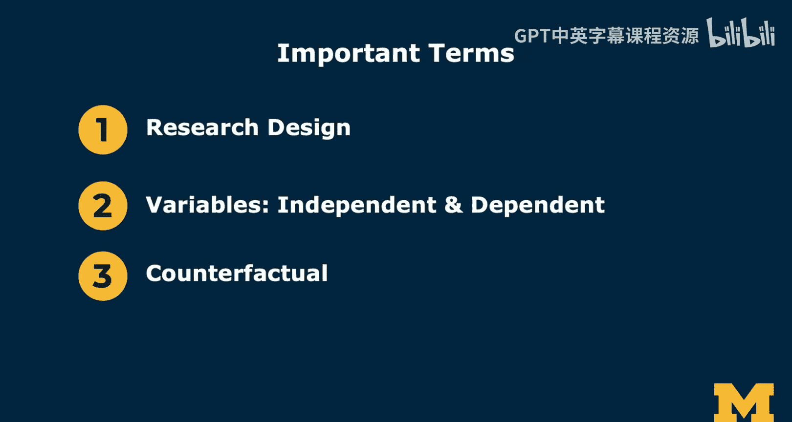
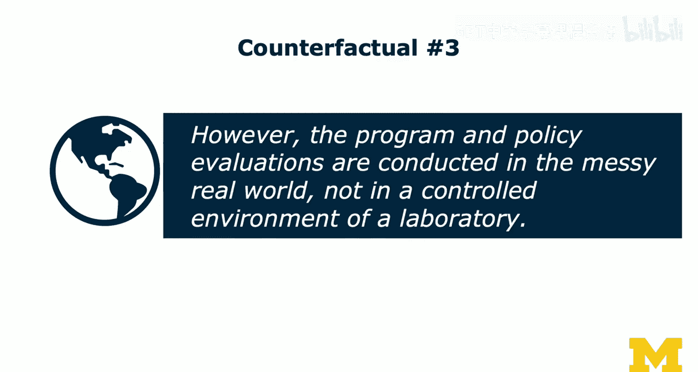
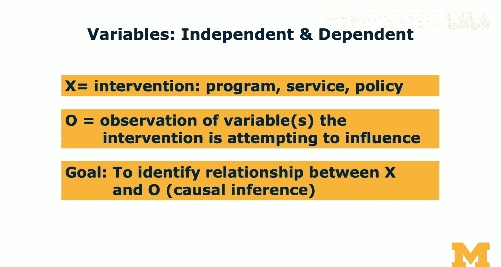
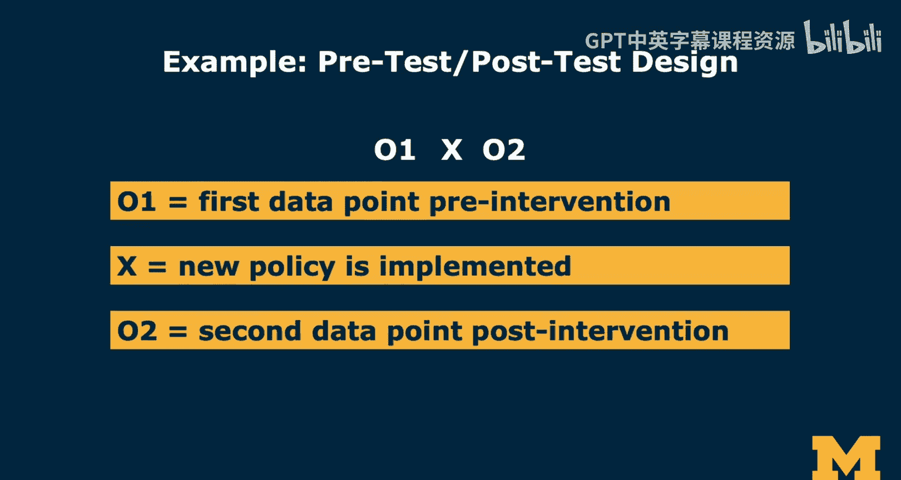
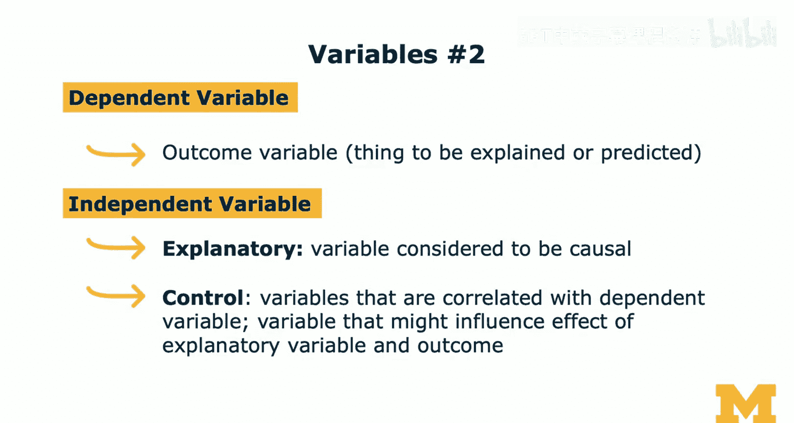
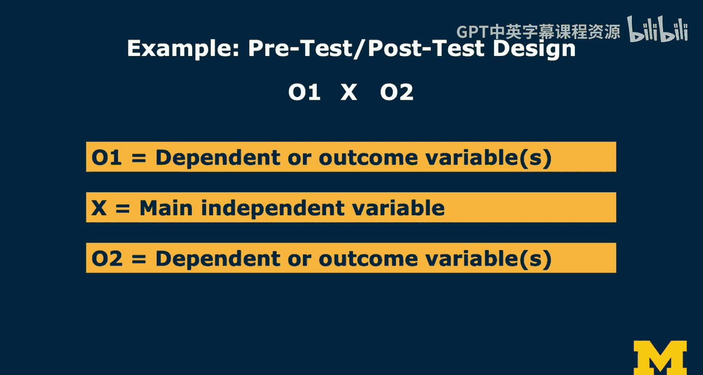
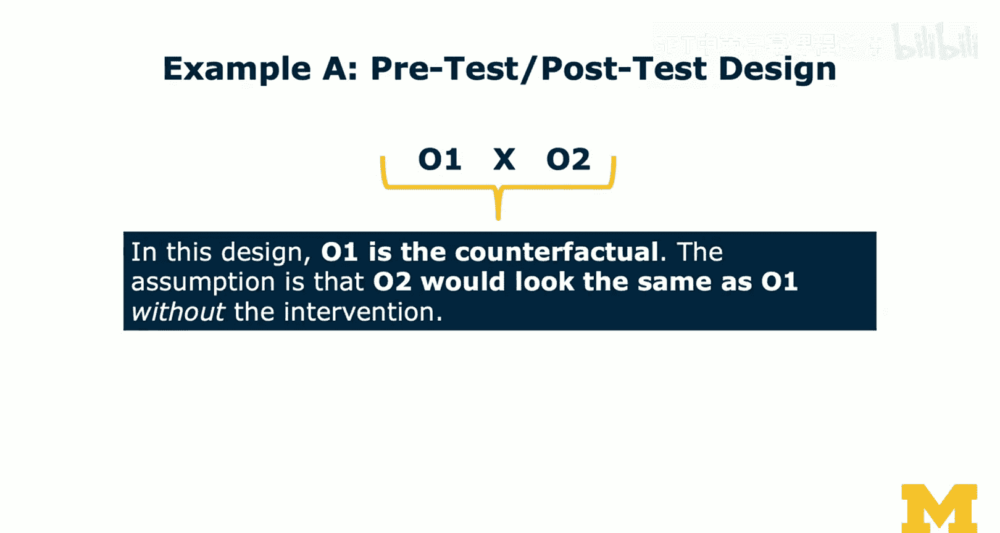
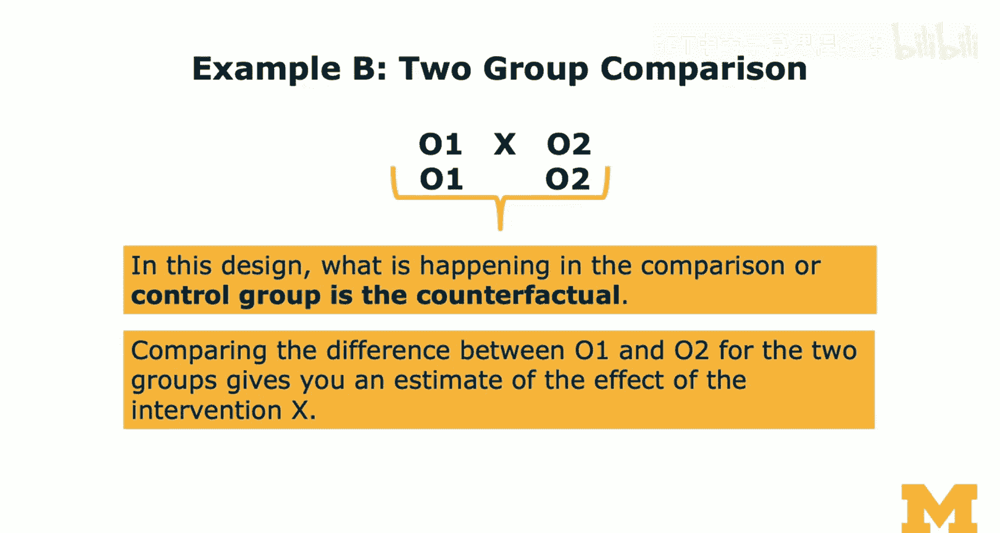
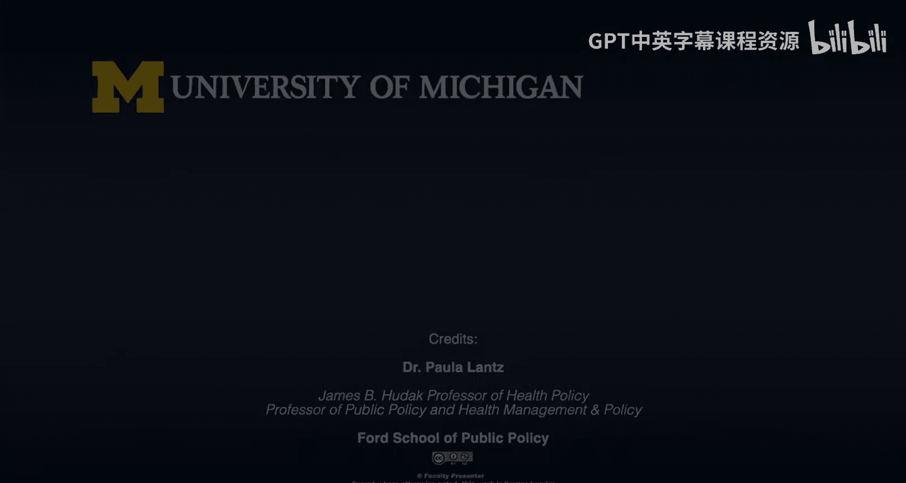

# 27：设计聚焦与可信证据采集 🎯

在本节课中，我们将学习项目评估研究流程的第三步：聚焦研究设计并收集可信证据。我们将介绍研究设计中的核心概念，包括自变量与因变量，以及评估研究中至关重要的“反事实”概念。

## 研究设计概述

上一节我们讨论了评估流程的早期步骤，本节中我们来看看如何具体规划一项科学探究。研究设计是科学探究的规划过程。

以下是研究设计的标准组成部分：
*   **目的**：研究是为了探索、描述现象，还是解释事物间的因果关系？在项目评估中，我们的核心目的是**解释**，即建立因果关系。
*   **分析单位**：研究关注的对象是什么？在公共政策评估中，分析单位通常是**个人**，但也可能是社区、企业、学校或非营利组织。
*   **主题**：我们关注分析单位的哪些方面？是行为、取向（如知识、态度），还是环境条件？
*   **时间维度**：研究在何时进行观察？这对于详细设计至关重要。

## 因果关系与反事实

项目评估试图做科学中最困难的事：**解释**新政策或项目实施后会发生什么。这意味着我们需要在项目/政策的实施（及个体对其的接触）与后续结果之间建立**因果关系**。

建立因果关系需要一个特定的研究设计，它能比较“接触干预后发生的情况”与“**不接触干预会发生的情况**”。后者就是**反事实**。

反事实是指：如果没有这项新政策、项目或干预，世界或我们所处的情境会是什么样子？我们将“有干预”的世界与“无干预”（反事实）的世界进行比较，以观察差异。

在实验室研究中，反事实通常被称为**控制条件**。在现实世界混乱的政策评估中，建立因果关系要困难得多，但目标相同：在某种干预与后续结果之间建立因果联系。

## 自变量与因变量

现在我们来谈谈自变量和因变量。这些术语在所有科学领域通用。在项目评估研究设计中，我们常用一系列 **`X`** 和 **`O`** 来图示化研究设计。

*   **`X`** 代表**干预**，即对项目、服务或政策的接触。它是我们试图建立因果关系的起点。
*   **`O`** 代表对**观察结果**的记录，即干预试图影响的变量。我们试图在干预 `X` 和观察结果 `O` 之间建立因果关系。

让我们看一个例子：**前测-后测研究设计**。
其图示为：**`O1` `X` `O2`**
*   `O1` 是干预前的第一个数据点（前测）。
*   `X` 是新政策或项目的实施。
*   `O2` 是干预后的第二个数据点（后测）。
在这个设计中，我们比较前测 (`O1`) 与后测 (`O2`) 以观察变化，并可能将此变化归因于干预 `X`。

变量是观察单位所具有的、能发生变化且我们感兴趣的特征或属性。

*   **因变量**：其值依赖于另一个变量（自变量）的变量。在项目评估中，它是**结果变量**，即我们试图解释或预测的事物，也就是那些 `O`（我们关心并认为干预会影响的结果）。
*   **自变量**：**解释性变量**，即我们认为会导致因变量发生变化的变量。在评估中，核心自变量通常是**干预** (`X`)。此外，分析中可能还需要控制其他与因变量相关的自变量（即**控制变量**）。

让我们再次可视化前测-后测设计：**`O1` `X` `O2`**
*   `O`（`O1` 和 `O2`）是**因变量**或结果变量。
*   `X` 是**自变量**（干预）。
我们在两个时间点观察因变量，并知道在这两点之间，分析单位接触了自变量（项目或政策变化），然后我们观察结果变量是否发生了变化。

## 研究设计与反事实评估

一个强大的研究设计能对**反事实**（即若无干预会发生什么）提供有效的评估。

在前测-后测设计 (**`O1` `X` `O2`**) 中，反事实是什么？在这个设计中，**第一个观察点 (`O1`)** 被假定为反事实。我们假设如果没有干预，世界在时间点2会与时间点1 (`O1`) 看起来一样。然后认为 `O2` 的变化可能是干预 `X` 的结果。但这个假设可能过于强，存在很多值得担忧的地方。

因此，这里有另一个更强的研究设计，它包含一个**控制组**：
*   **实验组**：`O1` `X` `O2`
*   **控制组**：`O3` `O4`
控制组在同一时间段内被观察两次，但**不接触**干预 `X`。

在这个设计中，我们的反事实就是**控制组**在时间点2发生的情况 (`O4`)。我们假设这两组在时间点1 (`O1` 和 `O3`) 是相似的（或足够接近），因此他们在时间点2 (`O2` 和 `O4`) 也应该相似。如果两组在第二个观察点出现差异，我们可以认为这部分差异（或全部）是对干预效果的一个估计。

## 总结

本节课中我们一起学习了项目评估研究设计的核心要素。我们明确了研究设计需要包含目的、分析单位、主题和时间维度。我们深入探讨了建立因果关系的必要性，并引入了**反事实**这一关键概念，即“若无干预会发生什么”。我们还用 `X`（干预/自变量）和 `O`（观察结果/因变量）的框架图示了研究设计，比较了简单的前测-后测设计与包含控制组的更强设计。理解这些概念是评估政策或项目效果的基础。在接下来的课程中，我们将更详细地探讨不同研究设计的优缺点及其反事实的构建。